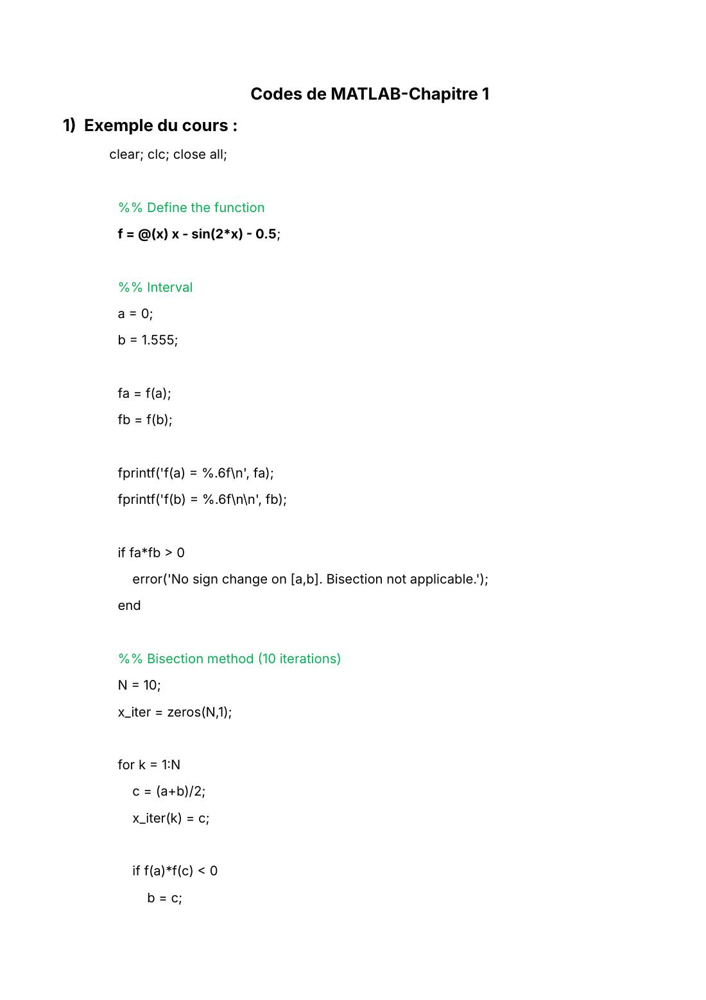
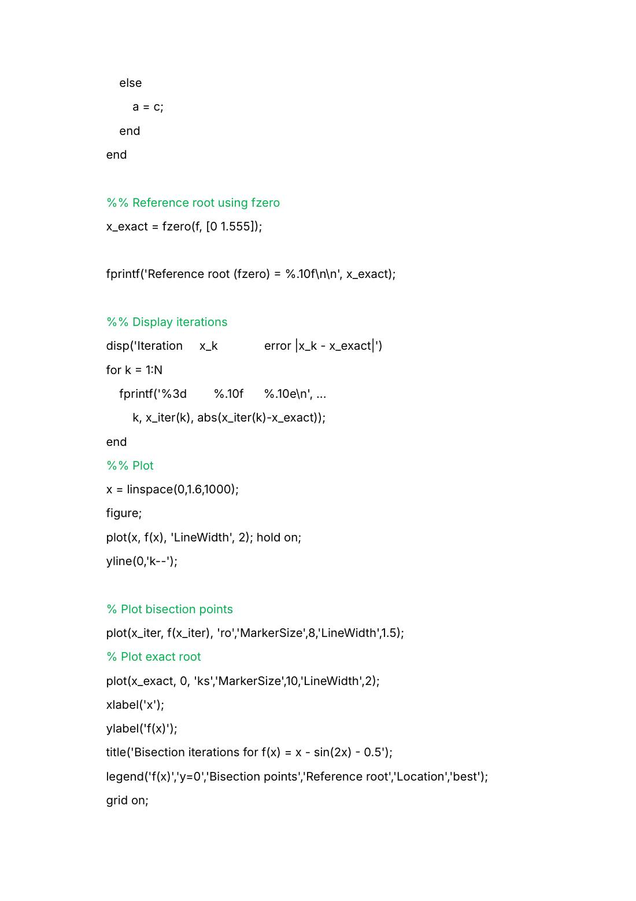
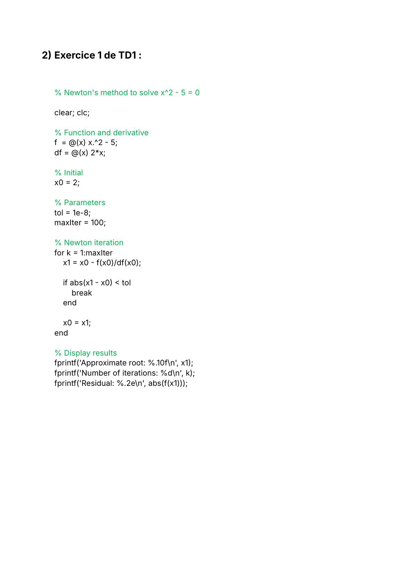
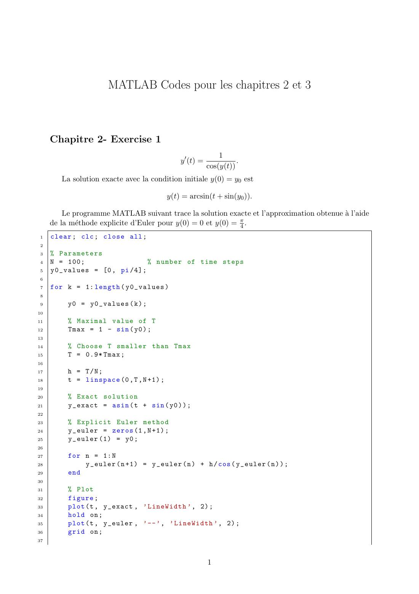
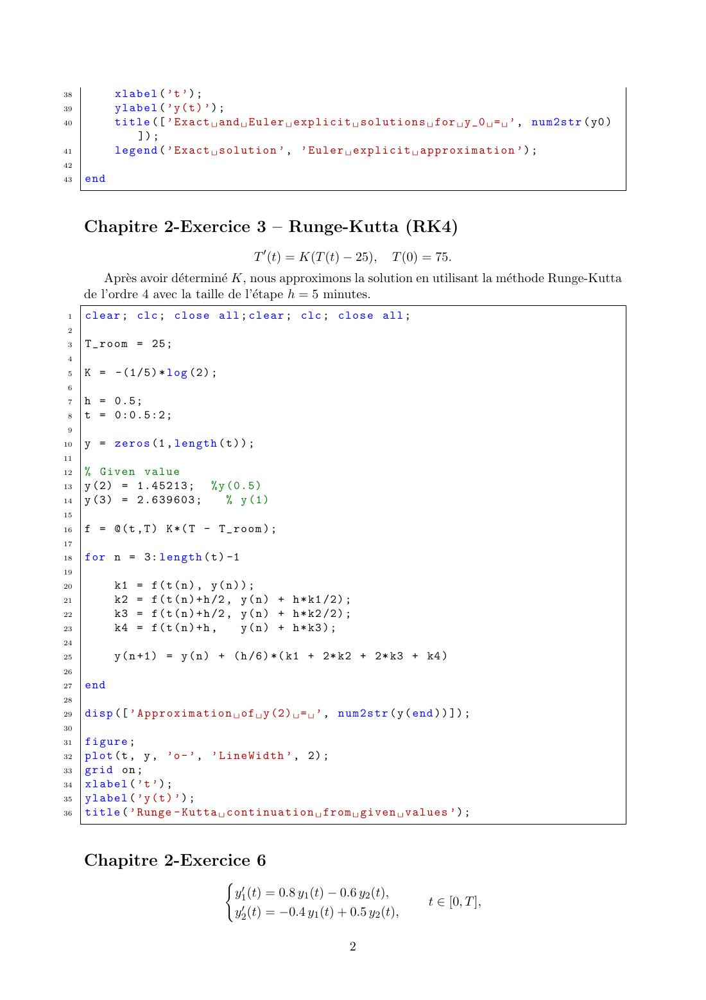
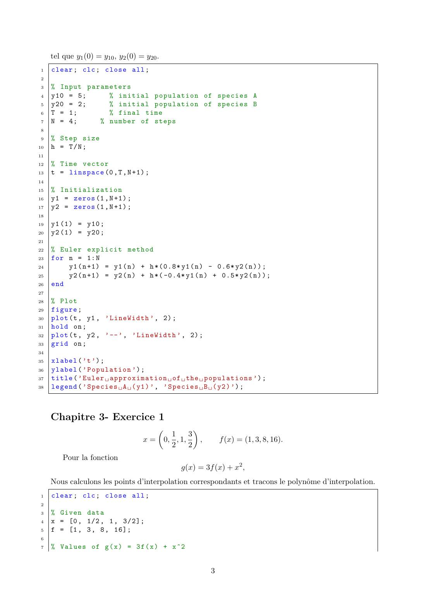
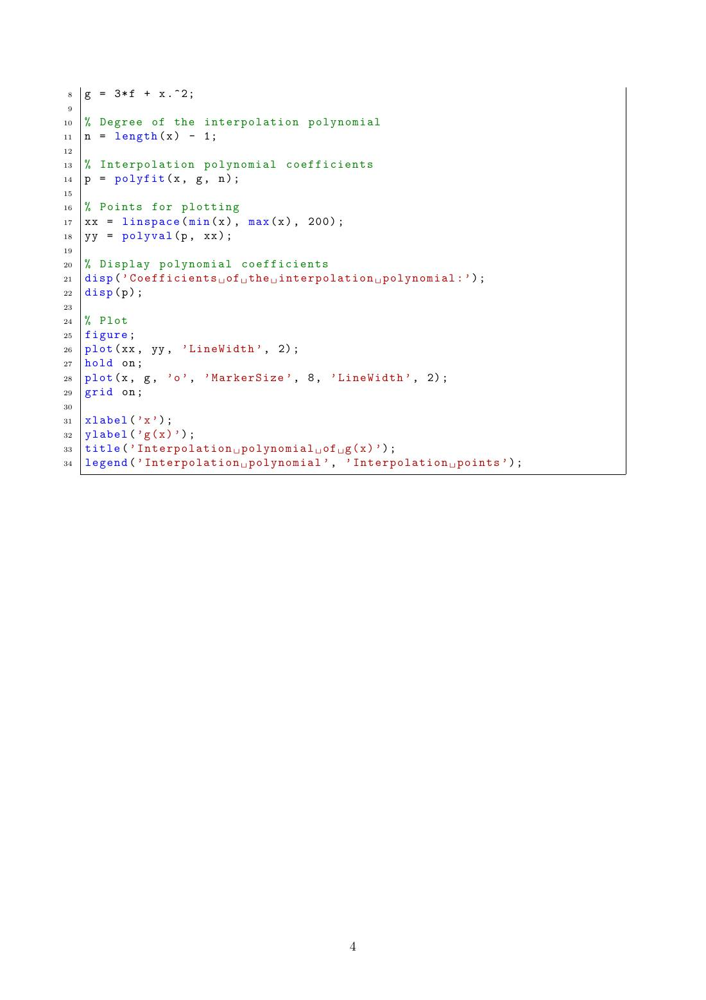

# MATLAB — un code type par méthode

=== "Version simplifiée"

    Les TD et les colles demandent de **programmer** chaque méthode. Voici un code court et commenté pour chacune :
    change seulement la fonction, l'intervalle et le pas. Les codes officiels du cours sont dans l'onglet « Version papier ».

    !!! tip "Rappels MATLAB"
        - Fonction anonyme : `f = @(x) x.^2 - 5;` (le point dans `.^`, `.*`, `./` permet de l'appliquer à un vecteur).
        - Indices à partir de **1** : `y(1)` correspond à $y_0$.
        - `abs`, `exp`, `log` (= ln), `sqrt` ; `linspace(a, b, N)` ; `plot`, `hold on`, `semilogy`, `legend`, `grid on`.

    ## Chapitre 1 — Équations non linéaires

    ### Dichotomie

    ```matlab
    f = @(x) x.^2 - 5;  a = 2;  b = 3;  tol = 1e-6;  nmax = 100;
    if f(a)*f(b) > 0, error('Pas de changement de signe sur [a,b]'); end
    n = 0;  c = [];
    while (b - a)/2 > tol && n < nmax
        m = (a + b)/2;  c(end+1) = m;  n = n + 1;
        if f(a)*f(m) <= 0, b = m; else, a = m; end
    end
    fprintf('racine ~ %.8f en %d iterations\n', (a+b)/2, n);
    semilogy(abs(diff(c)), 'o-'), grid on, xlabel('n'), ylabel('|c_{n+1} - c_n|')
    ```

    ### Newton-Raphson

    ```matlab
    f  = @(x) x.^2 - 5;
    df = @(x) 2*x;
    x = 2;  tol = 1e-10;  nmax = 50;  err = [];
    for k = 1:nmax
        if df(x) == 0, error('Derivee nulle : Newton non defini'); end
        xnew = x - f(x)/df(x);
        err(k) = abs(xnew - x);
        x = xnew;
        if err(k) < tol, break, end
    end
    fprintf('racine ~ %.10f en %d iterations\n', x, k);
    semilogy(err, 'o-'), grid on
    ```

    Pour une racine de multiplicité $m$ : `xnew = x - m*f(x)/df(x)`.

    ### Point fixe

    ```matlab
    g = @(x) cos(x);  x = 0.5;  tol = 1e-10;  nmax = 100;
    xs = x;
    for k = 1:nmax
        xs(k+1) = g(xs(k));
        if abs(xs(k+1) - xs(k)) < tol, break, end
    end
    semilogy(abs(diff(xs)), 'o-'), hold on
    semilogy(abs(g(xs) - xs), 's-'), grid on      % residu |g(x_n) - x_n|
    legend('|x_{n+1} - x_n|', 'residu')
    ```

    ### Newton à deux variables

    ```matlab
    F  = @(X) [-5*X(1) + 2*sin(X(1)) + 2*cos(X(2));
               -5*X(2) + 2*sin(X(2)) + 2*cos(X(1))];
    DF = @(X) [-5 + 2*cos(X(1)),  -2*sin(X(2));
               -2*sin(X(1)),      -5 + 2*cos(X(2))];
    X = [1; 1];  tol = 1e-10;
    for k = 1:50
        delta = -DF(X) \ F(X);       % resout DF*delta = -F (pas d'inversion de matrice)
        X = X + delta;
        if norm(delta) < tol, break, end
    end
    fprintf('solution (%.8f, %.8f) en %d iterations\n', X(1), X(2), k);
    ```

    ## Chapitre 2 — Équations différentielles

    ### Euler explicite et implicite

    ```matlab
    f = @(t,y) y - t.^2 + 1;   exact = @(t) (t+1).^2 - 0.5*exp(t);
    y0 = 0.5;  T = 2;  N = 20;  h = T/N;  t = linspace(0, T, N+1);
    y = zeros(1, N+1);  y(1) = y0;
    for n = 1:N
        y(n+1) = y(n) + h*f(t(n), y(n));           % Euler explicite
    end
    plot(t, exact(t), 'LineWidth', 2), hold on, plot(t, y, 'o--'), grid on
    legend('exacte', 'Euler'), fprintf('erreur en T : %.2e\n', abs(y(end) - exact(T)));
    ```

    **Euler implicite** : il faut résoudre $y_{n+1} = y_n + h f(t_{n+1}, y_{n+1})$ à chaque pas. Si $f$ est linéaire en $y$, on isole
    $y_{n+1}$ à la main ; sinon on utilise `fzero` :

    ```matlab
    y(n+1) = fzero(@(z) z - y(n) - h*f(t(n+1), z), y(n));
    ```

    ### Heun et Runge-Kutta 4

    ```matlab
    for n = 1:N                                     % Heun (ordre 2)
        k1 = f(t(n), y(n));
        k2 = f(t(n) + h, y(n) + h*k1);
        y(n+1) = y(n) + h/2*(k1 + k2);
    end

    for n = 1:N                                     % RK4 (ordre 4)
        K1 = f(t(n),       y(n));
        K2 = f(t(n) + h/2, y(n) + h/2*K1);
        K3 = f(t(n) + h/2, y(n) + h/2*K2);
        K4 = f(t(n) + h,   y(n) + h*K3);
        y(n+1) = y(n) + h/6*(K1 + 2*K2 + 2*K3 + K4);
    end
    ```

    ### Systèmes différentiels

    Exemple : les deux populations du TD 2 (exercice 6). Le même code marche pour un pendule ou des ressorts,
    en changeant `F` et la taille du vecteur.

    ```matlab
    F = @(t, Y) [0.8*Y(1) - 0.6*Y(2);
                -0.4*Y(1) + 0.5*Y(2)];
    T = 1;  N = 4;  h = T/N;  t = linspace(0, T, N+1);
    Y = zeros(2, N+1);  Y(:,1) = [5; 2];
    for n = 1:N
        Y(:,n+1) = Y(:,n) + h*F(t(n), Y(:,n));     % Euler vectoriel
    end
    plot(t, Y(1,:), t, Y(2,:), '--'), legend('y_1 (espece A)', 'y_2 (espece B)'), grid on
    % portrait de phase : plot(Y(1,:), Y(2,:))
    ```

    Pendule non linéaire : `F = @(t, Y) [Y(2); -w^2*sin(Y(1))];`.

    ## Chapitre 3 — Interpolation

    ### Interpolation

    ```matlab
    x = [0 0.5 1 1.5];  y = [1 3 8 16];  n = length(x);

    % Differences divisees (coefficients de Newton = premiere ligne de D)
    D = zeros(n);  D(:,1) = y';
    for j = 2:n
        for i = 1:n-j+1
            D(i,j) = (D(i+1,j-1) - D(i,j-1)) / (x(i+j-1) - x(i));
        end
    end
    c = D(1,:);

    % Evaluation du polynome de Newton (schema de Horner)
    xx = linspace(min(x), max(x), 200);
    P = c(n)*ones(size(xx));
    for k = n-1:-1:1
        P = c(k) + (xx - x(k)).*P;
    end

    % Verification avec polyfit / polyval
    p = polyfit(x, y, n-1);
    plot(xx, P, 'LineWidth', 2), hold on, plot(xx, polyval(p, xx), '--'), plot(x, y, 'o'), grid on
    ```

    Lagrange en une boucle :

    ```matlab
    L = zeros(size(xx));
    for i = 1:n
        li = ones(size(xx));
        for j = [1:i-1, i+1:n]
            li = li .* (xx - x(j)) / (x(i) - x(j));
        end
        L = L + y(i)*li;
    end
    ```

    ### Phénomène de Runge

    ```matlab
    f = @(x) 1./(1 + 25*x.^2);  n = 10;  xx = linspace(-1, 1, 400);
    xe = linspace(-1, 1, n+1);                       % noeuds equidistants
    xc = cos((2*(0:n) + 1)*pi/(2*(n+1)));            % noeuds de Tchebychev
    pe = polyfit(xe, f(xe), n);   pc = polyfit(xc, f(xc), n);
    plot(xx, f(xx), 'k', xx, polyval(pe, xx), 'r', xx, polyval(pc, xx), 'b'), grid on
    legend('f', 'equidistants', 'Tchebychev')
    fprintf('erreur max : %.3f (equidistants), %.3f (Tchebychev)\n', ...
            max(abs(f(xx) - polyval(pe, xx))), max(abs(f(xx) - polyval(pc, xx))));
    ```

    Sur $[a, b]$ au lieu de $[-1, 1]$ : `xc = (a+b)/2 + (b-a)/2*cos(...)`.

    ## Chapitre 4 — Intégration

    ```matlab
    f = @(x) exp(-x.^2);  a = 0;  b = 1;  n = 4;      % n pair pour Simpson
    h = (b - a)/n;  x = a:h:b;  y = f(x);

    T = h/2 * (y(1) + 2*sum(y(2:end-1)) + y(end));                      % trapezes
    S = h/3 * (y(1) + 4*sum(y(2:2:end-1)) + 2*sum(y(3:2:end-2)) + y(end)); % Simpson
    M = h * sum(f(a + h/2 : h : b));                 % point milieu (n rectangles de largeur h)

    I = integral(f, a, b);                           % valeur de reference
    fprintf('T = %.6f  S = %.6f  M = %.6f  (ref %.6f)\n', T, S, M, I);
    ```

    !!! piege "Les indices de Simpson"
        `y(2:2:end-1)` sont les points d'indice **impair** $x_1, x_3, \dots$ (coefficient 4) car MATLAB commence à 1.
        `y(3:2:end-2)` sont les points d'indice pair intérieurs $x_2, x_4, \dots$ (coefficient 2). C'est l'erreur à trouver dans la colle 4.7.

    Courbe d'erreur en log-log pour vérifier l'ordre : boucler sur `n = [4 8 16 32]`, stocker les erreurs, puis
    `loglog(n, err, 'o-')`. La pente vaut $-2$ pour les trapèzes et $-4$ pour Simpson.

=== "Version papier"

    Les codes MATLAB distribués avec le cours : chapitre 1, puis chapitres 2 et 3.

    <!-- papier: pdf/SM401P/matlab-ch1.pdf | Codes MATLAB — chapitre 1 | ch1 | page -->

    [{ loading=lazy .papier }](papier/ch1/p01.jpg)
    <p class="papier-legende">Codes de MATLAB-Chapitre 1 · Codes MATLAB — chapitre 1, page 1</p>

    [{ loading=lazy .papier }](papier/ch1/p02.jpg)
    <p class="papier-legende">%% Reference root using fzero · Codes MATLAB — chapitre 1, page 2</p>

    [{ loading=lazy .papier }](papier/ch1/p03.jpg)
    <p class="papier-legende">2) Exercice 1 de TD1 : · Codes MATLAB — chapitre 1, page 3</p>

    <!-- /papier -->

    <!-- papier: pdf/SM401P/matlab-ch2-3.pdf | Codes MATLAB — chapitres 2 et 3 | ch2-3 | page -->

    [{ loading=lazy .papier }](papier/ch2-3/p01.jpg)
    <p class="papier-legende">MATLAB Codes pour les chapitres 2 et 3 · Codes MATLAB — chapitres 2 et 3, page 1</p>

    [{ loading=lazy .papier }](papier/ch2-3/p02.jpg)
    <p class="papier-legende">title ([ ’ Exact ␣ and ␣ Euler ␣ explicit ␣ solutions ␣ for ␣ y_0 ␣ = ␣ ’ , num2str ( y0 ) · Codes MATLAB — chapitres 2 et 3, page 2</p>

    [{ loading=lazy .papier }](papier/ch2-3/p03.jpg)
    <p class="papier-legende">clear ; clc ; close all ; · Codes MATLAB — chapitres 2 et 3, page 3</p>

    [{ loading=lazy .papier }](papier/ch2-3/p04.jpg)
    <p class="papier-legende">% Degree of the interpolation polynomial · Codes MATLAB — chapitres 2 et 3, page 4</p>

    <!-- /papier -->
