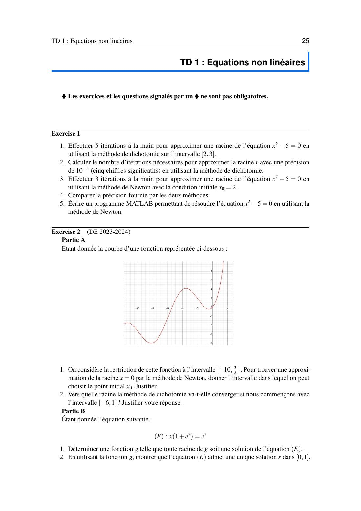
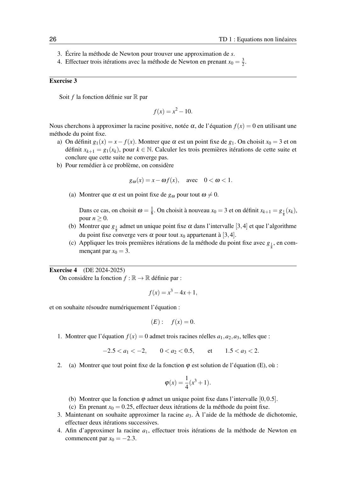
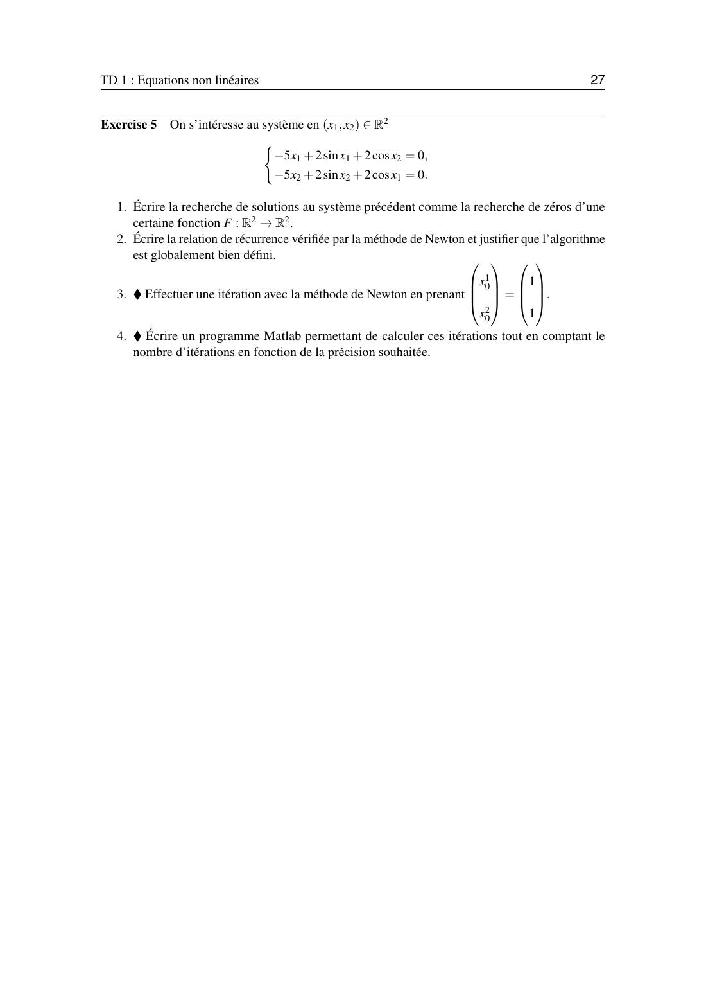

# TD 1 — Équations non linéaires

=== "Version simplifiée"

    Rappels : [chapitre 1](../cours/chapitre-1-equations-non-lineaires.md). Présente toujours les itérations
    en **tableau** ($n$, $a_n$, $b_n$, $c_n$, signe de $f(c_n)$ pour la dichotomie).

    ## Exercice 1 — $x^2 - 5 = 0$

    ??? success "Correction"
        **1.** Dichotomie sur $[2, 3]$ ($f(2) = -1 < 0$, $f(3) = 4 > 0$) :

        | $n$ | $a_n$ | $b_n$ | $c_n$ | $f(c_n)$ |
        |---|---|---|---|---|
        | 0 | 2 | 3 | 2,5 | $+1{,}25$ |
        | 1 | 2 | 2,5 | 2,25 | $+0{,}0625$ |
        | 2 | 2 | 2,25 | 2,125 | $-0{,}484$ |
        | 3 | 2,125 | 2,25 | 2,1875 | $-0{,}215$ |
        | 4 | 2,1875 | 2,25 | 2,21875 | $-0{,}077$ |

        Après 5 itérations, $\sqrt5 \in [2{,}21875;\ 2{,}25]$ et $c_4 = 2{,}21875$ (erreur réelle $\approx 0{,}017$).

        **2.** $|r - c_n| \le \frac{3 - 2}{2^{n+1}} \le 10^{-5}$ ⟺ $2^{n+1} \ge 10^5$ ⟺ $n + 1 \ge \log_2(10^5) \approx 16{,}6$. Il faut $n = 16$, soit **17 milieux** ($c_0$ à $c_{16}$).

        **3.** Newton : $x_{n+1} = x_n - \frac{x_n^2 - 5}{2x_n} = \frac12\left(x_n + \frac{5}{x_n}\right)$ (méthode de Héron). Avec $x_0 = 2$ :
        $x_1 = 2{,}25$, $x_2 \approx 2{,}236111$, $x_3 \approx 2{,}236068$.

        **4.** $\sqrt5 = 2{,}2360680\ldots$ : Newton a **6 bonnes décimales** en 3 itérations, la dichotomie une seule en 5. Newton converge à l'ordre 2, la dichotomie à l'ordre 1.

        **5.** Voir le code de Newton sur la page [MATLAB](../matlab/index.md#newton-raphson).

    ## Exercice 2 — DE 2023-2024

    ??? success "Correction"
        **Partie A** (lecture du graphe : racines vers $-5{,}8$, $-1$ et $0$ ; minimum local vers $-0{,}5$, maximum local vers $-3{,}5$).

        1. Il faut éviter le point où $f' = 0$ (le minimum local vers $x \approx -0{,}5$) : une tangente horizontale y rendrait Newton indéfini,
           et à gauche de ce point la méthode partirait vers une autre racine. Sur $]-0{,}5;\ \frac32]$, $f$ est croissante et convexe :
           on peut choisir $x_0$ dans cet intervalle (idéalement à droite de 0, où les itérés décroissent vers 0 sans dépasser).
        2. Sur $[-6, 1]$ : $f(-6) < 0$ et $f(1) > 0$. Le premier milieu $c_0 = -2{,}5$ donne $f(c_0) > 0$, donc on garde $[-6;\ -2{,}5]$,
           qui ne contient que la racine voisine de **$-5{,}8$**. La dichotomie converge vers elle (et non vers 0 ou $-1$).

        **Partie B** : $(E)\ x(1 + e^x) = e^x$.

        1. $g(x) = x(1 + e^x) - e^x$ : ses racines sont exactement les solutions de $(E)$.
        2. $g'(x) = 1 + e^x + xe^x - e^x = 1 + xe^x > 0$ sur $[0, 1]$ : $g$ est strictement croissante. $g(0) = -1 < 0$ et $g(1) = 1 > 0$.
           Par le TVI, $(E)$ a une **unique** solution $s \in [0, 1]$.
        3. $x_{n+1} = x_n - \dfrac{x_n(1 + e^{x_n}) - e^{x_n}}{1 + x_ne^{x_n}}$.
        4. $x_0 = \frac32$ : $x_1 \approx 1{,}0156$, $x_2 \approx 0{,}7373$, $x_3 \approx 0{,}6632$ (la racine vaut $s \approx 0{,}6590$).

    ## Exercice 3 — Point fixe pour $x^2 = 10$

    ??? success "Correction"
        **a)** $g_1(\alpha) = \alpha - f(\alpha) = \alpha$ car $f(\alpha) = 0$. Avec $x_0 = 3$ : $x_1 = 3 - (9 - 10) = 4$, $x_2 = 4 - 6 = -2$, $x_3 = -2 - (-6) = 4$.
        La suite oscille entre 4 et $-2$ : **elle ne converge pas** ($|g_1'(x)| = |1 - 2x| > 1$ près de $\alpha$).

        **b) (a)** $g_\omega(\alpha) = \alpha - \omega f(\alpha) = \alpha$ pour tout $\omega$.

        **(b)** $g_{1/8}(x) = x - \frac{x^2 - 10}{8}$, $g_{1/8}'(x) = 1 - \frac x4 \in [0;\ \frac14]$ sur $[3, 4]$.
        $g_{1/8}$ est donc croissante, avec $g(3) = 3{,}125$ et $g(4) = 3{,}75$ : $g([3, 4]) \subset [3, 4]$.
        Et $|g'| \le \frac14 < 1$ : $g$ est contractante. Le théorème du point fixe donne un unique point fixe (c'est $\alpha = \sqrt{10}$) et la convergence pour tout $x_0 \in [3, 4]$.

        **(c)** $x_1 = 3{,}125$, $x_2 \approx 3{,}154297$, $x_3 \approx 3{,}160598$ ($\sqrt{10} \approx 3{,}162278$).

    ## Exercice 4 — DE 2024-2025 : $f(x) = x^3 - 4x + 1$

    ??? success "Correction"
        **1.** $f(-2{,}5) = -4{,}625$, $f(-2) = 1$, $f(0) = 1$, $f(0{,}5) = -0{,}875$, $f(1{,}5) = -1{,}625$, $f(2) = 1$ : trois changements de signe, donc au moins
        trois racines (TVI), et au plus trois (polynôme de degré 3). D'où $a_1 \in ]-2{,}5;\ -2[$, $a_2 \in ]0;\ 0{,}5[$, $a_3 \in ]1{,}5;\ 2[$.

        **2. (a)** $\varphi(x) = x \iff x^3 + 1 = 4x \iff f(x) = 0$.

        **(b)** $\varphi'(x) = \frac{3x^2}{4} \ge 0$ : $\varphi$ croissante, $\varphi(0) = 0{,}25$ et $\varphi(0{,}5) = 0{,}28125$, donc $\varphi([0;\ 0{,}5]) \subset [0;\ 0{,}5]$.
        $|\varphi'(x)| \le \frac{3}{16} < 1$ : contractante, donc unique point fixe ($= a_2$).

        **(c)** $x_1 = \frac{0{,}25^3 + 1}{4} \approx 0{,}253906$, $x_2 \approx 0{,}254092$.

        **3.** Sur $[1{,}5;\ 2]$ : $c_0 = 1{,}75$, $f(c_0) \approx -0{,}641 < 0$ → $[1{,}75;\ 2]$ ; $c_1 = 1{,}875$, $f(c_1) \approx 0{,}092 > 0$ → $a_3 \in [1{,}75;\ 1{,}875]$.

        **4.** $x_{n+1} = x_n - \frac{x_n^3 - 4x_n + 1}{3x_n^2 - 4}$, $x_0 = -2{,}3$ : $x_1 \approx -2{,}134288$, $x_2 \approx -2{,}115156$, $x_3 \approx -2{,}114908$.

    ## Exercice 5 — Newton à deux variables

    ??? success "Correction"
        **1.** $F(x_1, x_2) = \begin{pmatrix} -5x_1 + 2\sin x_1 + 2\cos x_2 \\ -5x_2 + 2\sin x_2 + 2\cos x_1 \end{pmatrix}$, on cherche $F = 0$.

        **2.** $DF = \begin{pmatrix} -5 + 2\cos x_1 & -2\sin x_2 \\ -2\sin x_1 & -5 + 2\cos x_2 \end{pmatrix}$ et $X_{n+1} = X_n - DF^{-1}_{X_n}F(X_n)$.
        L'algorithme est toujours défini : $|-5 + 2\cos x_i| \ge 3$ donc le produit diagonal vaut au moins 9, et $|4\sin x_1\sin x_2| \le 4$,
        donc $\det DF \ge 9 - 4 = 5 > 0$ : la jacobienne est inversible partout.

        **3. ♦** En $(1, 1)$ : $F \approx (-2{,}2365;\ -2{,}2365)$, $DF \approx \begin{pmatrix} -3{,}919 & -1{,}683 \\ -1{,}683 & -3{,}919 \end{pmatrix}$.
        Par symétrie, $\delta_1 = \delta_2 = \frac{2{,}2365}{-3{,}919 - 1{,}683} \approx -0{,}3992$, d'où $X_1 \approx (0{,}6008;\ 0{,}6008)$.
        (La solution est $\approx (0{,}5501;\ 0{,}5501)$.)

        **4. ♦** Voir [MATLAB](../matlab/index.md#newton-a-deux-variables).

=== "Version papier"

    Les énoncés du TD 1 (polycopié 2025-2026).

    <!-- papier: pdf/SM401P/poly.pdf | Poly 2025-2026 | td1 | page | 25-27 -->

    [{ loading=lazy .papier }](papier/td1/p25.jpg)
    
TD 1 : Equations non linéaires · Poly 2025-2026, page 25

    [{ loading=lazy .papier }](papier/td1/p26.jpg)
    
TD 1 : Equations non linéaires · Poly 2025-2026, page 26

    [{ loading=lazy .papier }](papier/td1/p27.jpg)
    
TD 1 : Equations non linéaires · Poly 2025-2026, page 27

    <!-- /papier -->
