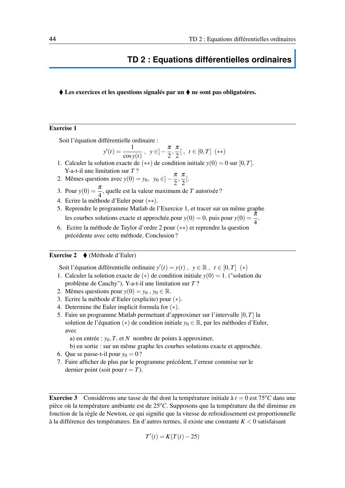
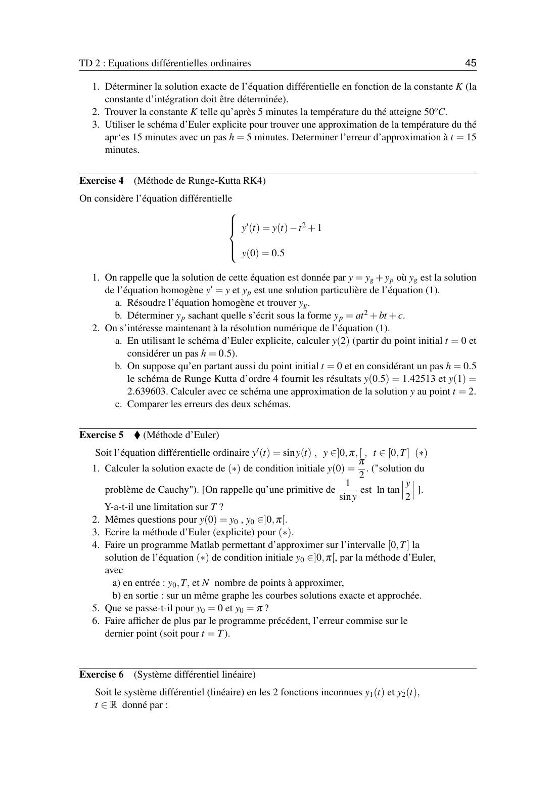
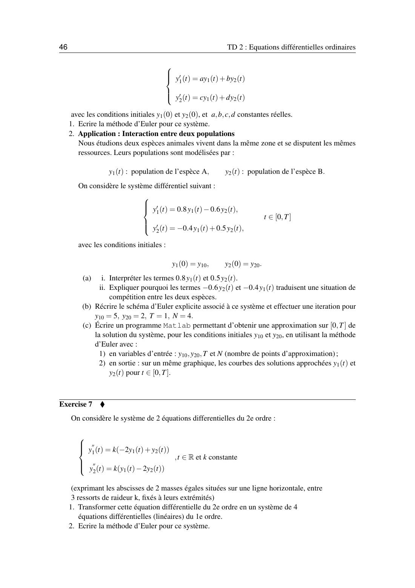
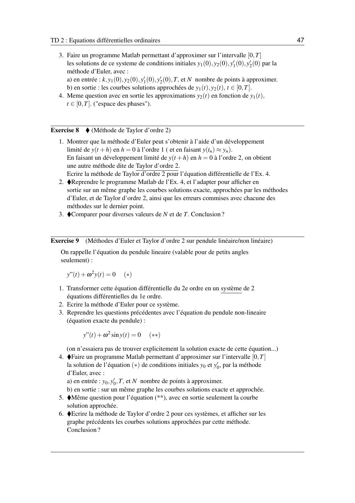
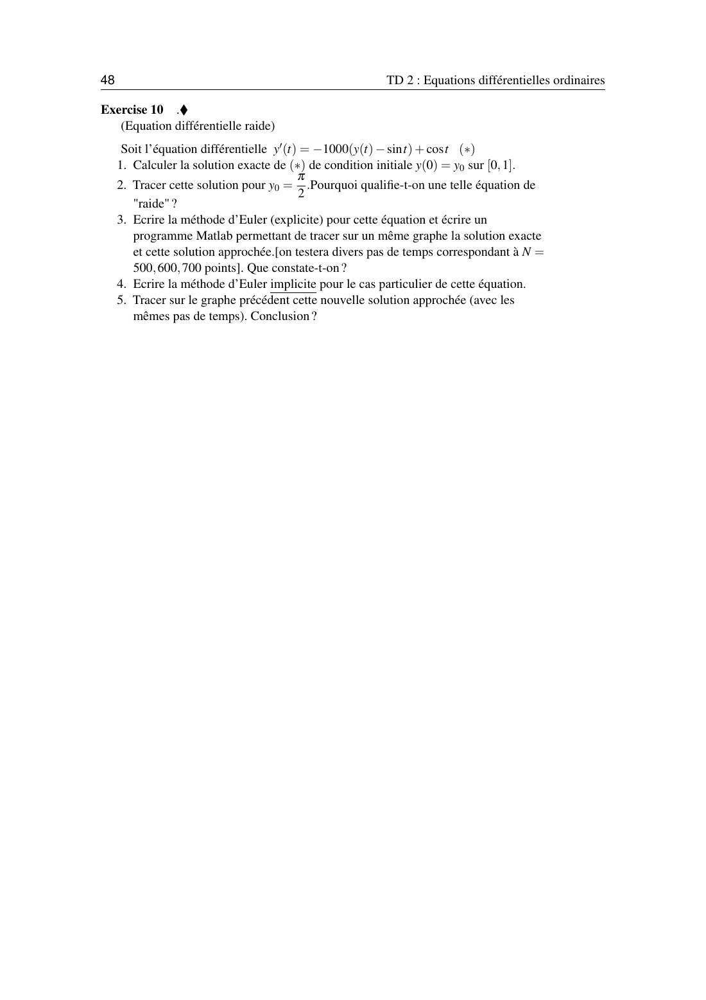

# TD 2 — Équations différentielles ordinaires

=== "Version simplifiée"

    Rappels : [chapitre 2](../cours/chapitre-2-edo.md). Les programmes MATLAB demandés sont sur la page
    [MATLAB](../matlab/index.md) (Euler, RK4, systèmes) : il suffit d'y changer la fonction $f$.

    ## Exercice 1 — $y' = \dfrac{1}{\cos y}$

    ??? success "Correction"
        **1-2.** Variables séparables : $\cos y\,dy = dt$, donc $\sin y = t + \sin y_0$ et

        $$
        y(t) = \arcsin(t + \sin y_0).
        $$

        Elle n'existe (et reste dans $]-\frac\pi2, \frac\pi2[$) que si $t + \sin y_0 < 1$ : **$T < 1 - \sin y_0$**. Pour $y_0 = 0$ : $T < 1$.

        **3.** $y_0 = \frac\pi4$ : $T < 1 - \frac{\sqrt2}{2} \approx 0{,}293$.

        **4.** Euler : $y_{n+1} = y_n + \dfrac{h}{\cos y_n}$.

        **6.** Taylor d'ordre 2 : $y'' = \dfrac{d}{dt}\left(\dfrac{1}{\cos y}\right) = \dfrac{\sin y}{\cos^2 y}\,y' = \dfrac{\sin y}{\cos^3 y}$, d'où

        $$
        y_{n+1} = y_n + \frac{h}{\cos y_n} + \frac{h^2}{2}\,\frac{\sin y_n}{\cos^3 y_n}.
        $$

        Conclusion attendue : Taylor 2 (ordre 2) colle mieux à la solution exacte qu'Euler (ordre 1), surtout près de $T_{max}$, où la pente devient infinie.

    ## Exercice 2 ♦ — $y' = y$

    ??? success "Correction"
        **1-2.** $y(t) = y_0e^t$, définie pour tout $T$.
        **3.** Euler explicite : $y_{n+1} = (1 + h)y_n$, donc $y_n = (1 + h)^ny_0$.
        **4.** Euler implicite : $y_{n+1} = y_n + hy_{n+1}$, donc $y_{n+1} = \dfrac{y_n}{1 - h}$ (si $h \ne 1$).
        **6.** $y_0 = 0$ : la solution exacte et les deux schémas restent identiquement nuls.
        **7.** Erreur au dernier point : $|y_N - y_0e^T|$. Avec $(1 + h)^N = (1 + \frac TN)^N \to e^T$, elle tend vers 0 quand $N \to \infty$ (en $1/N$).

    ## Exercice 3 — Le thé qui refroidit

    $T' = K(T - 25)$, $T(0) = 75$ °C.

    ??? success "Correction"
        **1.** $u = T - 25$ vérifie $u' = Ku$, donc $u = 50e^{Kt}$ et $T(t) = 25 + 50e^{Kt}$.

        **2.** $T(5) = 50$ ⟺ $e^{5K} = \frac12$ ⟺ $K = -\dfrac{\ln 2}{5} \approx -0{,}1386$ min⁻¹.

        **3.** Euler avec $h = 5$ : $T_{n+1} = T_n + 5K(T_n - 25) = 25 + (1 + 5K)(T_n - 25)$ avec $1 + 5K \approx 0{,}3069$ :

        | $t$ (min) | 0 | 5 | 10 | 15 |
        |---|---|---|---|---|
        | Euler | 75 | 40,34 | 29,71 | **26,44** |
        | Exact | 75 | 50 | 37,5 | **31,25** |

        Erreur à 15 min : $|26{,}44 - 31{,}25| \approx 4{,}81$ °C (15 % d'erreur relative). Le pas de 5 min est beaucoup trop grand.

    ## Exercice 4 — Euler et RK4 pour $y' = y - t^2 + 1$, $y(0) = 0{,}5$

    ??? success "Correction"
        **1. a.** $y_g = Ce^t$.
        **b.** $y_p = at^2 + bt + c$ : $2at + b = at^2 + bt + c - t^2 + 1$. Identification : $a = 1$, $b = 2a = 2$, $c = b - 1 = 1$, donc $y_p = (t + 1)^2$.
        Avec $y(0) = 0{,}5$ : $C = -0{,}5$ et $y(t) = (t + 1)^2 - \frac12e^t$.

        **2. a.** Euler, $h = 0{,}5$ : $y_{n+1} = y_n + 0{,}5\,(y_n - t_n^2 + 1)$.

        | $t$ | 0 | 0,5 | 1 | 1,5 | 2 |
        |---|---|---|---|---|---|
        | Euler | 0,5 | 1,25 | 2,25 | 3,375 | **4,4375** |

        **b.** RK4 à partir de $y(1) = 2{,}639603$ :

        | Pas | $K_1$ | $K_2$ | $K_3$ | $K_4$ | $y_{n+1}$ |
        |---|---|---|---|---|---|
        | $1 \to 1{,}5$ | 2,639603 | 2,737004 | 2,761354 | 2,770280 | 4,006820 |
        | $1{,}5 \to 2$ | 2,756820 | 2,633524 | 2,602701 | 2,308170 | **5,301606** |

        **c.** $y(2) = 9 - \frac12e^2 \approx 5{,}305472$. Erreur d'Euler : $\approx 0{,}868$ ; erreur de RK4 : $\approx 0{,}0039$, plus de 200 fois plus petite pour le même pas.

    ## Exercice 5 ♦ — $y' = \sin y$

    ??? success "Correction"
        **1-2.** $\frac{dy}{\sin y} = dt$ donne $\ln\left|\tan\frac y2\right| = t + \ln\tan\frac{y_0}{2}$, donc

        $$
        y(t) = 2\arctan\left(\tan\frac{y_0}{2}\,e^t\right).
        $$

        Pas de limitation sur $T$ ; $y \to \pi$ quand $t \to +\infty$. Pour $y_0 = \frac\pi2$ : $y(t) = 2\arctan(e^t)$.
        **3.** Euler : $y_{n+1} = y_n + h\sin y_n$.
        **5.** $y_0 = 0$ ou $\pi$ : $\sin y_0 = 0$, solutions **constantes** (points d'équilibre ; 0 est instable, $\pi$ est stable).

    ## Exercice 6 — Deux populations en compétition

    ??? success "Correction"
        **1.** $y_1^{n+1} = y_1^n + h(ay_1^n + by_2^n)$ et $y_2^{n+1} = y_2^n + h(cy_1^n + dy_2^n)$.

        **2. (a) i.** $0{,}8y_1$ et $0{,}5y_2$ : croissance **naturelle** de chaque espèce (proportionnelle à sa population, taux 0,8 et 0,5).
        **ii.** $-0{,}6y_2$ dans l'équation de $y_1$ : plus il y a de B, moins A croît (et inversement avec $-0{,}4y_1$). Chaque espèce freine l'autre : elles se disputent les ressources.

        **(b)** $h = \frac TN = 0{,}25$ :
        $y_1^1 = 5 + 0{,}25(0{,}8 \times 5 - 0{,}6 \times 2) = 5{,}7$ et $y_2^1 = 2 + 0{,}25(-0{,}4 \times 5 + 0{,}5 \times 2) = 1{,}75$.

        **(c)** Voir [MATLAB](../matlab/index.md#systemes-differentiels).

    ## Exercice 7 ♦ — Deux masses et trois ressorts

    ??? success "Correction"
        On pose $Y = (y_1, y_2, y_3, y_4) = (y_1, y_2, y_1', y_2')$ :

        $$
        y_1' = y_3,\quad y_2' = y_4,\quad y_3' = k(-2y_1 + y_2),\quad y_4' = k(y_1 - 2y_2).
        $$

        Euler : $Y_{n+1} = Y_n + h\,F(Y_n)$, composante par composante. Pour l'« espace des phases », on trace $y_2$ en fonction de $y_1$.

    ## Exercice 8 ♦ — Méthode de Taylor d'ordre 2

    ??? success "Correction"
        **1.** $y(t + h) = y(t) + hy'(t) + o(h) = y(t) + hf(t, y(t)) + o(h)$ : on retrouve Euler en négligeant le $o(h)$.
           À l'ordre 2 : $y(t + h) \approx y + hy' + \frac{h^2}{2}y''$. Pour $y' = y - t^2 + 1$ : $y'' = y' - 2t = y - t^2 + 1 - 2t$, donc

        $$
        y_{n+1} = y_n + h(y_n - t_n^2 + 1) + \frac{h^2}{2}(y_n - t_n^2 + 1 - 2t_n).
        $$

        **3.** Taylor 2 est d'ordre 2 : diviser $h$ par 2 divise l'erreur par 4 environ (par 2 seulement pour Euler).

    ## Exercice 9 — Pendule linéaire et non linéaire

    ??? success "Correction"
        **1-2.** $y_1 = y$, $y_2 = y'$ : $y_1' = y_2$, $y_2' = -\omega^2y_1$. Euler : $y_1^{n+1} = y_1^n + hy_2^n$, $y_2^{n+1} = y_2^n - h\omega^2y_1^n$.

        **3.** Non linéaire : $y_2' = -\omega^2\sin y_1$, Euler : $y_2^{n+1} = y_2^n - h\omega^2\sin y_1^n$.

        **6.** ♦ Taylor 2 (cas linéaire) : $y_1^{n+1} = y_1^n + hy_2^n - \frac{h^2}{2}\omega^2y_1^n$ et $y_2^{n+1} = y_2^n - h\omega^2y_1^n - \frac{h^2}{2}\omega^2y_2^n$.

        Conclusion attendue : avec Euler, l'amplitude du pendule **augmente** au fil du temps (l'énergie n'est pas conservée), alors que la vraie solution
        est périodique. Taylor 2 dérive beaucoup moins.

    ## Exercice 10 ♦ — Équation raide

    $y' = -1000(y - \sin t) + \cos t$.

    ??? success "Correction"
        1. $y(t) = \sin t + y_0e^{-1000t}$ (on vérifie : $y' = \cos t - 1000y_0e^{-1000t}$).
        2. Pour $y_0 = \frac\pi2$ : le terme $e^{-1000t}$ disparaît en quelques millièmes de seconde, puis $y \approx \sin t$. Deux échelles de temps
           très différentes : l'équation est **raide**.
        3. Euler explicite : $y_{n+1} = y_n + h\big(-1000(y_n - \sin t_n) + \cos t_n\big)$. Stable seulement si $|1 - 1000h| < 1$, soit $h < 0{,}002$, donc $N > 500$ sur $[0, 1]$.
           Avec $N = 500$, on est à la limite : la solution oscille sans s'amortir. Avec $N = 600$ ou 700, ça marche.
        4. Euler implicite (l'équation est linéaire en $y$, on isole $y_{n+1}$) :

            $$
            y_{n+1} = \frac{y_n + h\big(1000\sin t_{n+1} + \cos t_{n+1}\big)}{1 + 1000h}.
            $$

        5. Le schéma implicite est stable pour **tout** pas : il suit la solution même avec de grands $h$. C'est la méthode à utiliser pour les équations raides.

=== "Version papier"

    Les énoncés du TD 2 (polycopié 2025-2026).

    <!-- papier: pdf/SM401P/poly.pdf | Poly 2025-2026 | td2 | page | 44-48 -->

    [{ loading=lazy .papier }](papier/td2/p44.jpg)
    
TD 2 : Equations différentielles ordinaires · Poly 2025-2026, page 44

    [{ loading=lazy .papier }](papier/td2/p45.jpg)
    
TD 2 : Equations différentielles ordinaires · Poly 2025-2026, page 45

    [{ loading=lazy .papier }](papier/td2/p46.jpg)
    
TD 2 : Equations différentielles ordinaires · Poly 2025-2026, page 46

    [{ loading=lazy .papier }](papier/td2/p47.jpg)
    
TD 2 : Equations différentielles ordinaires · Poly 2025-2026, page 47

    [{ loading=lazy .papier }](papier/td2/p48.jpg)
    
TD 2 : Equations différentielles ordinaires · Poly 2025-2026, page 48

    <!-- /papier -->
