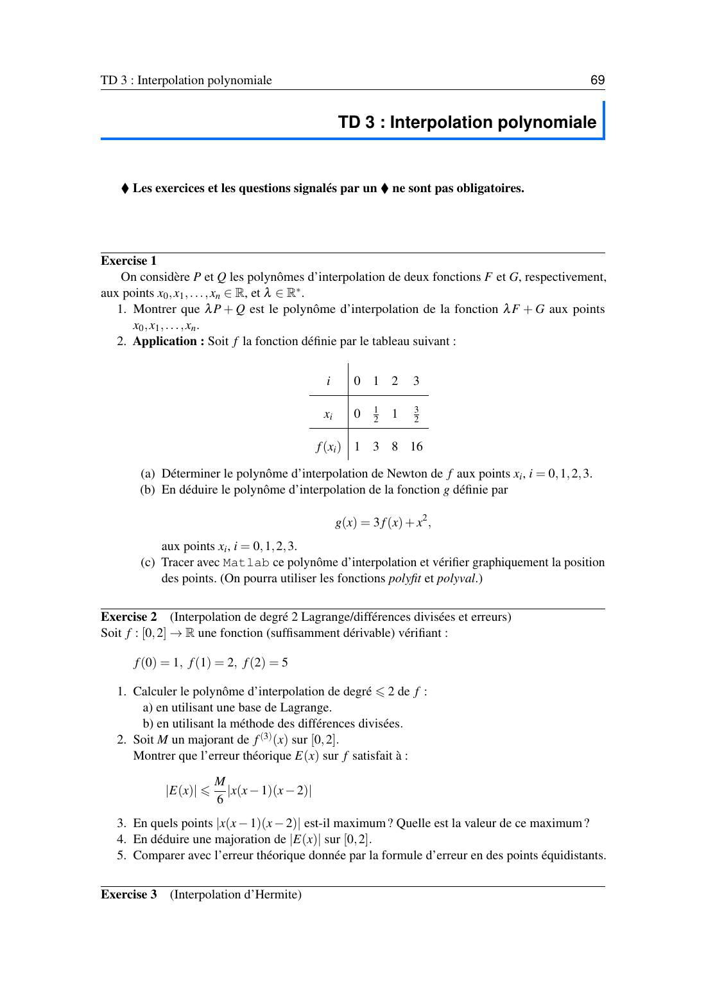
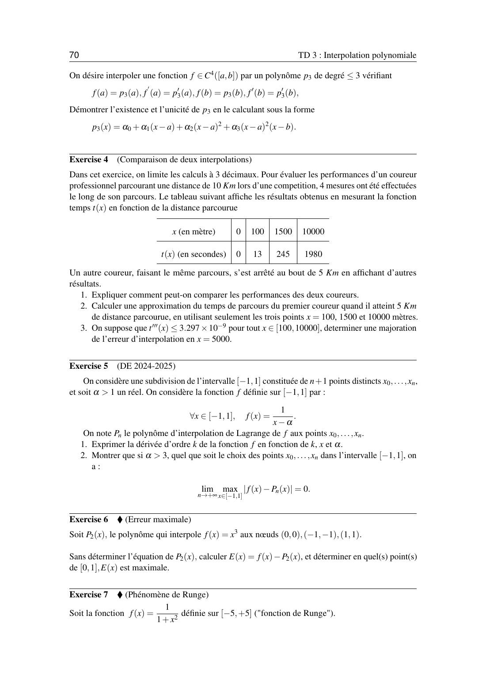
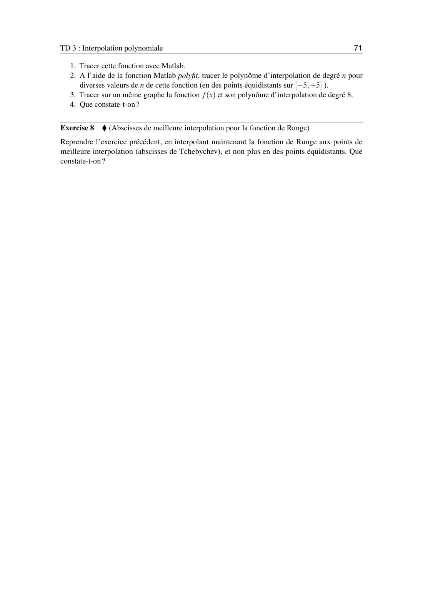

# TD 3 — Interpolation polynomiale

=== "Version simplifiée"

    Rappels : [chapitre 3](../cours/chapitre-3-interpolation.md). Vérifie toujours ton polynôme en l'évaluant aux nœuds.

    ## Exercice 1 — Linéarité et différences divisées

    ??? success "Correction"
        **1.** $\lambda P + Q$ est un polynôme de degré $\le n$ et $(\lambda P + Q)(x_i) = \lambda F(x_i) + G(x_i)$ pour tout $i$.
        Par **unicité** du polynôme d'interpolation, c'est celui de $\lambda F + G$.

        **2. (a)** Tableau des différences divisées pour $x = 0, \frac12, 1, \frac32$ et $f = 1, 3, 8, 16$ :

        | $x_i$ | $f$ | ordre 1 | ordre 2 | ordre 3 |
        |---|---|---|---|---|
        | 0 | **1** | **4** | **6** | **0** |
        | 1/2 | 3 | 10 | 6 | |
        | 1 | 8 | 16 | | |
        | 3/2 | 16 | | | |

        $P(x) = 1 + 4x + 6x\left(x - \frac12\right) = 6x^2 + x + 1$. Le terme d'ordre 3 est nul : les 4 points sont sur une parabole.
        Vérification : $P(1) = 8$, $P\left(\frac32\right) = 16$. ✓

        **(b)** $x^2$ est son propre polynôme d'interpolation (degré $2 \le 3$). Par la question 1 : $3P(x) + x^2 = 19x^2 + 3x + 3$.

        **(c)** `p = polyfit(x, 3*f + x.^2, 3)` donne $[0;\ 19;\ 3;\ 3]$ (à l'arrondi près) ; voir [MATLAB](../matlab/index.md#interpolation).

    ## Exercice 2 — $f(0) = 1$, $f(1) = 2$, $f(2) = 5$

    ??? success "Correction"
        **1. a)** $\ell_0 = \frac{(x - 1)(x - 2)}{2}$, $\ell_1 = -x(x - 2)$, $\ell_2 = \frac{x(x - 1)}{2}$, et $P = \ell_0 + 2\ell_1 + 5\ell_2 = x^2 + 1$.
        **b)** Différences divisées : $[x_0] = 1$, $[x_0, x_1] = 1$, $[x_1, x_2] = 3$, $[x_0, x_1, x_2] = \frac{3 - 1}{2} = 1$,
        donc $P = 1 + x + x(x - 1) = x^2 + 1$. Même polynôme. ✓

        **2.** Formule de l'erreur avec $n = 2$ : $|E(x)| = \frac{|f'''(\xi)|}{3!}|x(x - 1)(x - 2)| \le \frac M6|x(x - 1)(x - 2)|$.

        **3.** $w(x) = x^3 - 3x^2 + 2x$, $w'(x) = 3x^2 - 6x + 2 = 0$ pour $x = 1 \pm \frac{1}{\sqrt3}$, et
        $|w| = \frac{2}{3\sqrt3} \approx 0{,}385$ en ces points (le maximum sur $[0, 2]$, car $w$ s'annule aux bornes et en 1).

        **4.** $|E(x)| \le \frac{M}{6} \times \frac{2}{3\sqrt3} = \frac{M}{9\sqrt3} \approx 0{,}064\,M$.

        **5.** Formule équidistante ($h = 1$, $n = 2$) : $\frac{h^3}{4 \times 3}M = \frac{M}{12} \approx 0{,}083\,M$. Elle est plus simple mais moins fine.

    ## Exercice 3 — Interpolation d'Hermite

    ??? success "Correction"
        Avec $p_3(x) = \alpha_0 + \alpha_1(x - a) + \alpha_2(x - a)^2 + \alpha_3(x - a)^2(x - b)$ et $p_3'(x) = \alpha_1 + 2\alpha_2(x - a) + \alpha_3\big[2(x - a)(x - b) + (x - a)^2\big]$ :

        - $p_3(a) = f(a)$ donne $\alpha_0 = f(a)$ ;
        - $p_3'(a) = f'(a)$ donne $\alpha_1 = f'(a)$ ;
        - $p_3(b) = f(b)$ donne $\alpha_2 = \dfrac{f(b) - f(a) - f'(a)(b - a)}{(b - a)^2}$ ;
        - $p_3'(b) = f'(b)$ donne $\alpha_3 = \dfrac{f'(b) - f'(a) - 2\alpha_2(b - a)}{(b - a)^2}$.

        Chaque coefficient est déterminé de façon unique (le système est triangulaire, avec $a \ne b$) : $p_3$ existe et il est unique.

    ## Exercice 4 — Deux coureurs

    ??? success "Correction"
        **1.** On n'a pas les mêmes points de mesure pour les deux coureurs : on interpole chaque série et on compare les temps estimés
        **à la même distance** (par exemple à 5 km, la distance du second coureur).

        **2.** Différences divisées sur $100$, $1500$, $10\,000$ :
        $[x_0, x_1] = \frac{232}{1400} \approx 0{,}166$, $[x_1, x_2] = \frac{1735}{8500} \approx 0{,}204$,
        $[x_0, x_1, x_2] = \frac{0{,}204 - 0{,}166}{9900} \approx 3{,}879 \times 10^{-6}$.

        $$
        t(5000) \approx 13 + 0{,}166 \times 4900 + 3{,}879 \times 10^{-6} \times 4900 \times 3500 \approx 891{,}5\ \text{s}
        $$

        (environ 14 min 52 s).

        **3.** $|E(5000)| \le \frac{3{,}297 \times 10^{-9}}{6}\,|(5000 - 100)(5000 - 1500)(5000 - 10\,000)| \approx 47{,}1$ s.

    ## Exercice 5 — DE 2024-2025 : $f(x) = \dfrac{1}{x - \alpha}$

    ??? success "Correction"
        **1.** Par récurrence, $f^{(k)}(x) = \dfrac{(-1)^k\,k!}{(x - \alpha)^{k+1}}$.

        **2.** Formule de l'erreur : $|f(x) - P_n(x)| = \dfrac{|f^{(n+1)}(\xi)|}{(n + 1)!}\prod|x - x_i|$.
        Sur $[-1, 1]$ avec $\alpha > 1$ : $|\xi - \alpha| \ge \alpha - 1$, donc $|f^{(n+1)}(\xi)| \le \dfrac{(n + 1)!}{(\alpha - 1)^{n+2}}$, et $|x - x_i| \le 2$. D'où

        $$
        \max_{[-1,1]}|f - P_n| \le \frac{2^{n+1}}{(\alpha - 1)^{n+2}} = \frac{1}{\alpha - 1}\left(\frac{2}{\alpha - 1}\right)^{n+1} \xrightarrow[n \to \infty]{} 0 \quad \text{si } \alpha > 3,
        $$

        car alors $\frac{2}{\alpha - 1} < 1$. Le résultat ne dépend pas du choix des nœuds.

    ## Exercice 6 ♦ — Erreur maximale

    ??? success "Correction"
        $f''' = 6$, donc $E(x) = \frac{6}{3!}(x - 0)(x + 1)(x - 1) = x^3 - x$ (et $P_2(x) = x$).
        Sur $[0, 1]$, $E \le 0$ et $|E|$ est maximal là où $E' = 3x^2 - 1 = 0$ : en $x = \frac{1}{\sqrt3}$, $|E| = \frac{2}{3\sqrt3} \approx 0{,}385$.

    ## Exercices 7 et 8 ♦ — Phénomène de Runge

    ??? success "Correction"
        Avec des points équidistants sur $[-5, 5]$, le polynôme de degré 8 oscille fortement près des bords et l'erreur augmente avec $n$ :
        c'est le **phénomène de Runge**. Avec les abscisses de **Tchebychev** (ramenées à $[-5, 5]$ : $x_i = 5\cos\frac{(2i + 1)\pi}{2(n + 1)}$),
        les oscillations disparaissent et l'erreur diminue quand $n$ augmente. Code sur la page [MATLAB](../matlab/index.md#phenomene-de-runge).

=== "Version papier"

    Les énoncés du TD 3 (polycopié 2025-2026).

    <!-- papier: pdf/SM401P/poly.pdf | Poly 2025-2026 | td3 | page | 69-71 -->

    [{ loading=lazy .papier }](papier/td3/p69.jpg)
    
TD 3 : Interpolation polynomiale · Poly 2025-2026, page 69

    [{ loading=lazy .papier }](papier/td3/p70.jpg)
    
TD 3 : Interpolation polynomiale · Poly 2025-2026, page 70

    [{ loading=lazy .papier }](papier/td3/p71.jpg)
    
TD 3 : Interpolation polynomiale · Poly 2025-2026, page 71

    <!-- /papier -->
