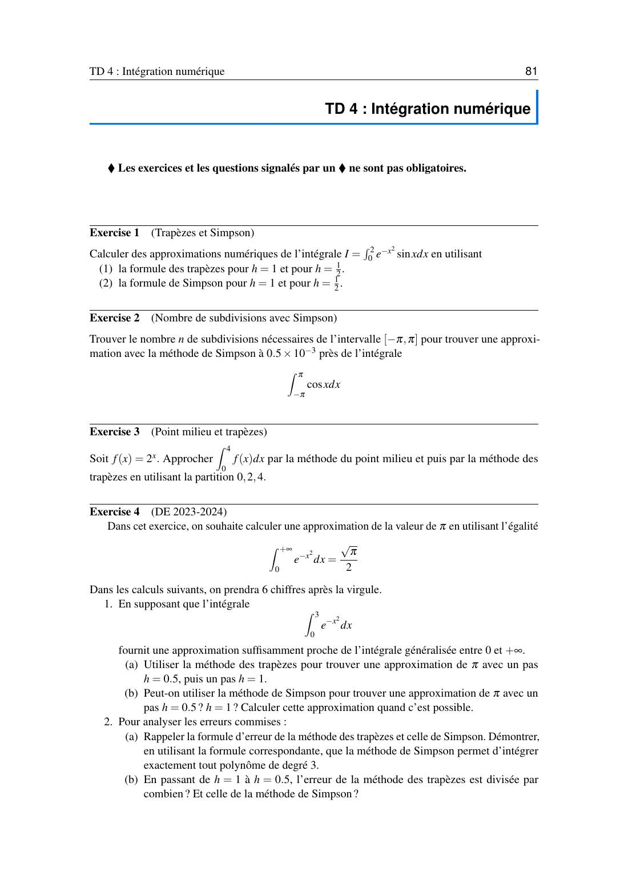
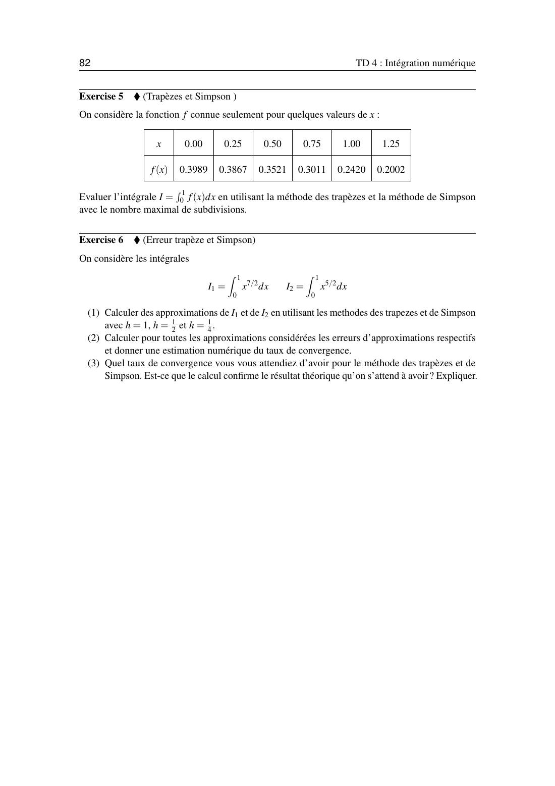

# TD 4 — Intégration numérique

=== "Version simplifiée"

    Rappels : [chapitre 4](../cours/chapitre-4-integration.md). Commence toujours par le **tableau des valeurs**
    $x_k$, $f(x_k)$, puis applique les poids (1, 2, …, 2, 1 pour les trapèzes ; 1, 4, 2, 4, …, 4, 1 pour Simpson).

    ## Exercice 1 — $I = \int_0^2 e^{-x^2}\sin x\,dx$

    ??? success "Correction"
        | $x$ | 0 | 0,5 | 1 | 1,5 | 2 |
        |---|---|---|---|---|---|
        | $f(x)$ | 0 | 0,37338 | 0,30956 | 0,10514 | 0,01665 |

        **(1)** Trapèzes : $h = 1$ : $\frac12(0 + 2 \times 0{,}30956 + 0{,}01665) \approx 0{,}3179$ ; $h = \frac12$ : $\frac14\big(0 + 2(0{,}37338 + 0{,}30956 + 0{,}10514) + 0{,}01665\big) \approx 0{,}3982$.

        **(2)** Simpson : $h = 1$ ($n = 2$) : $\frac13(0 + 4 \times 0{,}30956 + 0{,}01665) \approx 0{,}4183$ ;
        $h = \frac12$ ($n = 4$) : $\frac16\big(0 + 4(0{,}37338 + 0{,}10514) + 2 \times 0{,}30956 + 0{,}01665\big) \approx 0{,}4250$.

        Valeur de référence : $I \approx 0{,}4212$. Simpson est nettement plus précis à pas égal.

    ## Exercice 2 — Combien de subdivisions pour Simpson ?

    ??? success "Correction"
        $f = \cos$, donc $|f^{(4)}| = |\cos| \le 1$. Il faut $\dfrac{(2\pi)^5}{180\,n^4} \le 0{,}5 \times 10^{-3}$, soit
        $n^4 \ge \dfrac{(2\pi)^5}{0{,}09} \approx 1{,}09 \times 10^5$ et $n \ge 18{,}2$. $n$ doit être pair : **$n = 20$**
        (avec $n = 18$, la borne vaut $0{,}52 \times 10^{-3}$, trop grande).

    ## Exercice 3 — $f(x) = 2^x$ sur $[0, 4]$, partition 0, 2, 4

    ??? success "Correction"
        - Point milieu (un seul rectangle de largeur 4, centré en 2) : $4 \times f(2) = 16$.
        - Trapèzes ($h = 2$) : $\frac22\big(f(0) + 2f(2) + f(4)\big) = 1 + 8 + 16 = 25$.
        - Valeur exacte : $\int_0^4 2^x\,dx = \frac{2^4 - 1}{\ln 2} \approx 21{,}64$.

        $f$ est convexe : le point milieu **sous-estime** et les trapèzes **surestiment**. Avec les mêmes points, Simpson donne
        $\frac23(1 + 4 \times 4 + 16) = 22$, déjà bien plus proche de 21,64.

    ## Exercice 4 — DE 2023-2024 : approcher $\pi$

    $\int_0^{+\infty} e^{-x^2}dx = \frac{\sqrt\pi}{2}$, donc $\pi \approx (2J)^2$ avec $J = \int_0^3 e^{-x^2}dx$.

    ??? success "Correction"
        | $x$ | 0 | 0,5 | 1 | 1,5 | 2 | 2,5 | 3 |
        |---|---|---|---|---|---|---|---|
        | $e^{-x^2}$ | 1 | 0,778801 | 0,367879 | 0,105399 | 0,018316 | 0,001930 | 0,000123 |

        **1. (a)** Trapèzes, $h = 0{,}5$ : $J \approx 0{,}886194$, d'où $\pi \approx 3{,}141357$.
        Trapèzes, $h = 1$ : $J \approx 0{,}886257$, d'où $\pi \approx 3{,}141804$.

        **(b)** Simpson exige un nombre **pair** de sous-intervalles : $h = 0{,}5$ donne $n = 6$ (possible), $h = 1$ donne $n = 3$ (**impossible**).
        Avec $h = 0{,}5$ : $J \approx 0{,}886173$, d'où $\pi \approx 3{,}141207$.

        **2. (a)** $I - T_h = -\frac{b - a}{12}h^2f''(\xi)$ et $I - S_h = -\frac{b - a}{180}h^4f^{(4)}(\xi)$. Si $f$ est un polynôme de degré $\le 3$, $f^{(4)} = 0$ :
        l'erreur de Simpson est nulle, il intègre exactement les polynômes de degré 3.

        **(b)** L'erreur des trapèzes est en $h^2$ : divisée par **4** quand $h$ est divisé par 2. Celle de Simpson est en $h^4$ : divisée par **16**.

        !!! note "Un résultat surprenant"
            La vraie valeur est $J = \int_0^3 e^{-x^2}dx \approx 0{,}886207$. Avec $h = 0{,}5$, les trapèzes (erreur $\approx 1{,}3 \times 10^{-5}$) font ici
            **mieux** que Simpson ($3{,}4 \times 10^{-5}$) : pour une fonction aussi plate aux bords, les erreurs des trapèzes se compensent.
            C'est une exception : d'habitude, Simpson gagne largement à pas égal.

    ## Exercice 5 ♦ — Fonction tabulée

    ??? success "Correction"
        Sur $[0, 1]$, le maximum de subdivisions est $n = 4$ ($h = 0{,}25$ ; le point 1,25 ne sert pas).

        - Trapèzes : $\frac{0{,}25}{2}\big(0{,}3989 + 2(0{,}3867 + 0{,}3521 + 0{,}3011) + 0{,}2420\big) \approx 0{,}34009$.
        - Simpson : $\frac{0{,}25}{3}\big(0{,}3989 + 4(0{,}3867 + 0{,}3011) + 2 \times 0{,}3521 + 0{,}2420\big) \approx 0{,}34136$.

        (Ce sont les valeurs de la densité de la loi normale : la vraie valeur est $\Phi(1) - \frac12 \approx 0{,}34134$.)

    ## Exercice 6 ♦ — Vitesse de convergence

    $I_1 = \int_0^1 x^{7/2}dx = \frac29$ et $I_2 = \int_0^1 x^{5/2}dx = \frac27$.

    ??? success "Correction"
        Erreurs $|I - Q|$ :

        | | $h = 1$ | $h = \frac12$ | $h = \frac14$ | rapport |
        |---|---|---|---|---|
        | Trapèzes, $I_1$ | 0,2778 | 0,0720 | 0,0182 | ≈ 3,9 |
        | Trapèzes, $I_2$ | 0,2143 | 0,0527 | 0,0131 | ≈ 4,0 |
        | Simpson, $I_1$ | – | 0,00337 | 0,000231 | ≈ 14,6 |
        | Simpson, $I_2$ | – | 0,00120 | 0,000122 | ≈ 9,8 |

        (Simpson n'est pas défini pour $h = 1$, qui donne une seule subdivision.)

        Les trapèzes ont bien le rapport 4 attendu (ordre 2). Simpson devrait diviser l'erreur par 16 (ordre 4) : c'est presque le cas pour $I_1$,
        mais pas pour $I_2$ (rapport proche de $2^{3{,}3}$). La formule d'erreur de Simpson suppose $f \in C^4$ ; or $(x^{5/2})^{(4)}$ est en $x^{-3/2}$,
        **non bornée** en 0. La théorie ne s'applique pas, et la convergence est plus lente.

=== "Version papier"

    Les énoncés du TD 4 (polycopié 2025-2026).

    <!-- papier: pdf/SM401P/poly.pdf | Poly 2025-2026 | td4 | page | 81-82 -->

    [{ loading=lazy .papier }](papier/td4/p81.jpg)
    
TD 4 : Intégration numérique · Poly 2025-2026, page 81

    [{ loading=lazy .papier }](papier/td4/p82.jpg)
    
Exercise 5 · Poly 2025-2026, page 82

    <!-- /papier -->
