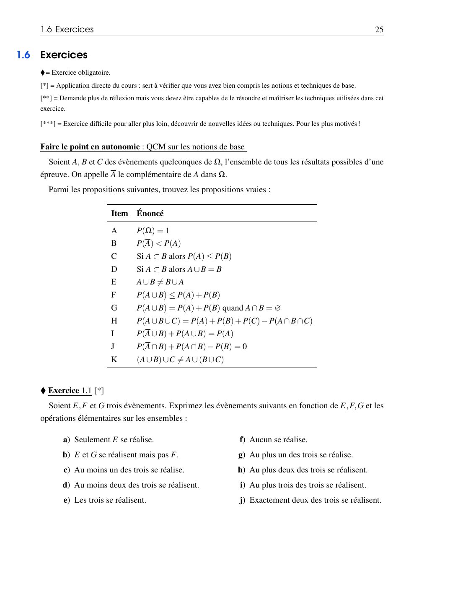
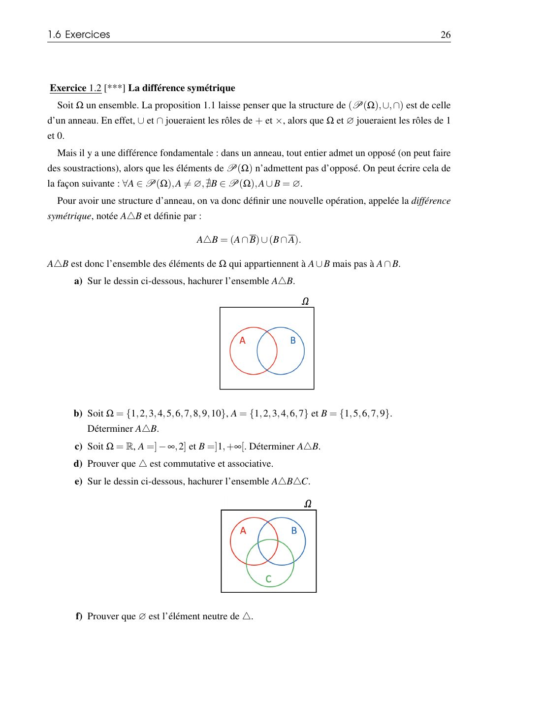
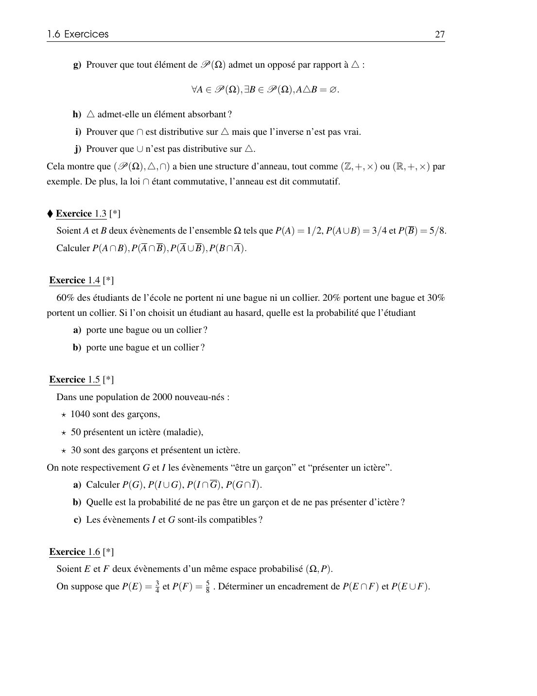
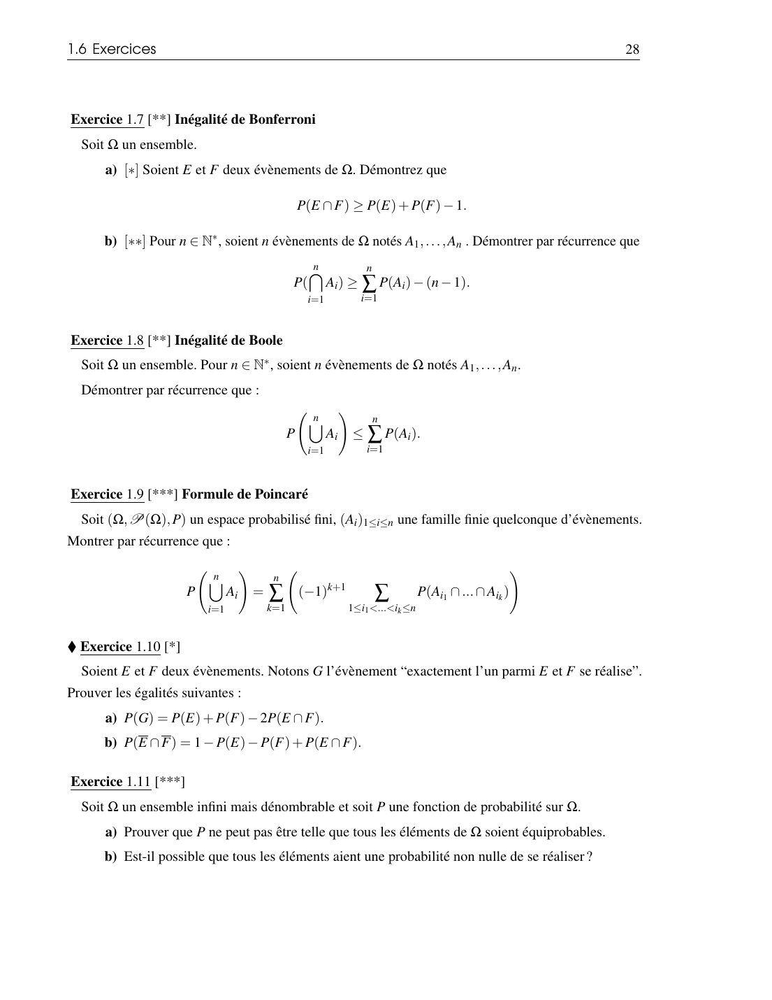
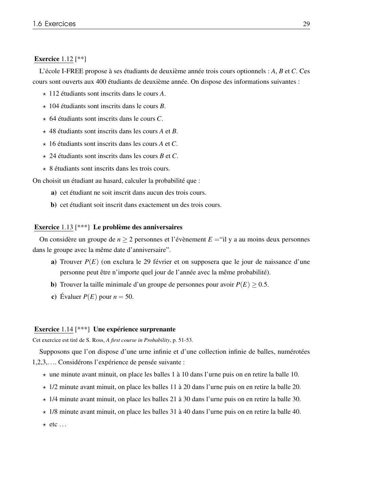
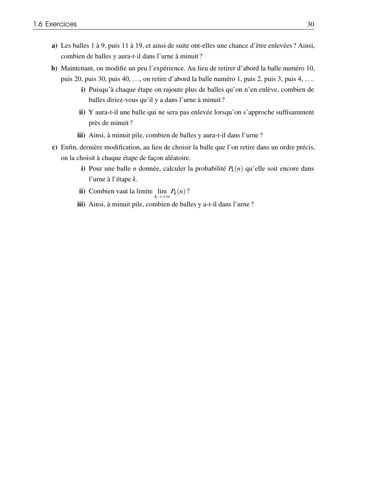

# TD 1 — Espace probabilisé

=== "Version simplifiée"

    Exercices de la section 1.6 du poly. Rappels : [chapitre 1](../cours/chapitre-1-espace-probabilise.md).
    Chaque exercice a un **indice** puis une **correction** repliés : cherche d'abord !
    ♦ = exercice obligatoire.

    ## QCM — Faire le point

    Soient $A$, $B$, $C$ trois évènements. Lesquelles sont vraies ?

    | | Énoncé |
    |:-:|--------|
    | A | $P(\Omega) = 1$ |
    | B | $P(\overline{A}) < P(A)$ |
    | C | Si $A \subset B$ alors $P(A) \le P(B)$ |
    | D | Si $A \subset B$ alors $A \cup B = B$ |
    | E | $A \cup B \neq B \cup A$ |
    | F | $P(A \cup B) \le P(A) + P(B)$ |
    | G | $P(A \cup B) = P(A) + P(B)$ quand $A \cap B = \emptyset$ |
    | H | $P(A \cup B \cup C) = P(A) + P(B) + P(C) - P(A \cap B \cap C)$ |
    | I | $P(A \cup B) + P(A \cup \overline{B}) = P(A)$ |
    | J | $P(A \cap B) + P(\overline{A} \cap B) - P(B) = 0$ |
    | K | $(A \cup B) \cup C \neq A \cup (B \cup C)$ |

    ??? success "Correction"
        **Vraies : A, C, D, F, G, J.**

        - B : faux (si $P(A) = 0{,}2$, $P(\overline{A}) = 0{,}8$).
        - E et K : faux, $\cup$ est commutative et associative.
        - F : vrai car $P(A \cup B) = P(A) + P(B) - P(A \cap B)$ et $P(A \cap B) \ge 0$.
        - H : faux, il manque les intersections deux à deux (Poincaré).
        - I : faux, $A \cup B$ et $A \cup \overline{B}$ ne sont pas disjoints ; leur somme vaut $1 + P(A)$.
        - J : vrai, $B = (A \cap B) \cup (\overline{A} \cap B)$ (union disjointe).

    ## ♦ Exercice 1.1 — Traduire en ensembles

    $E$, $F$, $G$ trois évènements. Exprimer :

    a) seulement $E$ ; b) $E$ et $G$ mais pas $F$ ; c) au moins un des trois ;
    d) au moins deux ; e) les trois ; f) aucun ; g) au plus un ; h) au plus deux ;
    i) au plus trois ; j) exactement deux.

    ??? tip "Indice"
        « Au plus » et « aucun » se traitent souvent par le complémentaire.
        « Exactement deux » = réunion de trois cas incompatibles.

    ??? success "Correction"
        | | Évènement |
        |-|-----------|
        | a | $E \cap \overline{F} \cap \overline{G}$ |
        | b | $E \cap \overline{F} \cap G$ |
        | c | $E \cup F \cup G$ |
        | d | $(E \cap F) \cup (E \cap G) \cup (F \cap G)$ |
        | e | $E \cap F \cap G$ |
        | f | $\overline{E} \cap \overline{F} \cap \overline{G} = \overline{E \cup F \cup G}$ |
        | g | $(\overline{E} \cap \overline{F}) \cup (\overline{E} \cap \overline{G}) \cup (\overline{F} \cap \overline{G})$ (au moins deux ne se réalisent pas) |
        | h | $\overline{E \cap F \cap G} = \overline{E} \cup \overline{F} \cup \overline{G}$ |
        | i | $\Omega$ (toujours vrai) |
        | j | $(E \cap F \cap \overline{G}) \cup (E \cap \overline{F} \cap G) \cup (\overline{E} \cap F \cap G)$ |

    ## ♦ Exercice 1.3

    $P(A) = \frac12$, $P(A \cup B) = \frac34$, $P(\overline{B}) = \frac58$.
    Calculer $P(A \cap B)$, $P(\overline{A} \cap \overline{B})$, $P(\overline{A} \cup \overline{B})$, $P(B \cap \overline{A})$.

    ??? tip "Indice"
        Commence par $P(B)$. Puis De Morgan pour les deux complémentaires.

    ??? success "Correction"
        - $P(B) = 1 - \frac58 = \frac38$.
        - $P(A \cap B) = P(A) + P(B) - P(A \cup B) = \frac12 + \frac38 - \frac34 = \frac18$.
        - $P(\overline{A} \cap \overline{B}) = P(\overline{A \cup B}) = 1 - \frac34 = \frac14$.
        - $P(\overline{A} \cup \overline{B}) = P(\overline{A \cap B}) = 1 - \frac18 = \frac78$.
        - $P(B \cap \overline{A}) = P(B) - P(A \cap B) = \frac38 - \frac18 = \frac14$.

    ## Exercice 1.4 — Bagues et colliers

    60 % ne portent ni bague ni collier, 20 % une bague, 30 % un collier.
    Probabilité de porter a) une bague **ou** un collier ; b) une bague **et** un collier.

    ??? success "Correction"
        a) « Ni l'un ni l'autre » est le complémentaire de « l'un ou l'autre » :
        $P(B \cup C) = 1 - 0{,}6 = 0{,}4$.

        b) $P(B \cap C) = P(B) + P(C) - P(B \cup C) = 0{,}2 + 0{,}3 - 0{,}4 = 0{,}1$.

    ## Exercice 1.5 — Nouveau-nés

    2000 nouveau-nés : 1040 garçons, 50 avec un ictère, 30 garçons avec un ictère.

    ??? tip "Indice"
        Effectifs → probabilités : on **divise par 2000**. Un tableau de contingence aide :
        remplis d'abord les effectifs, puis divise.

    ??? success "Correction"
        | | $I$ | $\overline{I}$ | Total |
        |-|:---:|:---:|:---:|
        | $G$ | 30 | 1010 | 1040 |
        | $\overline{G}$ | 20 | 940 | 960 |
        | Total | 50 | 1950 | 2000 |

        a) $P(G) = \frac{1040}{2000} = 0{,}52$ ;
        $P(I \cup G) = \frac{50 + 1040 - 30}{2000} = 0{,}53$ ;
        $P(I \cap \overline{G}) = \frac{20}{2000} = 0{,}01$ ;
        $P(G \cap \overline{I}) = \frac{1010}{2000} = 0{,}505$.

        b) $P(\overline{G} \cap \overline{I}) = 1 - P(G \cup I) = 0{,}47$.

        c) $P(I \cap G) = 0{,}015 \neq 0$ : $I$ et $G$ sont **compatibles**.

    ## Exercice 1.6 — Encadrements

    $P(E) = \frac34$, $P(F) = \frac58$. Encadrer $P(E \cap F)$ et $P(E \cup F)$.

    ??? success "Correction"
        - $E \cap F \subset F$ donc $P(E \cap F) \le \min\left(\frac34, \frac58\right) = \frac58$.
        - $P(E \cup F) \le 1$ donne $P(E \cap F) = P(E) + P(F) - P(E \cup F) \ge \frac34 + \frac58 - 1 = \frac38$.
        - Donc $\frac38 \le P(E \cap F) \le \frac58$, et $P(E \cup F) = \frac{11}{8} - P(E \cap F)$
          donne $\frac34 \le P(E \cup F) \le 1$.

    ## ♦ Exercice 1.10 — Exactement un des deux

    $G$ = « exactement un parmi $E$ et $F$ se réalise ». Montrer :
    a) $P(G) = P(E) + P(F) - 2P(E \cap F)$ ; b) $P(\overline{E} \cap \overline{F}) = 1 - P(E) - P(F) + P(E \cap F)$.

    ??? success "Correction"
        a) $G = (E \cap \overline{F}) \cup (\overline{E} \cap F)$, union **disjointe**. Or
        $P(E \cap \overline{F}) = P(E) - P(E \cap F)$ et $P(\overline{E} \cap F) = P(F) - P(E \cap F)$.
        On additionne.

        b) De Morgan : $\overline{E} \cap \overline{F} = \overline{E \cup F}$, donc
        $P = 1 - P(E \cup F) = 1 - P(E) - P(F) + P(E \cap F)$.

    ## Exercice 1.12 — Cours optionnels (Poincaré)

    400 étudiants ; $A$ : 112, $B$ : 104, $C$ : 64, $A \cap B$ : 48, $A \cap C$ : 16,
    $B \cap C$ : 24, $A \cap B \cap C$ : 8. Probabilité qu'un étudiant au hasard
    a) ne suive aucun cours ; b) suive exactement un cours.

    ??? tip "Indice"
        a) Poincaré à trois évènements, puis complémentaire.
        b) « Seulement $A$ » = $A$ moins ce qui est partagé : attention à ne pas retirer deux fois $A \cap B \cap C$.

    ??? success "Correction"
        a) $\operatorname{card}(A \cup B \cup C) = 112 + 104 + 64 - 48 - 16 - 24 + 8 = 200$,
        donc $P(\text{aucun}) = \frac{400 - 200}{400} = \frac12$.

        b) Seulement $A$ : $112 - 48 - 16 + 8 = 56$ ; seulement $B$ : $104 - 48 - 24 + 8 = 40$ ;
        seulement $C$ : $64 - 16 - 24 + 8 = 32$. Total $128$, donc $P = \frac{128}{400} = 0{,}32$.

    ## Exercice 1.13 — Le problème des anniversaires

    $n$ personnes, 365 jours équiprobables. $E$ = « au moins deux personnes ont le même anniversaire ».

    ??? tip "Indice"
        Calcule $P(\overline{E})$ : toutes les dates différentes. Cas favorables :
        $365 \times 364 \times \dots \times (365 - n + 1)$, cas possibles : $365^n$.

    ??? success "Correction"
        a) $P(E) = 1 - \dfrac{365 \times 364 \times \cdots \times (365 - n + 1)}{365^n}$.

        b) Le plus petit $n$ tel que $P(E) \ge 0{,}5$ est $n = 23$ ($P \approx 0{,}507$).

        c) Pour $n = 50$ : $P(E) \approx 0{,}970$. Résultat très contre-intuitif !

    ## Exercices pour aller plus loin

    Les exercices 1.2 (différence symétrique), 1.7 (Bonferroni), 1.8 (Boole), 1.9 (Poincaré
    par récurrence), 1.11 et 1.14 sont des [**] / [***] : démonstrations par récurrence
    et culture. Pour 1.7 a) : $P(E \cap F) = P(E) + P(F) - P(E \cup F) \ge P(E) + P(F) - 1$.

=== "Version papier"

    Les énoncés de la section 1.6 « Exercices » du polycopié 2026-2027 (pages 25 à 30). ♦ = exercice obligatoire. Le cours est dans la [version papier du chapitre 1](../cours/chapitre-1-espace-probabilise.md).

    [{ loading=lazy .papier }](papier/td1/p025.jpg)
    
Énoncés : QCM, exercice 1.1 · Poly 2026-2027, p. 25

    [{ loading=lazy .papier }](papier/td1/p026.jpg)
    
Énoncés : exercice 1.2 · Poly 2026-2027, p. 26

    [{ loading=lazy .papier }](papier/td1/p027.jpg)
    
Énoncés : exercices 1.3 à 1.6 · Poly 2026-2027, p. 27

    [{ loading=lazy .papier }](papier/td1/p028.jpg)
    
Énoncés : exercices 1.7 à 1.11 · Poly 2026-2027, p. 28

    [{ loading=lazy .papier }](papier/td1/p029.jpg)
    
Énoncés : exercices 1.12 à 1.14 · Poly 2026-2027, p. 29

    [{ loading=lazy .papier }](papier/td1/p030.jpg)
    
Suite de l'exercice précédent · Poly 2026-2027, p. 30

