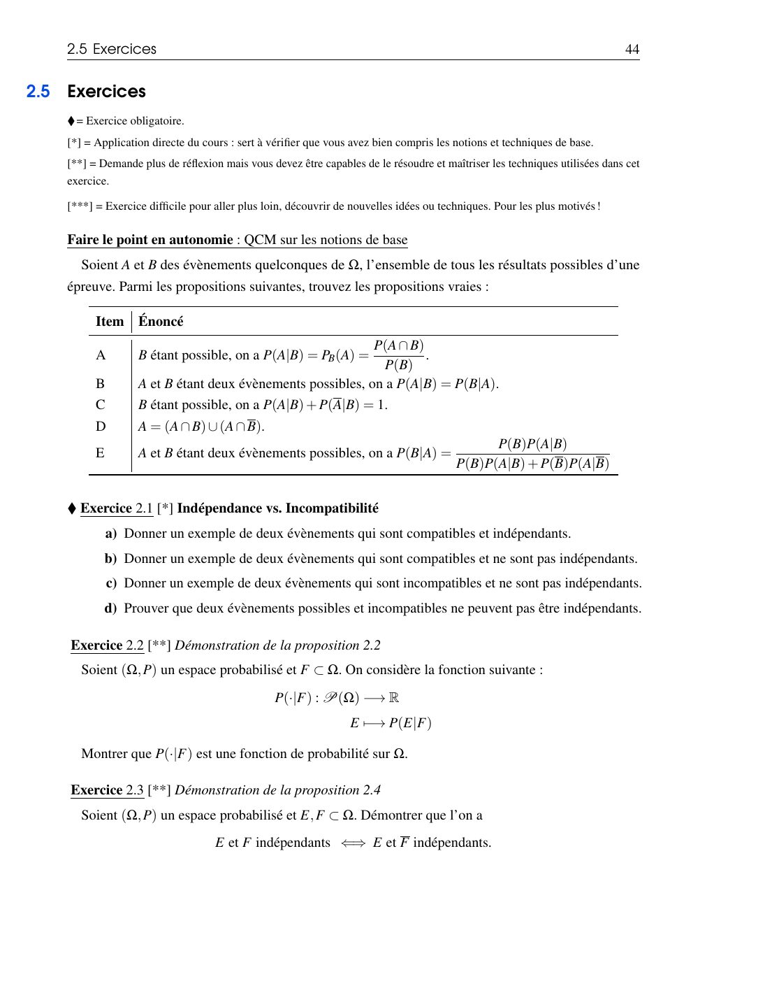
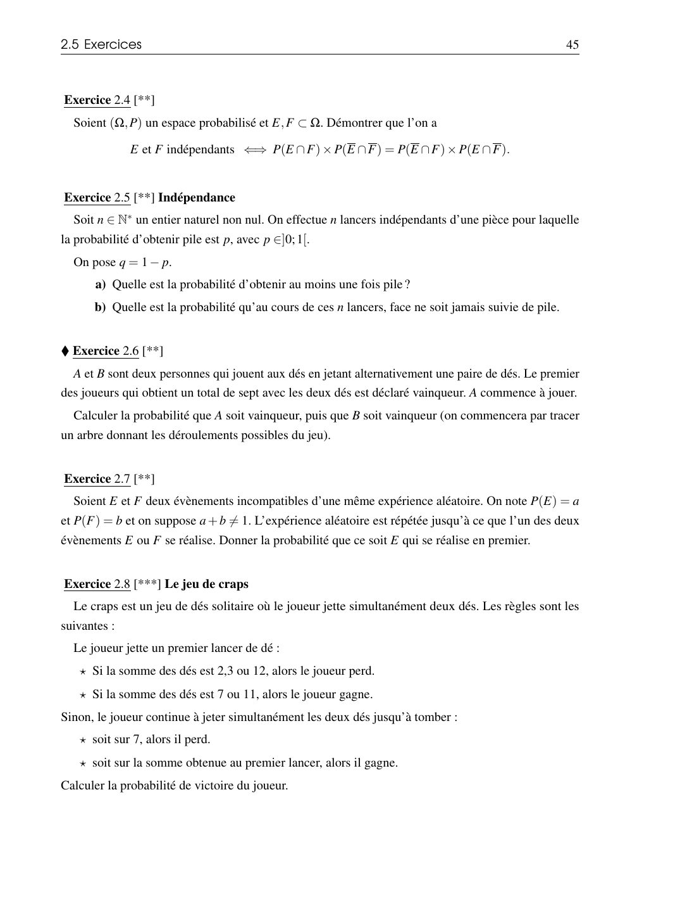
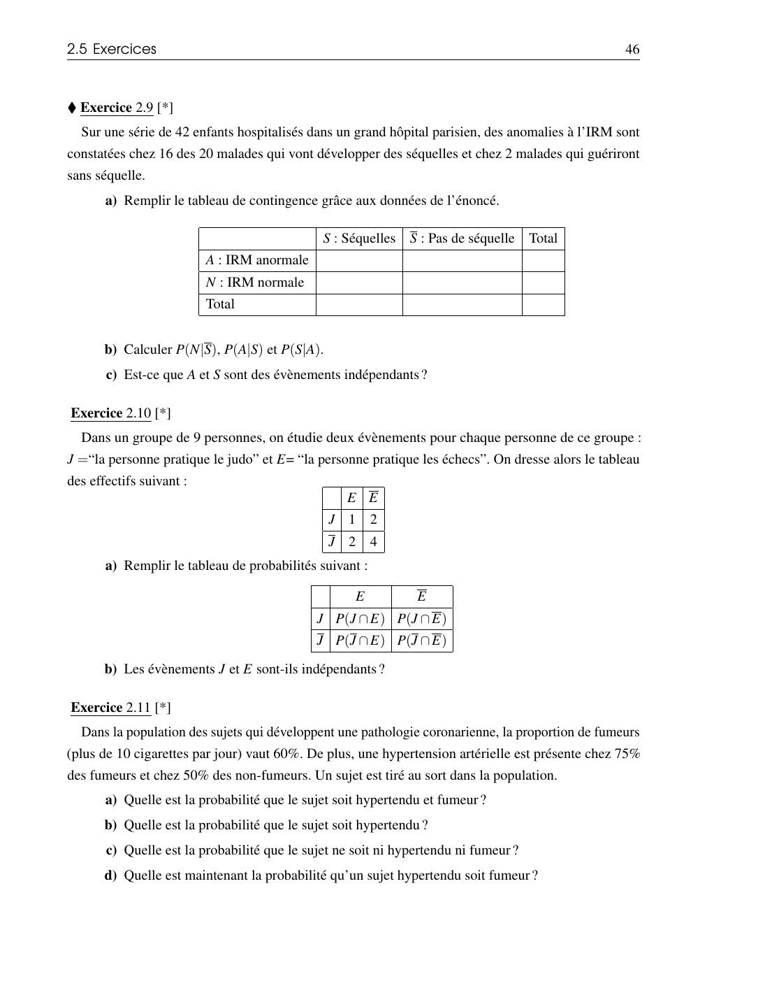
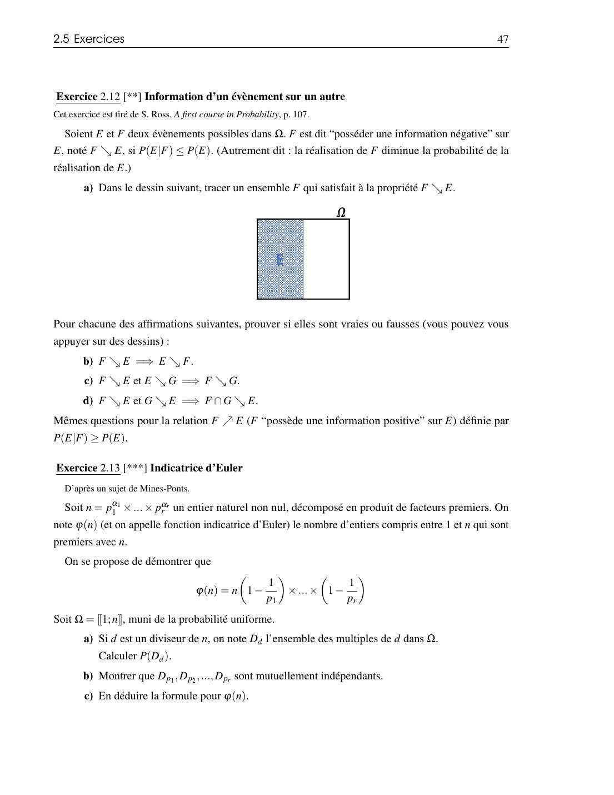
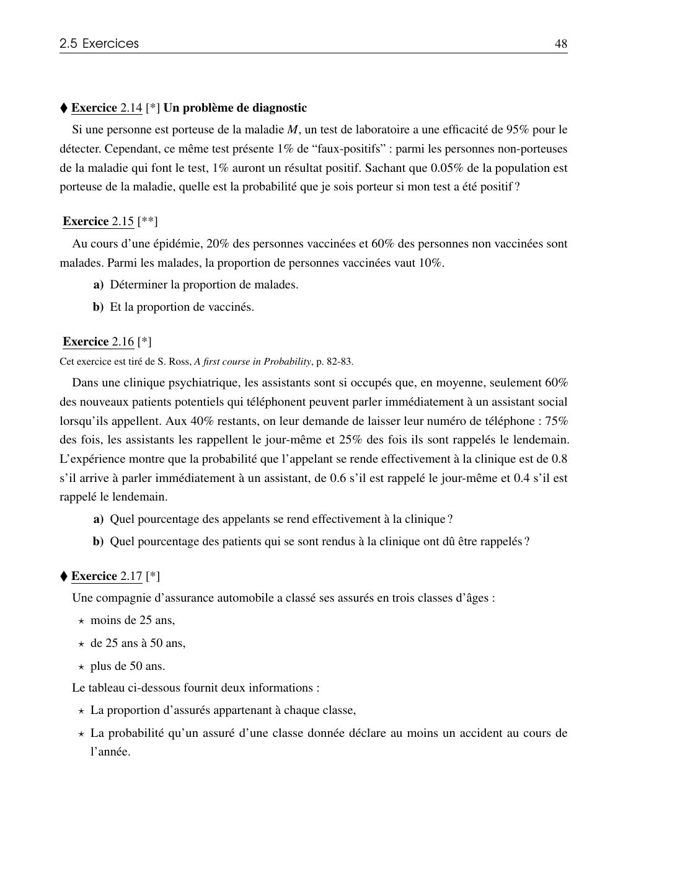
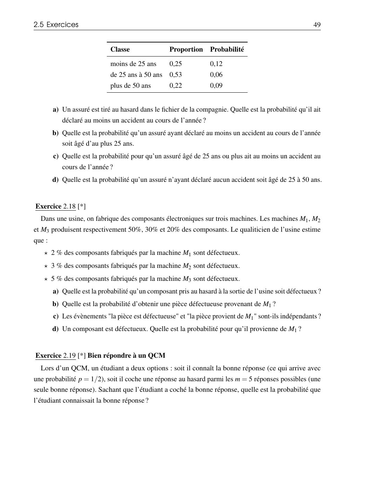
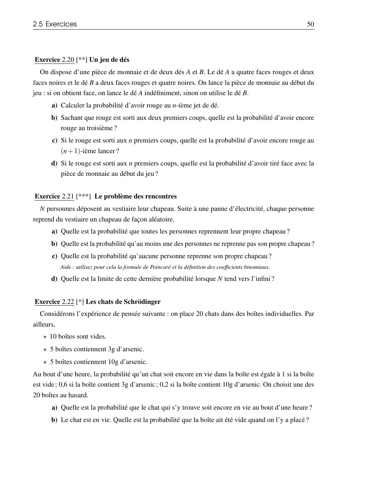
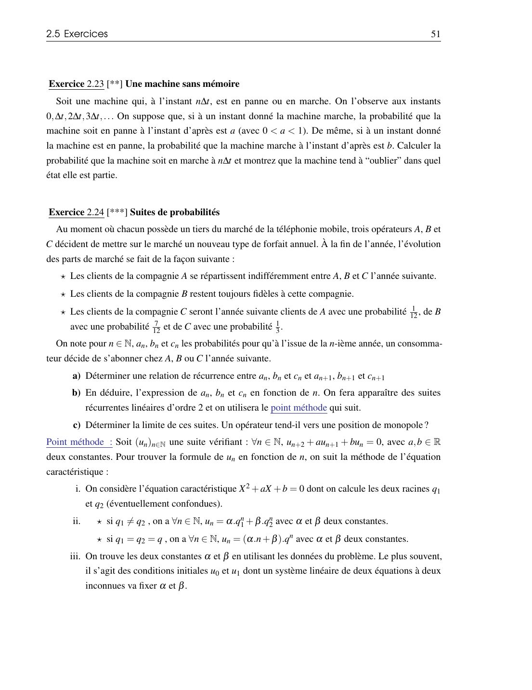
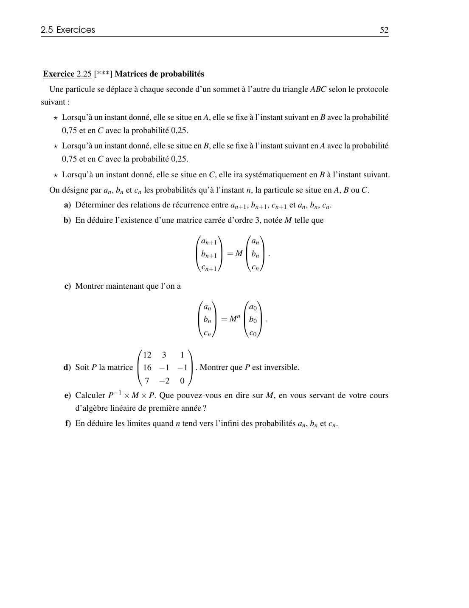

# TD 2 — Probabilités conditionnelles

=== "Version simplifiée"

    Exercices de la section 2.5 du poly. Rappels : [chapitre 2](../cours/chapitre-2-probabilites-conditionnelles.md).
    ♦ = exercice obligatoire.

    !!! methode "Réflexe pour tous les exercices de ce TD"
        1. **Nommer** les évènements avec des lettres.
        2. **Traduire** chaque donnée : « parmi les X, p % sont Y » = $P(Y \mid X) = p$ ;
           « p % sont X et Y » = $P(X \cap Y) = p$.
        3. Faire l'**arbre** (ou le tableau de contingence) avant de calculer.

    ## QCM — Faire le point

    | | Énoncé |
    |:-:|--------|
    | A | $P(B) > 0 \Rightarrow P(A \mid B) = P_B(A) = \frac{P(A \cap B)}{P(B)}$ |
    | B | $P(A \mid B) = P(B \mid A)$ |
    | C | $P(A \mid B) + P(\overline{A} \mid B) = 1$ |
    | D | $A = (A \cap B) \cup (A \cap \overline{B})$ |
    | E | $P(B \mid A) = \frac{P(B)P(A \mid B)}{P(B)P(A \mid B) + P(\overline{B})P(A \mid \overline{B})}$ |

    ??? success "Correction"
        **Vraies : A, C, D, E.** B est fausse en général (c'est exactement ce que corrige Bayes).
        E est la formule de Bayes avec le SCE $\{B, \overline{B}\}$.

    ## ♦ Exercice 2.1 — Indépendance vs incompatibilité

    ??? success "Correction"
        On lance un dé équilibré.

        a) Compatibles et indépendants : $A$ = « pair » $= \{2, 4, 6\}$, $B = \{1, 2\}$.
        $P(A \cap B) = \frac16 = \frac12 \times \frac13$.

        b) Compatibles, non indépendants : $A$ = « pair », $B = \{2\}$. $P(A \cap B) = \frac16 \neq \frac12 \times \frac16$.

        c) Incompatibles, non indépendants : $A = \{1\}$, $B = \{2\}$. $P(A \cap B) = 0 \neq \frac{1}{36}$.

        d) Si $P(A) > 0$, $P(B) > 0$ et $A \cap B = \emptyset$, alors
        $P(A \cap B) = 0 < P(A)P(B)$ : pas indépendants.

    ## Exercice 2.5 — $n$ lancers d'une pièce biaisée

    Probabilité de pile $p$, $q = 1 - p$.

    ??? success "Correction"
        a) $P(\text{au moins un pile}) = 1 - P(\text{que des faces}) = 1 - q^n$ (indépendance).

        b) « Face n'est jamais suivie de pile » : la suite est de la forme
        $\underbrace{P \dots P}_{k}\underbrace{F \dots F}_{n-k}$, pour $k = 0, \dots, n$.
        Ces $n+1$ cas sont incompatibles :

        $$
        P = \sum_{k=0}^n p^k q^{n-k}
        = \frac{p^{n+1} - q^{n+1}}{p - q} \text{ si } p \neq \tfrac12,
        \qquad = \frac{n+1}{2^n} \text{ si } p = \tfrac12
        $$

    ## ♦ Exercice 2.6 — Le premier qui fait 7

    $A$ et $B$ lancent alternativement deux dés ; le premier qui obtient une somme de 7 gagne. $A$ commence.

    ??? tip "Indice"
        $P(\text{somme} = 7) = \frac{6}{36} = \frac16$. $A$ gagne au tour $1$, $3$, $5$…
        C'est une série géométrique.

    ??? success "Correction"
        $A$ gagne au $(2k+1)$-e lancer si les $2k$ premiers échouent : probabilité
        $\left(\frac56\right)^{2k}\frac16$.

        $$
        P(A) = \frac16 \sum_{k \ge 0} \left(\frac{25}{36}\right)^k = \frac16 \times \frac{1}{1 - \frac{25}{36}} = \frac{6}{11},
        \qquad P(B) = \frac{5}{11}
        $$

        (La partie s'arrête presque sûrement, donc $P(B) = 1 - P(A)$.)

    ## Exercice 2.7

    $E$, $F$ incompatibles, $P(E) = a$, $P(F) = b$. On répète jusqu'à ce que $E$ ou $F$ se réalise.

    ??? success "Correction"
        À chaque essai, rien ne se passe avec probabilité $1 - a - b$. Donc
        $P(E \text{ en premier}) = \sum_{k \ge 0} (1 - a - b)^k a = \dfrac{a}{a + b}$.

    ## Exercice 2.8 — Le craps

    ??? success "Correction"
        $P(\text{somme} = s) = \frac{6 - |s - 7|}{36}$. Victoire directe : 7 ou 11, soit $\frac{6 + 2}{36}$.
        Si le 1er lancer donne un « point » $s \in \{4, 5, 6, 8, 9, 10\}$, d'après l'exercice 2.7
        on gagne avec probabilité $\frac{P(s)}{P(s) + P(7)}$.

        $$
        P(\text{victoire}) = \frac{8}{36} + \sum_{s} P(s) \frac{P(s)}{P(s) + P(7)} = \frac{244}{495} \approx 0{,}493
        $$

        Légèrement défavorable au joueur.

    ## ♦ Exercice 2.9 — IRM et séquelles

    42 enfants ; 20 auront des séquelles ($S$). IRM anormale ($A$) chez 16 des 20 malades
    avec séquelles et chez 2 malades sans séquelle.

    ??? tip "Indice"
        Tableau d'**effectifs** d'abord, puis divise par le total de la ligne ou de la colonne
        qui correspond à la condition.

    ??? success "Correction"
        | | $S$ | $\overline{S}$ | Total |
        |-|:---:|:---:|:---:|
        | $A$ | 16 | 2 | 18 |
        | $N$ | 4 | 20 | 24 |
        | Total | 20 | 22 | 42 |

        b) $P(N \mid S) = \frac{4}{20} = 0{,}2$ ; $P(A \mid S) = \frac{16}{20} = 0{,}8$ ;
        $P(S \mid A) = \frac{16}{18} = \frac89 \approx 0{,}89$.

        c) $P(A \cap S) = \frac{16}{42} = \frac{8}{21}$ et $P(A)P(S) = \frac{18}{42} \times \frac{20}{42} = \frac{10}{49}$ :
        différents, donc **pas indépendants**.

    ## Exercice 2.10 — Judo et échecs

    Effectifs (9 personnes) : $J \cap E$ : 1, $J \cap \overline{E}$ : 2, $\overline{J} \cap E$ : 2, $\overline{J} \cap \overline{E}$ : 4.

    ??? success "Correction"
        a) On divise par 9 : $\frac19$, $\frac29$, $\frac29$, $\frac49$.

        b) $P(J) = \frac39$, $P(E) = \frac39$, et $P(J)P(E) = \frac19 = P(J \cap E)$.
        Il faut vérifier les autres cases… mais par la propriété « indépendance avec les
        complémentaires », une case suffit pour un tableau $2 \times 2$. **Indépendants.**

    ## Exercice 2.11 — Fumeurs et hypertension

    $P(F) = 0{,}6$, $P(H \mid F) = 0{,}75$, $P(H \mid \overline{F}) = 0{,}5$.

    ??? success "Correction"
        a) $P(H \cap F) = 0{,}6 \times 0{,}75 = 0{,}45$.

        b) Probabilités totales : $P(H) = 0{,}45 + 0{,}4 \times 0{,}5 = 0{,}65$.

        c) $P(\overline{H} \cap \overline{F}) = 0{,}4 \times 0{,}5 = 0{,}2$.

        d) Bayes : $P(F \mid H) = \frac{0{,}45}{0{,}65} = \frac{9}{13} \approx 0{,}69$.

    ## ♦ Exercice 2.14 — Un problème de diagnostic

    Test : $P(+ \mid M) = 0{,}95$, faux positifs $P(+ \mid \overline{M}) = 0{,}01$, $P(M) = 0{,}0005$.
    Probabilité d'être porteur si le test est positif ?

    ??? tip "Indice"
        Bayes avec le SCE $\{M, \overline{M}\}$. Pose-toi la question : parmi tous les
        positifs, combien sont des vrais positifs ?

    ??? success "Correction"
        $$
        P(M \mid +) = \frac{0{,}95 \times 0{,}0005}{0{,}95 \times 0{,}0005 + 0{,}01 \times 0{,}9995} \approx 0{,}045
        $$

        Moins de 5 % ! La maladie est si rare que les faux positifs (1 % de presque toute
        la population) sont bien plus nombreux que les vrais positifs.

    ## Exercice 2.15 — Épidémie et vaccin

    $P(M \mid V) = 0{,}2$, $P(M \mid \overline{V}) = 0{,}6$, $P(V \mid M) = 0{,}1$.

    ??? tip "Indice"
        Pose $v = P(V)$. Écris $P(M)$ avec les probabilités totales, puis $P(V \mid M)$ avec
        Bayes : tu obtiens une équation en $v$.

    ??? success "Correction"
        $P(M) = 0{,}2v + 0{,}6(1 - v) = 0{,}6 - 0{,}4v$ et
        $P(V \mid M) = \frac{0{,}2v}{0{,}6 - 0{,}4v} = 0{,}1$, donc $0{,}24v = 0{,}06$ et $v = 0{,}25$.

        a) $P(M) = 0{,}6 - 0{,}1 = 0{,}5$. b) $P(V) = 0{,}25$.

    ## Exercice 2.16 — Clinique

    60 % parlent tout de suite à un assistant ; les 40 % restants sont rappelés le jour même
    (75 %) ou le lendemain (25 %). Probabilité de venir : 0,8 / 0,6 / 0,4.

    ??? success "Correction"
        SCE : $I$ (immédiat) : $0{,}6$ ; $J$ (jour même) : $0{,}4 \times 0{,}75 = 0{,}3$ ;
        $L$ (lendemain) : $0{,}4 \times 0{,}25 = 0{,}1$.

        a) $P(C) = 0{,}6 \times 0{,}8 + 0{,}3 \times 0{,}6 + 0{,}1 \times 0{,}4 = 0{,}7$, soit 70 %.

        b) $P(J \cup L \mid C) = \frac{0{,}18 + 0{,}04}{0{,}7} = \frac{11}{35} \approx 31{,}4\ \%$.

    ## ♦ Exercice 2.17 — Assurance automobile

    | Classe | Proportion | $P(\text{accident} \mid \text{classe})$ |
    |--------|:---:|:---:|
    | $< 25$ ans | 0,25 | 0,12 |
    | 25–50 ans | 0,53 | 0,06 |
    | $> 50$ ans | 0,22 | 0,09 |

    ??? success "Correction"
        a) $P(A) = 0{,}25 \times 0{,}12 + 0{,}53 \times 0{,}06 + 0{,}22 \times 0{,}09 = 0{,}0816$.

        b) $P(J \mid A) = \frac{0{,}03}{0{,}0816} \approx 0{,}368$.

        c) Ce n'est **pas** une formule de Bayes : on conditionne par « 25 ans ou plus » :
        $P(A \mid \overline{J}) = \frac{0{,}53 \times 0{,}06 + 0{,}22 \times 0{,}09}{0{,}75} = \frac{0{,}0516}{0{,}75} = 0{,}0688$.

        d) $P(M \mid \overline{A}) = \frac{0{,}53 \times 0{,}94}{1 - 0{,}0816} = \frac{0{,}4982}{0{,}9184} \approx 0{,}542$.

    ## Exercice 2.18 — Trois machines

    $M_1$, $M_2$, $M_3$ : 50 %, 30 %, 20 % de la production ; défauts 2 %, 3 %, 5 %.

    ??? success "Correction"
        a) $P(D) = 0{,}5 \times 0{,}02 + 0{,}3 \times 0{,}03 + 0{,}2 \times 0{,}05 = 0{,}029$.

        b) $P(D \cap M_1) = 0{,}5 \times 0{,}02 = 0{,}01$.

        c) $P(D)P(M_1) = 0{,}0145 \neq 0{,}01$ : **pas indépendants**.

        d) $P(M_1 \mid D) = \frac{0{,}01}{0{,}029} = \frac{10}{29} \approx 0{,}345$.

    ## Exercice 2.19 — Bien répondre à un QCM

    L'étudiant connaît la réponse avec probabilité $\frac12$, sinon répond au hasard parmi 5.

    ??? success "Correction"
        $$
        P(C \mid B) = \frac{1 \times \frac12}{1 \times \frac12 + \frac15 \times \frac12} = \frac56
        $$

    ## Exercice 2.22 — Les chats de Schrödinger

    10 boîtes vides (survie 1), 5 avec 3 g (survie 0,6), 5 avec 10 g (survie 0,2).

    ??? success "Correction"
        a) $P(V) = \frac{10}{20} \times 1 + \frac{5}{20} \times 0{,}6 + \frac{5}{20} \times 0{,}2 = 0{,}7$.

        b) $P(\text{vide} \mid V) = \frac{0{,}5}{0{,}7} = \frac57 \approx 0{,}71$.

    ## Exercices pour aller plus loin

    - **2.2, 2.3, 2.4** : démonstrations de cours (voir le chapitre 2 pour 2.3).
    - **2.20** (dés A et B) : probabilités totales sur le résultat de la pièce, puis Bayes.
      $P(R_n) = \frac12 \cdot \frac23 + \frac12 \cdot \frac13 = \frac12$ ; sachant rouge aux
      $n$ premiers coups, $P(\text{face}) = \frac{2^n}{2^n + 1}$.
    - **2.21** (rencontres) : $P(\text{aucun bon chapeau}) = \sum_{k=0}^N \frac{(-1)^k}{k!} \to e^{-1}$.
    - **2.23 à 2.25** : suites récurrentes et matrices (chaînes de Markov).

=== "Version papier"

    Les énoncés de la section 2.5 « Exercices » du polycopié 2026-2027 (pages 44 à 52). ♦ = exercice obligatoire. Le cours est dans la [version papier du chapitre 2](../cours/chapitre-2-probabilites-conditionnelles.md).

    [{ loading=lazy .papier }](papier/td2/p044.jpg)
    
Énoncés : QCM, exercices 2.1 à 2.3 · Poly 2026-2027, p. 44

    [{ loading=lazy .papier }](papier/td2/p045.jpg)
    
Énoncés : exercices 2.4 à 2.8 · Poly 2026-2027, p. 45

    [{ loading=lazy .papier }](papier/td2/p046.jpg)
    
Énoncés : exercices 2.9 à 2.11 · Poly 2026-2027, p. 46

    [{ loading=lazy .papier }](papier/td2/p047.jpg)
    
Énoncés : exercices 2.12 et 2.13 · Poly 2026-2027, p. 47

    [{ loading=lazy .papier }](papier/td2/p048.jpg)
    
Énoncés : exercices 2.14 à 2.17 · Poly 2026-2027, p. 48

    [{ loading=lazy .papier }](papier/td2/p049.jpg)
    
Énoncés : exercices 2.18 et 2.19 · Poly 2026-2027, p. 49

    [{ loading=lazy .papier }](papier/td2/p050.jpg)
    
Énoncés : exercices 2.20 à 2.22 · Poly 2026-2027, p. 50

    [{ loading=lazy .papier }](papier/td2/p051.jpg)
    
Énoncés : exercices 2.23 et 2.24 · Poly 2026-2027, p. 51

    [{ loading=lazy .papier }](papier/td2/p052.jpg)
    
Énoncés : exercice 2.25 · Poly 2026-2027, p. 52

