# TD 3 — Variables aléatoires discrètes

=== "Version simplifiée"

    Exercices de la section 3.7 du poly 2026-2027. Rappels : [chapitre 3](../cours/chapitre-3-va-discretes.md).
    Chaque exercice a un **indice** puis une **correction** repliés : cherche d'abord !
    ♦ = exercice obligatoire. Programme du CE : exercices 3.1 à 3.15.

    ## QCM — Faire le point

    Soient $X$ et $Y$ deux variables aléatoires sur un espace probabilisé fini $(\Omega, P)$. Lesquelles sont vraies ?

    | | Énoncé |
    |:-:|--------|
    | A | Si $X \sim \mathcal{U}([\![1, n]\!])$ alors $P(X = k) = \frac{1}{n^2}$ |
    | B | $E(X^2) \le E(X)^2$ |
    | C | Si $X(\Omega) = [\![1, n]\!]$ alors $E(e^X) = \sum_{k=1}^n e^k P(X = k)$ |
    | D | Si $X \sim \mathcal{B}(p)$ alors $E(X) = \frac1p$ |
    | E | Si $X \sim \mathcal{B}(n, p)$ alors $E(X) = np$ |
    | F | Si $X \sim \mathcal{BN}(r, p)$ alors $X(\Omega) = [\![1, r]\!]$ |
    | G | Si $X \sim \mathcal{B}(n, p)$ alors $P(X = 0) = (1-p)^n$ |
    | H | Pour que $X$ et $Y$ ne soient pas indépendantes, il suffit que $\mathrm{Cov}(X, Y) \neq 0$ |
    | I | $X$, $Y$ indépendantes si $P(X = x, Y = y) = P(X = x)P(Y = y)$ pour tous $(x, y) \in X(\Omega) \times Y(\Omega)$ |

    ??? success "Correction"
        **Vraies : C, E, G, H, I.**

        - A : faux, c'est $\frac1n$.
        - B : faux, c'est l'inverse : $E(X^2) \ge E(X)^2$ car $V(X) = E(X^2) - E(X)^2 \ge 0$.
        - C : vrai, théorème de transfert.
        - D : faux, $E(X) = p$.
        - F : faux, $X(\Omega) = [\![r, +\infty[\![$ (il faut au moins $r$ essais pour $r$ succès).
        - G : vrai, $P(X = 0) = \binom{n}{0} p^0 (1-p)^n$.
        - H : vrai, c'est la contraposée de « indépendantes $\Rightarrow$ $\mathrm{Cov} = 0$ ».
        - I : vrai, c'est la définition.

    ## ♦ Exercice 3.1 — Familles de trois enfants

    Dans les familles de trois enfants, $X$ compte le nombre de garçons. Donner la loi de $X$
    (sexes équiprobables).

    ??? tip "Indice"
        Trois naissances indépendantes, chacune « garçon » avec probabilité $\frac12$ : loi usuelle.

    ??? success "Correction"
        $X \sim \mathcal{B}(3, \frac12)$ : $P(X = k) = \binom3k \frac18$.

        | $k$ | 0 | 1 | 2 | 3 |
        |:-:|:-:|:-:|:-:|:-:|
        | $P(X = k)$ | $\frac18$ | $\frac38$ | $\frac38$ | $\frac18$ |

    ## Exercice 3.2 — Trois pièces, $X = N_F - N_P$

    On jette trois pièces ; $N_F$ et $N_P$ sont les nombres de faces et de piles. Donner la loi de
    $X = N_F - N_P$.

    ??? tip "Indice"
        $N_F + N_P = 3$ : exprime $X$ en fonction de $N_F$ seul.

    ??? success "Correction"
        $N_P = 3 - N_F$, donc $X = 2N_F - 3$ avec $N_F \sim \mathcal{B}(3, \frac12)$.

        | $x$ | $-3$ | $-1$ | $1$ | $3$ |
        |:-:|:-:|:-:|:-:|:-:|
        | $P(X = x)$ | $\frac18$ | $\frac38$ | $\frac38$ | $\frac18$ |

    ## ♦ Exercice 3.3 — Appels téléphoniques

    $X$ = nombre d'appels reçus par minute (jours ouvrés) :

    | $x$ | 0 | 1 | 2 | 3 | 4 | 5 | 6 | 7 |
    |:-:|:-:|:-:|:-:|:-:|:-:|:-:|:-:|:-:|
    | $P(X \le x)$ | 0,05 | 0,15 | 0,3 | 0,5 | 0,7 | 0,85 | 0,95 | 1 |

    a) Donner $P(X = x)$ pour $x = 0, \dots, 7$. b) Calculer $E(X)$ et $V(X)$.
    c) Probabilité de recevoir au plus 2 appels par minute ?
    d) Probabilité que, sur dix minutes, il y ait exactement trois appels chaque minute ?
    e) Parmi les minutes avec plus de quatre appels, quelle proportion en reçoit exactement sept ?
    f) $Y$ = nombre d'appels par heure. Calculer $E(Y)$ et $V(Y)$.

    ??? tip "Indice"
        C'est la **fonction de répartition** : $P(X = x) = F(x) - F(x - 1)$.
        Pour f), une heure = 60 minutes, que l'on suppose indépendantes.

    ??? success "Correction"
        a)

        | $x$ | 0 | 1 | 2 | 3 | 4 | 5 | 6 | 7 |
        |:-:|:-:|:-:|:-:|:-:|:-:|:-:|:-:|:-:|
        | $P(X = x)$ | 0,05 | 0,1 | 0,15 | 0,2 | 0,2 | 0,15 | 0,1 | 0,05 |

        b) $E(X) = 3{,}5$ (la loi est symétrique autour de 3,5) ; $E(X^2) = 15{,}5$, donc $V(X) = 15{,}5 - 12{,}25 = 3{,}25$.

        c) $P(X \le 2) = 0{,}3$ (lecture directe).

        d) Minutes indépendantes : $P(X = 3)^{10} = 0{,}2^{10} \approx 1{,}02 \times 10^{-7}$.

        e) $P(X = 7 \mid X > 4) = \frac{P(X = 7)}{1 - P(X \le 4)} = \frac{0{,}05}{0{,}3} = \frac16$.

        f) $Y = X_1 + \dots + X_{60}$ (60 minutes supposées indépendantes, de même loi que $X$) :
        $E(Y) = 60 \times 3{,}5 = 210$ et $V(Y) = 60 \times 3{,}25 = 195$.

    ## ♦ Exercice 3.4 — Les autocars du WEI

    Quatre bus transportent 40, 33, 25 et 50 étudiants (148 au total). On tire au hasard un étudiant
    parmi les 148 et un conducteur parmi les 4. $X$ : nombre d'étudiants dans le bus de l'étudiant tiré ;
    $Y$ : nombre d'étudiants dans le bus du conducteur tiré.

    a) À votre avis, lequel est le plus grand : $E(X)$ ou $E(Y)$ ? $V(X)$ ou $V(Y)$ ?
    b) Calculer $E(X)$, $E(Y)$, $V(X)$, $V(Y)$.

    ??? tip "Indice"
        Le conducteur choisit un bus uniformément, mais l'étudiant a une probabilité proportionnelle à
        la taille du bus : $P(X = b) = \frac{b}{148}$.

    ??? success "Correction"
        a) $P(Y = b) = \frac14$ pour chaque bus, mais $P(X = b) = \frac{b}{148}$ : un étudiant a plus
        de chances d'être dans un **gros** bus, donc on s'attend à $E(X) > E(Y)$. Pour les variances,
        l'intuition est moins nette.

        b)

        - $E(Y) = \frac{40 + 33 + 25 + 50}{4} = 37$ ;
          $E(Y^2) = \frac{40^2 + 33^2 + 25^2 + 50^2}{4} = \frac{5814}{4} = 1453{,}5$, donc $V(Y) = 1453{,}5 - 37^2 = 84{,}5$.
        - $E(X) = \frac{40^2 + 33^2 + 25^2 + 50^2}{148} = \frac{5814}{148} = \frac{2907}{74} \approx 39{,}28$ ;
          $E(X^2) = \frac{40^3 + 33^3 + 25^3 + 50^3}{148} = \frac{240\,562}{148} \approx 1625{,}42$,
          donc $V(X) \approx 1625{,}42 - 39{,}28^2 \approx 82{,}2$.

        Bilan : $E(X) > E(Y)$ et $V(X) < V(Y)$ (de peu).

    ## Exercice 3.5 — Le rang d'un enfant

    Un village compte 100 familles : 30 avec un enfant, 50 avec deux, 20 avec trois. Le rang d'un enfant
    vaut 1 (aîné), 2 (cadet) ou 3.

    a) On choisit une famille au hasard, puis un enfant au hasard dans cette famille. Loi, espérance et
    écart-type du rang $R$ ?
    b) On choisit cette fois un enfant au hasard parmi tous les enfants du village. Mêmes questions.

    ??? tip "Indice"
        a) Probabilités totales sur le type de famille. b) Compte les enfants de chaque rang.

    ??? success "Correction"
        a) Famille puis enfant (probabilités totales) :
        $P(R = 1) = 0{,}3 + 0{,}5 \times \frac12 + 0{,}2 \times \frac13 = \frac{37}{60}$,
        $P(R = 2) = 0{,}5 \times \frac12 + 0{,}2 \times \frac13 = \frac{19}{60}$, $P(R = 3) = 0{,}2 \times \frac13 = \frac{4}{60}$.
        $E(R) = \frac{37 + 38 + 12}{60} = 1{,}45$, $V(R) = \frac{457}{1200}$, $\sigma(R) \approx 0{,}62$.

        b) Il y a $30 + 100 + 60 = 190$ enfants : 100 aînés, 70 cadets, 20 troisièmes.
        $P(R = 1) = \frac{10}{19}$, $P(R = 2) = \frac{7}{19}$, $P(R = 3) = \frac{2}{19}$.
        $E(R) = \frac{30}{19} \approx 1{,}58$, $V(R) = \frac{164}{361}$, $\sigma(R) \approx 0{,}67$.

    ## ♦ Exercice 3.6 — Démonstrations (théorème 3.8, propositions 3.6 et 3.9)

    Soient $X$ et $Y$ deux variables aléatoires discrètes sur $\Omega$.

    a) Prouver que $V(X + Y) = V(X) + V(Y) + 2\mathrm{Cov}(X, Y)$.
    b) Prouver que $X$ et $Y$ indépendantes $\Longrightarrow \mathrm{Cov}(X, Y) = 0$.

    ??? tip "Indice"
        a) Formule de König-Huygens $V(Z) = E(Z^2) - E(Z)^2$ et linéarité de l'espérance.
        b) Calcule $E(XY)$ avec le théorème de transfert pour le couple $(X, Y)$.

    ??? success "Correction"
        On utilise $V(Z) = E(Z^2) - E(Z)^2$ et $\mathrm{Cov}(X, Y) = E(XY) - E(X)E(Y)$.

        a) Par linéarité de l'espérance, $E(X + Y) = E(X) + E(Y)$ et
        $E\big((X + Y)^2\big) = E(X^2 + 2XY + Y^2) = E(X^2) + 2E(XY) + E(Y^2)$. Donc

        $$
        \begin{aligned}
        V(X + Y) &= E(X^2) + 2E(XY) + E(Y^2) - \big(E(X)^2 + 2E(X)E(Y) + E(Y)^2\big) \\
        &= \big(E(X^2) - E(X)^2\big) + \big(E(Y^2) - E(Y)^2\big) + 2\big(E(XY) - E(X)E(Y)\big) \\
        &= V(X) + V(Y) + 2\mathrm{Cov}(X, Y).
        \end{aligned}
        $$

        b) Par le théorème de transfert appliqué au couple, $E(XY) = \sum_{x \in X(\Omega)} \sum_{y \in Y(\Omega)} xy\,P(X = x, Y = y)$.
        Si $X$ et $Y$ sont indépendantes, $P(X = x, Y = y) = P(X = x)P(Y = y)$, donc la somme double se factorise
        (les séries convergent absolument, on peut séparer les sommes) :

        $$
        E(XY) = \sum_{x} \sum_{y} x P(X = x)\, y P(Y = y) = \Big(\sum_x x P(X = x)\Big)\Big(\sum_y y P(Y = y)\Big) = E(X)E(Y).
        $$

        Donc $\mathrm{Cov}(X, Y) = E(XY) - E(X)E(Y) = 0$. (La réciproque est fausse : voir 3.10.)

    ## ♦ Exercice 3.7 — Constante d'une loi conjointe

    | | $Y = 2$ | $Y = 4$ | $Y = 5$ |
    |-|:-:|:-:|:-:|
    | $X = 1$ | $2c$ | $c$ | $c$ |
    | $X = 2$ | $4c$ | $2c$ | $3c$ |
    | $X = 3$ | $6c$ | $3c$ | $2c$ |

    a) Trouver $c$. b) Calculer $P(X \le 2, Y \le 4)$. c) Calculer $P(Y = 2 \mid X = 1)$.
    d) $X$ et $Y$ sont-elles indépendantes ?

    ??? tip "Indice"
        La somme de toutes les cases vaut 1. Pour d), il suffit d'une case où
        $P(X = x, Y = y) \neq P(X = x)P(Y = y)$.

    ??? success "Correction"
        a) Somme $= 24c = 1$, donc $c = \frac{1}{24}$.

        b) $P(X \le 2, Y \le 4) = (2 + 1 + 4 + 2)c = \frac{9}{24} = \frac38$.

        c) $P(Y = 2 \mid X = 1) = \frac{P(X = 1, Y = 2)}{P(X = 1)} = \frac{2c}{4c} = \frac12$.

        d) $P(X = 2, Y = 5) = \frac{3}{24} = 0{,}125$ mais $P(X = 2)P(Y = 5) = \frac{9}{24} \times \frac{6}{24} \approx 0{,}094$ :
        **pas indépendantes** (les lignes ne sont pas proportionnelles).

    ## ♦ Exercice 3.8 — Les anagrammes de RBV

    Une urne contient une boule blanche, une verte, une rouge ; on les tire toutes successivement.
    $X$ = rang de la boule blanche, $Y$ = rang de la rouge ; $\Omega$ = anagrammes de $RBV$.

    a) $\operatorname{card}(\Omega)$ ? b) Loi conjointe de $(X, Y)$. c) Lois de $X$ et $Y$ ; indépendantes ?
    d) Espérance et variance de $X$ et $Y$. e) $\mathrm{Cov}(X, Y)$ puis $\rho(X, Y)$.

    ??? tip "Indice"
        Les 6 ordres sont équiprobables, et deux boules ne peuvent pas avoir le même rang.

    ??? success "Correction"
        a) $\operatorname{card}(\Omega) = 3! = 6$.

        b) $X$ et $Y$ ne peuvent pas être égaux ; chacun des 6 couples $(x, y)$ avec $x \neq y$ correspond à un seul ordre :

        | | $X = 1$ | $X = 2$ | $X = 3$ |
        |-|:-:|:-:|:-:|
        | $Y = 1$ | 0 | $\frac16$ | $\frac16$ |
        | $Y = 2$ | $\frac16$ | 0 | $\frac16$ |
        | $Y = 3$ | $\frac16$ | $\frac16$ | 0 |

        c) $X$ et $Y$ sont uniformes sur $\{1, 2, 3\}$. Pas indépendantes : $P(X = 1, Y = 1) = 0 \neq \frac19$.

        d) $E(X) = E(Y) = 2$, $E(X^2) = \frac{1 + 4 + 9}{3} = \frac{14}{3}$, $V(X) = V(Y) = \frac{14}{3} - 4 = \frac23$.

        e) $E(XY) = \frac16(2 + 3 + 2 + 6 + 3 + 6) = \frac{11}{3}$,
        $\mathrm{Cov}(X, Y) = \frac{11}{3} - 4 = -\frac13$, $\rho = \frac{-1/3}{\sqrt{2/3}\sqrt{2/3}} = -\frac12$.

    ## Exercice 3.9 — Couple $(\Theta, \varphi)$

    | | $\Theta = -2$ | $\Theta = 0$ | $\Theta = 2$ |
    |-|:-:|:-:|:-:|
    | $\varphi = 1$ | 0,03 | 0,01 | 0,06 |
    | $\varphi = 2$ | 0,06 | 0,02 | 0,12 |
    | $\varphi = 3$ | 0,12 | 0,04 | 0,24 |
    | $\varphi = 4$ | 0,06 | 0,02 | 0,12 |
    | $\varphi = 5$ | 0,03 | 0,01 | 0,06 |

    a) Calculer $P(\Theta = -2)$ et $P(\Theta = -2 \mid \varphi \ge 3)$. b) Calculer $E(\Theta)$ et $E(\varphi)$.
    c) Combien vaut $\mathrm{Cov}(\Theta, \varphi)$ ?

    ??? tip "Indice"
        Regarde si les lignes du tableau sont proportionnelles entre elles.

    ??? success "Correction"
        a) $P(\Theta = -2) = 0{,}03 + 0{,}06 + 0{,}12 + 0{,}06 + 0{,}03 = 0{,}3$.
        $P(\Theta = -2 \mid \varphi \ge 3) = \frac{0{,}12 + 0{,}06 + 0{,}03}{0{,}4 + 0{,}2 + 0{,}1} = \frac{0{,}21}{0{,}7} = 0{,}3$.

        b) $P(\Theta = 0) = 0{,}1$, $P(\Theta = 2) = 0{,}6$, donc $E(\Theta) = -0{,}6 + 1{,}2 = 0{,}6$.
        $\varphi$ : $0{,}1 ; 0{,}2 ; 0{,}4 ; 0{,}2 ; 0{,}1$, symétrique autour de 3 : $E(\varphi) = 3$.

        c) Les lignes sont toutes proportionnelles à $(3, 1, 6)$ : chaque case vaut
        $P(\Theta = \theta)P(\varphi = k)$, donc $\Theta$ et $\varphi$ sont
        **indépendantes** et $\mathrm{Cov}(\Theta, \varphi) = 0$.

    ## ♦ Exercice 3.10 — Un jeu d'enfants

    Deux enfants choisissent chacun, uniformément et indépendamment, un entier entre 0 et 9. Si la
    somme est paire, la partie est gagnée et $A = 1$ ; sinon $A = -1$. $B$ = nombre d'entiers pairs
    parmi les deux choisis.

    a) Loi conjointe de $(A, B)$. b) $A$ et $B$ sont-elles indépendantes ?
    c) Calculer $\rho(A, B)$ et commenter.

    ??? tip "Indice"
        Chaque entier est pair avec probabilité $\frac{5}{10} = \frac12$, donc $B \sim \mathcal{B}(2, \frac12)$.
        La somme est paire si et seulement si les deux entiers ont **la même parité**.

    ??? success "Correction"
        a) $B \sim \mathcal{B}(2, \frac12)$ : $P(B = 0) = \frac14$, $P(B = 1) = \frac12$, $P(B = 2) = \frac14$.
        La somme est paire $\iff$ les deux entiers sont tous deux pairs ($B = 2$) ou tous deux impairs ($B = 0$).
        Donc $A = 1 \iff B \in \{0, 2\}$ :

        | | $B = 0$ | $B = 1$ | $B = 2$ | loi de $A$ |
        |-|:-:|:-:|:-:|:-:|
        | $A = -1$ | 0 | $\frac12$ | 0 | $\frac12$ |
        | $A = 1$ | $\frac14$ | 0 | $\frac14$ | $\frac12$ |
        | loi de $B$ | $\frac14$ | $\frac12$ | $\frac14$ | 1 |

        b) $P(A = 1, B = 1) = 0$ alors que $P(A = 1)P(B = 1) = \frac12 \times \frac12 = \frac14$ :
        **pas indépendantes**. (D'ailleurs $A$ est une fonction de $B$.)

        c) $E(A) = 0$, $E(B) = 1$, $E(AB) = 1 \times 0 \times \frac14 + (-1) \times 1 \times \frac12 + 1 \times 2 \times \frac14 = 0$.
        Donc $\mathrm{Cov}(A, B) = 0 - 0 \times 1 = 0$ et, comme $V(A) = 1$ et $V(B) = \frac12$ sont non nuls,
        $\rho(A, B) = 0$.

        Commentaire : $A$ et $B$ sont **non corrélées mais dépendantes** (et même $A = 2(B - 1)^2 - 1$).
        Le coefficient $\rho$ ne mesure que la dépendance **linéaire** : ici la relation est
        symétrique autour de $B = 1$, aucune droite ne l'approche. $\rho = 0$ n'implique pas l'indépendance.

    ## ♦ Exercice 3.11 — Interprétation de la covariance

    Soient $A$ et $B$ deux évènements **possibles**, et les indicatrices $X_A = 1$ si $A$ se réalise, $0$ sinon ;
    $X_B = 1$ si $B$ se réalise, $0$ sinon. Prouver que

    $$
    \mathrm{Cov}(X_A, X_B) \ge 0 \iff P(A \mid B) \ge P(A).
    $$

    ??? tip "Indice"
        $X_A \sim \mathcal{B}(P(A))$, et $X_A X_B$ vaut 1 exactement quand $A$ **et** $B$ se réalisent.
        Puis écris $P(A \cap B) = P(A \mid B)P(B)$.

    ??? success "Correction"
        ($P(A \mid B)$ n'a de sens que si $P(B) > 0$, ce qu'on suppose.)

        $X_A$ suit une loi de Bernoulli de paramètre $P(A)$, donc $E(X_A) = P(A)$ ; de même $E(X_B) = P(B)$.
        Le produit $X_A X_B$ vaut 1 si $A$ et $B$ se réalisent, 0 sinon : c'est l'indicatrice de $A \cap B$,
        donc $E(X_A X_B) = P(A \cap B)$. Ainsi

        $$
        \mathrm{Cov}(X_A, X_B) = P(A \cap B) - P(A)P(B) = P(A \mid B)P(B) - P(A)P(B) = P(B)\big(P(A \mid B) - P(A)\big).
        $$

        Comme $P(B) > 0$, $\mathrm{Cov}(X_A, X_B)$ a le même signe que $P(A \mid B) - P(A)$, d'où
        $\mathrm{Cov}(X_A, X_B) \ge 0 \iff P(A \mid B) \ge P(A)$.

        Interprétation : une covariance positive signifie que savoir que $B$ s'est réalisé **augmente**
        la probabilité de $A$ ; une covariance nulle correspond exactement à $A$ et $B$ indépendants.

    ## ♦ Exercice 3.12 — Corrélation sans calcul

    Donner sans calcul $\rho(X, Y)$ et justifier.
    a) $X$ = nombre de garçons d'une famille de trois enfants choisie au hasard, $Y$ = nombre de filles
    de **cette même** famille.
    b) $X$ = nombre de garçons d'une famille de trois enfants, $Y$ = nombre de filles d'une **autre**
    famille de trois enfants choisie au hasard.

    ??? tip "Indice"
        $|\rho| = 1$ quand $Y$ est une fonction affine de $X$ ; $\rho = 0$ quand $X$ et $Y$ sont indépendantes.

    ??? success "Correction"
        a) $X + Y = 3$, donc $Y = 3 - X$ : relation affine de pente $-1 < 0$, donc $\rho = -1$.

        b) Deux familles différentes choisies au hasard : $X$ et $Y$ sont indépendantes, donc
        $\mathrm{Cov}(X, Y) = 0$ et $\rho = 0$.

    ## Exercice 3.13 — Couples et changement de variable

    | | $Y = 0$ | $Y = 1$ | $Y = 2$ | $Y = 3$ |
    |-|:-:|:-:|:-:|:-:|
    | $X = 1$ | 0,1 | 0,05 | 0 | 0,05 |
    | $X = 2$ | 0,2 | 0,1 | 0,1 | 0,2 |
    | $X = 3$ | 0,1 | 0 | 0,05 | 0,05 |

    a) Vérifier que c'est bien une loi de couple.
    b) Lois de $X$ et de $Y$. Sont-elles indépendantes ? Sinon, comment modifier **trois cases** pour
    les rendre indépendantes ? (Dans la suite, on ne modifie pas la table.)
    c) Espérance et variance de $X$ et $Y$. d) $\mathrm{Cov}(X, Y)$.
    e) Loi de $U = XY$. f) Loi de $V = \min(X, Y)$. g) Table conjointe de $(U, V)$.

    ??? tip "Indice"
        b) Indépendance $\iff$ chaque case est le produit des marges $\iff$ les lignes (ou les colonnes)
        sont proportionnelles. Regarde la colonne $Y = 0$ : $(0{,}1 ; 0{,}2 ; 0{,}1)$.
        e) à g) : pour chaque case, calcule $xy$ et $\min(x, y)$, puis regroupe.

    ??? success "Correction"
        a) Toutes les cases sont positives et leur somme vaut $0{,}2 + 0{,}6 + 0{,}2 = 1$.

        b) $X$ : $P(X = 1) = 0{,}2$, $P(X = 2) = 0{,}6$, $P(X = 3) = 0{,}2$.
        $Y$ : $P(Y = 0) = 0{,}4$, $P(Y = 1) = 0{,}15$, $P(Y = 2) = 0{,}15$, $P(Y = 3) = 0{,}3$.
        $P(X = 1, Y = 2) = 0 \neq 0{,}2 \times 0{,}15$ : **pas indépendantes**.

        Modification (une solution) : la colonne $Y = 0$ est proportionnelle à $(1, 2, 1)$. On rend toutes
        les colonnes proportionnelles à $(1, 2, 1)$ en changeant trois cases :
        $P(X = 1, Y = 2) : 0 \to 0{,}05$, $P(X = 3, Y = 1) : 0 \to 0{,}05$, $P(X = 2, Y = 3) : 0{,}2 \to 0{,}1$.
        La somme reste égale à 1 ($+0{,}05 + 0{,}05 - 0{,}1 = 0$). Nouvelle table :

        | | $Y = 0$ | $Y = 1$ | $Y = 2$ | $Y = 3$ | loi de $X$ |
        |-|:-:|:-:|:-:|:-:|:-:|
        | $X = 1$ | 0,1 | 0,05 | 0,05 | 0,05 | 0,25 |
        | $X = 2$ | 0,2 | 0,1 | 0,1 | 0,1 | 0,5 |
        | $X = 3$ | 0,1 | 0,05 | 0,05 | 0,05 | 0,25 |
        | loi de $Y$ | 0,4 | 0,2 | 0,2 | 0,2 | 1 |

        Chaque case est bien le produit des marges (ex. $0{,}25 \times 0{,}4 = 0{,}1$) : $X$ et $Y$ indépendantes.

        c) $E(X) = 0{,}2 + 1{,}2 + 0{,}6 = 2$, $E(X^2) = 0{,}2 + 2{,}4 + 1{,}8 = 4{,}4$, $V(X) = 4{,}4 - 4 = 0{,}4$.
        $E(Y) = 0{,}15 + 0{,}3 + 0{,}9 = 1{,}35$, $E(Y^2) = 0{,}15 + 0{,}6 + 2{,}7 = 3{,}45$,
        $V(Y) = 3{,}45 - 1{,}8225 = 1{,}6275$.

        d) $E(XY) = \sum xy\,P(X = x, Y = y) = 2{,}75$ (voir la loi de $U$ ci-dessous), donc
        $\mathrm{Cov}(X, Y) = 2{,}75 - 2 \times 1{,}35 = 0{,}05$.

        e) $U = XY$ (on regroupe les cases de même produit) :

        | $u$ | 0 | 1 | 2 | 3 | 4 | 6 | 9 |
        |:-:|:-:|:-:|:-:|:-:|:-:|:-:|:-:|
        | $P(U = u)$ | 0,4 | 0,05 | 0,1 | 0,05 | 0,1 | 0,25 | 0,05 |

        Par exemple $U = 6$ : $(2, 3)$ et $(3, 2)$, soit $0{,}2 + 0{,}05$. Vérification :
        $E(U) = 0{,}05 + 0{,}2 + 0{,}15 + 0{,}4 + 1{,}5 + 0{,}45 = 2{,}75$.

        f) $V = \min(X, Y)$ : $P(V = 0) = P(Y = 0) = 0{,}4$ ;
        $P(V = 1) = \underbrace{0{,}05 + 0 + 0{,}05}_{X = 1,\ Y \ge 1} + \underbrace{0{,}1}_{(2, 1)} + \underbrace{0}_{(3, 1)} = 0{,}2$ ;
        $P(V = 2) = \underbrace{0{,}1 + 0{,}2}_{X = 2,\ Y \ge 2} + \underbrace{0{,}05}_{(3, 2)} = 0{,}35$ ; $P(V = 3) = P(X = 3, Y = 3) = 0{,}05$.

        g) Chaque valeur de $U$ détermine $V$ : on obtient les cases non nulles
        $(U, V) = (0,0)$ : 0,4 ; $(1,1)$ : 0,05 ; $(2,1)$ : 0,1 ; $(3,1)$ : 0,05 ; $(4,2)$ : 0,1 ;
        $(6,2)$ : 0,25 ; $(9,3)$ : 0,05 ; toutes les autres cases valent 0.

        | | $V = 0$ | $V = 1$ | $V = 2$ | $V = 3$ |
        |-|:-:|:-:|:-:|:-:|
        | $U = 0$ | 0,4 | 0 | 0 | 0 |
        | $U = 1$ | 0 | 0,05 | 0 | 0 |
        | $U = 2$ | 0 | 0,1 | 0 | 0 |
        | $U = 3$ | 0 | 0,05 | 0 | 0 |
        | $U = 4$ | 0 | 0 | 0,1 | 0 |
        | $U = 6$ | 0 | 0 | 0,25 | 0 |
        | $U = 9$ | 0 | 0 | 0 | 0,05 |

    ## Exercice 3.14 — Filles et garçons d'un couple

    Dans une communauté, 15 % des couples n'ont pas d'enfant, 20 % en ont un, 35 % deux et 30 % trois.
    On tire un couple au hasard : $G$ = nombre de garçons, $F$ = nombre de filles (sexes équiprobables).

    a) Loi conjointe de $(F, G)$. b) $F$ et $G$ sont-elles indépendantes ?
    c) Calculer $\rho(F, G)$ et commenter.

    ??? tip "Indice"
        Conditionne par le nombre $N$ d'enfants : sachant $N = n$, $G \sim \mathcal{B}(n, \frac12)$ et $F = n - G$.
        Pour c), $F + G = N$ donne $V(N) = V(F) + V(G) + 2\mathrm{Cov}(F, G)$.

    ??? success "Correction"
        a) $P(F = f, G = g) = P(N = f + g) \times \binom{f+g}{g}\frac{1}{2^{f+g}}$ :

        | | $G = 0$ | $G = 1$ | $G = 2$ | $G = 3$ | loi de $F$ |
        |-|:-:|:-:|:-:|:-:|:-:|
        | $F = 0$ | 0,15 | 0,1 | 0,0875 | 0,0375 | 0,375 |
        | $F = 1$ | 0,1 | 0,175 | 0,1125 | 0 | 0,3875 |
        | $F = 2$ | 0,0875 | 0,1125 | 0 | 0 | 0,2 |
        | $F = 3$ | 0,0375 | 0 | 0 | 0 | 0,0375 |
        | loi de $G$ | 0,375 | 0,3875 | 0,2 | 0,0375 | 1 |

        (Ex. : $P(F = 1, G = 1) = 0{,}35 \times \frac24 = 0{,}175$ ; $P(F = 1, G = 2) = 0{,}3 \times \frac38 = 0{,}1125$.)

        b) $P(F = 3, G = 3) = 0$ mais $P(F = 3)P(G = 3) = 0{,}0375^2 > 0$ : **pas indépendantes**.

        c) Par symétrie, $F$ et $G$ ont la même loi.
        $E(F) = 0{,}3875 + 0{,}4 + 0{,}1125 = 0{,}9$, $E(F^2) = 0{,}3875 + 0{,}8 + 0{,}3375 = 1{,}525$,
        $V(F) = V(G) = 1{,}525 - 0{,}81 = 0{,}715$.
        $E(FG) = 1 \times 0{,}175 + 2 \times 0{,}1125 + 2 \times 0{,}1125 = 0{,}625$, donc
        $\mathrm{Cov}(F, G) = 0{,}625 - 0{,}9^2 = -0{,}185$.
        (Vérification : $N = F + G$, $E(N) = 1{,}8$, $E(N^2) = 4{,}3$, $V(N) = 1{,}06 = 0{,}715 + 0{,}715 + 2 \times (-0{,}185)$.)

        $$
        \rho(F, G) = \frac{-0{,}185}{\sqrt{0{,}715}\sqrt{0{,}715}} = -\frac{37}{143} \approx -0{,}26.
        $$

        Commentaire : corrélation **négative mais faible**. À nombre d'enfants fixé, plus de filles
        veut dire moins de garçons (effet négatif) ; mais les familles nombreuses ont à la fois plus de
        filles et plus de garçons (effet positif), ce qui atténue la corrélation. On est loin de $-1$.

    ## Exercice 3.15 — Moyenne empirique

    Soient $X_1, \dots, X_n$ des variables discrètes mutuellement indépendantes, de même loi,
    d'espérance $\mu$ et d'écart-type $\sigma$. On pose $\overline{X} = \frac{X_1 + \dots + X_n}{n}$.

    a) Déterminer l'espérance et l'écart-type de $\overline{X}$.
    b) Démontrer que pour tout $k \in [\![1, n]\!]$, $\mathrm{Cov}(\overline{X}, X_k - \overline{X}) = 0$.

    ??? tip "Indice"
        a) Linéarité de $E$ ; pour $V$, $V(aZ) = a^2V(Z)$ et la variance d'une somme de variables
        indépendantes est la somme des variances.
        b) Bilinéarité : $\mathrm{Cov}(\overline{X}, X_k - \overline{X}) = \mathrm{Cov}(\overline{X}, X_k) - V(\overline{X})$.

    ??? success "Correction"
        a) Par linéarité : $E(\overline{X}) = \frac1n \sum_{i=1}^n E(X_i) = \frac{n\mu}{n} = \mu$.
        Les $X_i$ étant indépendantes, leurs covariances deux à deux sont nulles, donc
        $V(X_1 + \dots + X_n) = \sum_{i=1}^n V(X_i) = n\sigma^2$, et

        $$
        V(\overline{X}) = \frac{1}{n^2} \times n\sigma^2 = \frac{\sigma^2}{n}, \qquad \sigma(\overline{X}) = \frac{\sigma}{\sqrt n}.
        $$

        b) Par bilinéarité de la covariance :
        $\mathrm{Cov}(\overline{X}, X_k) = \frac1n \sum_{i=1}^n \mathrm{Cov}(X_i, X_k) = \frac1n \mathrm{Cov}(X_k, X_k) = \frac{\sigma^2}{n}$,
        car $\mathrm{Cov}(X_i, X_k) = 0$ pour $i \neq k$ (indépendance) et $\mathrm{Cov}(X_k, X_k) = V(X_k) = \sigma^2$. Donc

        $$
        \mathrm{Cov}(\overline{X}, X_k - \overline{X}) = \mathrm{Cov}(\overline{X}, X_k) - \mathrm{Cov}(\overline{X}, \overline{X}) = \frac{\sigma^2}{n} - \frac{\sigma^2}{n} = 0.
        $$

    ## Hors programme du CE (3.16 et suivants)

    Lois usuelles : pas au CE du 14 octobre, utile pour le DE.

    ## ♦ Exercice 3.17 — Deux tireurs

    $A$ touche avec $\frac14$, $B$ avec $\frac13$, tirs indépendants.

    ??? success "Correction"
        a) $N_A \sim \mathcal{B}(3, \frac14)$, $N_B \sim \mathcal{B}(3, \frac13)$, on veut $N_A + N_B = 2$ :
        $P = \sum_{i=0}^2 P(N_A = i)P(N_B = 2 - i) = \frac{31}{96} \approx 0{,}323$.

        b) $P(A \text{ touche} \mid \text{une seule touche}) = \dfrac{\frac14 \times \frac23}{\frac14 \times \frac23 + \frac34 \times \frac13} = \dfrac25$.

    ## ♦ Exercice 3.18 — Méningocoques

    1,5 cas pour 100 000 habitants par an.

    ??? success "Correction"
        a) $n = 50\,000$ grand, $p$ petit : Poisson $\lambda = 50\,000 \times 1{,}5 \times 10^{-5} = 0{,}75$.
        $P(X > 2) = 1 - e^{-0{,}75}(1 + 0{,}75 + \frac{0{,}75^2}{2}) \approx 0{,}041$.

        b) Bayes : $P(\text{IIM} \mid < 25) = \frac{0{,}8 \times 1{,}5 \times 10^{-5}}{0{,}31} \approx 3{,}87 \times 10^{-5}$.

        c) $310\,000$ moins de 25 ans, $\lambda = 310\,000 \times 3{,}87 \times 10^{-5} = 12$.
        $P(X < 2) = e^{-12}(1 + 12) \approx 8 \times 10^{-5}$.

    ## Exercice 3.19 — Un examen important (3 ou 5 exercices ?)

    En forme : réussite d'un exercice $0{,}8$ ; pas en forme : $0{,}4$ ; $P(\text{pas en forme}) = \frac23$.
    Il faut réussir **plus de la moitié** des exercices.

    ??? tip "Indice"
        Sachant l'état de forme, le nombre d'exercices réussis suit une binomiale. Puis
        probabilités totales sur l'état de forme.

    ??? success "Correction"
        - 3 exercices (au moins 2) : en forme $0{,}896$, pas en forme $0{,}352$,
          donc $P = \frac13 \times 0{,}896 + \frac23 \times 0{,}352 \approx 0{,}533$.
        - 5 exercices (au moins 3) : en forme $0{,}942$, pas en forme $0{,}317$,
          donc $P \approx 0{,}526$.

        Il vaut (un peu) mieux **3 exercices**.

    ## ♦ Exercice 3.24 — Les coquilles de Russell (DE 2023-2024)

    200 pages de philosophie ($X_P \sim \mathcal{P}(\frac{1}{30})$), 120 de maths ($X_M \sim \mathcal{P}(\frac{1}{10})$).

    ??? success "Correction"
        a) $P(X_M \ge 1) = 1 - e^{-0{,}1} \approx 0{,}095$.

        b) $P(X_P \le 2) = e^{-1/30}\left(1 + \frac{1}{30} + \frac{1}{1800}\right) \approx 0{,}99999$.

        c) Bayes avec $P(M) = \frac{120}{320}$ :
        $P(M \mid 1) = \dfrac{\frac{120}{320} \times 0{,}1e^{-0{,}1}}{\frac{120}{320} \times 0{,}1e^{-0{,}1} + \frac{200}{320} \times \frac{1}{30}e^{-1/30}} \approx 0{,}627$.

        d) Somme de Poisson indépendantes : $X \sim \mathcal{P}\left(120 \times \frac{1}{10} + 200 \times \frac{1}{30}\right) = \mathcal{P}\left(\frac{56}{3}\right)$,
        donc $E(X) = V(X) = \frac{56}{3} \approx 18{,}7$.

    ## Exercice 3.25 — Ruptures de stock

    $X \sim \mathcal{P}(3)$, $Y \sim \mathcal{P}(2)$ indépendantes, $Z = X + Y \sim \mathcal{P}(5)$.

    ??? success "Correction"
        a) $P(X > 1) = 1 - e^{-3}(1 + 3) \approx 0{,}801$.
        b) $P(Z = 0) = e^{-5} \approx 0{,}0067$.
        c) $P(Z \ge 2) = 1 - e^{-5}(1 + 5) \approx 0{,}960$.

    ## Exercice 3.26 — Pannes de Vélib'

    $W \sim \mathcal{P}(2)$, $X \sim \mathcal{P}(3)$, $Y \sim \mathcal{P}(1)$ indépendantes.

    ??? success "Correction"
        a) $1 - e^{-2} \approx 0{,}865$. b) $e^{-3} \approx 0{,}050$. c) $e^{-2}\frac{2^2}{2!} \approx 0{,}271$.
        d) $Z = W + X + Y \sim \mathcal{P}(6)$, $E(Z) = 6$.
        e) $P(Z \le 2) = e^{-6}(1 + 6 + 18) \approx 0{,}062$.

    ## Exercice 3.27 — Le serrurier

    10 clés, une seule bonne.

    ??? success "Correction"
        **À jeun** (sans remise) : $P(X = k) = \frac{9}{10} \times \frac89 \times \dots \times \frac{1}{11 - k} = \frac{1}{10}$ :
        loi **uniforme** sur $[\![1, 10]\!]$. $E(X) = 5{,}5$, $V(X) = \frac{100 - 1}{12} = 8{,}25$.

        **Ivre** (avec remise) : $Y \sim \mathcal{G}(\frac{1}{10})$ (géométrique).
        d) $0{,}1$ ; e) $0{,}9^4 \times 0{,}1 \approx 0{,}066$ ; f) $P(Y = k) = 0{,}9^{k-1} \times 0{,}1$ ;
        g) $P(Y \ge 100) = 0{,}9^{99} \approx 3 \times 10^{-5}$ ; h) $P(\text{jamais}) = \lim 0{,}9^n = 0$.

    ## Exercice 3.28 — Surréservation

    52 billets pour 50 places, chaque passager vient avec probabilité $0{,}95$.

    ??? success "Correction"
        $N \sim \mathcal{B}(52;\ 0{,}95)$ passagers présents.
        $P(N \le 50) = 1 - 0{,}95^{52} - 52 \times 0{,}95^{51} \times 0{,}05 \approx 0{,}741$.

    ## ♦ Exercice 3.29 — Coraux et réchauffement

    Chaque décennie : $+0{,}2\ °\mathrm{C}$ avec probabilité $0{,}6$. Les coraux disparaissent à $+0{,}6\ °\mathrm{C}$, donc à la **3e hausse**.

    ??? tip "Indice"
        On compte le nombre de décennies pour obtenir 3 « succès » : binomiale négative.

    ??? success "Correction"
        $X \sim \mathcal{BN}(3;\ 0{,}6)$ = décennie où les coraux disparaissent.

        a) Encore là dans 50 ans $\iff$ au plus 2 hausses en 5 décennies :
        $P(X > 5) = \sum_{k=0}^2 \binom5k 0{,}6^k 0{,}4^{5-k} \approx 0{,}317$.

        b) $P(X = 7) = \binom62 0{,}6^3 \times 0{,}4^4 \approx 0{,}083$.

        c) $E(X) = \frac{3}{0{,}6} = 5$ décennies, soit 50 ans.

    ## Exercice 3.32 — $U = X_1 + X_2$, $V = X_1 - X_2$

    $X_1$, $X_2$ indépendantes de loi $\mathcal{BN}(1, p)$, $U = X_1 + X_2$, $V = X_1 - X_2$.

    ??? success "Correction"
        a) Bilinéarité : $\mathrm{Cov}(U, V) = V(X_1) - \mathrm{Cov}(X_1, X_2) + \mathrm{Cov}(X_2, X_1) - V(X_2) = 0$.

        b) Pourtant pas indépendantes : $P(U = 2) = p^2 > 0$ et $P(V = 1) > 0$, mais
        $U = 2$ impose $X_1 = X_2 = 1$ donc $P(U = 2, V = 1) = 0$. Encore un exemple de covariance
        nulle sans indépendance.

    ## Exercices pour aller plus loin

    Non rédigés ici : 3.16 (reconnaître les lois usuelles), 3.20 à 3.23, 3.30, 3.31 et 3.33 ([**] et [***]).
    Les preuves 3.34 à 3.36 correspondent aux propositions du cours (espérance et variance de la
    binomiale négative, $|\rho| \le 1$, somme de deux Poisson indépendantes).

=== "Version papier"

    Les énoncés de la section 3.7 « Exercices » du polycopié 2026-2027 (pages 82 à 94). ♦ = exercice obligatoire. Le cours est dans la [version papier du chapitre 3](../cours/chapitre-3-va-discretes.md).

    [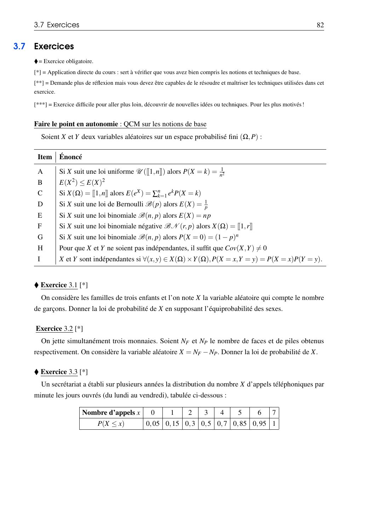{ loading=lazy .papier }](papier/td3/p082.jpg)
    
Énoncés : QCM, exercices 3.1 à 3.3 · Poly 2026-2027, p. 82

    [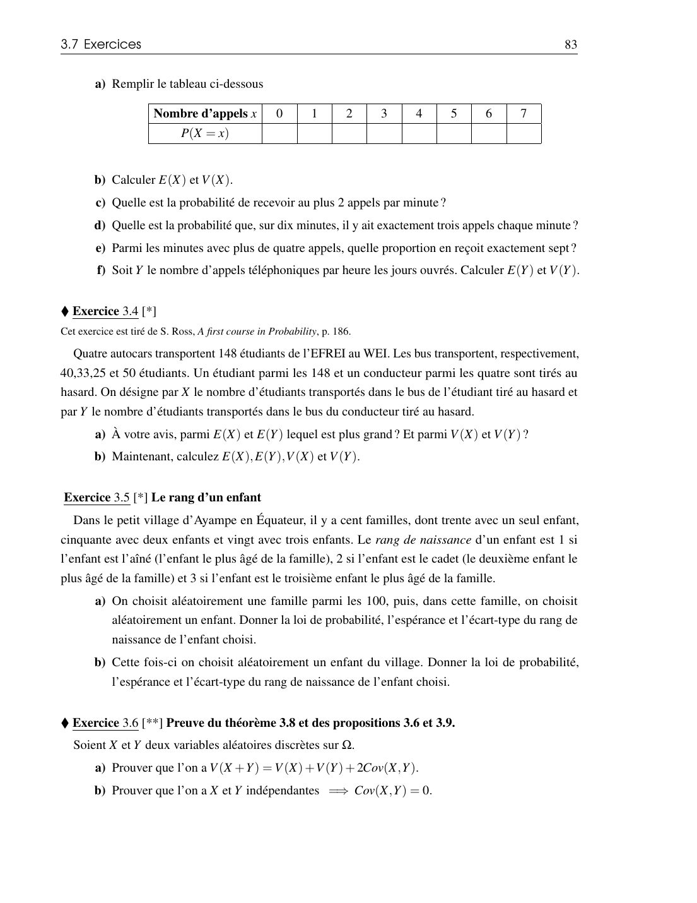{ loading=lazy .papier }](papier/td3/p083.jpg)
    
Énoncés : exercices 3.4 à 3.6 · Poly 2026-2027, p. 83

    [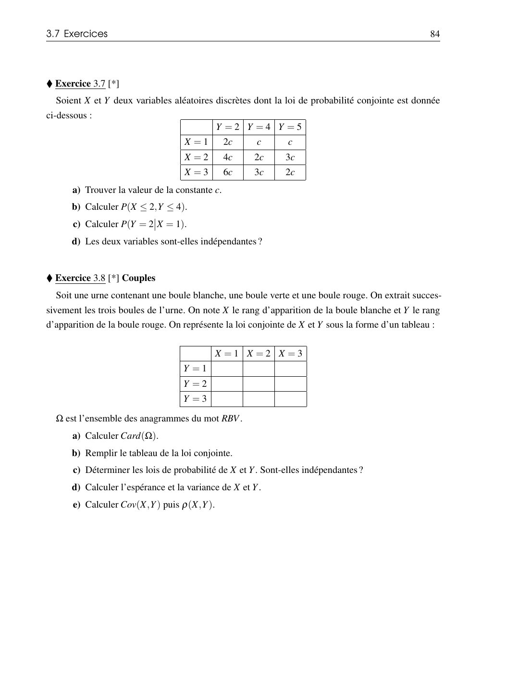{ loading=lazy .papier }](papier/td3/p084.jpg)
    
Énoncés : exercices 3.7 et 3.8 · Poly 2026-2027, p. 84

    [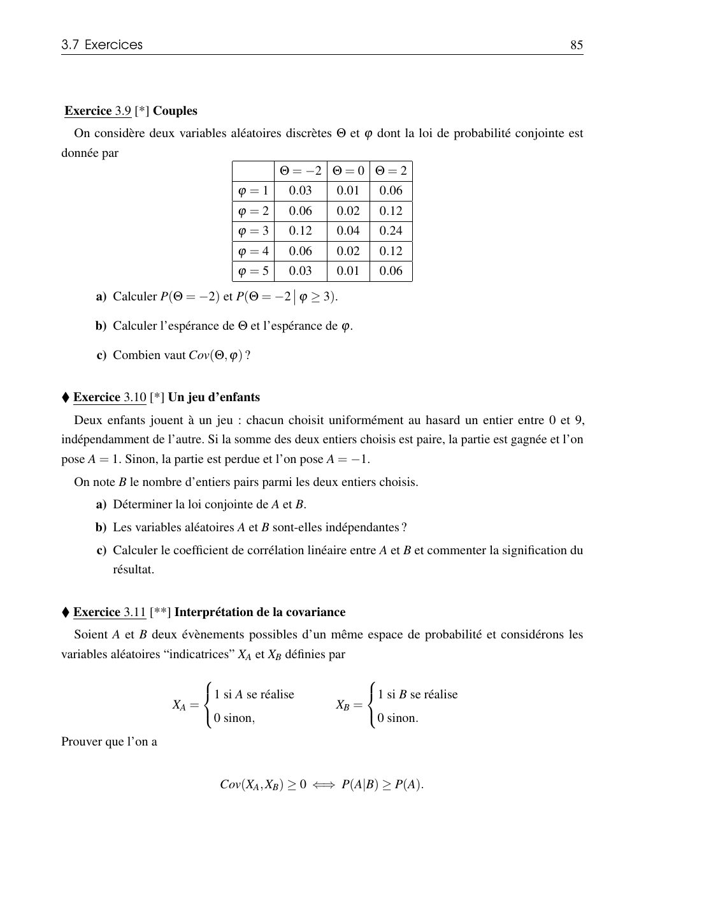{ loading=lazy .papier }](papier/td3/p085.jpg)
    
Énoncés : exercices 3.9 à 3.11 · Poly 2026-2027, p. 85

    [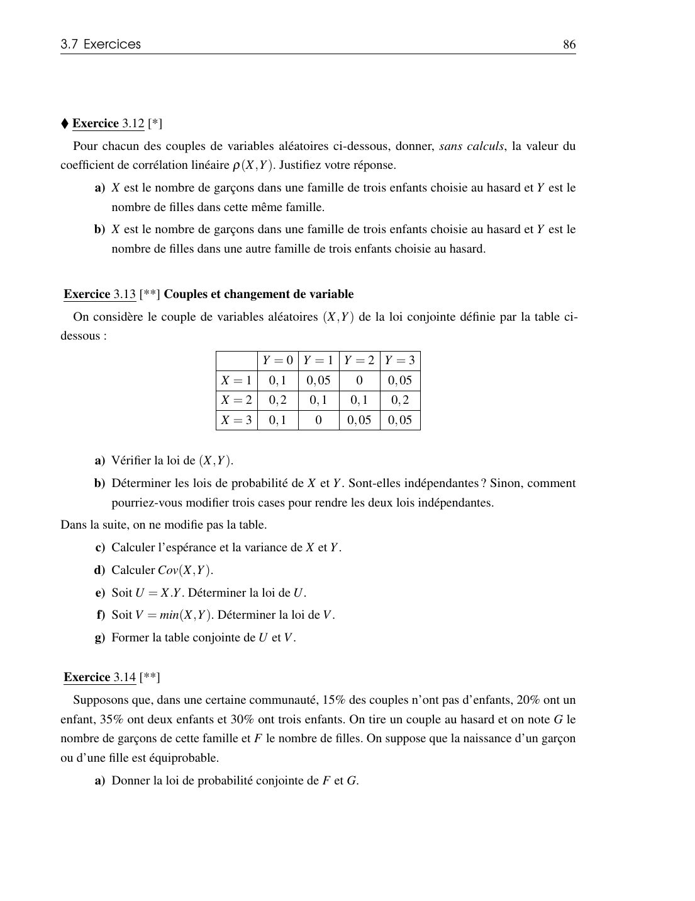{ loading=lazy .papier }](papier/td3/p086.jpg)
    
Énoncés : exercices 3.12 à 3.14 · Poly 2026-2027, p. 86

    [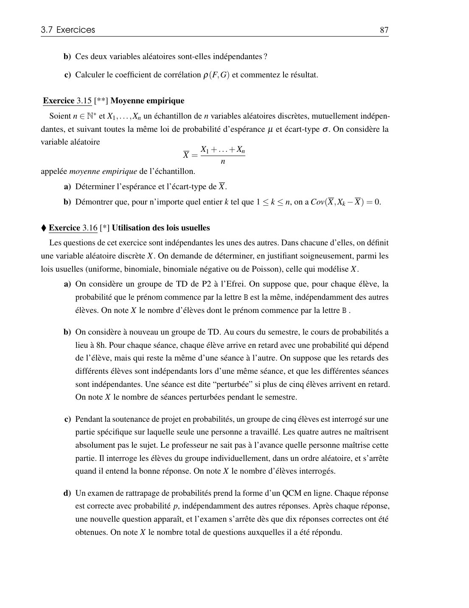{ loading=lazy .papier }](papier/td3/p087.jpg)
    
Énoncés : exercices 3.15 et 3.16 · Poly 2026-2027, p. 87

    [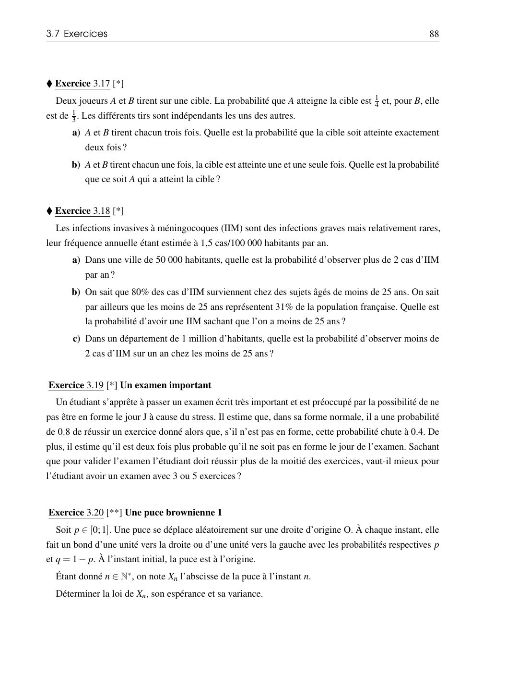{ loading=lazy .papier }](papier/td3/p088.jpg)
    
Énoncés : exercices 3.17 à 3.20 · Poly 2026-2027, p. 88

    [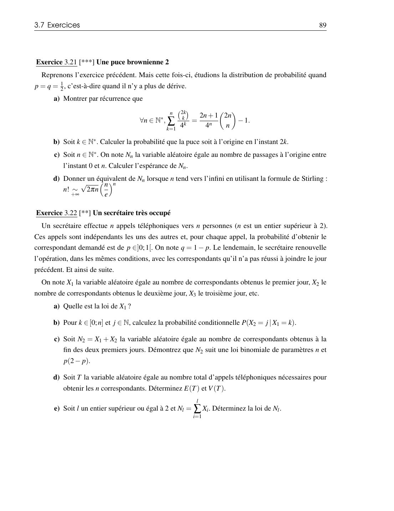{ loading=lazy .papier }](papier/td3/p089.jpg)
    
Énoncés : exercices 3.21 et 3.22 · Poly 2026-2027, p. 89

    [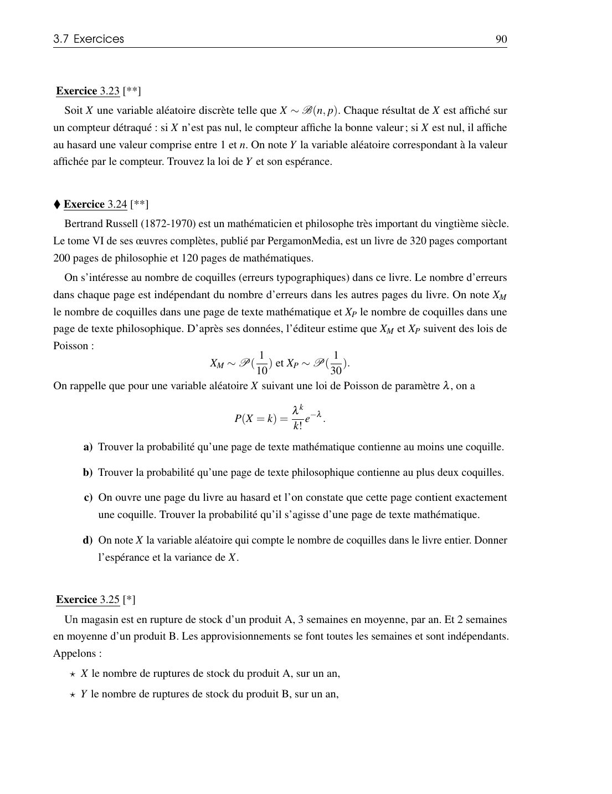{ loading=lazy .papier }](papier/td3/p090.jpg)
    
Énoncés : exercices 3.23 à 3.25 · Poly 2026-2027, p. 90

    [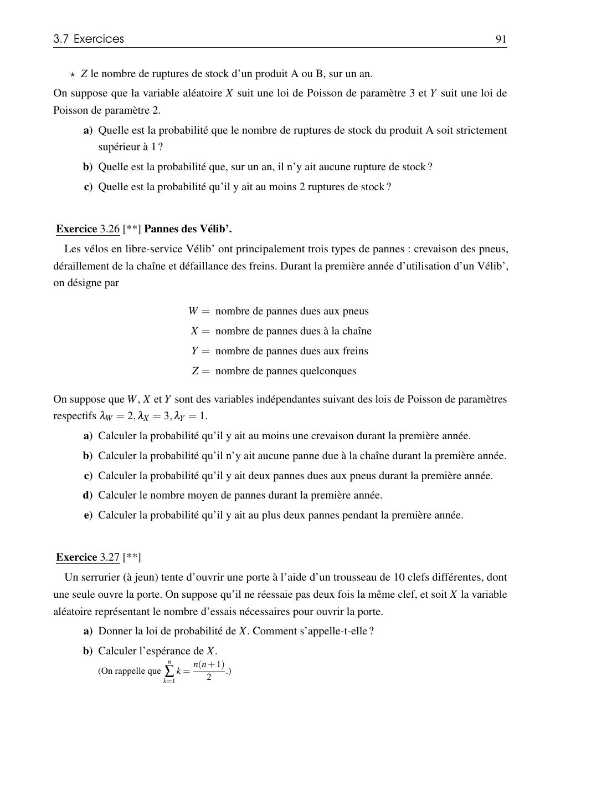{ loading=lazy .papier }](papier/td3/p091.jpg)
    
Énoncés : exercices 3.26 et 3.27 · Poly 2026-2027, p. 91

    [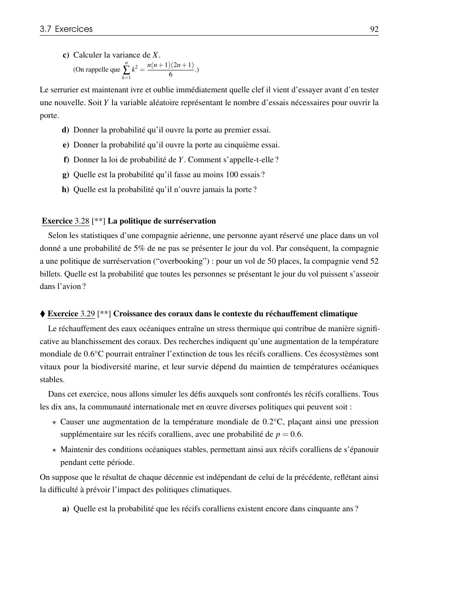{ loading=lazy .papier }](papier/td3/p092.jpg)
    
Énoncés : exercices 3.28 et 3.29 · Poly 2026-2027, p. 92

    [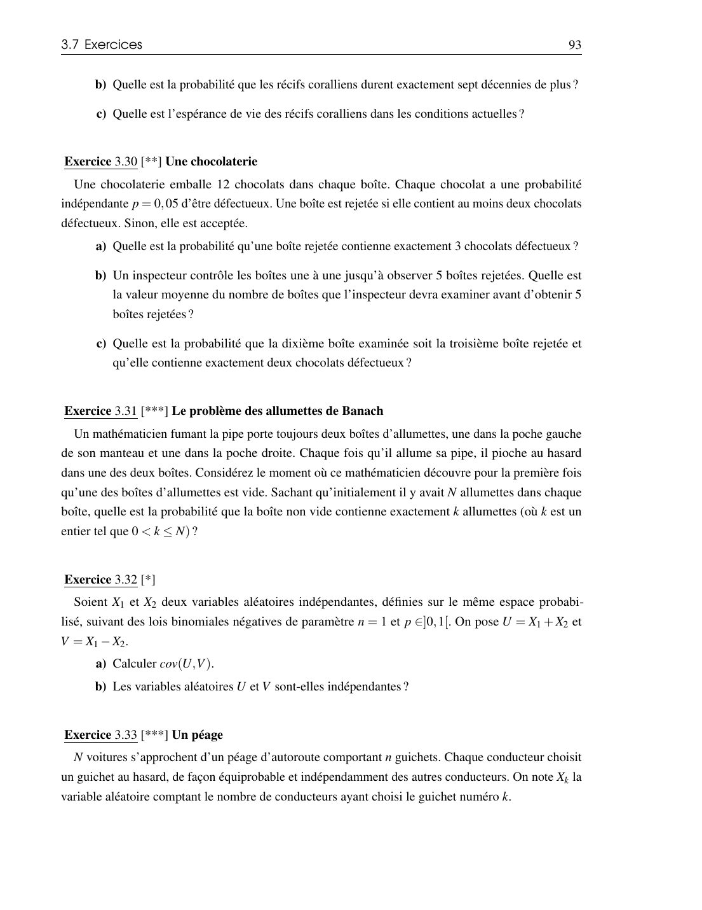{ loading=lazy .papier }](papier/td3/p093.jpg)
    
Énoncés : exercices 3.30 à 3.33 · Poly 2026-2027, p. 93

    [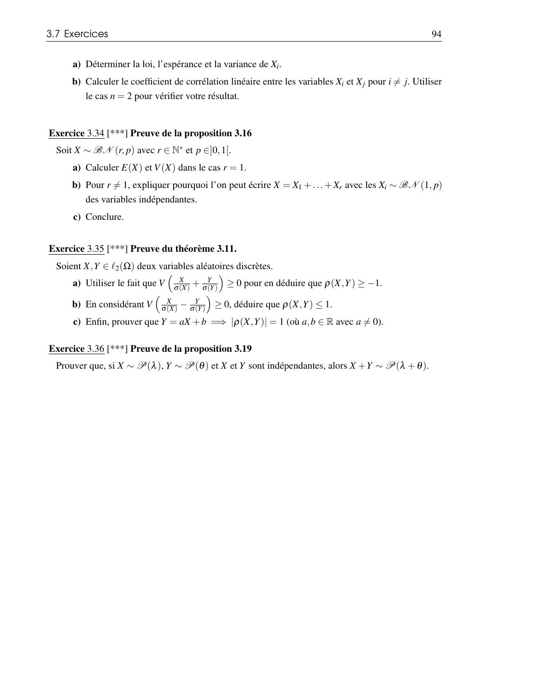{ loading=lazy .papier }](papier/td3/p094.jpg)
    
Énoncés : exercices 3.34 à 3.36 · Poly 2026-2027, p. 94

