# TD 4 — Variables aléatoires continues

=== "Version simplifiée"

    Exercices de la section 4.6 du poly 2026-2027 (numérotation du poly). Rappels : [chapitre 4](../cours/chapitre-4-va-continues.md).
    Chaque exercice a un **indice** puis une **correction** repliés : cherche d'abord !
    ♦ = exercice obligatoire. Le ♦ 4.1 (densité donnée par un graphique) est seulement dans la version papier.

    !!! methode "Les réflexes du chapitre"
        - **Trouver une constante** : on écrit $\int_{-\infty}^{+\infty} f(x)\,dx = 1$.
        - **Probabilité d'un intervalle** : $P(a \le X \le b) = \int_a^b f(x)\,dx = F(b) - F(a)$.
          Pour une variable continue, $P(X = a) = 0$, donc $<$ ou $\le$ ne change rien.
        - **Loi de $Y = g(X)$** : on calcule d'abord $F_Y(y) = P(g(X) \le y)$, on le réécrit
          comme un évènement sur $X$, puis on dérive : $f_Y = F_Y'$.
        - **Loi normale** : on centre-réduit, $Z = \frac{X - \mu}{\sigma} \sim \mathcal{N}(0, 1)$,
          puis on lit $\Phi$ dans la table, avec $\Phi(-z) = 1 - \Phi(z)$.

    ## QCM — Faire le point

    $Z \sim \mathcal{N}(0, 1)$ et $X$ continue quelconque.

    | | Énoncé |
    |:-:|--------|
    | A | $V(X) = E(X^2) - E(X)^2$ ne s'applique pas aux variables continues |
    | B | Si $f$ est la densité de $X$, alors $f$ est la dérivée de $F$ |
    | C | $E(X) = \sum_{-\infty}^{+\infty} x f(x)\,dx$ |
    | D | La loi $\mathcal{U}([a, b])$ a pour espérance $b - a$ |
    | E | La loi exponentielle est « sans mémoire » |
    | F | $P(Z = 0) = \frac{1}{\sqrt{2\pi}}$ |
    | G | $P(Z < 1{,}26)$ est proche de $0{,}896$ |
    | H | La valeur $a$ telle que $P(Z < a) = 0{,}367$ est plus petite que $-0{,}3$ |

    ??? success "Correction"
        **Vraies : B, E, G, H.**

        - A : faux, la formule de König-Huygens est la même pour les variables continues.
        - B : vrai (là où $f$ est continue) : $F(x) = \int_{-\infty}^x f(t)\,dt$, donc $F' = f$.
        - C : faux, c'est une **intégrale** : $E(X) = \int_{-\infty}^{+\infty} x f(x)\,dx$.
        - D : faux, $E(X) = \frac{a + b}{2}$ (le milieu de l'intervalle). $b - a$ est la longueur.
        - E : vrai, $P(T > t + s \mid T > t) = \frac{e^{-\lambda(t+s)}}{e^{-\lambda t}} = e^{-\lambda s} = P(T > s)$.
        - F : faux, $P(Z = 0) = 0$ comme pour toute variable continue. C'est la **densité** qui vaut $f(0) = \frac{1}{\sqrt{2\pi}} \approx 0{,}399$.
        - G : vrai, on lit $\Phi(1{,}26) \approx 0{,}8962$ dans la table.
        - H : vrai. $0{,}367 < 0{,}5$ donc $a < 0$. On cherche $-a$ avec $\Phi(-a) = 1 - 0{,}367 = 0{,}633$.
          La table donne $\Phi(0{,}34) \approx 0{,}633$, donc $-a \approx 0{,}34$ et $a \approx -0{,}34 < -0{,}3$.

    ## Exercice 4.2

    $f(x) = \frac{k}{x}$ si $x \in [1, 4]$, $0$ sinon.
    a) Trouver $k$. b) Calculer $P(1 \le X \le 2 \mid 1 \le X \le 3)$. c) Calculer $E(X)$ et $V(X)$.

    ??? tip "Indice"
        Une primitive de $\frac1x$ est $\ln x$. Pour b), définition de la probabilité conditionnelle :
        l'intersection des deux évènements est $\{1 \le X \le 2\}$.

    ??? success "Correction"
        a) La densité doit être d'intégrale 1 :

        $$
        \int_1^4 \frac{k}{x}\,dx = k\big[\ln x\big]_1^4 = k(\ln 4 - \ln 1) = k\ln 4 = 1
        \quad\Longrightarrow\quad k = \frac{1}{\ln 4} \approx 0{,}721.
        $$

        ($k > 0$, donc $f \ge 0$ : c'est bien une densité.)

        b) $\{1 \le X \le 2\} \subset \{1 \le X \le 3\}$, donc l'intersection vaut $\{1 \le X \le 2\}$ :

        $$
        P(1 \le X \le 2 \mid 1 \le X \le 3) = \frac{P(1 \le X \le 2)}{P(1 \le X \le 3)}
        = \frac{k[\ln x]_1^2}{k[\ln x]_1^3} = \frac{k\ln 2}{k\ln 3} = \frac{\ln 2}{\ln 3} \approx 0{,}631.
        $$

        c) **Espérance** : le $x$ simplifie le $\frac1x$.

        $$
        E(X) = \int_1^4 x \cdot \frac{k}{x}\,dx = \int_1^4 k\,dx = k(4 - 1) = \frac{3}{\ln 4} \approx 2{,}164.
        $$

        **Moment d'ordre 2** :

        $$
        E(X^2) = \int_1^4 x^2 \cdot \frac{k}{x}\,dx = k\int_1^4 x\,dx = k\left[\frac{x^2}{2}\right]_1^4 = k \cdot \frac{16 - 1}{2} = \frac{15}{2\ln 4} \approx 5{,}410.
        $$

        **Variance** (König-Huygens) :

        $$
        V(X) = E(X^2) - E(X)^2 = \frac{15}{2\ln 4} - \frac{9}{(\ln 4)^2} \approx 5{,}410 - 4{,}683 \approx 0{,}727.
        $$

    ## ♦ Exercice 4.3 — Loi de Cauchy

    $f(x) = \dfrac{c}{1 + x^2}$ pour tout $x \in \mathbb{R}$.
    a) Trouver $c$. b) Fonction de répartition $F_X$. c) $P(X \ge 2)$ et $P(-3 \le X \le 4)$.
    d) $P\left(\frac13 \le X^2 \le 1\right)$. e) $E(X)$ et $V(X)$.

    ??? tip "Indice"
        Une primitive de $\frac{1}{1 + x^2}$ est $\arctan x$, avec $\arctan x \to \pm\frac{\pi}{2}$ en $\pm\infty$.
        d) $X^2 \in [a, b]$ veut dire $|X| \in [\sqrt a, \sqrt b]$ : **deux** intervalles, un positif et un négatif.
        e) Regarde si l'intégrale de $|x| f(x)$ converge.

    ??? success "Correction"
        a) $\displaystyle\int_{-\infty}^{+\infty} \frac{c}{1 + x^2}\,dx = c\big[\arctan x\big]_{-\infty}^{+\infty} = c\left(\frac{\pi}{2} - \left(-\frac{\pi}{2}\right)\right) = c\pi = 1$,
        donc $c = \dfrac{1}{\pi}$.

        b) Pour tout $x \in \mathbb{R}$ :

        $$
        F_X(x) = \int_{-\infty}^x \frac{dt}{\pi(1 + t^2)} = \frac1\pi\left(\arctan x + \frac{\pi}{2}\right) = \frac12 + \frac{\arctan x}{\pi}.
        $$

        Vérification : $F_X(x) \to 0$ en $-\infty$, $\to 1$ en $+\infty$, et $F_X(0) = \frac12$ (la densité est paire).

        c) $P(X \ge 2) = 1 - F_X(2) = \dfrac12 - \dfrac{\arctan 2}{\pi} \approx 0{,}5 - \dfrac{1{,}1071}{\pi} \approx 0{,}148$.

        $P(-3 \le X \le 4) = F_X(4) - F_X(-3) = \dfrac{\arctan 4 - \arctan(-3)}{\pi} = \dfrac{\arctan 4 + \arctan 3}{\pi} \approx \dfrac{1{,}3258 + 1{,}2490}{\pi} \approx 0{,}820$.

        (On utilise que $\arctan$ est impaire : $\arctan(-3) = -\arctan 3$.)

        d) $\frac13 \le X^2 \le 1 \iff \frac{1}{\sqrt3} \le |X| \le 1 \iff X \in \left[-1, -\frac{1}{\sqrt3}\right] \cup \left[\frac{1}{\sqrt3}, 1\right]$.
        Les deux morceaux ont la même probabilité, car la densité est paire :

        $$
        P = 2\big(F_X(1) - F_X(\tfrac{1}{\sqrt3})\big) = \frac{2}{\pi}\left(\arctan 1 - \arctan\frac{1}{\sqrt3}\right) = \frac2\pi\left(\frac\pi4 - \frac\pi6\right) = \frac2\pi \cdot \frac{\pi}{12} = \frac16.
        $$

        e) $E(X)$ existe seulement si $\int |x| f(x)\,dx$ converge. Or

        $$
        \int_0^A \frac{x}{\pi(1 + x^2)}\,dx = \frac{1}{2\pi}\big[\ln(1 + x^2)\big]_0^A = \frac{\ln(1 + A^2)}{2\pi} \xrightarrow[A \to +\infty]{} +\infty.
        $$

        L'intégrale diverge : **$X$ n'a pas d'espérance**, donc **pas de variance** non plus.
        Attention au piège : « la densité est paire donc $E(X) = 0$ » est faux, il faut d'abord que l'intégrale converge.

    ## Exercice 4.5

    $f_Z(z) = \dfrac{3}{8z^4}$ si $|z| \ge 1$, $f_Z(z) = \dfrac38$ si $|z| < 1$.
    a) Vérifier que c'est une densité. b) $P(0 \le Z \le 4)$. c) $E(Z)$ et $V(Z)$. d) Fonction de répartition.

    ??? tip "Indice"
        Découpe toutes les intégrales aux points $-1$ et $1$. Une primitive de $\frac{1}{z^4} = z^{-4}$ est $-\frac{1}{3z^3}$.
        La densité est paire : utilise la symétrie pour diviser le travail par deux.

    ??? success "Correction"
        a) $f_Z \ge 0$. Au milieu : $\int_{-1}^1 \frac38\,dz = \frac38 \times 2 = \frac34$.
        À droite : $\int_1^{+\infty} \frac{3}{8z^4}\,dz = \frac38\left[-\frac{1}{3z^3}\right]_1^{+\infty} = \frac38\left(0 + \frac13\right) = \frac18$.
        À gauche, c'est pareil par symétrie ($\frac18$). Total : $\frac34 + \frac18 + \frac18 = 1$. ✓

        b) On coupe en $1$ :

        $$
        P(0 \le Z \le 4) = \int_0^1 \frac38\,dz + \int_1^4 \frac{3}{8z^4}\,dz = \frac38 + \left[-\frac{1}{8z^3}\right]_1^4
        = \frac38 + \left(-\frac{1}{512} + \frac18\right) = \frac{192 + 64 - 1}{512} = \frac{255}{512} \approx 0{,}498.
        $$

        c) **Espérance.** $\int_1^{+\infty} z \cdot \frac{3}{8z^4}\,dz = \frac38\int_1^{+\infty} z^{-3}\,dz$ converge, donc $E(Z)$ existe.
        $z f_Z(z)$ est impaire : les deux côtés se compensent et $E(Z) = 0$.

        **Variance** : $V(Z) = E(Z^2) - 0^2 = E(Z^2)$, et $z^2 f_Z(z)$ est paire :

        $$
        E(Z^2) = 2\left(\int_0^1 \frac38 z^2\,dz + \int_1^{+\infty} \frac{3}{8z^2}\,dz\right)
        = 2\left(\frac38 \cdot \frac13 + \frac38\left[-\frac1z\right]_1^{+\infty}\right) = 2\left(\frac18 + \frac38\right) = 1.
        $$

        Donc $V(Z) = 1$.

        d) Trois cas, selon où se trouve $z$ :

        - $z \le -1$ : $F_Z(z) = \int_{-\infty}^z \frac{3}{8t^4}\,dt = \left[-\frac{1}{8t^3}\right]_{-\infty}^z = -\frac{1}{8z^3}$ (positif car $z < 0$). En $z = -1$ : $\frac18$.
        - $-1 < z < 1$ : $F_Z(z) = \frac18 + \int_{-1}^z \frac38\,dt = \frac18 + \frac38(z + 1) = \frac12 + \frac{3z}{8}$.
        - $z \ge 1$ : $F_Z(z) = \frac78 + \int_1^z \frac{3}{8t^4}\,dt = \frac78 + \frac18 - \frac{1}{8z^3} = 1 - \frac{1}{8z^3}$.

        Vérification de la continuité : en $-1$, les deux formules donnent $\frac18$ ; en $1$, elles donnent $\frac78$.

    ## ♦ Exercice 4.6

    $f_Z(x) = \dfrac{a}{x^2}$ si $x < -2$ ou $x > 2$, $f_Z(x) = a$ si $-2 \le x \le 2$.
    a) Trouver $a$. b) $P(Z = 3 \mid Z < 5)$, $P(Z^2 \le 2)$, $P(Z \ge 1)$. c) Fonction de répartition.
    d) $W = \dfrac{Z}{1 + Z^2}$ : calculer $E(W)$.

    ??? tip "Indice"
        Même découpage qu'au 4.5, aux points $-2$ et $2$. Pour $P(Z = 3 \mid \dots)$, souviens-toi que $Z$ est continue.
        d) Montre que $|W| \le \frac12$ puis utilise la parité.

    ??? success "Correction"
        a) Au milieu : $\int_{-2}^2 a\,dx = 4a$. À droite : $\int_2^{+\infty} \frac{a}{x^2}\,dx = a\left[-\frac1x\right]_2^{+\infty} = \frac a2$, et pareil à gauche.
        Total : $4a + \frac a2 + \frac a2 = 5a = 1$, donc $a = \dfrac15$.

        b) Trois calculs :

        - $P(Z = 3 \mid Z < 5) = \dfrac{P(Z = 3)}{P(Z < 5)} = 0$, car $P(Z = 3) = 0$ pour une variable continue.
        - $Z^2 \le 2 \iff -\sqrt2 \le Z \le \sqrt2$, et $\sqrt2 < 2$, donc on reste dans la zone où $f = \frac15$ :
          $P(Z^2 \le 2) = \frac15 \times 2\sqrt2 = \frac{2\sqrt2}{5} \approx 0{,}566$.
        - $P(Z \ge 1) = \int_1^2 \frac15\,dx + \int_2^{+\infty} \frac{1}{5x^2}\,dx = \frac15 + \frac{1}{10} = \frac{3}{10}$.

        c) Trois cas :

        - $x < -2$ : $F_Z(x) = \int_{-\infty}^x \frac{dt}{5t^2} = \left[-\frac{1}{5t}\right]_{-\infty}^x = -\frac{1}{5x}$. En $-2$ : $\frac{1}{10}$.
        - $-2 \le x \le 2$ : $F_Z(x) = \frac{1}{10} + \frac{x + 2}{5}$. En $2$ : $\frac{1}{10} + \frac45 = \frac{9}{10}$.
        - $x > 2$ : $F_Z(x) = \frac{9}{10} + \int_2^x \frac{dt}{5t^2} = \frac{9}{10} + \frac{1}{10} - \frac{1}{5x} = 1 - \frac{1}{5x}$.

        d) Pour tout réel $z$, $(|z| - 1)^2 \ge 0$ donne $1 + z^2 \ge 2|z|$, donc $|W| = \frac{|z|}{1 + z^2} \le \frac12$.
        $W$ est bornée, donc $E(W) = \int \frac{x}{1 + x^2} f_Z(x)\,dx$ converge.
        La fonction intégrée est impaire ($\frac{x}{1 + x^2}$ est impaire et $f_Z$ est paire), donc $E(W) = 0$.

    ## ♦ Exercice 4.7

    $f(x) = k|x|$ si $-\frac12 \le x \le 1$, $0$ sinon. a) Trouver $k$. b) Densité de $Y = \sqrt{|X|}$.

    ??? tip "Indice"
        Coupe en $0$ pour enlever la valeur absolue. Pour b), écris $\{Y \le a\} = \{-a^2 \le X \le a^2\}$
        et compare $-a^2$ à $-\frac12$, la borne gauche du support.

    ??? success "Correction"
        a) $\displaystyle\int_{-1/2}^0 k(-x)\,dx + \int_0^1 kx\,dx = k\left[-\frac{x^2}{2}\right]_{-1/2}^0 + k\left[\frac{x^2}{2}\right]_0^1 = k\cdot\frac18 + k\cdot\frac12 = \frac{5k}{8} = 1$,
        donc $k = \dfrac85$.

        b) $|X| \in [0, 1]$, donc $Y \in [0, 1]$. Pour $a \in [0, 1]$ :
        $Y \le a \iff |X| \le a^2 \iff -a^2 \le X \le a^2$. Deux cas :

        - **Si $a^2 \le \frac12$** (c.-à-d. $a \le \frac{1}{\sqrt2}$) : l'intervalle $[-a^2, a^2]$ est entièrement dans le support.

        $$
        F_Y(a) = \int_{-a^2}^{a^2} k|x|\,dx = 2\int_0^{a^2} kx\,dx = 2k\cdot\frac{a^4}{2} = ka^4 = \frac85 a^4.
        $$

        - **Si $a^2 > \frac12$** : la densité est nulle avant $-\frac12$, donc on commence en $-\frac12$.

        $$
        F_Y(a) = \int_{-1/2}^0 k|x|\,dx + \int_0^{a^2} kx\,dx = \frac k8 + \frac{ka^4}{2} = \frac15 + \frac45 a^4.
        $$

        Vérification : en $a = \frac{1}{\sqrt2}$, les deux formules donnent $\frac25$ ; en $a = 1$, on trouve $\frac15 + \frac45 = 1$. ✓
        On dérive par rapport à $a$ :

        $$
        f_Y(y) = \begin{cases} \frac{32}{5}y^3 & 0 \le y \le \frac{1}{\sqrt2} \\[2pt] \frac{16}{5}y^3 & \frac{1}{\sqrt 2} < y \le 1 \\[2pt] 0 & \text{sinon.} \end{cases}
        $$

    ## ♦ Exercice 4.8

    $f(x) = kx^2$ si $x \in [-3, 6]$, $0$ sinon.
    a) Trouver $k$. b) Densités de $U = \frac13(12 - X)$ et de $V = X^2$. c) Espérance et variance de $X$, $U$ et $V$.

    ??? tip "Indice"
        b) $U$ : la fonction est décroissante, donc $U \le u \iff X \ge 12 - 3u$. Attention au sens de l'inégalité.
        $V$ : $\{X^2 \le v\} = \{-\sqrt v \le X \le \sqrt v\}$, à comparer avec $-3$ (donc deux cas, selon que $v \le 9$ ou non).
        c) Pour $U$, inutile de refaire une intégrale : $E(aX + b) = aE(X) + b$ et $V(aX + b) = a^2V(X)$. Pour $V$, $E(V) = E(X^2)$ et $E(V^2) = E(X^4)$.

    ??? success "Correction"
        a) $\displaystyle\int_{-3}^6 kx^2\,dx = k\left[\frac{x^3}{3}\right]_{-3}^6 = k\cdot\frac{216 - (-27)}{3} = k \cdot \frac{243}{3} = 81k = 1$, donc $k = \dfrac{1}{81}$.

        b) **Variable $U$.** Quand $X$ parcourt $[-3, 6]$, $U = 4 - \frac X3$ parcourt $[2, 5]$
        ($X = 6 \to U = 2$ et $X = -3 \to U = 5$). Pour $u \in [2, 5]$ :

        $$
        F_U(u) = P\left(4 - \tfrac X3 \le u\right) = P(X \ge 12 - 3u) = 1 - F_X(12 - 3u).
        $$

        On dérive avec la règle de la chaîne : la dérivée de $12 - 3u$ est $-3$, d'où

        $$
        f_U(u) = -f_X(12 - 3u) \times (-3) = 3 \cdot \frac{(12 - 3u)^2}{81} = \frac{9(4 - u)^2}{27} = \frac{(4 - u)^2}{3} \quad \text{sur } [2, 5], \quad 0 \text{ sinon.}
        $$

        Vérification : $\int_2^5 \frac{(4 - u)^2}{3}\,du = \left[-\frac{(4 - u)^3}{9}\right]_2^5 = \frac{1}{9} + \frac{8}{9} = 1$. ✓

        **Variable $V$.** $X \in [-3, 6]$, donc $V = X^2 \in [0, 36]$. Pour $v \ge 0$ : $V \le v \iff -\sqrt v \le X \le \sqrt v$.

        - Si $0 \le v \le 9$ : $-\sqrt v \ge -3$, l'intervalle est dans le support.
          $F_V(v) = \int_{-\sqrt v}^{\sqrt v} \frac{x^2}{81}\,dx = \frac{1}{81}\cdot\frac{2v^{3/2}}{3} = \frac{2v^{3/2}}{243}$,
          donc $f_V(v) = \frac{2}{243}\cdot\frac32 v^{1/2} = \dfrac{\sqrt v}{81}$.
        - Si $9 < v \le 36$ : $-\sqrt v < -3$, donc on part de $-3$.
          $F_V(v) = \int_{-3}^{\sqrt v} \frac{x^2}{81}\,dx = \frac{v^{3/2} + 27}{243}$,
          donc $f_V(v) = \dfrac{\sqrt v}{162}$.

        $$
        f_V(v) = \begin{cases} \frac{\sqrt v}{81} & 0 \le v \le 9 \\[2pt] \frac{\sqrt v}{162} & 9 < v \le 36 \\[2pt] 0 & \text{sinon.} \end{cases}
        $$

        Vérification : $\int_0^9 \frac{\sqrt v}{81}\,dv = \frac{1}{81}\cdot\frac23\cdot 27 = \frac29$ et $\int_9^{36} \frac{\sqrt v}{162}\,dv = \frac{1}{162}\cdot\frac23(216 - 27) = \frac79$ : total 1. ✓

        c) Tous les moments de $X$ se calculent avec la même formule : $E(X^n) = \frac{1}{81}\int_{-3}^6 x^{n+2}\,dx = \frac{6^{n+3} - (-3)^{n+3}}{81(n+3)}$.

        - $E(X) = \frac{6^4 - 3^4}{81 \times 4} = \frac{1296 - 81}{324} = \frac{1215}{324} = \frac{15}{4} = 3{,}75$.
        - $E(X^2) = \frac{6^5 + 3^5}{81 \times 5} = \frac{7776 + 243}{405} = \frac{8019}{405} = \frac{99}{5} = 19{,}8$.
        - $V(X) = 19{,}8 - 3{,}75^2 = 19{,}8 - 14{,}0625 = 5{,}7375 = \frac{459}{80}$.

        **Pour $U = 4 - \frac13 X$** (fonction affine de $X$) :
        $E(U) = 4 - \frac13 \times \frac{15}{4} = 4 - \frac54 = \frac{11}{4} = 2{,}75$ et
        $V(U) = \left(-\frac13\right)^2 V(X) = \frac{459}{720} = \frac{51}{80} = 0{,}6375$.

        **Pour $V = X^2$** :
        $E(V) = E(X^2) = \frac{99}{5} = 19{,}8$. Ensuite $E(V^2) = E(X^4) = \frac{6^7 + 3^7}{81 \times 7} = \frac{279\,936 + 2187}{567} = \frac{3483}{7} \approx 497{,}57$, donc
        $V(V) = \frac{3483}{7} - 19{,}8^2 = \frac{18\,468}{175} \approx 105{,}5$.

    ## ♦ Exercice 4.14 — Produit de deux uniformes

    $X$, $Y$ indépendantes de loi $\mathcal{U}([0, 1])$, $Z = XY$. a) Densité de $Z$. b) Vérifier avec $E(Z)$ calculée de deux façons.

    ??? tip "Indice"
        Le couple $(X, Y)$ est uniforme sur le carré $[0, 1]^2$ (densité 1). $P(Z \le z)$ est donc **l'aire** de la zone
        $\{xy \le z\}$ du carré. Coupe selon $x \le z$ (alors $xy \le z$ toujours) ou $x > z$ (alors il faut $y \le \frac zx$).

    ??? success "Correction"
        a) $Z \in [0, 1]$. Pour $z \in ]0, 1[$, la densité du couple vaut $1$ sur le carré, donc :

        $$
        F_Z(z) = \iint_{xy \le z} 1\,dx\,dy = \int_0^z \underbrace{1}_{y \in [0,1]}\,dx + \int_z^1 \underbrace{\frac zx}_{y \le z/x}\,dx = z + z\big[\ln x\big]_z^1 = z - z\ln z.
        $$

        On dérive (produit $z\ln z$, dont la dérivée est $\ln z + 1$) : $f_Z(z) = 1 - (\ln z + 1) = -\ln z$ sur $]0, 1]$, et $0$ sinon.
        ($-\ln z \ge 0$ sur $]0, 1]$, c'est bien positif.)

        b) **Avec l'indépendance** : $E(Z) = E(X)E(Y) = \frac12 \times \frac12 = \frac14$.

        **Avec la densité** (intégration par parties, $u = \ln z$, $v' = z$) :

        $$
        E(Z) = \int_0^1 -z\ln z\,dz = -\left(\left[\frac{z^2}{2}\ln z\right]_0^1 - \int_0^1 \frac{z^2}{2}\cdot\frac1z\,dz\right) = -\left(0 - \frac14\right) = \frac14,
        $$

        en utilisant $z^2\ln z \to 0$ quand $z \to 0$. Les deux résultats coïncident. ✓

    ## ♦ Exercice 4.15 — Somme de variables indépendantes (convolution)

    $X$, $Y$ indépendantes de densités $f_X$, $f_Y$, $Z = X + Y$.
    a) Exprimer $F_Z$ en fonction de $f_X$ et $f_Y$. b) En déduire $f_Z(z) = \int_{-\infty}^{+\infty} f_X(x) f_Y(z - x)\,dx$.
    c) Densité de $X + Y$ si $X, Y \sim \mathcal{U}([0, 1])$. d) Même question si $X \sim \mathcal{U}([0, 1])$ et $Y \sim \mathcal{U}([0, 2])$.

    ??? tip "Indice"
        Par indépendance, la densité du couple est $f_X(x)f_Y(y)$. Intègre d'abord en $y$ sur $\{y \le z - x\}$.
        c) et d) : $f_Y(z - x) \ne 0$ seulement si $z - x$ est dans le support de $Y$. Trouve, pour chaque $z$,
        l'intervalle des $x$ qui conviennent : l'intégrale est la longueur de cet intervalle fois la hauteur.

    ??? success "Correction"
        a) Par indépendance, $(X, Y)$ a pour densité $f_X(x)f_Y(y)$. Donc

        $$
        F_Z(z) = P(X + Y \le z) = \int_{-\infty}^{+\infty} f_X(x)\left(\int_{-\infty}^{z - x} f_Y(y)\,dy\right)dx = \int_{-\infty}^{+\infty} f_X(x)\,F_Y(z - x)\,dx.
        $$

        b) On dérive par rapport à $z$ sous l'intégrale ($x$ est fixé dans l'intégrale, et $\frac{d}{dz}F_Y(z - x) = f_Y(z - x)$) :
        $f_Z(z) = \int_{-\infty}^{+\infty} f_X(x)\,f_Y(z - x)\,dx = (f_X * f_Y)(z)$.

        c) $f_X(x) = 1$ si $x \in [0, 1]$ et $f_Y(z - x) = 1$ si $0 \le z - x \le 1$, c.-à-d. $x \in [z - 1, z]$.
        Donc $f_Z(z)$ = longueur de $[0, 1] \cap [z - 1, z]$ :

        - $0 \le z \le 1$ : l'intersection est $[0, z]$, de longueur $z$ ;
        - $1 \le z \le 2$ : l'intersection est $[z - 1, 1]$, de longueur $2 - z$ ;
        - sinon : $0$.

        On obtient une densité **triangulaire** sur $[0, 2]$, avec un sommet de hauteur 1 en $z = 1$ (aire $\frac12 \times 2 \times 1 = 1$ ✓).

        d) Cette fois $f_Y = \frac12$ sur $[0, 2]$, donc $f_Z(z) = \frac12 \times$ longueur de $[0, 1] \cap [z - 2, z]$ :

        - $0 \le z \le 1$ : intersection $[0, z]$, donc $f_Z(z) = \frac z2$ ;
        - $1 \le z \le 2$ : intersection $[0, 1]$ entière, donc $f_Z(z) = \frac12$ ;
        - $2 \le z \le 3$ : intersection $[z - 2, 1]$, donc $f_Z(z) = \frac{3 - z}{2}$ ;
        - sinon : $0$.

        La densité est un **trapèze** (aire $\frac14 + \frac12 + \frac14 = 1$ ✓).

    ## ♦ Exercice 4.17 — Un fait surprenant

    a) $X \sim \mathcal{U}([0, 1])$ : densité de $Y = \sqrt X$. b) $X_1$, $X_2$ indépendantes de loi $\mathcal{U}([0, 1])$ : densité de
    $Z = \max(X_1, X_2)$. c) Conclusion ?

    ??? tip "Indice"
        Pour un maximum : $\max(X_1, X_2) \le z \iff X_1 \le z$ **et** $X_2 \le z$. Puis l'indépendance transforme le « et » en produit.

    ??? success "Correction"
        Rappel : si $X \sim \mathcal{U}([0, 1])$, $P(X \le t) = t$ pour $t \in [0, 1]$.

        a) $Y \in [0, 1]$. Pour $y \in [0, 1]$, la racine carrée est croissante, donc
        $F_Y(y) = P(\sqrt X \le y) = P(X \le y^2) = y^2$. En dérivant : $f_Y(y) = 2y$ sur $[0, 1]$, $0$ sinon.

        b) Pour $z \in [0, 1]$ :

        $$
        F_Z(z) = P(X_1 \le z \text{ et } X_2 \le z) = P(X_1 \le z)\,P(X_2 \le z) = z \times z = z^2,
        $$

        donc $f_Z(z) = 2z$ sur $[0, 1]$.

        c) $Y$ et $Z$ ont la **même densité** : les deux manipulations sont équivalentes du point de vue des probabilités.

    ## ♦ Exercice 4.19 — Deux guichets (min et max d'exponentielles)

    $T_1$, $T_2$ indépendantes, exponentielles de moyennes 5 min et 8 min, donc $T_1 \sim \mathcal{E}(\frac15)$ et $T_2 \sim \mathcal{E}(\frac18)$.
    a) $Z = \min(T_1, T_2)$ : exprimer $F_Z$ avec $F_1$ et $F_2$. b) Montrer que $Z \sim \mathcal{E}(\frac{13}{40})$.
    c) Trouver $\delta T$ (temps moyen de sortie du premier client) et $\Delta T$ (du dernier).

    ??? tip "Indice"
        Pour un minimum, passe par le complémentaire : $\min > t \iff T_1 > t$ **et** $T_2 > t$.
        Pour $\Delta T$ : $T_1 + T_2 = \min + \max$ et linéarité de l'espérance.

    ??? success "Correction"
        Rappel : si $T \sim \mathcal{E}(\lambda)$, $P(T > t) = e^{-\lambda t}$ pour $t \ge 0$ et $E(T) = \frac1\lambda$.

        a) $P(Z > t) = P(T_1 > t,\ T_2 > t) = P(T_1 > t)P(T_2 > t)$ par indépendance, donc
        $1 - F_Z(t) = (1 - F_1(t))(1 - F_2(t))$, soit $F_Z = 1 - (1 - F_1)(1 - F_2)$.

        b) Pour $t \ge 0$ : $P(Z > t) = e^{-t/5}\,e^{-t/8} = e^{-\left(\frac15 + \frac18\right)t} = e^{-\frac{13}{40}t}$,
        car $\frac15 + \frac18 = \frac{8 + 5}{40}$. C'est la fonction de survie de $\mathcal{E}\left(\frac{13}{40}\right)$.

        c) $\delta T = E(Z) = \dfrac{1}{13/40} = \dfrac{40}{13} \approx 3{,}08$ min.

        Comme $T_1 + T_2 = \min(T_1, T_2) + \max(T_1, T_2)$, par linéarité :
        $\Delta T = E(\max) = E(T_1) + E(T_2) - E(\min) = 5 + 8 - \frac{40}{13} = \frac{129}{13} \approx 9{,}92$ min.

    ## Exercice 4.21 — Exponentielle et uniforme

    $X \sim \mathcal{U}([0, 1])$. Montrer que $Y = -\ln X$ suit une loi exponentielle.

    ??? tip "Indice"
        $-\ln$ est **décroissante** : en isolant $X$, l'inégalité change de sens.

    ??? success "Correction"
        $X \in ]0, 1]$, donc $Y = -\ln X \in [0, +\infty[$. Pour $y \ge 0$ :

        $$
        P(Y \le y) = P(-\ln X \le y) = P(\ln X \ge -y) = P(X \ge e^{-y}) = 1 - e^{-y},
        $$

        en utilisant que $\exp$ est croissante, puis $P(X \ge t) = 1 - t$ avec $t = e^{-y} \in ]0, 1]$.
        C'est la fonction de répartition de $\mathcal{E}(1)$ : **$Y \sim \mathcal{E}(1)$**.

    ## ♦ Exercice 4.22 — Une conversation WhatsApp

    $X \sim \mathcal{E}(\frac{1}{15})$ et $Y \sim \mathcal{E}(\frac{1}{30})$ indépendantes (temps de réponse en minutes).
    a) Densité conjointe de $(X, Y)$. b) Probabilité que la première personne réponde avant la seconde.
    c) Probabilité que les deux réponses arrivent à moins de 5 minutes d'intervalle.

    ??? tip "Indice"
        b) $P(X < Y) = \int_0^{+\infty} f_X(x)\,P(Y > x)\,dx$ (on fixe $x$, puis on intègre).
        c) Complémentaire : $|X - Y| \ge 5 \iff Y \ge X + 5$ **ou** $X \ge Y + 5$ (incompatibles). Même méthode qu'en b).

    ??? success "Correction"
        Notons $\lambda = \frac{1}{15}$ et $\mu = \frac{1}{30}$.

        a) Par indépendance, $f(x, y) = f_X(x)f_Y(y) = \frac{1}{15}e^{-x/15} \cdot \frac{1}{30}e^{-y/30} = \dfrac{1}{450}\,e^{-\frac{x}{15} - \frac{y}{30}}$ si $x, y \ge 0$, et $0$ sinon.

        b) On fixe $X = x$ et on intègre :

        $$
        P(X < Y) = \int_0^{+\infty} \lambda e^{-\lambda x}\,\underbrace{e^{-\mu x}}_{P(Y > x)}\,dx = \lambda\int_0^{+\infty} e^{-(\lambda + \mu)x}\,dx = \frac{\lambda}{\lambda + \mu} = \frac{1/15}{1/15 + 1/30} = \frac{2/30}{3/30} = \frac23.
        $$

        c) Même méthode :

        $$
        P(Y \ge X + 5) = \int_0^{+\infty} \lambda e^{-\lambda x}\,e^{-\mu(x + 5)}\,dx = e^{-5\mu}\,\frac{\lambda}{\lambda + \mu} = \frac23\,e^{-1/6} \approx 0{,}5643,
        $$

        $$
        P(X \ge Y + 5) = \int_0^{+\infty} \mu e^{-\mu y}\,e^{-\lambda(y + 5)}\,dy = e^{-5\lambda}\,\frac{\mu}{\lambda + \mu} = \frac13\,e^{-1/3} \approx 0{,}2388.
        $$

        Donc $P(|X - Y| < 5) = 1 - \frac23 e^{-1/6} - \frac13 e^{-1/3} \approx 1 - 0{,}5643 - 0{,}2388 \approx 0{,}197$.

    ## ♦ Exercice 4.24 — Loi normale

    $X \sim \mathcal{N}(\mu = 10, \sigma = 2)$. a) $P(X \le 15)$. b) $P(|X| \le 8)$. c) $P(8 \le X \le 15)$.

    ??? tip "Indice"
        On centre-réduit : $Z = \frac{X - 10}{2} \sim \mathcal{N}(0, 1)$. Pour b), $|X| \le 8 \iff -8 \le X \le 8$.

    ??? success "Correction"
        a) $P(X \le 15) = P\left(Z \le \frac{15 - 10}{2}\right) = \Phi(2{,}5) \approx 0{,}9938$.

        b) $P(-8 \le X \le 8) = P\left(\frac{-8 - 10}{2} \le Z \le \frac{8 - 10}{2}\right) = \Phi(-1) - \Phi(-9)$.
        $\Phi(-9) \approx 0$ (on est à 9 écarts-types), et $\Phi(-1) = 1 - \Phi(1) = 1 - 0{,}8413 = 0{,}1587$.
        Donc $P(|X| \le 8) \approx 0{,}1587$.

        c) $P(8 \le X \le 15) = \Phi(2{,}5) - \Phi(-1) = 0{,}9938 - 0{,}1587 = 0{,}8351$.

    ## ♦ Exercice 4.26 — Score de Maddrey

    Atteinte sévère : $X \sim \mathcal{N}(54, 14^2)$ ; atteinte minime : $Y \sim \mathcal{N}(20, 6^2)$.
    a) $P(X < 68)$. b) $P(Y < 8)$. c) $s$ tel que $P(X > s) = 0{,}95$. d) $s$ tel que $P(Y < s) = 0{,}90$.
    On prend maintenant $s = 32$ : e) $P(X < s)$ ; f) $P(Y > s)$.
    g) Avec $P(\text{sévère}) = 0{,}3$, nombre d'erreurs de diagnostic sur 100 patients ?

    ??? tip "Indice"
        Attention : le 2e paramètre est la **variance**, donc $\sigma_X = 14$ et $\sigma_Y = 6$.
        c) et d) : on lit la table **à l'envers** ($\Phi(1{,}645) = 0{,}95$ et $\Phi(1{,}2816) = 0{,}90$).
        g) Il y a erreur si un malade sévère a un score $< s$, ou si un malade minime a un score $> s$.

    ??? success "Correction"
        a) $P(X < 68) = \Phi\left(\frac{68 - 54}{14}\right) = \Phi(1) \approx 0{,}8413$.

        b) $P(Y < 8) = \Phi\left(\frac{8 - 20}{6}\right) = \Phi(-2) = 1 - \Phi(2) = 1 - 0{,}9772 = 0{,}0228$.

        c) $P(X > s) = 1 - \Phi\left(\frac{s - 54}{14}\right) = \Phi\left(\frac{54 - s}{14}\right)$. On veut $\Phi\left(\frac{54 - s}{14}\right) = 0{,}95$,
        donc $\frac{54 - s}{14} = 1{,}645$, soit $s = 54 - 14 \times 1{,}645 = 54 - 23{,}03 \approx 30{,}97$.

        d) $\Phi\left(\frac{s - 20}{6}\right) = 0{,}90 \Rightarrow \frac{s - 20}{6} = 1{,}2816 \Rightarrow s = 20 + 6 \times 1{,}2816 \approx 27{,}69$.

        e) $P(X < 32) = \Phi\left(\frac{32 - 54}{14}\right) = \Phi(-1{,}57) = 1 - \Phi(1{,}57) = 1 - 0{,}9418 = 0{,}0582$.

        f) $P(Y > 32) = 1 - \Phi\left(\frac{32 - 20}{6}\right) = 1 - \Phi(2) = 0{,}0228$.

        g) Formule des probabilités totales avec le SCE $\{\text{sévère}, \text{minime}\}$ :

        $$
        P(\text{erreur}) = 0{,}3 \times \underbrace{0{,}0582}_{\text{sévère non détecté}} + 0{,}7 \times \underbrace{0{,}0228}_{\text{minime classé sévère}} = 0{,}01746 + 0{,}01596 \approx 0{,}0334.
        $$

        Sur 100 patients, on s'attend à environ $100 \times 0{,}0334 \approx 3{,}3$ erreurs, soit 3 environ.

    ## ♦ Exercice 4.27 — Validerez-vous ce module ?

    Note finale $N = 0{,}5X + 0{,}2Y + 0{,}3Z$ (DE, CE, projet), avec $X$, $Y$, $Z$ indépendantes,
    $X \sim \mathcal{N}(7, 4)$, $Y \sim \mathcal{N}(10, 9)$, $Z \sim \mathcal{N}(13, 1)$ (2e paramètre = variance). Promotion de 450 étudiants.
    a) Nombre d'étudiants avec $N > 10$. b) Nombre avec $N < 6$. c) Moyenne $m$ du DE pour que la moitié valide.

    ??? tip "Indice"
        Une combinaison linéaire de normales **indépendantes** est normale :
        $E(aX + bY + cZ) = aE(X) + bE(Y) + cE(Z)$ et $V(aX + bY + cZ) = a^2V(X) + b^2V(Y) + c^2V(Z)$.
        c) Pour une loi normale, « la moitié au-dessus de 10 » veut dire que la moyenne vaut 10.

    ??? success "Correction"
        **Loi de $N$.** $N$ est normale, avec

        $$
        E(N) = 0{,}5 \times 7 + 0{,}2 \times 10 + 0{,}3 \times 13 = 3{,}5 + 2 + 3{,}9 = 9{,}4,
        $$

        $$
        V(N) = 0{,}5^2 \times 4 + 0{,}2^2 \times 9 + 0{,}3^2 \times 1 = 1 + 0{,}36 + 0{,}09 = 1{,}45, \qquad \sigma_N = \sqrt{1{,}45} \approx 1{,}204.
        $$

        a) $P(N > 10) = 1 - \Phi\left(\frac{10 - 9{,}4}{1{,}204}\right) = 1 - \Phi(0{,}50) \approx 1 - 0{,}6915 = 0{,}3085$.
        Nombre d'étudiants : $450 \times 0{,}3085 \approx 139$.

        b) $P(N < 6) = \Phi\left(\frac{6 - 9{,}4}{1{,}204}\right) = \Phi(-2{,}82) = 1 - \Phi(2{,}82) \approx 1 - 0{,}9976 = 0{,}0024$.
        Nombre d'étudiants : $450 \times 0{,}0024 \approx 1$.

        c) Avec $E(X) = m$, la variance ne change pas et $E(N) = 0{,}5m + 2 + 3{,}9 = 0{,}5m + 5{,}9$.
        La loi normale est symétrique autour de sa moyenne, donc $P(N > 10) = \frac12 \iff E(N) = 10$ :
        $0{,}5m + 5{,}9 = 10$, d'où $m = 8{,}2$.

    ## Exercice 4.28 — Retraits au distributeur

    $X \sim \mathcal{N}(650, 150^2)$ : total des retraits mensuels d'un client.
    a) Proportion de clients retirant plus de 750 €. b) Famille de 4 personnes indépendantes : probabilité que le total dépasse 3500 €.
    c) Valeur de $n$ pour que la moyenne $M$ de $n$ clients ne s'écarte pas de $E(M)$ de plus de $\frac{E(M)}{10}$ avec probabilité $> 95\ \%$.
    d) Parmi 100 clients, loi de $Y$ = nombre de clients retirant plus de 750 €, et probabilité que 30 % d'entre eux le fassent.
    e) $Z$ = nombre de clients parmi 100 retirant plus de 900 € : probabilité que $Z \ge 1$, exacte puis approchée.

    ??? tip "Indice"
        b) Somme de 4 normales indépendantes : les moyennes et les **variances** s'additionnent (pas les écarts-types !).
        c) $M \sim \mathcal{N}\left(650, \frac{150^2}{n}\right)$. d) et e) : chaque client « réussit » avec une probabilité calculée au a) : loi binomiale.

    ??? success "Correction"
        a) $P(X > 750) = 1 - \Phi\left(\frac{750 - 650}{150}\right) = 1 - \Phi(0{,}67) \approx 1 - 0{,}7486 = 0{,}2514$, soit environ **25 %**.

        b) $S = X_1 + X_2 + X_3 + X_4$ avec $E(S) = 4 \times 650 = 2600$ et $V(S) = 4 \times 150^2 = 90\,000$, donc $\sigma_S = 300$.
        (Erreur classique : $\sigma_S = 4 \times 150 = 600$, c'est faux.)
        $P(S > 3500) = 1 - \Phi\left(\frac{3500 - 2600}{300}\right) = 1 - \Phi(3) \approx 1 - 0{,}99865 = 0{,}00135$.

        c) $E(M) = 650$ et $\sigma_M = \frac{150}{\sqrt n}$. On veut $P(|M - 650| \le 65) \ge 0{,}95$.
        Or $P(|M - 650| \le 65) = 2\Phi\left(\frac{65\sqrt n}{150}\right) - 1$, et $2\Phi(t) - 1 \ge 0{,}95 \iff \Phi(t) \ge 0{,}975 \iff t \ge 1{,}96$. Donc

        $$
        \frac{65\sqrt n}{150} \ge 1{,}96 \iff \sqrt n \ge \frac{1{,}96 \times 150}{65} \approx 4{,}52 \iff n \ge 20{,}46.
        $$

        Il faut **au moins 21 clients**.

        d) Les clients sont indépendants, et chacun retire plus de 750 € avec $p = P(X > 750) \approx 0{,}2525$ (valeur non arrondie du a)) : $Y \sim \mathcal{B}(100;\ 0{,}2525)$.

        $$
        P(Y = 30) = \binom{100}{30}\,0{,}2525^{30}\,0{,}7475^{70} \approx 0{,}049.
        $$

        e) $p' = P(X > 900) = 1 - \Phi\left(\frac{250}{150}\right) = 1 - \Phi(1{,}67) \approx 0{,}0478$, et $Z \sim \mathcal{B}(100;\ p')$.

        - **Exact** : $P(Z \ge 1) = 1 - P(Z = 0) = 1 - (1 - 0{,}0478)^{100} \approx 1 - 0{,}0075 = 0{,}9925$.
        - **Approché** : $n = 100$ grand et $p'$ petit, donc on approche par une loi de Poisson de paramètre $\lambda = np' \approx 4{,}78$ :
          $P(Z \ge 1) \approx 1 - e^{-4{,}78} \approx 0{,}9916$.
        - Marge d'erreur : $|0{,}9925 - 0{,}9916| \approx 0{,}001$, soit environ 0,1 point. L'approximation est très bonne.

    ## Exercices pour aller plus loin

    Non rédigés ici : 4.4, 4.9 à 4.13, 4.16 (aiguille de Buffon), 4.18 (preuve « sans mémoire »), 4.20, 4.23, 4.25, 4.29 à 4.31.
    Leurs énoncés sont dans la version papier.

=== "Version papier"

    Les énoncés de la section 4.6 « Exercices » du polycopié 2026-2027 (pages 122 à 133). ♦ = exercice obligatoire. Le cours est dans la [version papier du chapitre 4](../cours/chapitre-4-va-continues.md).

    [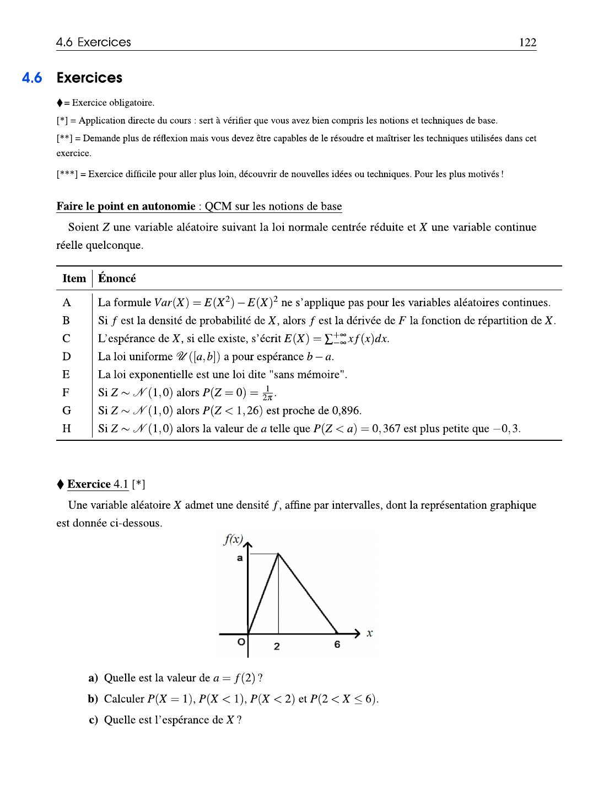{ loading=lazy .papier }](papier/td4/p122.jpg)
    
Énoncés : QCM, exercice 4.1 · Poly 2026-2027, p. 122

    [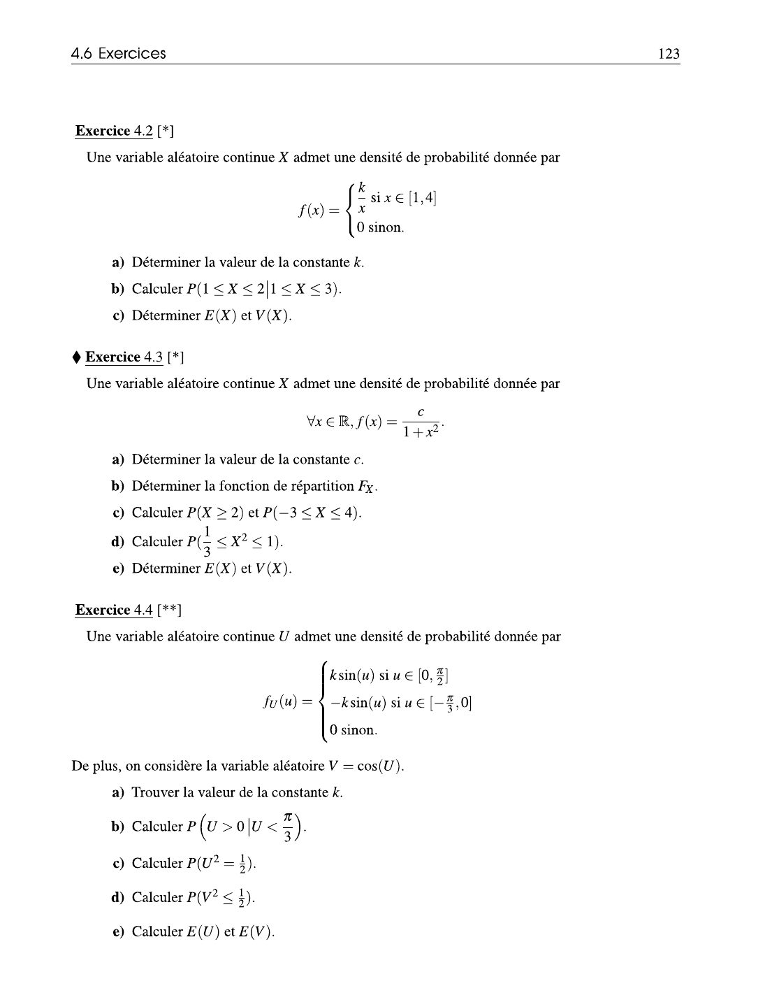{ loading=lazy .papier }](papier/td4/p123.jpg)
    
Énoncés : exercices 4.2 à 4.4 · Poly 2026-2027, p. 123

    [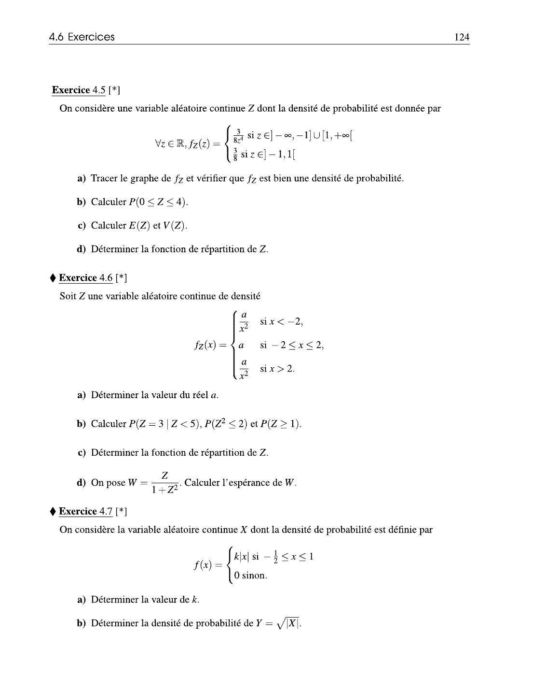{ loading=lazy .papier }](papier/td4/p124.jpg)
    
Énoncés : exercices 4.5 à 4.7 · Poly 2026-2027, p. 124

    [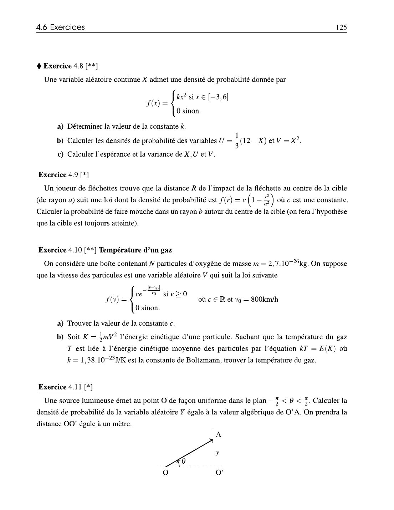{ loading=lazy .papier }](papier/td4/p125.jpg)
    
Énoncés : exercices 4.8 à 4.11 · Poly 2026-2027, p. 125

    [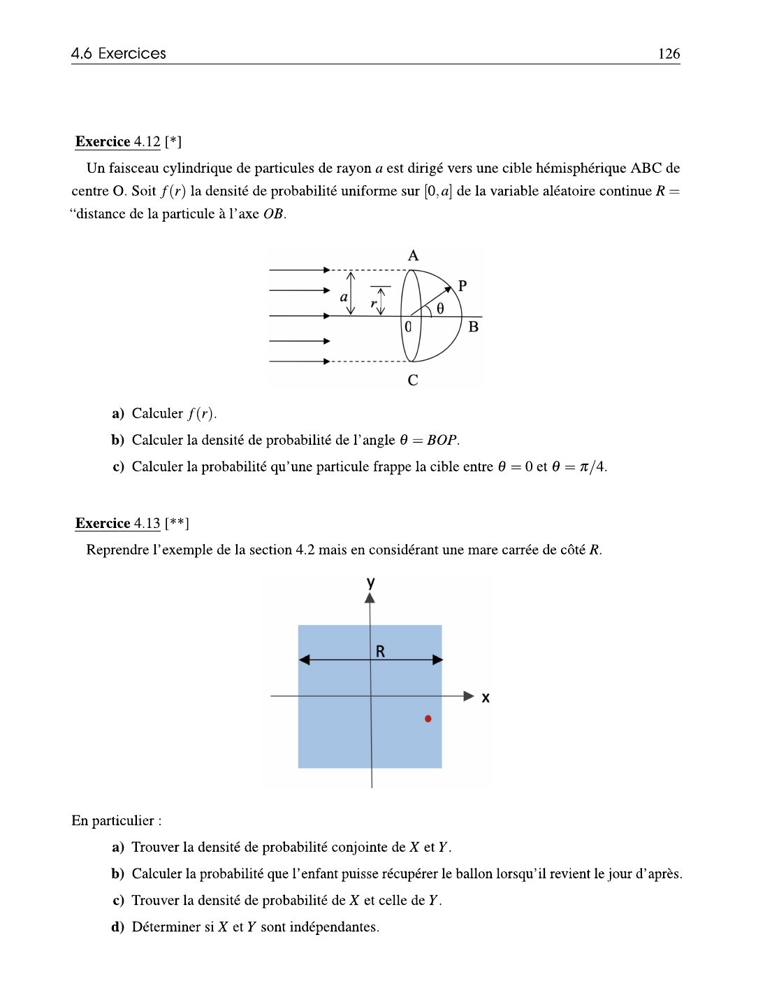{ loading=lazy .papier }](papier/td4/p126.jpg)
    
Énoncés : exercices 4.12 et 4.13 · Poly 2026-2027, p. 126

    [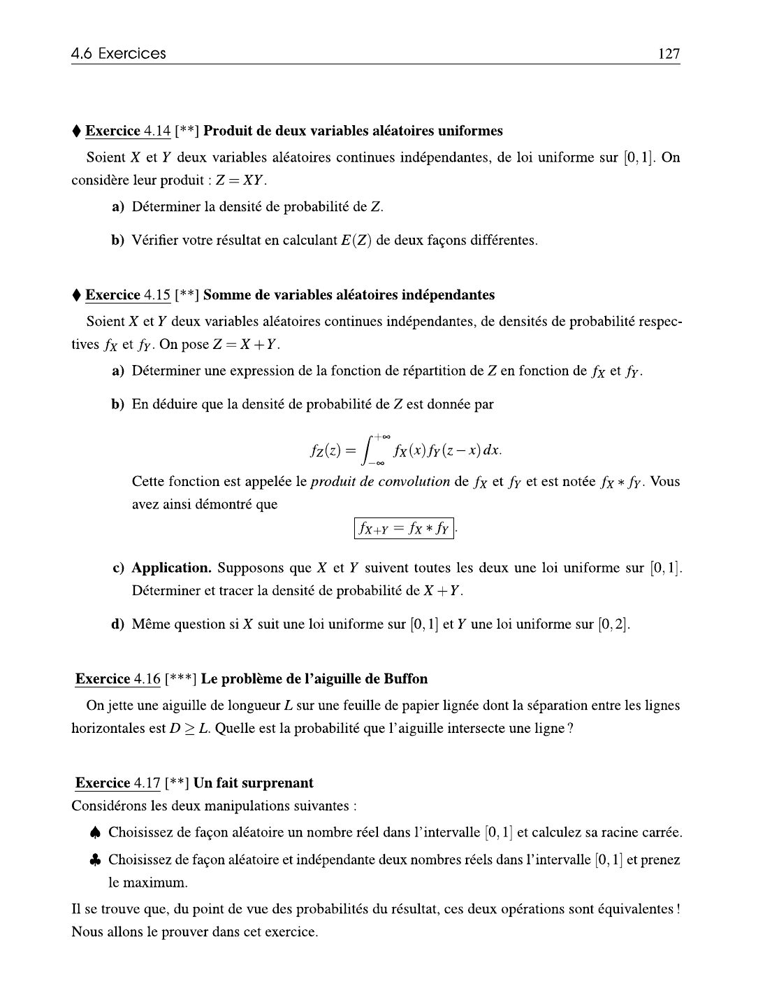{ loading=lazy .papier }](papier/td4/p127.jpg)
    
Énoncés : exercices 4.14 à 4.17 · Poly 2026-2027, p. 127

    [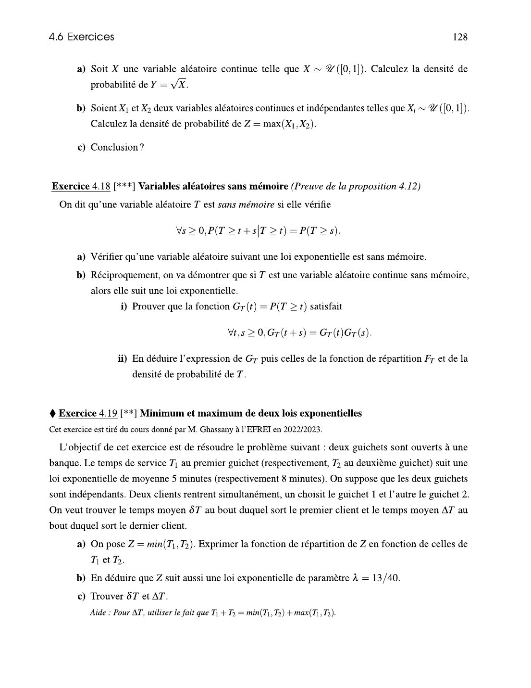{ loading=lazy .papier }](papier/td4/p128.jpg)
    
Énoncés : exercices 4.18 et 4.19 · Poly 2026-2027, p. 128

    [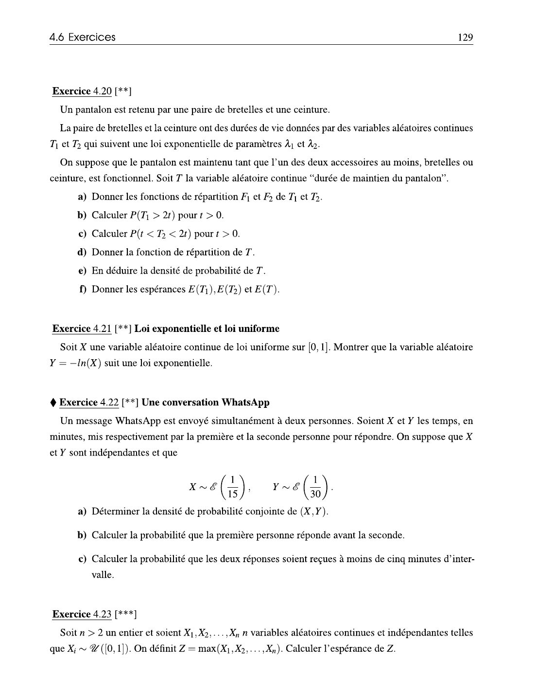{ loading=lazy .papier }](papier/td4/p129.jpg)
    
Énoncés : exercices 4.20 à 4.23 · Poly 2026-2027, p. 129

    [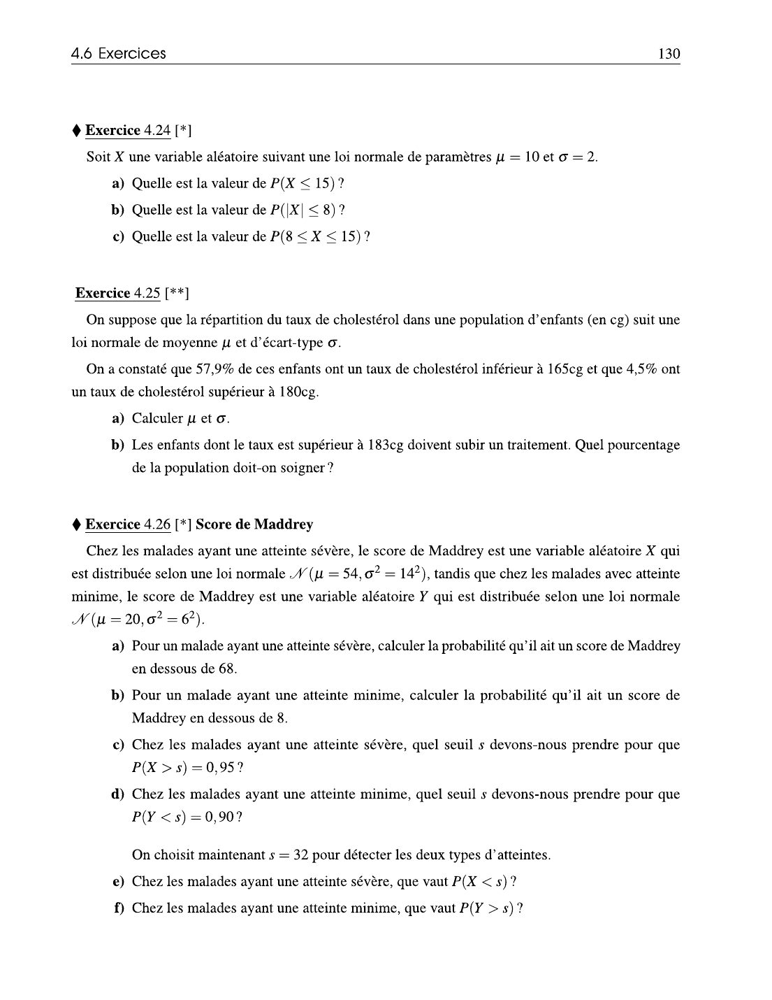{ loading=lazy .papier }](papier/td4/p130.jpg)
    
Énoncés : exercices 4.24 à 4.26 · Poly 2026-2027, p. 130

    [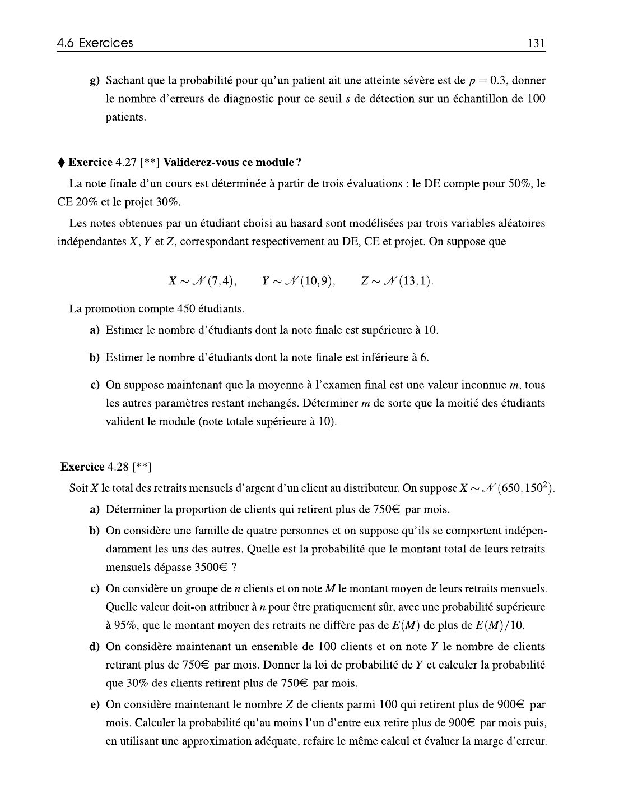{ loading=lazy .papier }](papier/td4/p131.jpg)
    
Énoncés : exercices 4.27 et 4.28 · Poly 2026-2027, p. 131

    [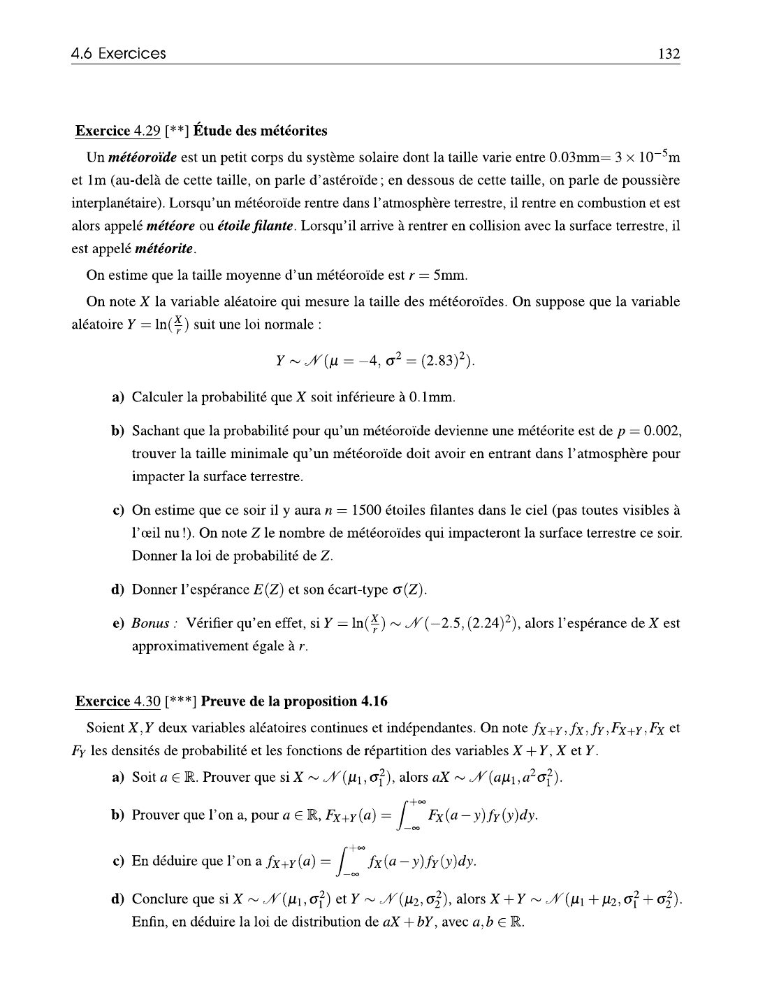{ loading=lazy .papier }](papier/td4/p132.jpg)
    
Énoncés : exercices 4.29 et 4.30 · Poly 2026-2027, p. 132

    [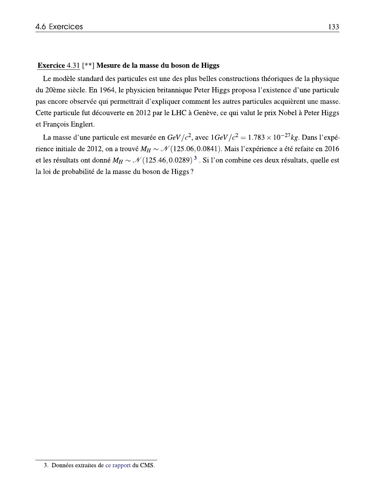{ loading=lazy .papier }](papier/td4/p133.jpg)
    
Énoncés : exercice 4.31 · Poly 2026-2027, p. 133

