# Chapitre 0 — Introduction aux canaux de transmission

=== "Version simplifiée"

    ## Où se situent les canaux de transmission ?

    Dans les modèles **OSI** et **TCP/IP**, le canal de transmission est la
    **couche physique** : le support matériel qui transporte le signal entre deux
    équipements. Tout ce qui est au-dessus (trames, paquets, protocoles) relève du
    logiciel ; le canal relève de l'électronique et de la physique des ondes.

    ## Les supports selon la fréquence

    | Support | Exemples | Domaine typique |
    |---------|----------|-----------------|
    | **Lignes de transmission** | paire torsadée, câble coaxial, lignes imprimées (microstrip) | du continu aux GHz |
    | **Guide d'ondes** | tube métallique creux | micro-ondes (GHz) |
    | **Liaison hertzienne** | antennes, propagation dans l'air | radio, Wi-Fi, 4G/5G |
    | **Fibre optique** | silice, lumière infrarouge | ~200 THz (λ ≈ 850 / 1310 / 1550 nm) |

    ## Rappels d'électromagnétisme

    !!! definition "Onde TEM (transverse électromagnétique)"
        Onde dont les champs $\vec E$ (V/m) et $\vec H$ (A/m) sont **perpendiculaires
        entre eux et à la direction de propagation** $Oz$. C'est le mode qui se
        propage dans l'isolant d'un câble coaxial ou d'une ligne bifilaire.

    Une onde électromagnétique se propage **dans un isolant**, pas dans un
    conducteur : dans un coaxial, elle voyage dans le diélectrique entre l'âme et
    le blindage.

    !!! theoreme "Impédance d'onde et vitesse dans un isolant $(\varepsilon, \mu)$"

        $$
        Z_{onde} = \frac{E}{H} = \sqrt{\frac{\mu}{\varepsilon}}
        \qquad
        v = \frac{1}{\sqrt{\varepsilon\mu}} = \frac{c}{\sqrt{\varepsilon_r\,\mu_r}}
        $$

        avec $\varepsilon = \varepsilon_r\varepsilon_0$, $\mu = \mu_r\mu_0$,
        $\mu_0 = 4\pi\cdot10^{-7}$ H/m, $c = 1/\sqrt{\varepsilon_0\mu_0} \approx 3\cdot10^8$ m/s.
        Dans le vide : $Z_0 = \sqrt{\mu_0/\varepsilon_0} \approx 377\ \Omega$.

    !!! piege "B ou H ?"
        En basses fréquences on parle surtout de $\vec B$ (en tesla). En hautes
        fréquences on travaille avec $\vec H$ (en A/m), le « champ magnétique »
        des hyperfréquences. Ne pas mélanger les unités dans $Z = E/H$.

=== "Version papier"

    Les diapos de l'introduction telles que projetées en cours (C. Maréchal, 2025-2026).

    <!-- papier: pdf/TE403P/2026-03-ct-introduction.pdf | Introduction — support 2025-2026 | ch0 | diapo -->

    [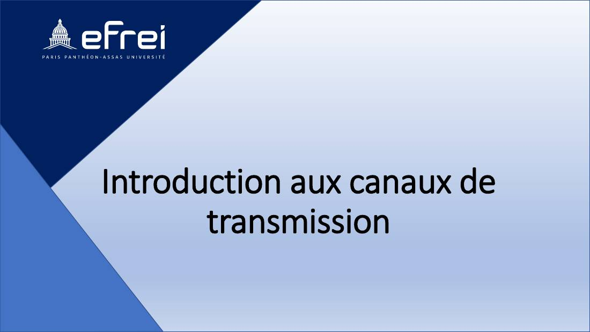{ loading=lazy .papier }](papier/ch0/p01.jpg)
    
Introduction aux canaux de · Introduction — support 2025-2026, diapo 1

    [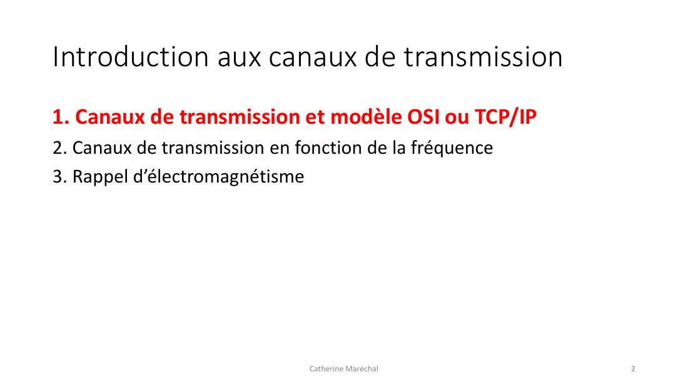{ loading=lazy .papier }](papier/ch0/p02.jpg)
    
Introduction aux canaux de transmission · Introduction — support 2025-2026, diapo 2

    [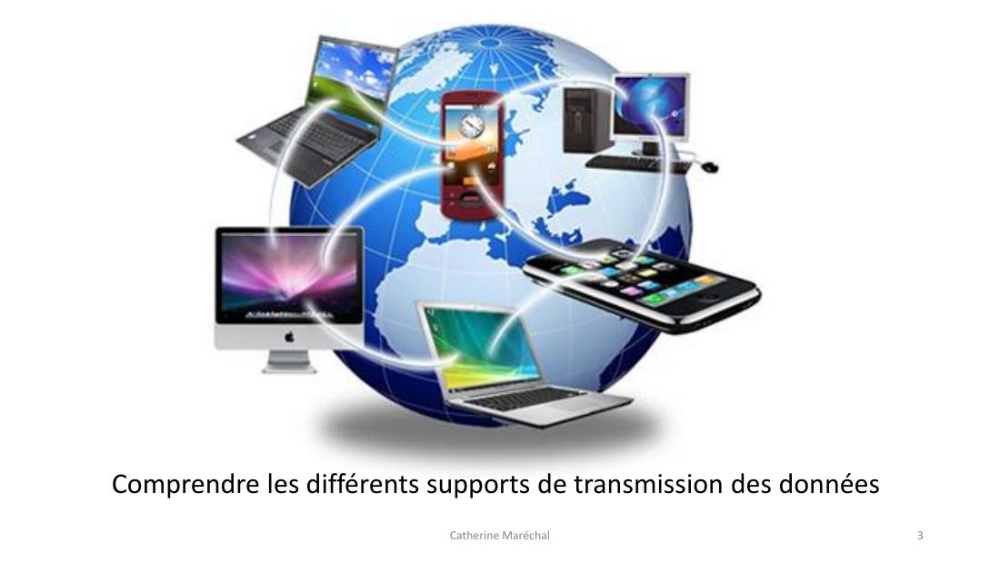{ loading=lazy .papier }](papier/ch0/p03.jpg)
    
Comprendre les différents supports de transmission des données · Introduction — support 2025-2026, diapo 3

    [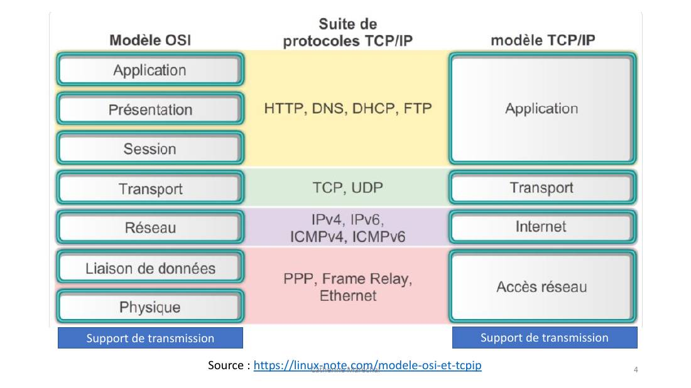{ loading=lazy .papier }](papier/ch0/p04.jpg)
    
Support de transmission · Introduction — support 2025-2026, diapo 4

    [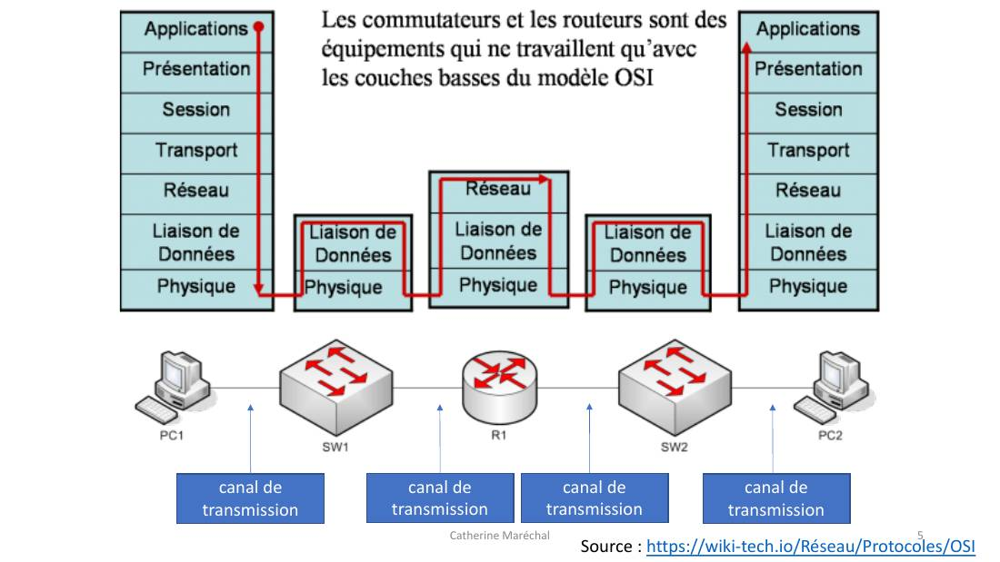{ loading=lazy .papier }](papier/ch0/p05.jpg)
    
canal de · Introduction — support 2025-2026, diapo 5

    [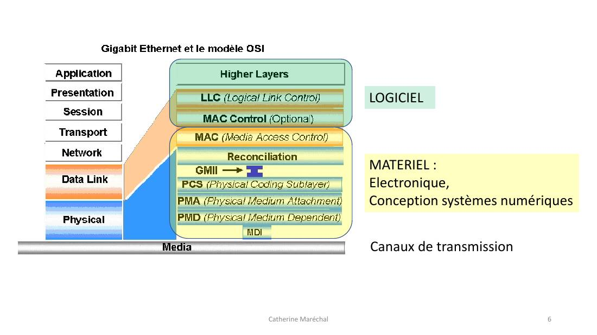{ loading=lazy .papier }](papier/ch0/p06.jpg)
    
MATERIEL : · Introduction — support 2025-2026, diapo 6

    [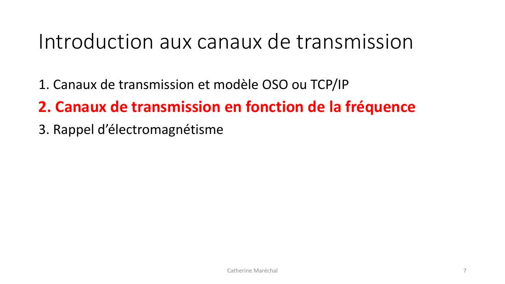{ loading=lazy .papier }](papier/ch0/p07.jpg)
    
Introduction aux canaux de transmission · Introduction — support 2025-2026, diapo 7

    [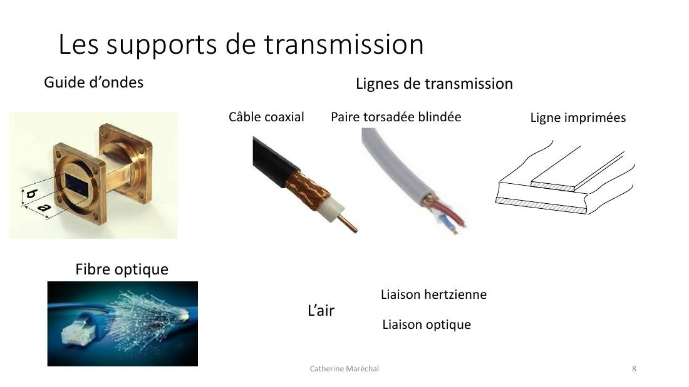{ loading=lazy .papier }](papier/ch0/p08.jpg)
    
Les supports de transmission · Introduction — support 2025-2026, diapo 8

    [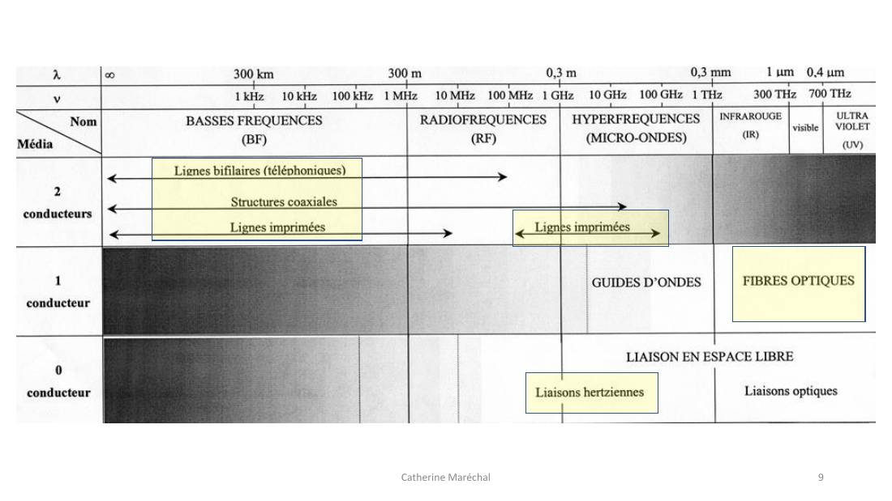{ loading=lazy .papier }](papier/ch0/p09.jpg)
    
Introduction — support 2025-2026, diapo 9

    [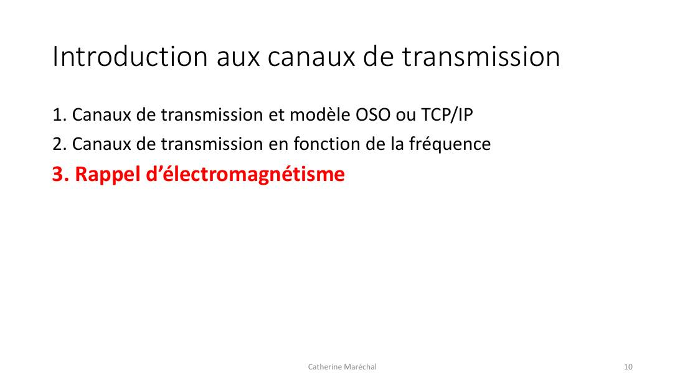{ loading=lazy .papier }](papier/ch0/p10.jpg)
    
Introduction aux canaux de transmission · Introduction — support 2025-2026, diapo 10

    [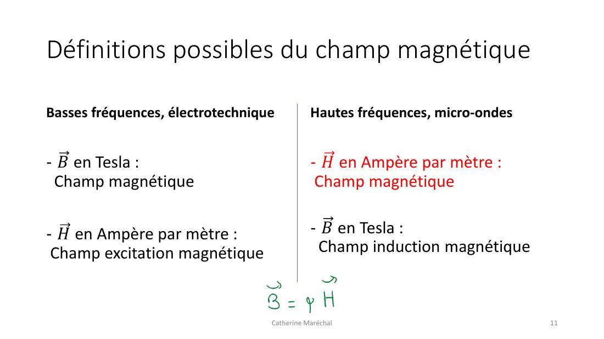{ loading=lazy .papier }](papier/ch0/p11.jpg)
    
Définitions possibles du champ magnétique · Introduction — support 2025-2026, diapo 11

    [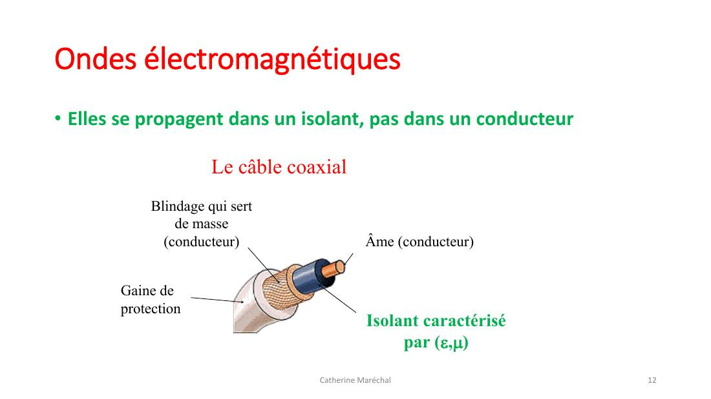{ loading=lazy .papier }](papier/ch0/p12.jpg)
    
Ondes électromagnétiques · Introduction — support 2025-2026, diapo 12

    [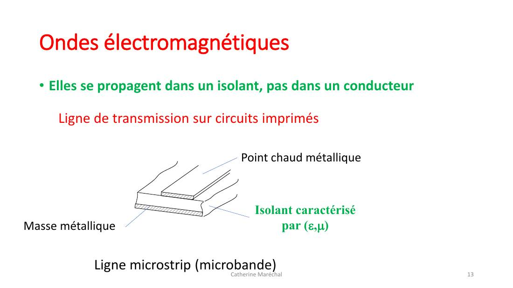{ loading=lazy .papier }](papier/ch0/p13.jpg)
    
Ondes électromagnétiques · Introduction — support 2025-2026, diapo 13

    [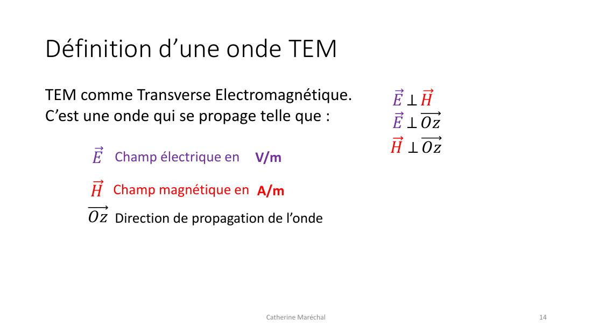{ loading=lazy .papier }](papier/ch0/p14.jpg)
    
Définition d’une onde TEM · Introduction — support 2025-2026, diapo 14

    [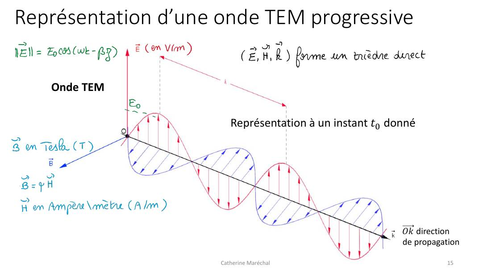{ loading=lazy .papier }](papier/ch0/p15.jpg)
    
Représentation d’une onde TEM progressive · Introduction — support 2025-2026, diapo 15

    [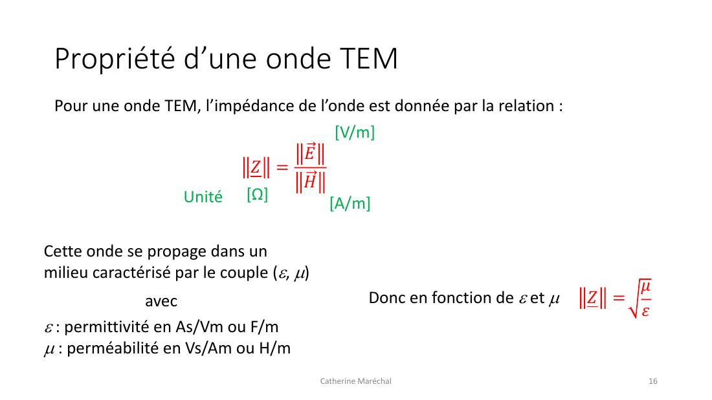{ loading=lazy .papier }](papier/ch0/p16.jpg)
    
Propriété d’une onde TEM · Introduction — support 2025-2026, diapo 16

    [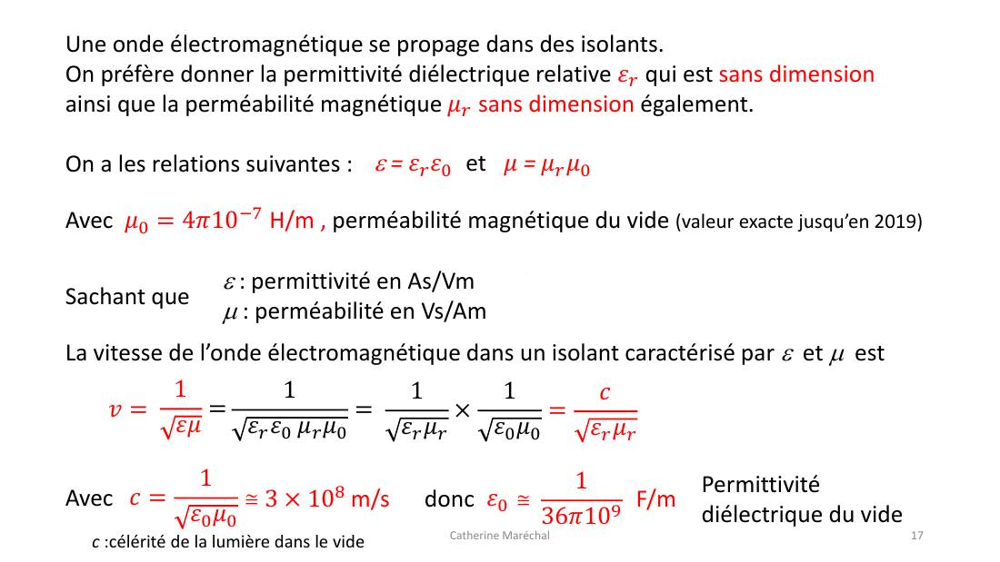{ loading=lazy .papier }](papier/ch0/p17.jpg)
    
Une onde électromagnétique se propage dans des isolants. · Introduction — support 2025-2026, diapo 17

    <!-- /papier -->
