# Chapitre 1 — Lignes de transmission : phénomènes physiques

=== "Version simplifiée"

    ## 1. Superposition

    Une ligne est un **système linéaire** : on peut découper le signal du
    générateur en **composante continue** + **composante variable**, calculer la
    réponse de la ligne à chacune, puis **additionner**.

    ## 2. Réponse à une tension continue

    Aucun phénomène de propagation : la ligne se comporte comme deux fils.
    Les formules de l'électronique basses fréquences s'appliquent :

    $$
    U_0(0) = U_0(L_0) = E_{g0}\,\frac{R_t}{R_g + R_t},
    \qquad I_0 = \frac{E_{g0}}{R_g + R_t}
    $$

    ## 3. Réponse à une variation de tension

    Une variation de tension à l'entrée crée un champ $\vec E$ variable, qui crée
    un champ $\vec H$ variable : une **onde TEM** part dans l'isolant, à la vitesse

    $$
    v = \frac{c}{\sqrt{\varepsilon_r\mu_r}}
    $$

    On lui associe une **onde de tension** $U^+$ et une **onde de courant** $I^+$
    qui se déplacent du générateur vers la charge.

    !!! definition "Impédance caractéristique $R_c$"
        Pour une ligne donnée, le rapport onde de tension / onde de courant est une
        constante, qui ne dépend que de la géométrie et de l'isolant :
        $$
        R_c = \frac{U^+}{I^+} = -\frac{U^-}{I^-}
        $$
        (signe moins pour l'onde qui revient : le courant change de sens).
        Valeurs courantes : 50 Ω (coaxial RF), 75 Ω (TV), 100–120 Ω (paire torsadée).

    !!! definition "Temps de propagation"
        $$
        \tau = \frac{L_0}{v} = \frac{L_0\sqrt{\varepsilon_r\mu_r}}{c}
        $$

    !!! piege "$R_c$ n'est pas une résistance physique"
        On ne la mesure pas à l'ohmmètre : c'est un rapport d'ondes. Une ligne sans
        pertes ne dissipe rien, même si $R_c = 50\ \Omega$.

=== "Version papier"

    Les diapos du chapitre telles que projetées en cours (C. Maréchal, 2025-2026).

    <!-- papier: pdf/TE403P/2026-03-ct-lt-a-physique.pdf | Phénomènes physiques — support 2025-2026 | ch1 | diapo -->

    [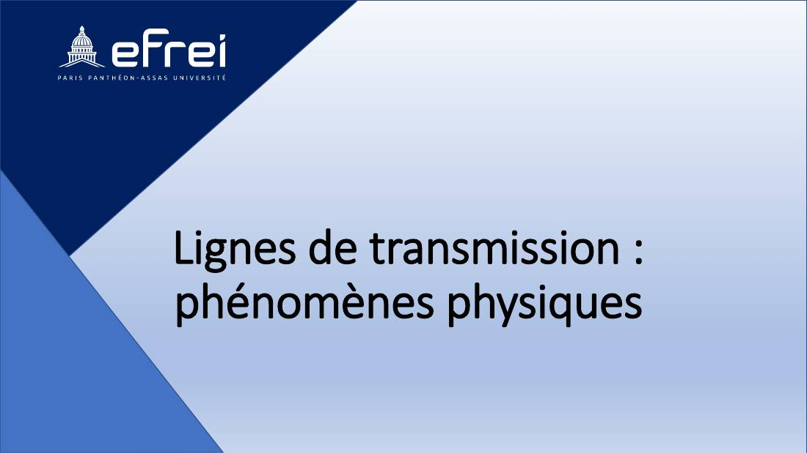{ loading=lazy .papier }](papier/ch1/p01.jpg)
    
Lignes de transmission : · Phénomènes physiques — support 2025-2026, diapo 1

    [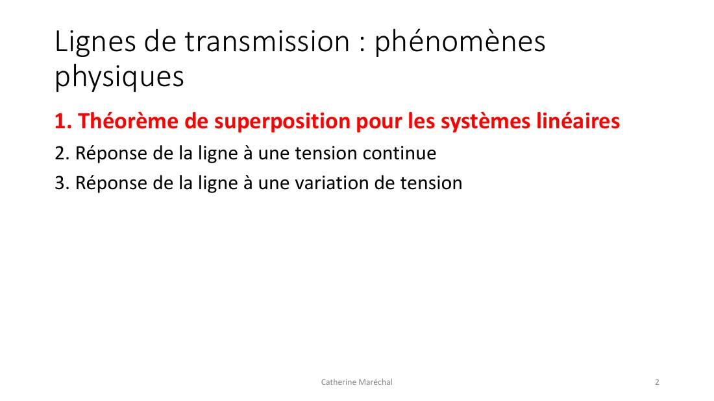{ loading=lazy .papier }](papier/ch1/p02.jpg)
    
Lignes de transmission : phénomènes · Phénomènes physiques — support 2025-2026, diapo 2

    [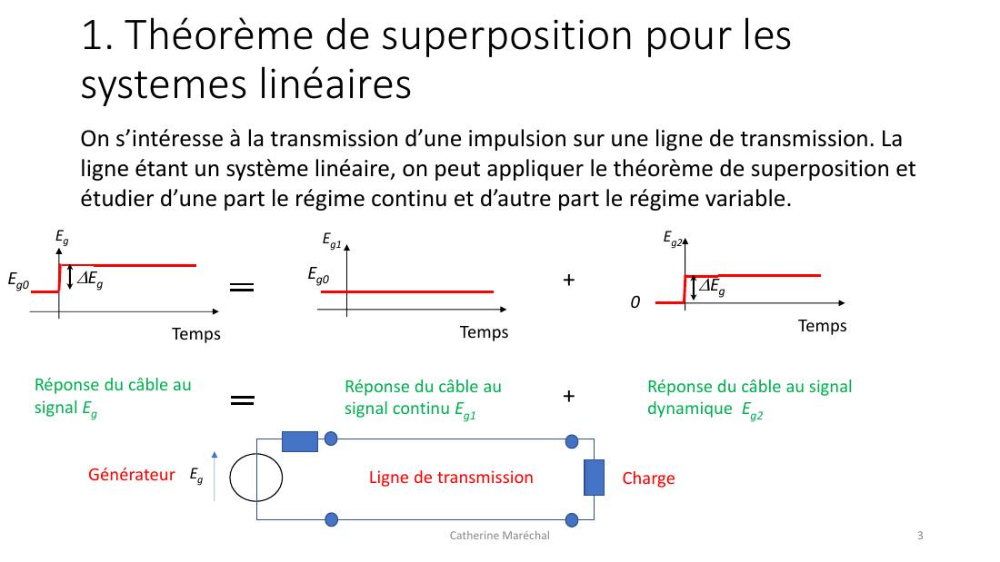{ loading=lazy .papier }](papier/ch1/p03.jpg)
    
1. Théorème de superposition pour les · Phénomènes physiques — support 2025-2026, diapo 3

    [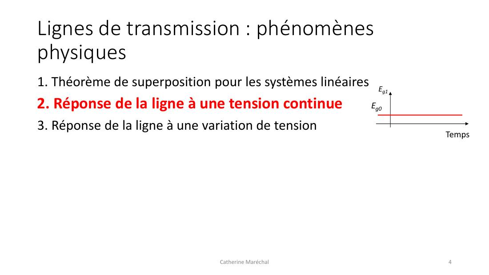{ loading=lazy .papier }](papier/ch1/p04.jpg)
    
Lignes de transmission : phénomènes · Phénomènes physiques — support 2025-2026, diapo 4

    [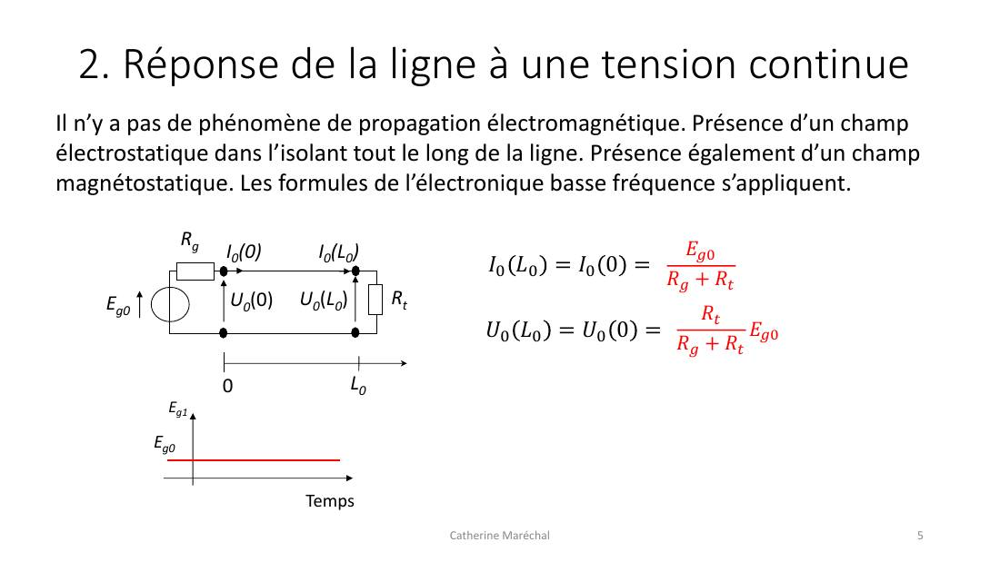{ loading=lazy .papier }](papier/ch1/p05.jpg)
    
2. Réponse de la ligne à une tension continue · Phénomènes physiques — support 2025-2026, diapo 5

    [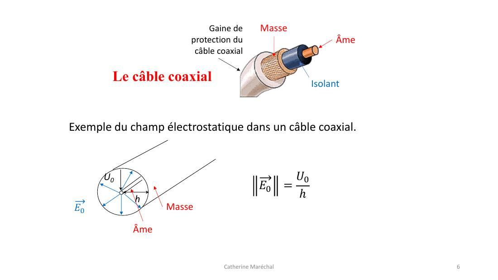{ loading=lazy .papier }](papier/ch1/p06.jpg)
    
Gaine de · Phénomènes physiques — support 2025-2026, diapo 6

    [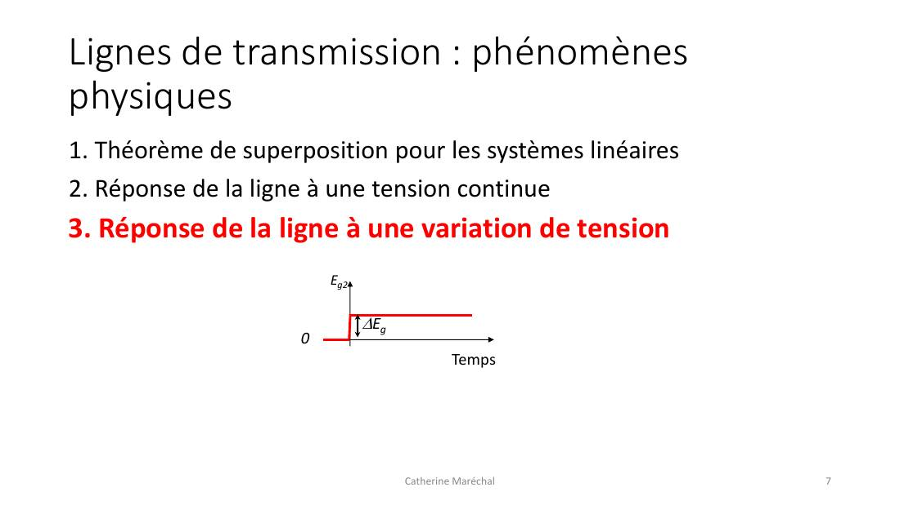{ loading=lazy .papier }](papier/ch1/p07.jpg)
    
Lignes de transmission : phénomènes · Phénomènes physiques — support 2025-2026, diapo 7

    [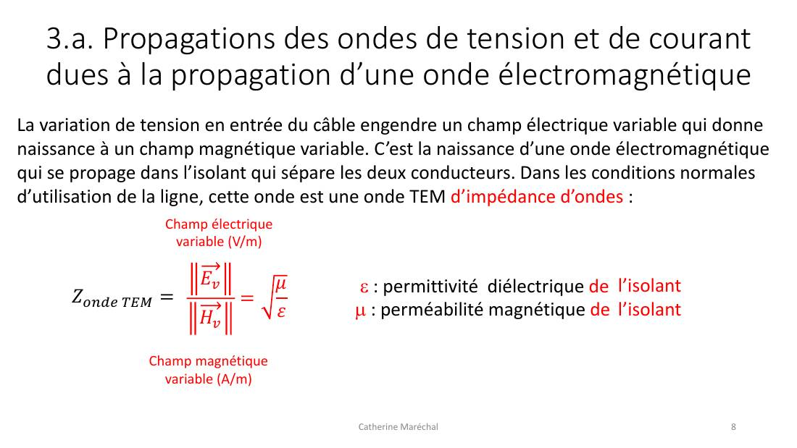{ loading=lazy .papier }](papier/ch1/p08.jpg)
    
3.a. Propagations des ondes de tension et de courant · Phénomènes physiques — support 2025-2026, diapo 8

    [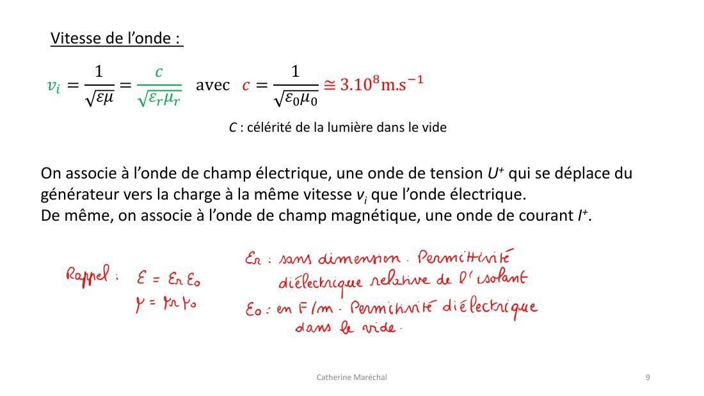{ loading=lazy .papier }](papier/ch1/p09.jpg)
    
Vitesse de l’onde : · Phénomènes physiques — support 2025-2026, diapo 9

    [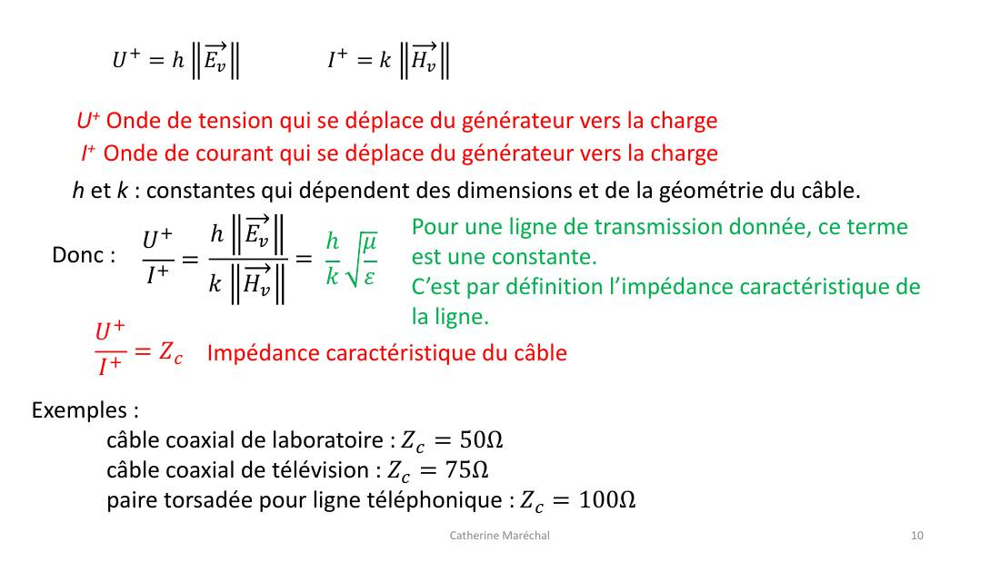{ loading=lazy .papier }](papier/ch1/p10.jpg)
    
U+ Onde de tension qui se déplace du générateur vers la charge · Phénomènes physiques — support 2025-2026, diapo 10

    [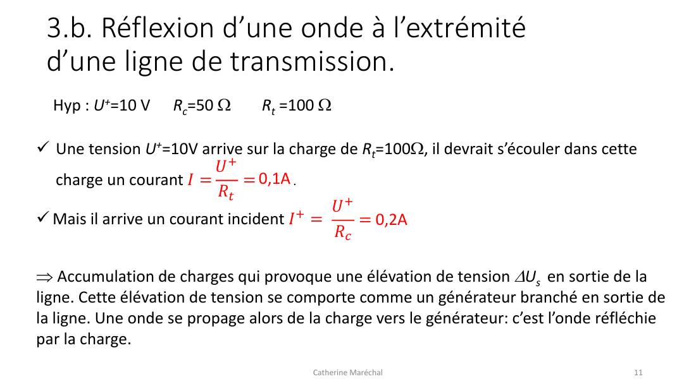{ loading=lazy .papier }](papier/ch1/p11.jpg)
    
3.b. Réflexion d’une onde à l’extrémité · Phénomènes physiques — support 2025-2026, diapo 11

    [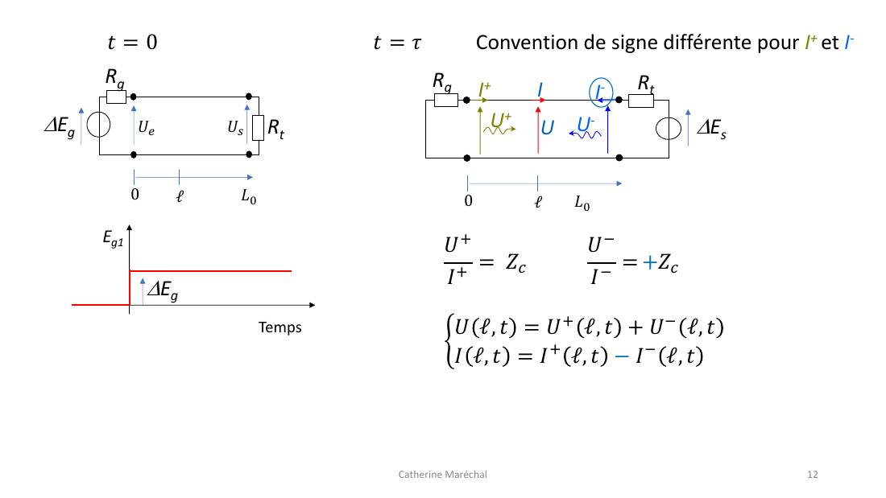{ loading=lazy .papier }](papier/ch1/p12.jpg)
    
Convention de signe différente pour I+ et I · Phénomènes physiques — support 2025-2026, diapo 12

    [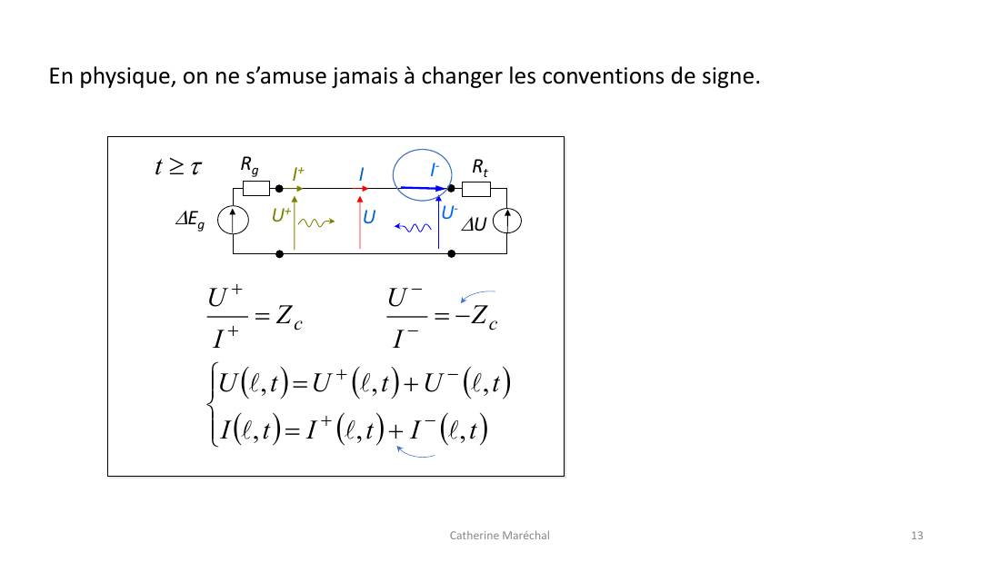{ loading=lazy .papier }](papier/ch1/p13.jpg)
    
En physique, on ne s’amuse jamais à changer les conventions de signe. · Phénomènes physiques — support 2025-2026, diapo 13

    [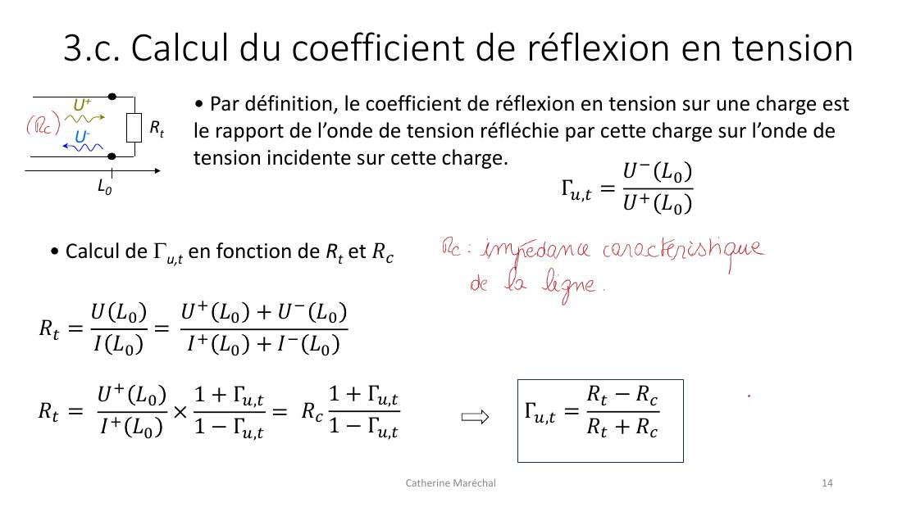{ loading=lazy .papier }](papier/ch1/p14.jpg)
    
3.c. Calcul du coefficient de réflexion en tension · Phénomènes physiques — support 2025-2026, diapo 14

    [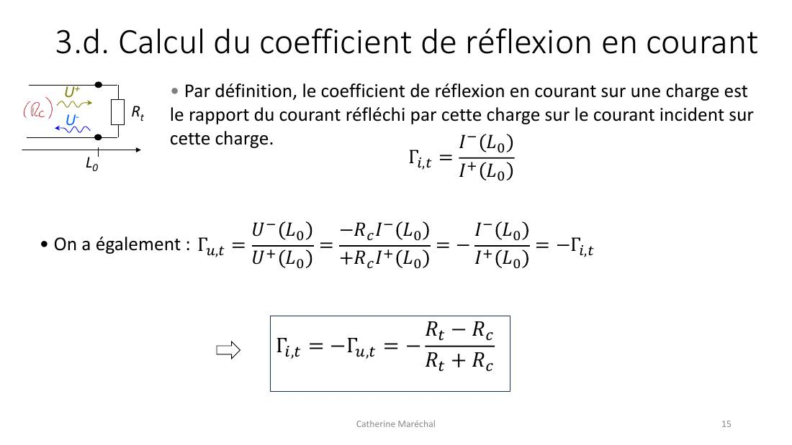{ loading=lazy .papier }](papier/ch1/p15.jpg)
    
3.d. Calcul du coefficient de réflexion en courant · Phénomènes physiques — support 2025-2026, diapo 15

    <!-- /papier -->
