# Chapitre 2 — Échelon sur une ligne : graphe des réflexions multiples

=== "Version simplifiée"

    ## BF ou HF ?

    - **Électronique BF** : on néglige le temps de propagation, $U_e(t) = U_s(t) = E_g(t)\,\dfrac{R_t}{R_t + R_g}$.
    - **Électronique HF** : le temps de propagation $\tau$ n'est plus négligeable
      devant la durée des fronts. Chaque front fait des **allers-retours** sur la
      ligne et se **réfléchit** sur la charge et sur le générateur.

    Deux méthodes : la méthode graphique de **Bergeron**, ou (si $R_g$ et $R_t$ sont
    des résistances et la ligne sans pertes) le **graphe des réflexions multiples**.

    ## Les trois formules

    !!! theoreme "Première onde et coefficients de réflexion"
        Onde envoyée dans la ligne à $t = 0$ (pont diviseur entre $R_g$ et $R_c$) :

        $$
        \Delta U_e(0) = U^+ = \Delta E_g\,\frac{R_c}{R_c + R_g}
        $$

        Réflexion sur la charge et sur le générateur :

        $$
        \Gamma_t = \frac{R_t - R_c}{R_t + R_c}
        \qquad
        \Gamma_g = \frac{R_g - R_c}{R_g + R_c}
        $$

    ## Méthode du tableau

    !!! methode "Graphe des réflexions multiples"
        1. **Séparer** le signal : composante continue $E_{g0}$ + échelon $\Delta E_g$.
        2. **Régime initial** (continu) : $U_{e1} = U_{s1} = E_{g0}\,\dfrac{R_t}{R_g + R_t}$.
        3. **Première onde** $U^+ = \Delta E_g\,\dfrac{R_c}{R_c+R_g}$ à $t = 0$ côté entrée.
        4. À chaque arrivée sur une extrémité, l'onde est multipliée par $\Gamma_t$
           (côté charge, à $\tau, 3\tau, 5\tau\ldots$) ou $\Gamma_g$ (côté générateur,
           à $2\tau, 4\tau\ldots$).
        5. **Tension à une extrémité** = somme de l'onde qui arrive **et** de l'onde
           réfléchie : saut de $U^+(1 + \Gamma_t)$ en sortie, de $U^-(1 + \Gamma_g)$ en entrée.
        6. **Ajouter la composante continue** du point 2.
        7. **Vérifier** : la suite doit tendre vers le régime final
           $U(\infty) = E_g(\infty)\,\dfrac{R_t}{R_t + R_g}$.

    !!! example "Exemple du cours : $R_c = 50\ \Omega$, $R_g = 150\ \Omega$, $R_t = 16\ \Omega$, échelon de 4 V à 12 V"
        - $U^+ = 8 \times \frac{50}{200} = 2$ V ; $\Gamma_t = \frac{16-50}{66} \approx -0{,}5$ ; $\Gamma_g = \frac{150-50}{200} = +0{,}5$.
        - Sortie : $+2(1-0{,}5) = +1$ V à $\tau$, puis $-0{,}25$ V à $3\tau$…
        - Entrée : $+2$ V à 0, $-1{,}5$ V à $2\tau$, $+0{,}375$ V à $4\tau$…
        - Avec le continu de 0,4 V : $U_e(4\tau) \approx 1{,}275$ V, $U_s(3\tau) = 1{,}15$ V,
          qui tendent bien vers $12\times\frac{16}{166} \approx 1{,}16$ V.

    !!! piege "Les pièges classiques"
        - Oublier le facteur $(1 + \Gamma)$ : la tension à l'extrémité n'est pas
          seulement l'onde réfléchie.
        - Prendre $R_t$ au lieu de $R_c$ dans le pont diviseur de la première onde :
          à $t = 0$, le générateur « voit » $R_c$, pas la charge.
        - Charge adaptée ($R_t = R_c$) : $\Gamma_t = 0$, plus aucune réflexion.

=== "Version papier"

    Les diapos du chapitre telles que projetées en cours (C. Maréchal, 2025-2026).

    <!-- papier: pdf/TE403P/2026-03-ct-lt-b-graphereflexions.pdf | Graphe des réflexions — support 2025-2026 | ch2 | diapo -->

    [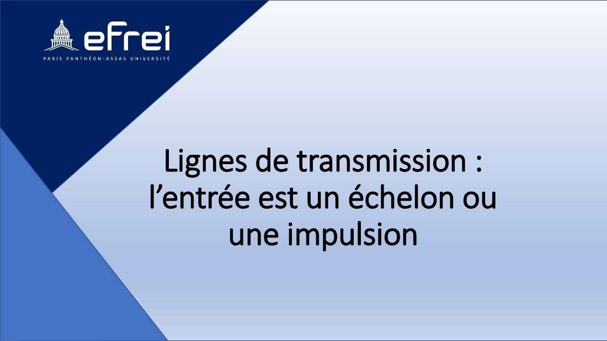{ loading=lazy .papier }](papier/ch2/p01.jpg)
    
Lignes de transmission : · Graphe des réflexions — support 2025-2026, diapo 1

    [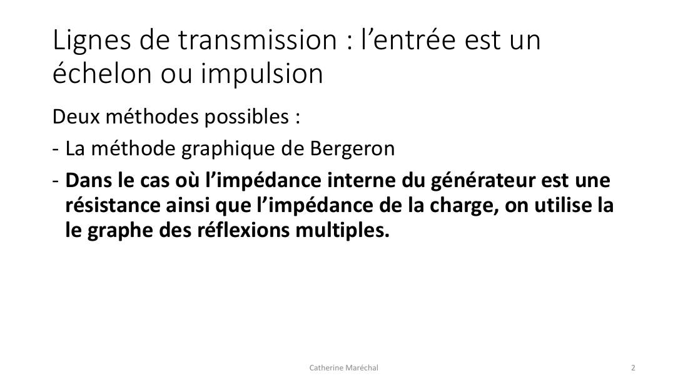{ loading=lazy .papier }](papier/ch2/p02.jpg)
    
Lignes de transmission : l’entrée est un · Graphe des réflexions — support 2025-2026, diapo 2

    [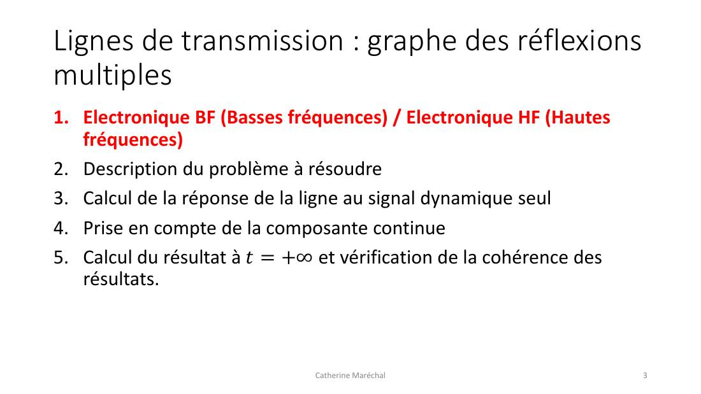{ loading=lazy .papier }](papier/ch2/p03.jpg)
    
2. Description du problème à résoudre · Graphe des réflexions — support 2025-2026, diapo 3

    [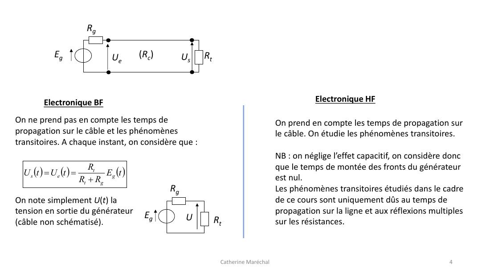{ loading=lazy .papier }](papier/ch2/p04.jpg)
    
Electronique HF · Graphe des réflexions — support 2025-2026, diapo 4

    [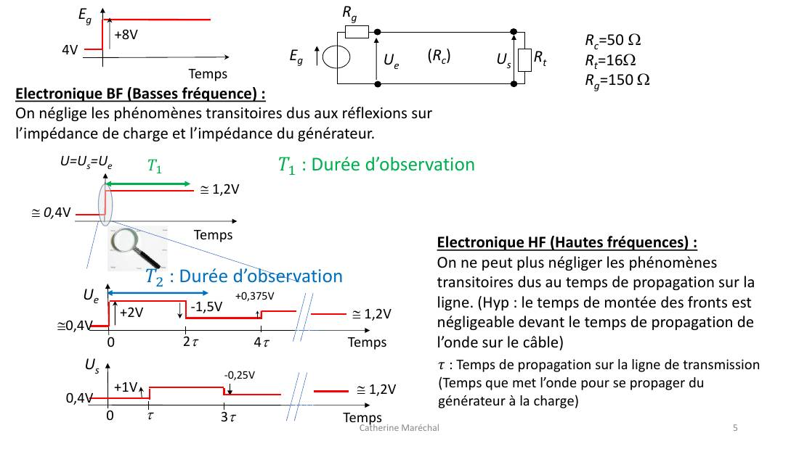{ loading=lazy .papier }](papier/ch2/p05.jpg)
    
Electronique BF (Basses fréquence) : · Graphe des réflexions — support 2025-2026, diapo 5

    [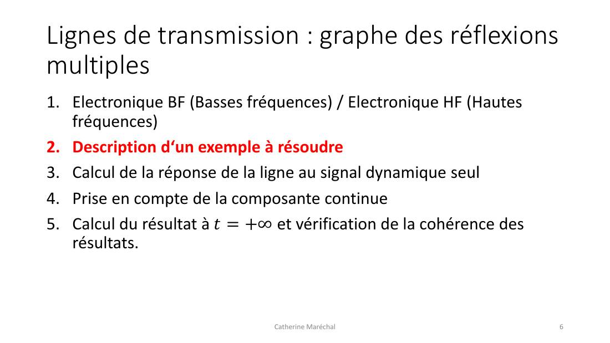{ loading=lazy .papier }](papier/ch2/p06.jpg)
    
2. Description d‘un exemple à résoudre · Graphe des réflexions — support 2025-2026, diapo 6

    [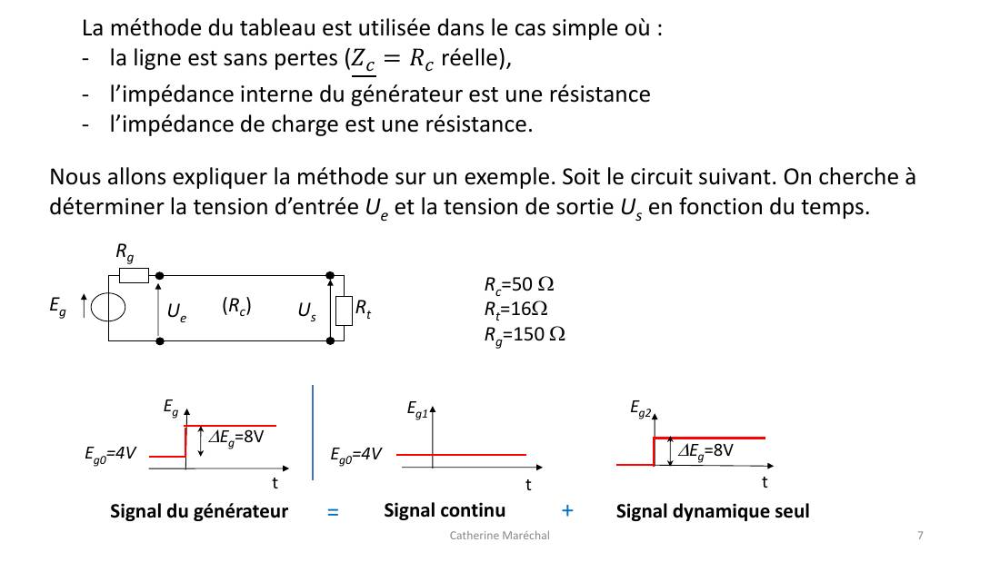{ loading=lazy .papier }](papier/ch2/p07.jpg)
    
La méthode du tableau est utilisée dans le cas simple où : · Graphe des réflexions — support 2025-2026, diapo 7

    [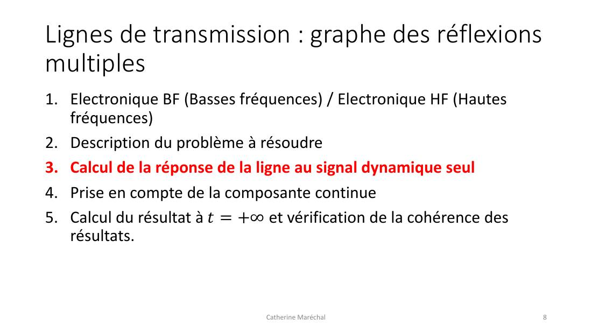{ loading=lazy .papier }](papier/ch2/p08.jpg)
    
2. Description du problème à résoudre · Graphe des réflexions — support 2025-2026, diapo 8

    [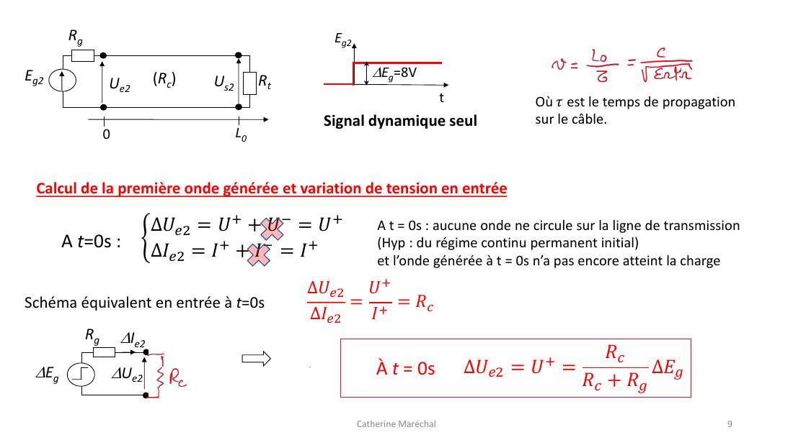{ loading=lazy .papier }](papier/ch2/p09.jpg)
    
Signal dynamique seul · Graphe des réflexions — support 2025-2026, diapo 9

    [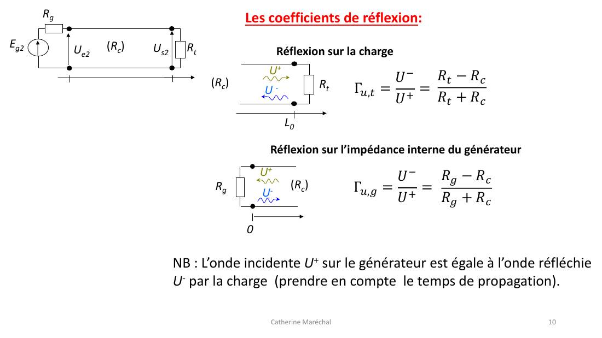{ loading=lazy .papier }](papier/ch2/p10.jpg)
    
Les coefficients de réflexion: · Graphe des réflexions — support 2025-2026, diapo 10

    [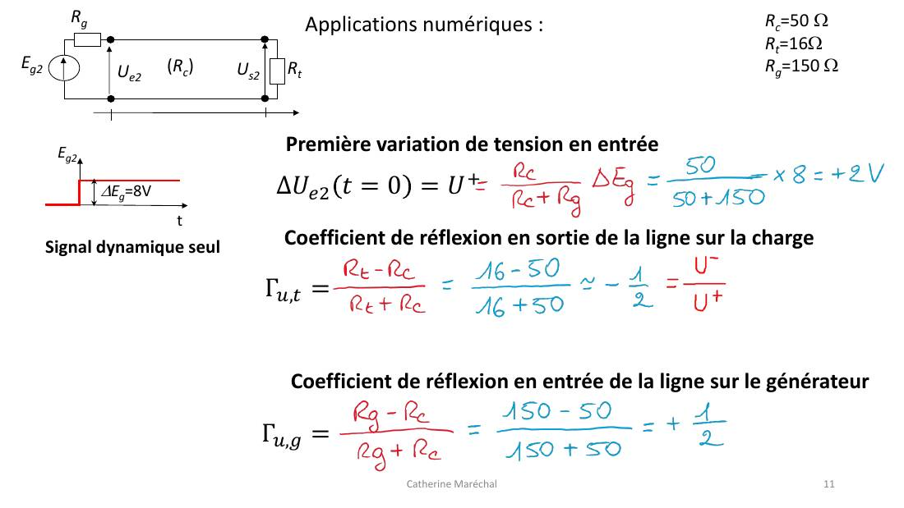{ loading=lazy .papier }](papier/ch2/p11.jpg)
    
Applications numériques : · Graphe des réflexions — support 2025-2026, diapo 11

    [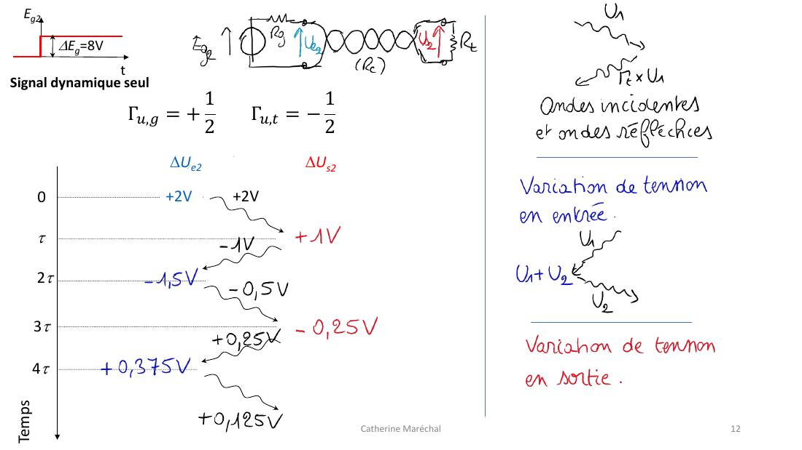{ loading=lazy .papier }](papier/ch2/p12.jpg)
    
Signal dynamique seul · Graphe des réflexions — support 2025-2026, diapo 12

    [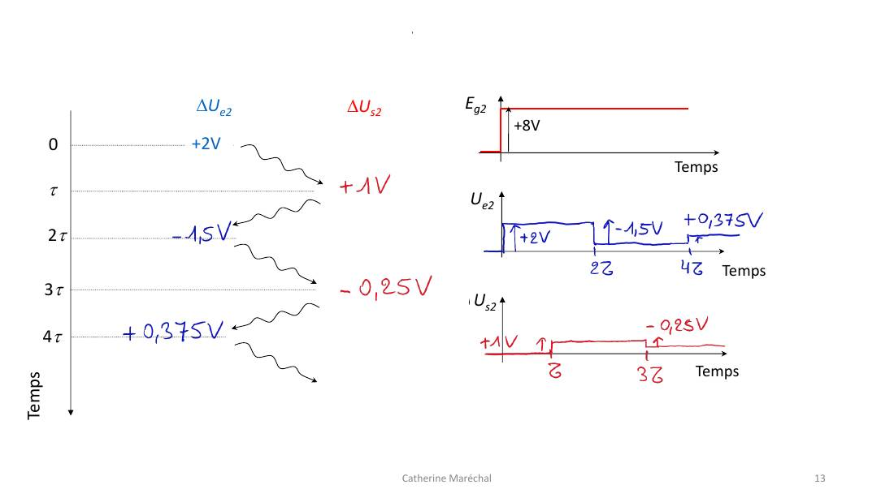{ loading=lazy .papier }](papier/ch2/p13.jpg)
    
UUs s2 · Graphe des réflexions — support 2025-2026, diapo 13

    [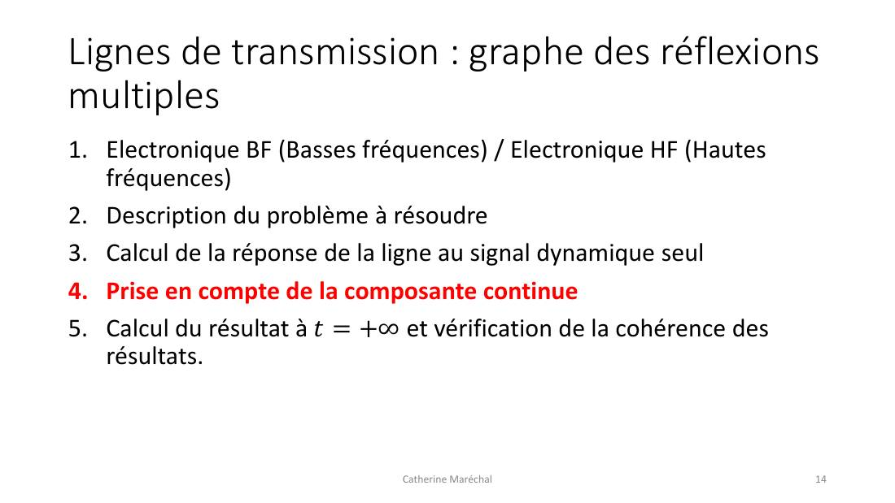{ loading=lazy .papier }](papier/ch2/p14.jpg)
    
2. Description du problème à résoudre · Graphe des réflexions — support 2025-2026, diapo 14

    [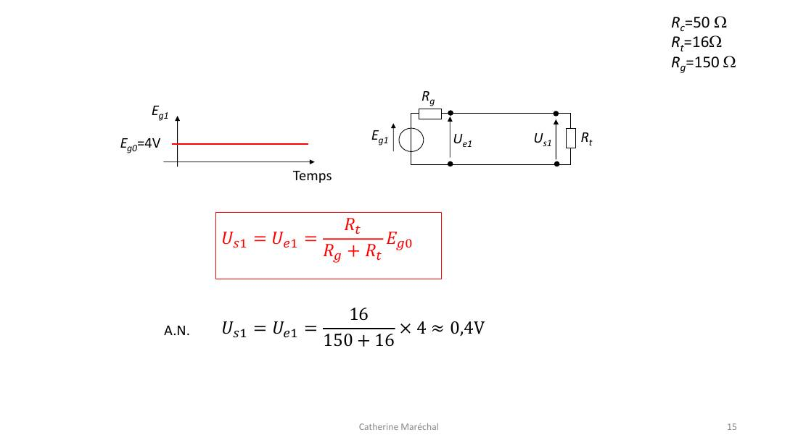{ loading=lazy .papier }](papier/ch2/p15.jpg)
    
Graphe des réflexions — support 2025-2026, diapo 15

    [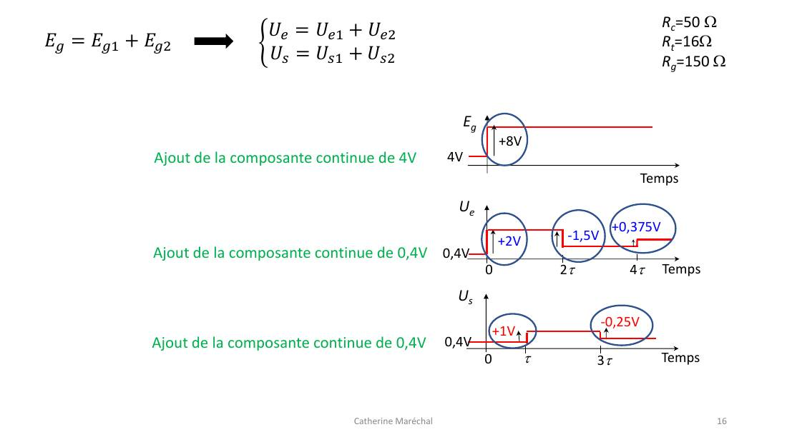{ loading=lazy .papier }](papier/ch2/p16.jpg)
    
Ajout de la composante continue de 4V · Graphe des réflexions — support 2025-2026, diapo 16

    [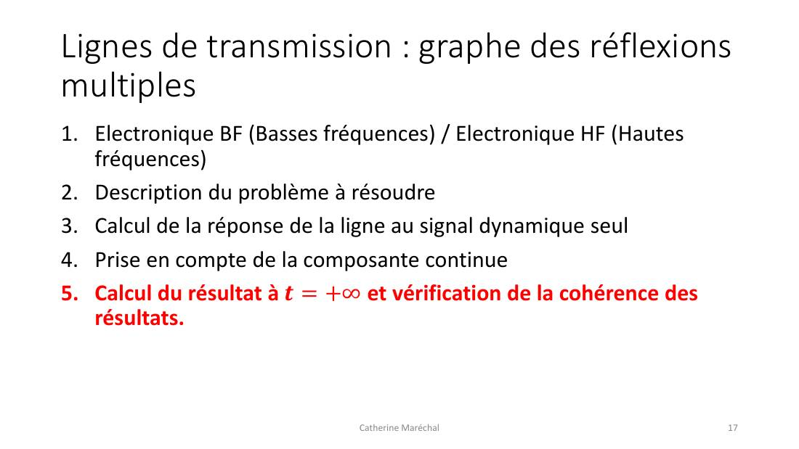{ loading=lazy .papier }](papier/ch2/p17.jpg)
    
2. Description du problème à résoudre · Graphe des réflexions — support 2025-2026, diapo 17

    [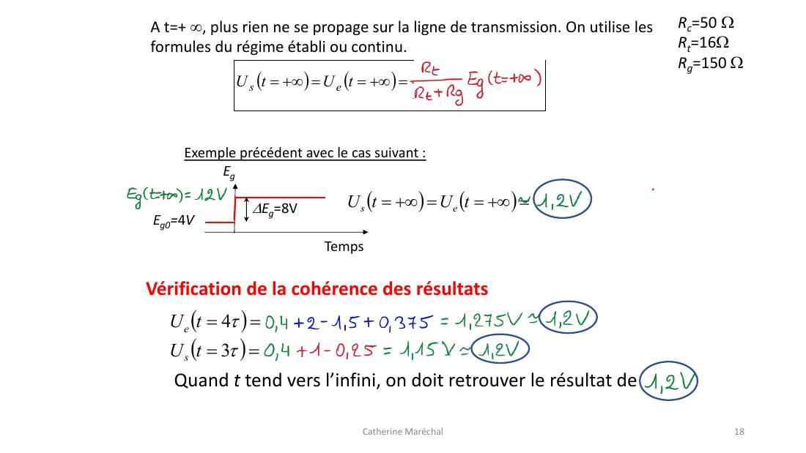{ loading=lazy .papier }](papier/ch2/p18.jpg)
    
A t=+ , plus rien ne se propage sur la ligne de transmission. On utilise les · Graphe des réflexions — support 2025-2026, diapo 18

    <!-- /papier -->
