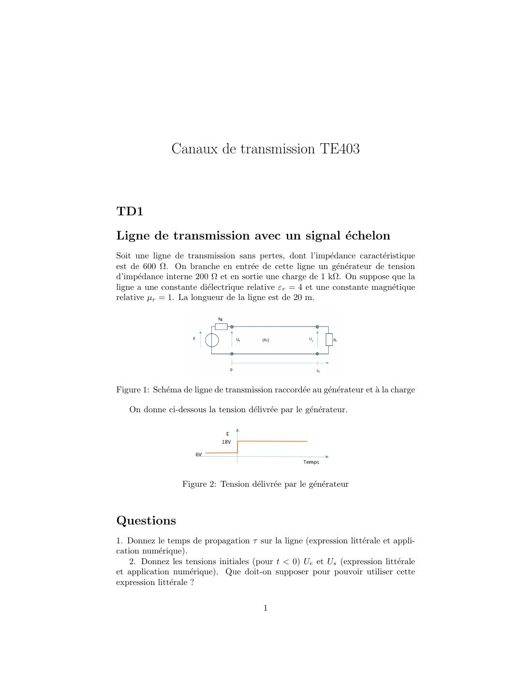
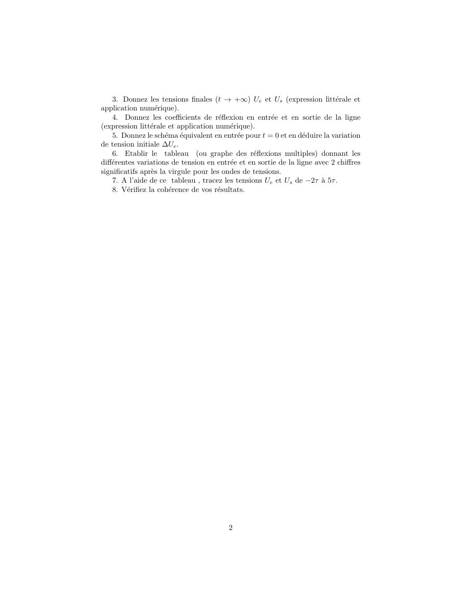

# TD 1 — Ligne de transmission avec un signal échelon

=== "Version simplifiée"

    Données : ligne sans pertes $R_c = 600\ \Omega$, $R_g = 200\ \Omega$,
    $R_t = 1\ \text{k}\Omega$, $\varepsilon_r = 4$, $\mu_r = 1$, $L_0 = 20$ m.
    Les niveaux du générateur sont sur la figure de l'énoncé (onglet **Version papier**) :
    on note $E_{g0}$ le niveau avant $t = 0$ et $E_{g\infty}$ le niveau après.
    Méthode : [chapitre 2](../cours/chapitre-2-reflexions-multiples.md).

    **1. Temps de propagation**

    $$
    \tau = \frac{L_0\sqrt{\varepsilon_r\mu_r}}{c} = \frac{20\times 2}{3\cdot10^8} \approx 133\ \text{ns}
    $$

    **2. Tensions initiales** (régime continu établi pour $t < 0$, d'où l'hypothèse :
    le générateur est à $E_{g0}$ depuis assez longtemps pour que toutes les
    réflexions se soient éteintes) :

    $$
    U_e = U_s = E_{g0}\,\frac{R_t}{R_g + R_t} = \frac{1000}{1200}\,E_{g0} = 0{,}83\,E_{g0}
    $$

    **3. Tensions finales** : même formule avec $E_{g\infty}$ : $U_e = U_s = 0{,}83\,E_{g\infty}$.

    **4. Coefficients de réflexion**

    $$
    \Gamma_t = \frac{1000 - 600}{1000 + 600} = +0{,}25
    \qquad
    \Gamma_g = \frac{200 - 600}{200 + 600} = -0{,}5
    $$

    **5. Première onde** : à $t = 0$ le générateur voit $R_c$ (la charge n'est pas
    encore « au courant ») :

    $$
    \Delta U_e = \Delta E_g\,\frac{R_c}{R_c + R_g} = 0{,}75\,\Delta E_g
    $$

    **6. Tableau des réflexions** (en multiples de $U^+ = 0{,}75\,\Delta E_g$) :

    | Instant | Onde | Saut en sortie | Saut en entrée |
    |:-:|:-:|:-:|:-:|
    | $0$ | $U^+$ | | $+1$ |
    | $\tau$ | réfléchie par la charge : $\times 0{,}25$ | $1\times(1 + 0{,}25) = +1{,}25$ | |
    | $2\tau$ | réfléchie par le générateur : $\times(-0{,}5)$ | | $0{,}25\times(1 - 0{,}5) = +0{,}125$ |
    | $3\tau$ | $0{,}25\times(-0{,}5) = -0{,}125$ | $-0{,}125\times 1{,}25 = -0{,}156$ | |
    | $4\tau$ | $-0{,}125\times 0{,}25 = -0{,}031$ | | $-0{,}031\times 0{,}5 = -0{,}016$ |
    | $5\tau$ | $+0{,}016$ | $+0{,}020$ | |

    **7–8. Vérification** : en sortie, $1{,}25 - 0{,}156 + 0{,}020 \approx 1{,}11$ ;
    en entrée, $1 + 0{,}125 - 0{,}016 \approx 1{,}11$. Les deux tendent vers
    $\dfrac{1}{0{,}75}\times\dfrac{1000}{1200} = 1{,}11$, soit bien
    $\Delta U(\infty) = 0{,}83\,\Delta E_g$ (le résultat du régime continu).

=== "Version papier"

    Énoncé du TD 1 tel qu'il est distribué.

    <!-- papier: pdf/TE403P/te403-td1-nonc.pdf | TD 1 — énoncé | td1 | page -->

    [{ loading=lazy .papier }](papier/td1/p01.jpg)
    
Canaux de transmission TE403 · TD 1 — énoncé, page 1

    [{ loading=lazy .papier }](papier/td1/p02.jpg)
    
3. Donnez les tensions finales (t → +∞) Ue et Us (expression littérale et · TD 1 — énoncé, page 2

    <!-- /papier -->
