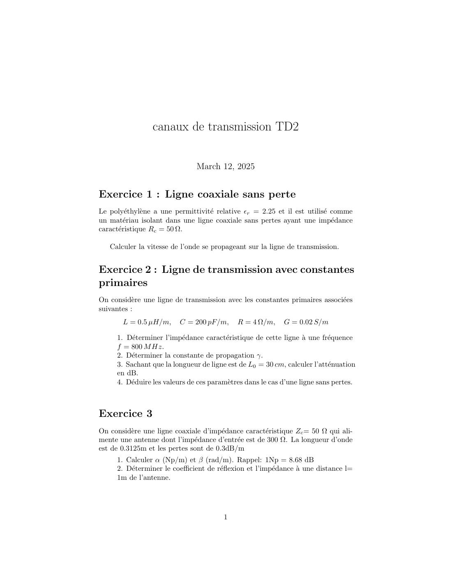
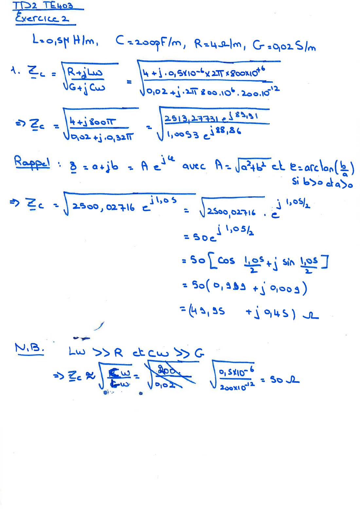
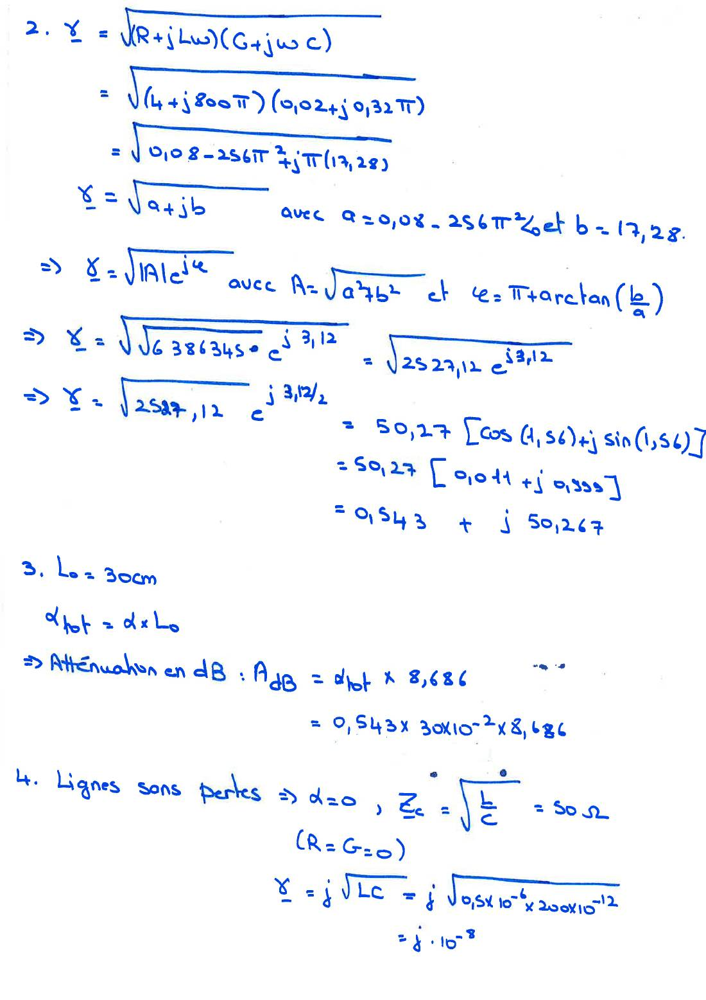
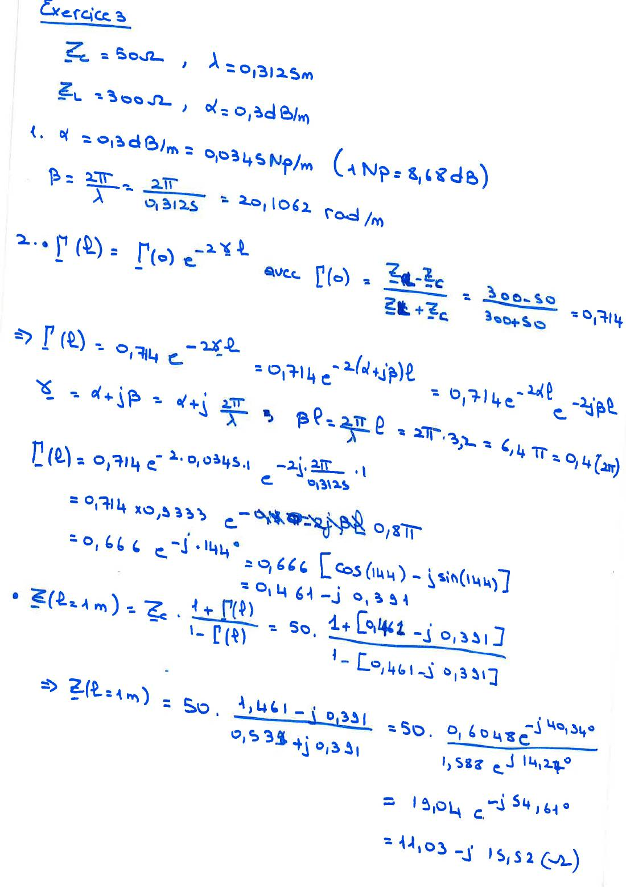

# TD 2 — Constantes primaires et secondaires

=== "Version simplifiée"

    Formules : [chapitre 3](../cours/chapitre-3-regime-sinusoidal.md).

    ## Exercice 1 — Coaxial au polyéthylène

    $$
    v = \frac{c}{\sqrt{\varepsilon_r}} = \frac{3\cdot10^8}{1{,}5} = 2\cdot10^8\ \text{m/s}
    $$
    ($R_c$ ne sert pas ici.)

    ## Exercice 2 — Constantes primaires à 800 MHz

    $L = 0{,}5$ µH/m, $C = 200$ pF/m, $R = 4$ Ω/m, $G = 0{,}02$ S/m ;
    $\omega = 2\pi\times 8\cdot10^8$ : $L\omega \approx 2513\ \Omega/\text{m}$, $C\omega \approx 1{,}005$ S/m.

    1. $Z_c = \sqrt{\dfrac{R + jL\omega}{G + jC\omega}} \approx 50{,}0 + 0{,}46j\ \Omega$ (quasi réelle).
    2. $\gamma = \sqrt{(R + jL\omega)(G + jC\omega)} \approx 0{,}54 + 50{,}27j\ \text{m}^{-1}$,
       donc $\alpha \approx 0{,}54$ Np/m et $\beta \approx 50{,}3$ rad/m.
    3. Atténuation sur 30 cm : $8{,}686\times\alpha\times 0{,}3 \approx 1{,}4$ dB.
    4. Sans pertes : $R_c = \sqrt{L/C} = 50\ \Omega$, $\beta = \omega\sqrt{LC} \approx 50{,}27$ rad/m, $\alpha = 0$.

    ## Exercice 3 — Antenne 300 Ω sur coaxial 50 Ω

    1. $\alpha = \dfrac{0{,}3}{8{,}686} \approx 0{,}0345$ Np/m ; $\beta = \dfrac{2\pi}{0{,}3125} \approx 20{,}1$ rad/m.
    2. $\Gamma_t = \dfrac{300 - 50}{300 + 50} \approx 0{,}714$.
       À 1 m : $\Gamma(1) = \Gamma_t\,e^{-2\alpha}e^{-2j\beta} \approx 0{,}667\,e^{-j144°}$,
       puis $Z(1) = 50\,\dfrac{1 + \Gamma}{1 - \Gamma} \approx 11 - 15{,}5j\ \Omega$.

    !!! piege "Phase modulo 360°"
        $2\beta\ell = 40{,}2$ rad, soit 6,4 tours : seule la partie fractionnaire compte.

=== "Version papier"

    Énoncé du TD 2, puis le corrigé des exercices 2 et 3 distribué par le prof.

    <!-- papier: pdf/TE403P/te403-td2-nonc.pdf | TD 2 — énoncé | td2 | page -->

    [{ loading=lazy .papier }](papier/td2/p01.jpg)
    
canaux de transmission TD2 · TD 2 — énoncé, page 1

    <!-- /papier -->

    <!-- papier: pdf/TE403P/te403-td2-corrig-ex2-3.pdf | TD 2 — corrigé des exercices 2 et 3 | td2-corrige | page -->

    [{ loading=lazy .papier }](papier/td2-corrige/p01.jpg)
    
TD 2 — corrigé des exercices 2 et 3, page 1

    [{ loading=lazy .papier }](papier/td2-corrige/p02.jpg)
    
TD 2 — corrigé des exercices 2 et 3, page 2

    [{ loading=lazy .papier }](papier/td2-corrige/p03.jpg)
    
TD 2 — corrigé des exercices 2 et 3, page 3

    [{ loading=lazy .papier }](papier/td2-corrige/p04.jpg)
    
TD 2 — corrigé des exercices 2 et 3, page 4

    <!-- /papier -->
