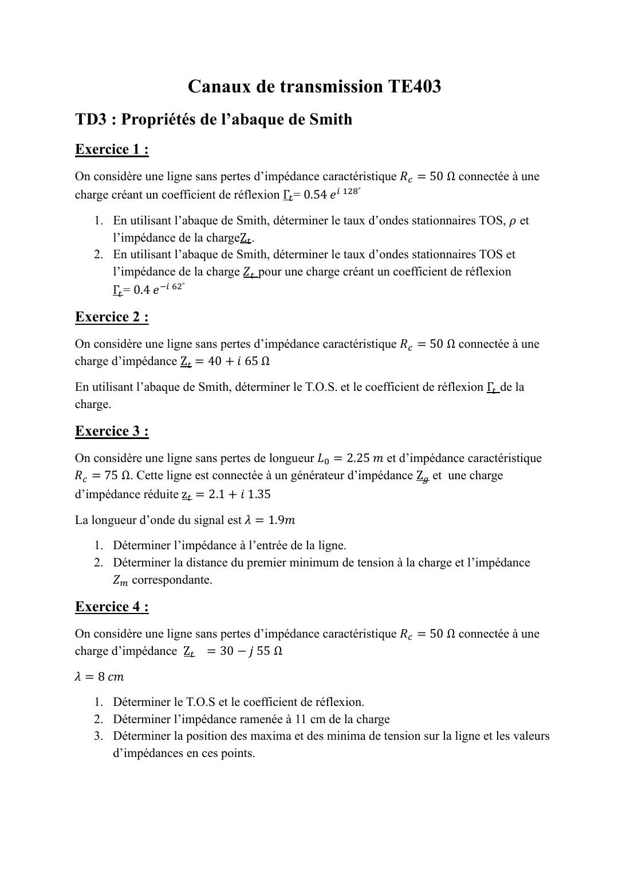

# TD 3 — Propriétés de l'abaque de Smith

=== "Version simplifiée"

    Méthode : [chapitre 4](../cours/chapitre-4-abaque-de-smith.md). Les valeurs
    ci-dessous sont calculées avec les formules exactes : sur l'abaque, on doit
    tomber à la précision de lecture près (± 0,01 λ, ± 5 %).

    ## Exercice 1 — Lire $Z_t$ à partir de $\Gamma_t$

    Placer $\Gamma_t$ (module = fraction du rayon, angle sur la graduation en
    degrés), lire $z_t$ puis $Z_t = 50\,z_t$ ; le TOS se lit sur l'axe réel.

    | $\Gamma_t$ | TOS $\rho = \frac{1+\|\Gamma\|}{1-\|\Gamma\|}$ | $Z_t$ |
    |---|:-:|---|
    | $0{,}54\,e^{j128°}$ | 3,35 | $\approx 18 + 22j\ \Omega$ |
    | $0{,}4\,e^{-j62°}$ | 2,33 | $\approx 54 - 45j\ \Omega$ |

    ## Exercice 2 — $Z_t = 40 + 65j$, $R_c = 50\ \Omega$

    $z_t = 0{,}8 + 1{,}3j$ → $\Gamma_t \approx 0{,}59\,e^{j63°}$, TOS $\approx 3{,}9$.

    ## Exercice 3 — Impédance d'entrée, $L_0 = 2{,}25$ m, $\lambda = 1{,}9$ m

    1. $L_0/\lambda = 1{,}184$ → on retire les demi-tours ($0{,}5\lambda$) : il reste
       $\Delta\eta = 0{,}184$ à parcourir vers le générateur depuis $z_t = 2{,}1 + 1{,}35j$.
       On lit $z_e \approx 0{,}48 - 0{,}65j$, soit $Z_e \approx 36 - 48j\ \Omega$.
    2. Premier minimum de tension : on tourne depuis $z_t$ jusqu'à l'axe réel **à
       gauche** : $d_{min} \approx 0{,}55$ m ($\approx 0{,}29\lambda$).
       Là, $z = 1/\rho$ avec $\rho \approx 3{,}12$, donc $Z_m \approx 75/3{,}12 \approx 24\ \Omega$.

    ## Exercice 4 — $Z_t = 30 - 55j$, $\lambda = 8$ cm

    1. $z_t = 0{,}6 - 1{,}1j$ : $\Gamma_t \approx 0{,}60\,e^{-j75°}$, TOS $\approx 4{,}0$.
    2. 11 cm = $1{,}375\lambda$ → $\Delta\eta = 0{,}375$ : $Z(11\ \text{cm}) \approx 162 + 77j\ \Omega$.
    3. Minima de tension à $\approx 1{,}16$ cm de la charge puis tous les 4 cm
       ($\lambda/2$), avec $Z_{min} = R_c/\rho \approx 12\ \Omega$ ; maxima à
       $\approx 3{,}16$ cm puis tous les 4 cm, avec $Z_{max} = R_c\,\rho \approx 202\ \Omega$.

    !!! methode "Pour trouver un extremum"
        Maximum de tension = intersection du cercle avec l'axe réel **à droite** ;
        minimum = **à gauche**. La distance se lit sur la graduation « vers le
        générateur ». Pour une charge capacitive (moitié basse), on rencontre
        d'abord le minimum.

=== "Version papier"

    Énoncé du TD 3 tel qu'il est distribué (prévoir un abaque vierge : voir le [chapitre 4](../cours/chapitre-4-abaque-de-smith.md)).

    <!-- papier: pdf/TE403P/te403-td3-nonc.pdf | TD 3 — énoncé | td3 | page -->

    [{ loading=lazy .papier }](papier/td3/p01.jpg)
    
Canaux de transmission TE403 · TD 3 — énoncé, page 1

    <!-- /papier -->
