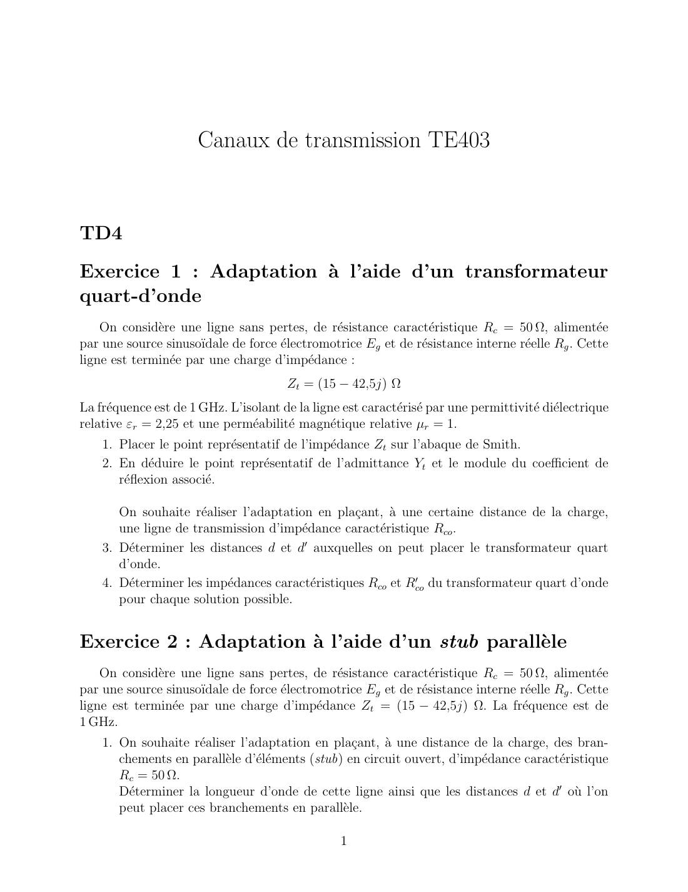

# TD 4 — Adaptation d'impédance

=== "Version simplifiée"

    Méthode : [chapitre 5](../cours/chapitre-5-adaptation.md). Les deux exercices
    utilisent $Z_t = 15 - 42{,}5j\ \Omega$, $R_c = 50\ \Omega$, $f = 1$ GHz, $\varepsilon_r = 2{,}25$.

    Longueur d'onde dans la ligne :
    $$
    \lambda = \frac{c}{f\sqrt{\varepsilon_r}} = \frac{3\cdot10^8}{10^9\times1{,}5} = 20\ \text{cm}
    $$

    ## Exercice 1 — Transformateur quart d'onde

    1. $z_t = 0{,}3 - 0{,}85j$ (moitié basse : charge capacitive).
    2. $y_t$ = point opposé : $y_t \approx 0{,}37 + 1{,}05j$ ; $|\Gamma| \approx 0{,}71$ (TOS $\approx 5{,}9$).
    3. On tourne vers le générateur jusqu'à l'axe réel :
        - à gauche (minimum de tension) : $d \approx 2{,}3$ cm ($0{,}116\lambda$), $z = 1/\rho \approx 0{,}17$, $R_B \approx 8{,}5\ \Omega$ ;
        - à droite (maximum) : $d' \approx 7{,}3$ cm ($0{,}366\lambda$), $z = \rho \approx 5{,}9$, $R_B' \approx 294\ \Omega$.
    4. $R_{c0} = \sqrt{8{,}5\times 50} \approx 21\ \Omega$ et $R_{c0}' = \sqrt{294\times 50} \approx 121\ \Omega$
       (quart d'onde de 5 cm dans les deux cas).

    ## Exercice 2 — Stub parallèle en circuit ouvert ($R_{c0} = 50\ \Omega$)

    1. On travaille en admittances : depuis $y_t$, on tourne vers le générateur
       jusqu'au cercle $g = 1$. Deux positions :
        - $d \approx 1{,}1$ cm ($0{,}054\lambda$) où $y = 1 + 2{,}01j$ ;
        - $d' \approx 3{,}6$ cm ($0{,}179\lambda$) où $y = 1 - 2{,}01j$.
    2. Le stub doit ramener la susceptance opposée. Un stub en circuit ouvert
       ramène $y = j\tan\beta s$ (on part du point $y = 0$, à gauche) :
        - en $d$ : il faut $-2{,}01j$ → $s \approx 6{,}5$ cm ($0{,}323\lambda$) ;
        - en $d'$ : il faut $+2{,}01j$ → $s' \approx 3{,}5$ cm ($0{,}177\lambda$).
    3. Élément équivalent à 1 GHz : $B = b/R_c$.
        - $-2{,}01j$ : susceptance négative → **inductance** $L = \dfrac{1}{|B|\omega} \approx 4{,}0$ nH ;
        - $+2{,}01j$ : susceptance positive → **capacité** $C = \dfrac{B}{\omega} \approx 6{,}4$ pF.

    !!! piege "Point de départ du stub"
        En admittance, le **circuit ouvert** est à gauche ($y = 0$) et le
        **court-circuit** à droite ($y = \infty$) : c'est l'inverse de l'abaque
        en impédance.

=== "Version papier"

    Énoncé du TD 4 tel qu'il est distribué.

    <!-- papier: pdf/TE403P/te403-td4-nonc.pdf | TD 4 — énoncé | td4 | page -->

    [{ loading=lazy .papier }](papier/td4/p01.jpg)
    
Canaux de transmission TE403 · TD 4 — énoncé, page 1

    [{ loading=lazy .papier }](papier/td4/p02.jpg)
    
2. Déterminer les longueurs des stubs en circuit ouvert s et s′ pour réaliser l’adaptati… · TD 4 — énoncé, page 2

    <!-- /papier -->
