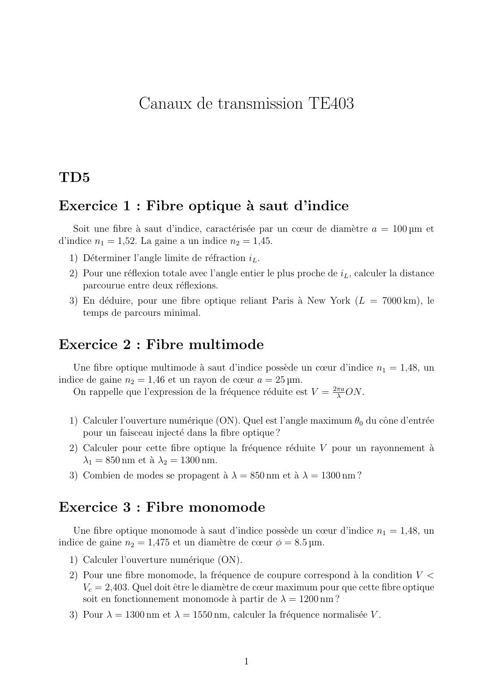
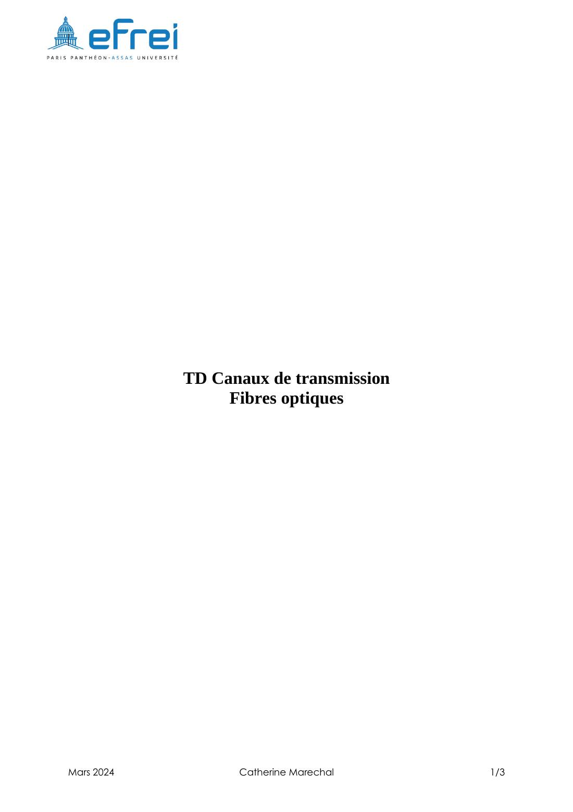
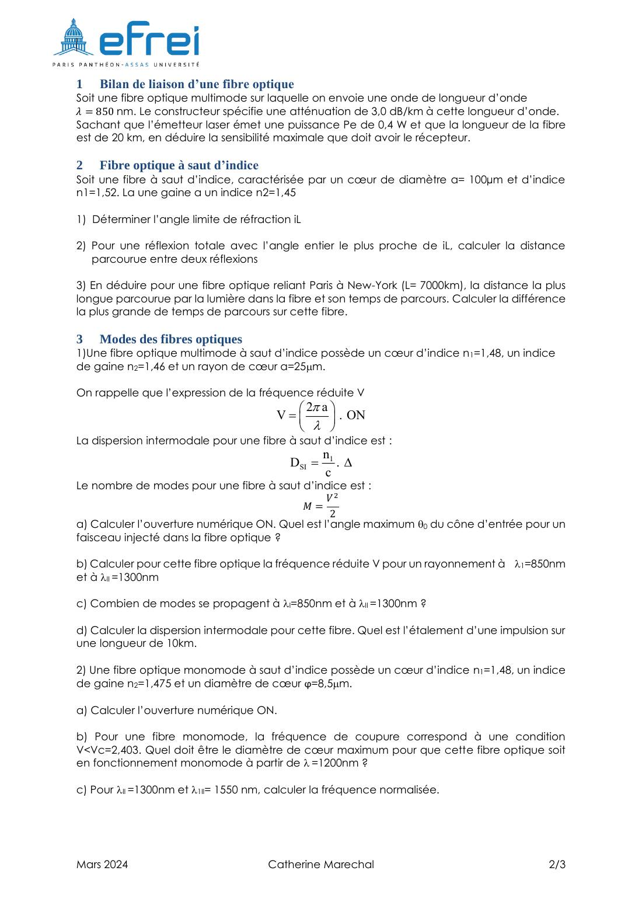
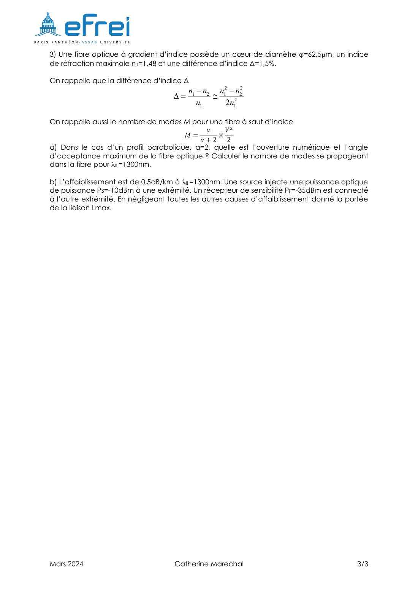

# TD 5 — Fibres optiques

=== "Version simplifiée"

    Formules : [chapitre 6](../cours/chapitre-6-fibres-optiques.md). Le TD 5 et
    l'ancienne feuille « Fibres optiques » (2024) reprennent les mêmes exercices ;
    les corrections ci-dessous couvrent les deux.

    ## Saut d'indice : $n_1 = 1{,}52$, $n_2 = 1{,}45$, cœur de 100 µm

    1. $\sin i_L = n_2/n_1$ → $i_L \approx 72{,}5°$.
    2. Avec $i = 73°$ : le rayon traverse le cœur (100 µm) entre deux réflexions,
       ce qui fait avancer de $100\ \mu\text{m}\times\tan 73° \approx 0{,}33$ mm le long de l'axe.
    3. Paris–New York (7000 km) : trajet direct $t_{min} = \dfrac{n_1 L}{c} \approx 35{,}5$ ms ;
       trajet le plus long $L/\sin i_L \approx 7338$ km, soit $\approx 37{,}2$ ms :
       écart $\approx 1{,}7$ ms.

    ## Multimode : $n_1 = 1{,}48$, $n_2 = 1{,}46$, $a = 25$ µm

    1. $ON = \sqrt{1{,}48^2 - 1{,}46^2} \approx 0{,}242$ → $\theta_0 \approx 14°$.
    2. $V = \dfrac{2\pi a}{\lambda}ON$ : $V \approx 44{,}8$ à 850 nm, $\approx 29{,}3$ à 1300 nm.
    3. $M = V^2/2$ : $\approx 1000$ modes à 850 nm, $\approx 430$ à 1300 nm.
    4. Dispersion intermodale $D = \dfrac{n_1\Delta}{c} = \dfrac{n_1 - n_2}{c}$ $\approx 67$ ns/km :
       sur 10 km, l'impulsion s'étale de $\approx 0{,}67$ µs.

    ## Monomode : $n_1 = 1{,}48$, $n_2 = 1{,}475$, $\phi = 8{,}5$ µm

    1. $ON \approx 0{,}122$.
    2. Monomode si $V < 2{,}403$ : $\phi_{max} = \dfrac{2{,}403\,\lambda}{\pi\,ON} \approx 7{,}6$ µm à 1200 nm.
    3. $V \approx 2{,}50$ à 1300 nm (encore un peu multimode) et $\approx 2{,}09$ à 1550 nm (monomode).

    ## Gradient d'indice parabolique et bilans de liaison (feuille 2024)

    - $\phi = 62{,}5$ µm, $n_1 = 1{,}48$, $\Delta = 1{,}5\,\%$ : $ON = n_1\sqrt{2\Delta} \approx 0{,}256$
      (angle $\approx 14{,}9°$), $V \approx 38{,}7$ à 1300 nm, $M = V^2/4 \approx 375$ modes.
    - Portée : $L_{max} = \dfrac{-10 - (-35)}{0{,}5} = 50$ km.
    - Fibre de 20 km à 3 dB/km avec $P_e = 0{,}4$ W = 26 dBm : il arrive
      $26 - 60 = -34$ dBm (0,4 µW). Le récepteur doit être sensible au moins à −34 dBm.

=== "Version papier"

    Énoncé du TD 5, puis l'ancienne feuille d'exercices sur les fibres (2024).

    <!-- papier: pdf/TE403P/te403-td5-nonc.pdf | TD 5 — énoncé | td5 | page -->

    [{ loading=lazy .papier }](papier/td5/p01.jpg)
    
Canaux de transmission TE403 · TD 5 — énoncé, page 1

    <!-- /papier -->

    <!-- papier: pdf/TE403P/04-td-ct-fibreoptique.pdf | TD Fibres optiques — 2024 | td-fo | page -->

    [{ loading=lazy .papier }](papier/td-fo/p01.jpg)
    
TD Canaux de transmission · TD Fibres optiques — 2024, page 1

    [{ loading=lazy .papier }](papier/td-fo/p02.jpg)
    
Bilan de liaison d’une fibre optique · TD Fibres optiques — 2024, page 2

    [{ loading=lazy .papier }](papier/td-fo/p03.jpg)
    
3) Une fibre optique à gradient d’indice possède un cœur de diamètre ϕ=62,5m, un indice · TD Fibres optiques — 2024, page 3

    <!-- /papier -->
