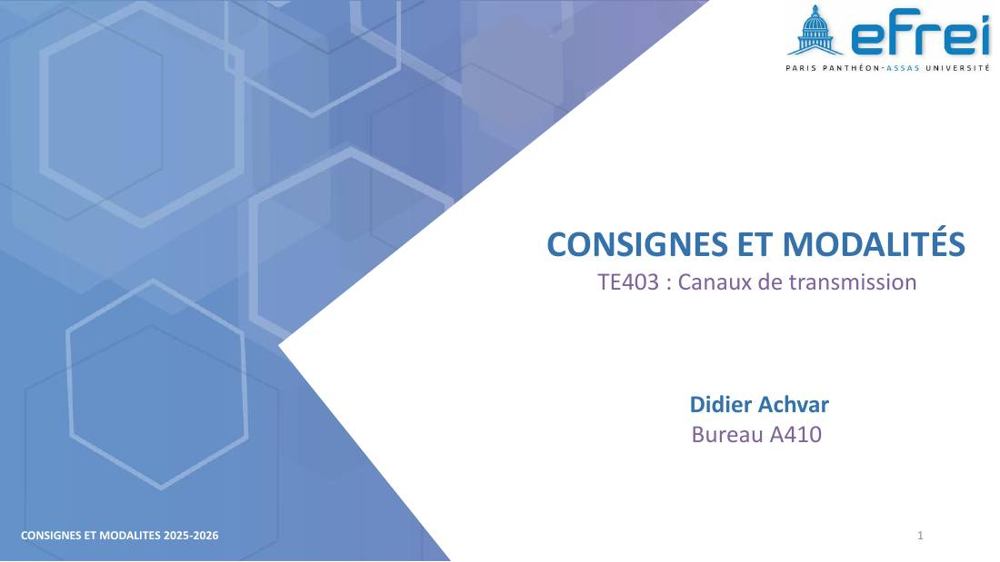
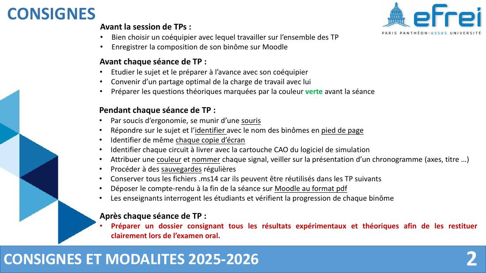
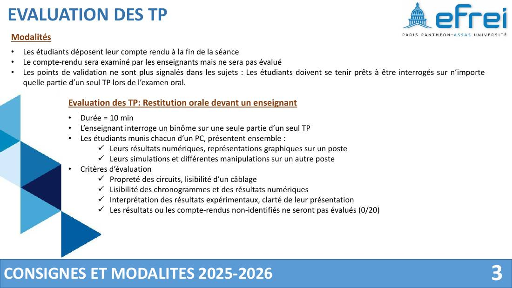
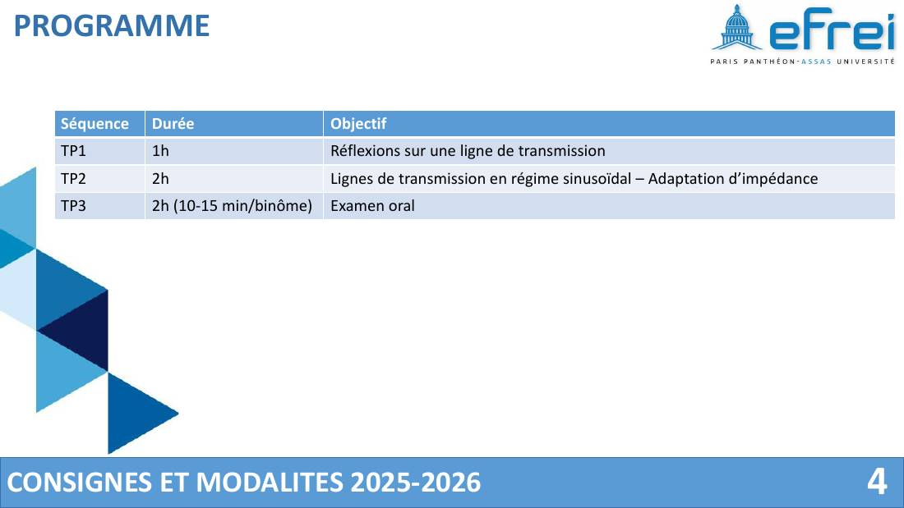
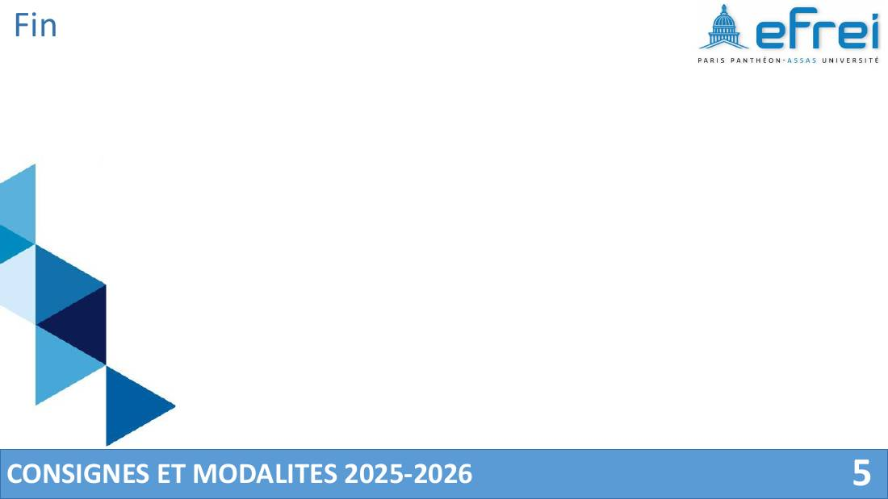

# Travaux pratiques

=== "Version simplifiée"

    Les TP se font en **binôme** sur simulateur (fichiers `.ms14`, Multisim).

    !!! methode "Avant / pendant / après chaque séance"
        - **Avant** : enregistrer son binôme sur Moodle, préparer le sujet et les
          questions théoriques **en vert**.
        - **Pendant** : nommer chaque circuit (cartouche CAO), chaque signal
          (couleur, nom) et chaque chronogramme (axes, titre) ; sauvegarder souvent
          et **garder tous les `.ms14`** (réutilisés d'un TP à l'autre) ; déposer
          le compte rendu PDF sur Moodle en fin de séance.
        - **Après** : préparer un dossier avec tous les résultats pour l'oral.

    !!! warning "Évaluation : oral de 10 minutes"
        Le compte rendu n'est pas noté. L'enseignant interroge le binôme sur
        **une partie d'un seul TP**, au hasard : il faut être prêt sur tout.
        Critères : propreté des circuits, lisibilité des chronogrammes et des
        résultats, interprétation. Un résultat **non identifié** vaut 0/20.

=== "Version papier"

    Consignes et modalités 2025-2026 (D. Achvar).

    <!-- papier: pdf/TE403P/consignes-et-nouvelles-modalit-s.pdf | Consignes TP 2025-2026 | consignes | page -->

    [{ loading=lazy .papier }](papier/consignes/p01.jpg)
    
CONSIGNES ET MODALITÉS · Consignes TP 2025-2026, page 1

    [{ loading=lazy .papier }](papier/consignes/p02.jpg)
    
Avant la session de TPs : · Consignes TP 2025-2026, page 2

    [{ loading=lazy .papier }](papier/consignes/p03.jpg)
    
EVALUATION DES TP · Consignes TP 2025-2026, page 3

    [{ loading=lazy .papier }](papier/consignes/p04.jpg)
    
Réflexions sur une ligne de transmission · Consignes TP 2025-2026, page 4

    [{ loading=lazy .papier }](papier/consignes/p05.jpg)
    
CONSIGNES ET MODALITES 2025-2026 · Consignes TP 2025-2026, page 5

    <!-- /papier -->
