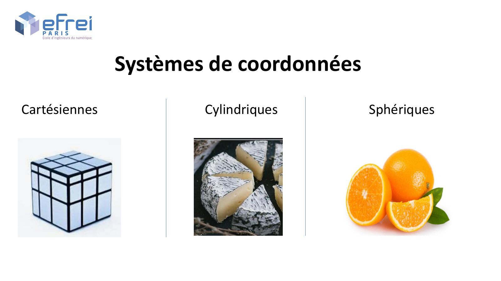
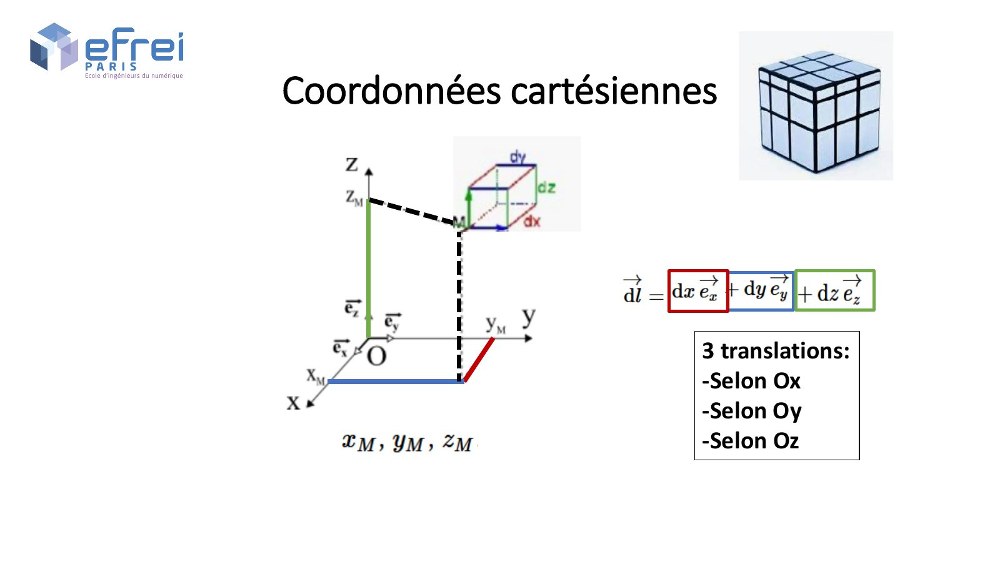
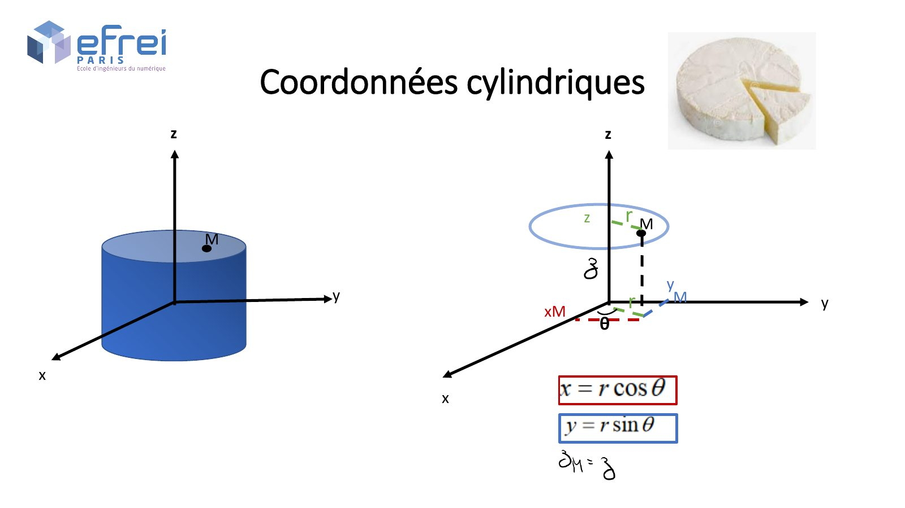
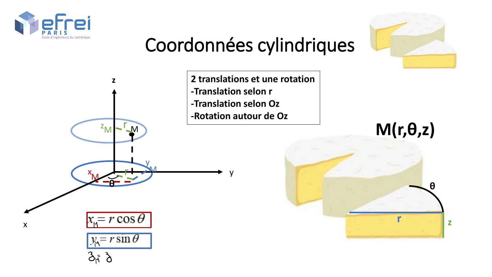
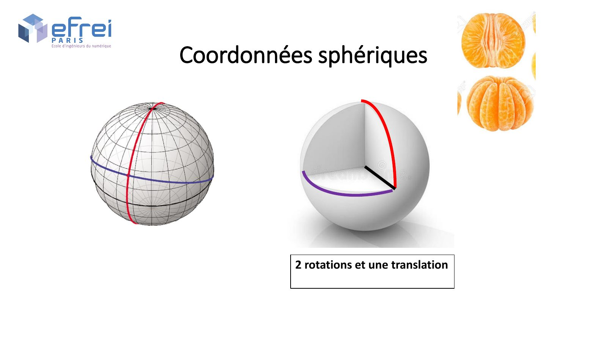
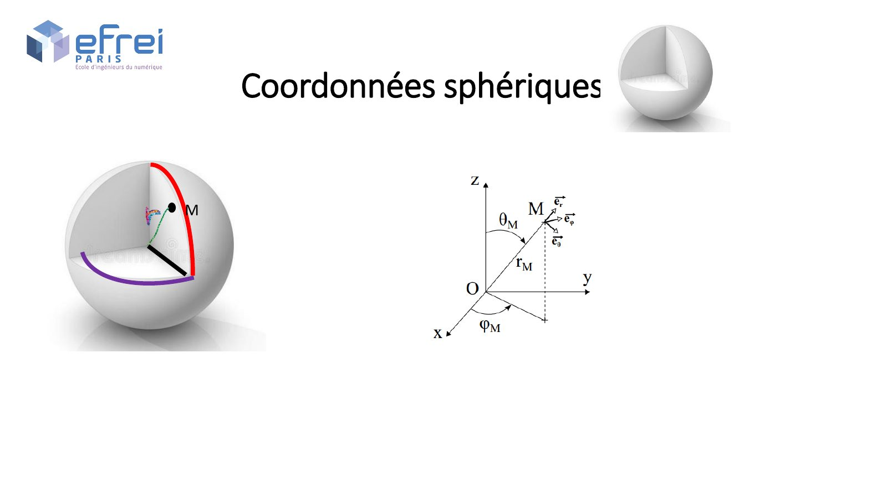

# Chapitre 2 — Systèmes de coordonnées et théorème de Gauss

=== "Version simplifiée"

    !!! abstract "Le fil du chapitre"
        Calculer un champ avec Coulomb et une intégrale, c'est souvent long. Quand la distribution
        est **très symétrique** (plan, fil, sphère), le **théorème de Gauss** donne le champ en
        trois lignes. Pour s'en servir il faut savoir choisir les bonnes coordonnées et écrire
        les bons éléments de surface et de volume.

    ## 1. Les trois systèmes de coordonnées

    Le choix du système dépend de la **symétrie** du problème :

    | Symétrie | Système | Exemples |
    |----------|---------|----------|
    | Plane | cartésiennes $(x, y, z)$ | plan infini, condensateur plan |
    | Cylindrique (un axe) | cylindriques $(r, \theta, z)$ | fil infini, câble coaxial, cylindre |
    | Sphérique (un centre) | sphériques $(r, \theta, \varphi)$ | charge ponctuelle, boule, coque sphérique |

    === "Cartésiennes"

        Trois **translations** selon $Ox$, $Oy$, $Oz$.

        - Déplacement : $\mathrm d\vec l = \mathrm dx\,\vec e_x + \mathrm dy\,\vec e_y + \mathrm dz\,\vec e_z$
        - Surfaces : $\mathrm dS = \mathrm dx\,\mathrm dy$, $\mathrm dy\,\mathrm dz$ ou $\mathrm dx\,\mathrm dz$
        - Volume : $\mathrm d\tau = \mathrm dx\,\mathrm dy\,\mathrm dz$

    === "Cylindriques"

        Deux translations ($r$ et $z$) et une rotation ($\theta$ autour de $Oz$).

        $$
        x = r\cos\theta,\quad y = r\sin\theta,\quad z = z
        \qquad r \geq 0,\ \theta \in [0, 2\pi[
        $$

        - Déplacement : $\mathrm d\vec l = \mathrm dr\,\vec e_r + r\,\mathrm d\theta\,\vec e_\theta + \mathrm dz\,\vec e_z$
        - Surfaces :
            - **latérale** (cylindre de rayon $r$) : $\mathrm dS = r\,\mathrm d\theta\,\mathrm dz$
            - **disque** (fond, $z$ fixé) : $\mathrm dS = r\,\mathrm d\theta\,\mathrm dr$
            - demi-plan ($\theta$ fixé) : $\mathrm dS = \mathrm dr\,\mathrm dz$
        - Volume : $\mathrm d\tau = r\,\mathrm dr\,\mathrm d\theta\,\mathrm dz$

    === "Sphériques"

        Une translation ($r$) et deux rotations ($\theta$ depuis $Oz$, $\varphi$ autour de $Oz$).

        $$
        x = r\sin\theta\cos\varphi,\quad y = r\sin\theta\sin\varphi,\quad z = r\cos\theta
        \qquad \theta \in [0, \pi],\ \varphi \in [0, 2\pi[
        $$

        - Déplacement : $\mathrm d\vec l = \mathrm dr\,\vec e_r + r\,\mathrm d\theta\,\vec e_\theta + r\sin\theta\,\mathrm d\varphi\,\vec e_\varphi$
        - Surface d'une **sphère** de rayon $r$ : $\mathrm dS = r^2\sin\theta\,\mathrm d\theta\,\mathrm d\varphi$
        - Volume : $\mathrm d\tau = r^2\sin\theta\,\mathrm dr\,\mathrm d\theta\,\mathrm d\varphi$

    !!! methode "Les éléments se lisent sur le déplacement"
        Chaque élément est un produit de **longueurs** élémentaires : $\mathrm dr$, $r\,\mathrm d\theta$,
        $\mathrm dz$ (ou $r\sin\theta\,\mathrm d\varphi$). Une surface = deux d'entre elles, un volume =
        les trois. Le facteur $r$ (ou $r^2\sin\theta$) n'est jamais à oublier.

    !!! example "Résultats à savoir retrouver"
        | Grandeur | Calcul | Résultat |
        |----------|--------|----------|
        | Aire d'un disque | $\int_0^R\!\int_0^{2\pi} r\,\mathrm dr\,\mathrm d\theta$ | $\pi R^2$ |
        | Aire latérale d'un cylindre | $\int_0^{2\pi}\!\int_0^H R\,\mathrm d\theta\,\mathrm dz$ | $2\pi RH$ |
        | Aire d'une sphère | $R^2\int_0^\pi \sin\theta\,\mathrm d\theta\int_0^{2\pi}\mathrm d\varphi$ | $4\pi R^2$ |
        | Volume d'une boule | $\int_0^R r^2\,\mathrm dr\int_0^\pi\sin\theta\,\mathrm d\theta\int_0^{2\pi}\mathrm d\varphi$ | $\dfrac43\pi R^3$ |

        Retenir aussi $\int_0^\pi \sin\theta\,\mathrm d\theta = 2$ et
        $\int_0^\pi \sin^2\theta\,\mathrm d\theta = \dfrac{\pi}{2}$ (avec $\sin^2\theta = \dfrac{1 - \cos 2\theta}{2}$).

    ## 2. Flux du champ électrique

    !!! definition "Flux"
        Le flux de $\vec E$ à travers une surface $S$ orientée :

        $$
        \Phi(\vec E) = \iint_S \vec E\cdot\mathrm d\vec S
        \qquad \mathrm d\vec S = \mathrm dS\,\vec n
        $$

        Pour une surface **fermée**, $\vec n$ est orienté **vers l'extérieur**.

    Deux cas qui simplifient tout :

    - $\vec E \parallel \mathrm d\vec S$ et $\|\vec E\|$ constant sur la surface : $\Phi = E \times S$ ;
    - $\vec E \perp \mathrm d\vec S$ : le flux est **nul** (c'est le cas des surfaces latérales
      « rasées » par le champ).

    ## 3. Le théorème de Gauss

    !!! tip "Simulation animée"
        Gonfle une surface de Gauss autour d'une boule, d'une sphère creuse ou d'un cylindre et regarde $E(r)$ se tracer. [:material-play-circle: Ouvrir la simulation](../simulations/simulations-champs.html#gauss){ target="_blank" }

    !!! theoreme "Théorème de Gauss"
        Le flux de $\vec E$ à travers une surface **fermée** $S_g$ (la « surface de Gauss »)
        est égal à la charge **intérieure** divisée par $\varepsilon_0$ :

        $$
        \Phi(\vec E) = \oint\!\!\!\oint_{S_g} \vec E\cdot\mathrm d\vec S = \frac{Q_{int}}{\varepsilon_0}
        $$

        Dans un milieu, on remplace $\varepsilon_0$ par $\varepsilon = \varepsilon_r\varepsilon_0$.

    Les charges **extérieures** à la surface créent du champ sur la surface, mais leur flux total
    est nul : elles n'apparaissent pas dans $Q_{int}$.

    ### Symétries et invariances

    Avant d'appliquer Gauss il faut connaître **la direction** de $\vec E$ et **les variables** dont
    il dépend.

    !!! theoreme "Les deux règles"
        - **Symétrie** : si un plan passant par $M$ est un plan de symétrie de la distribution,
          alors $\vec E(M)$ est **contenu dans ce plan**. Avec deux plans de symétrie, $\vec E$ est
          porté par leur intersection.
        - **Invariance** : si la distribution est invariante par translation selon $z$ (ou rotation
          selon $\theta$), alors $E$ ne dépend **pas** de $z$ (ou de $\theta$).

    | Distribution | Direction de $\vec E$ | Dépend de | Surface de Gauss |
    |--------------|-----------------------|-----------|------------------|
    | Sphère, boule (centre $O$) | $\vec e_r$ | $r$ | sphère de rayon $r$ |
    | Fil / cylindre infini (axe $Oz$) | $\vec e_r$ (cylindrique) | $r$ | cylindre de rayon $r$, hauteur $H$ |
    | Plan infini ($xOy$) | $\vec e_z$ | $z$ | cylindre (ou pavé) de section $S$ traversant le plan |

    !!! methode "Appliquer le théorème de Gauss"
        1. **Symétries** → direction de $\vec E$ ; **invariances** → variable dont il dépend.
        2. Choisir une **surface de Gauss fermée** passant par $M$, sur laquelle $\vec E$ est soit
           parallèle et constant, soit perpendiculaire à $\mathrm d\vec S$.
        3. Calculer le **flux** : souvent $\Phi = E(r) \times (\text{aire utile})$.
        4. Calculer $Q_{int}$ **région par région** (intégrale de la densité jusqu'à $r$).
        5. Égaler $\Phi = Q_{int}/\varepsilon_0$ et isoler $E$. Écrire le résultat en **vecteur**.
        6. Si on demande $V$ : intégrer $E = -\mathrm dV/\mathrm dr$ et fixer les constantes avec
           $V(\infty) = 0$ et la **continuité** de $V$ aux frontières.

    ## 4. Les résultats classiques

    !!! example "Boule de rayon $R$ chargée uniformément ($\rho$, charge $Q$)"
        Surface de Gauss : sphère de rayon $r$, $\Phi = E \cdot 4\pi r^2$.

        - $r < R$ : $Q_{int} = \rho\dfrac43\pi r^3$, donc $\vec E = \dfrac{\rho\,r}{3\varepsilon_0}\vec e_r$ (croît linéairement) ;
        - $r > R$ : $Q_{int} = Q$, donc $\vec E = \dfrac{Q}{4\pi\varepsilon_0 r^2}\vec e_r$ : comme une charge
          ponctuelle placée au centre.

    !!! example "Fil infini (densité $\lambda$)"
        Cylindre de rayon $r$ et hauteur $H$ : flux nul sur les deux bases,
        $\Phi = E\cdot 2\pi rH$ sur la face latérale, $Q_{int} = \lambda H$ :

        $$
        \vec E = \frac{\lambda}{2\pi\varepsilon_0\,r}\,\vec e_r
        $$

    !!! example "Plan infini (densité $\sigma$)"
        Cylindre de section $S$ coupé en deux par le plan : flux nul sur la face latérale,
        $\Phi = 2ES$ sur les deux bases, $Q_{int} = \sigma S$ :

        $$
        \vec E = \frac{\sigma}{2\varepsilon_0}\,\vec e_z \ (z > 0),
        \qquad \vec E = -\frac{\sigma}{2\varepsilon_0}\,\vec e_z \ (z < 0)
        $$

        Le champ est **uniforme** de chaque côté et **change de sens** en traversant le plan.

    !!! example "Condensateur plan ($+\sigma$ et $-\sigma$, distance $e$)"
        Par superposition des deux plans : $E = \dfrac{\sigma}{\varepsilon_0}$ entre les armatures,
        **0 à l'extérieur**. Tension $U = \dfrac{\sigma e}{\varepsilon_0}$ et capacité

        $$
        C = \frac{Q}{U} = \frac{\varepsilon_0 S}{e}
        $$

        La capacité ne dépend que de la **géométrie** et du milieu, pas de la charge.

    ## 5. Capacité d'un condensateur

    !!! tip "Simulation animée"
        Champ uniforme $E = U/d$, équipotentielles planes, électron accéléré ou dévié. [:material-play-circle: Ouvrir la simulation](../simulations/simulations-champs.html#condo){ target="_blank" }

    !!! definition "Capacité"
        Deux conducteurs portant $+Q$ et $-Q$, aux potentiels $V_1$ et $V_2$ :
        $C = \dfrac{Q}{V_1 - V_2}$, en farads (F).

    | Condensateur | Capacité |
    |--------------|----------|
    | Plan (surface $S$, distance $e$) | $\dfrac{\varepsilon_0 S}{e}$ |
    | Sphérique (rayons $R_1 < R_2$) | $\dfrac{4\pi\varepsilon_0 R_1R_2}{R_2 - R_1}$ |
    | Cylindrique (rayons $R_1 < R_2$, hauteur $h$) | $\dfrac{2\pi\varepsilon_0 h}{\ln(R_2/R_1)}$ |

    ## Pièges classiques

    !!! piege "Flux nul ≠ champ nul"
        Si $Q_{int} = 0$, le **flux** est nul, mais le champ peut très bien exister sur la surface
        (des charges extérieures le créent). On ne conclut $E = 0$ que si la symétrie impose en plus
        que $E$ soit constant et de signe fixe sur la surface.

    !!! piege "La charge intérieure, région par région"
        Pour $r$ dans la zone chargée, $Q_{int}$ dépend de $r$ (on intègre de la frontière intérieure
        jusqu'à $r$). Au-delà, $Q_{int}$ est la charge **totale**, constante. Un résultat en
        $Q_{int}(R)$ quand $M$ est à l'intérieur est faux.

    !!! piege "Gauss ne marche que si la symétrie est suffisante"
        Le théorème est toujours vrai, mais il ne **donne** $E$ que pour les distributions très
        symétriques. Pour un anneau ou un disque, on revient à l'intégration de $\mathrm d\vec E$
        ([chapitre 1](chapitre-1-electrostatique.md)).

=== "Version papier"

    Les diapos « Systèmes de coordonnées » du chapitre 2. Le formulaire du livret de TD et les
    feuilles de formules (dont le théorème de Gauss) sont dans le [formulaire](../fiches/formulaire.md).

    [{ loading=lazy .papier }](papier/ch2/p01.jpg)
    
Les trois systèmes de coordonnées · Chapitre 2 — systèmes de coordonnées, diapo 1

    [{ loading=lazy .papier }](papier/ch2/p02.jpg)
    
Coordonnées cartésiennes · Chapitre 2 — systèmes de coordonnées, diapo 2

    [{ loading=lazy .papier }](papier/ch2/p03.jpg)
    
Coordonnées cylindriques · Chapitre 2 — systèmes de coordonnées, diapo 3

    [{ loading=lazy .papier }](papier/ch2/p04.jpg)
    
Coordonnées cylindriques : déplacements · Chapitre 2 — systèmes de coordonnées, diapo 4

    [{ loading=lazy .papier }](papier/ch2/p05.jpg)
    
Coordonnées sphériques · Chapitre 2 — systèmes de coordonnées, diapo 5

    [{ loading=lazy .papier }](papier/ch2/p06.jpg)
    
Coordonnées sphériques : déplacements · Chapitre 2 — systèmes de coordonnées, diapo 6

