# Chapitre 3 — Champ magnétique

=== "Version simplifiée"

    !!! abstract "Le fil du chapitre"
        Les **courants** (charges en mouvement) créent un champ magnétique $\vec B$. On le calcule
        soit par la **loi de Biot et Savart** (intégrale, marche toujours), soit par le **théorème
        d'Ampère** (trois lignes, si la symétrie est suffisante). C'est le pendant exact du
        chapitre 1 (Coulomb) et du chapitre 2 (Gauss).

    ## 1. Sources et mise en évidence

    Trois sources de champ magnétique :

    1. les **aimants** (action plus forte aux pôles) ;
    2. les **courants**, c'est-à-dire des charges en mouvement ;
    3. la **Terre** (de l'ordre de quelques dizaines de µT).

    !!! definition "Expérience d'Oersted (1820)"
        Un fil parcouru par un courant fait **dévier** une boussole placée à côté. Si on inverse le
        courant, la déviation s'inverse. Conclusion : **un courant crée un champ magnétique**.
        Biot et Savart mesurent ensuite que ce champ décroît comme $1/r$ autour d'un fil.

    Unités : le **tesla** (T). On rencontre aussi le gauss : $1\ \text{G} = 10^{-4}$ T.

    ## 2. Lignes de champ

    !!! definition "Ligne de champ magnétique"
        Courbe tangente à $\vec B$ en chaque point, orientée dans le sens de $\vec B$.

    - À l'extérieur d'un aimant, elles vont du pôle **nord** vers le pôle **sud**.
    - Autour d'un fil, ce sont des **cercles** centrés sur le fil.
    - Elles sont **fermées** : elles ne partent ni n'arrivent nulle part (pas de « charge
      magnétique »).
    - **Champ uniforme** (même direction, sens, norme) → lignes parallèles : à l'intérieur d'un
      solénoïde, entre les branches d'un aimant en U, au centre des bobines de Helmholtz (deux
      bobines identiques séparées d'une distance égale à leur rayon).

    ## 3. Calcul du champ

    ### Charge en mouvement

    !!! theoreme "Champ d'une charge mobile"
        Une charge $q$ en $P$, de vitesse $\vec v$, crée en $M$ :

        $$
        \vec B(M) = \frac{\mu_0}{4\pi}\,\frac{q\,\vec v\wedge\overrightarrow{PM}}{PM^3}
        $$

        $\mu_0 = 4\pi\times 10^{-7}$ H/m est la **perméabilité du vide**.

    ### Loi de Biot et Savart

    !!! theoreme "Loi de Biot et Savart"
        Un élément de circuit $I\,\mathrm d\vec l$ placé en $P$ crée en $M$ :

        $$
        \mathrm d\vec B(M) = \frac{\mu_0}{4\pi}\,\frac{I\,\mathrm d\vec l\wedge\overrightarrow{PM}}{PM^3}
        \qquad\text{et}\qquad
        \vec B(M) = \frac{\mu_0}{4\pi}\oint_{(C)}\frac{I\,\mathrm d\vec l\wedge\overrightarrow{PM}}{PM^3}
        $$

        Direction et sens : **règle de la main droite** (pouce = sens de $I$, index vers $M$,
        majeur = sens de $\mathrm d\vec B$), ou règle du tire-bouchon.

    Conséquence immédiate : si $M$ est **sur le prolongement** d'une portion rectiligne, alors
    $\mathrm d\vec l \parallel \overrightarrow{PM}$ et cette portion ne crée **aucun** champ en $M$.

    !!! example "Fil rectiligne infini"
        On repère $P$ par l'angle $\theta$ vu depuis $M$ : $z = r\tan\theta$, $PM = r/\cos\theta$,
        $\mathrm dz = r\,\mathrm d\theta/\cos^2\theta$. On obtient
        $\mathrm dB = \dfrac{\mu_0 I}{4\pi r}\cos\theta\,\mathrm d\theta$, intégré de $-\pi/2$ à $\pi/2$ :

        $$
        \vec B = \frac{\mu_0 I}{2\pi r}\,\vec e_\theta
        $$

        Le champ est **orthoradial** : les lignes de champ sont des cercles autour du fil.

    !!! example "Spire circulaire, sur son axe"
        Spire de rayon $R$, courant $I$, point $M$ sur l'axe à la cote $z$ ; $\alpha$ est l'angle
        sous lequel on voit le rayon depuis $M$ ($\sin\alpha = R/PM$).

        - $\mathrm d\vec l \perp \overrightarrow{PM}$, donc $\|\mathrm d\vec B\| = \dfrac{\mu_0 I\,\mathrm dl}{4\pi\,PM^2}$.
        - Par symétrie, les composantes perpendiculaires à l'axe s'annulent ; il reste la projection
          sur $\vec e_z$, qui vaut $\mathrm dB\sin\alpha$.
        - On intègre $\mathrm dl$ sur $2\pi R$ :

        $$
        \vec B(M) = \frac{\mu_0 I R^2}{2\,(R^2 + z^2)^{3/2}}\,\vec e_z = \frac{\mu_0 I}{2R}\sin^3\alpha\;\vec e_z
        $$

        Au centre : $B = \dfrac{\mu_0 I}{2R}$. Pour une **demi-spire** : $\dfrac{\mu_0 I}{4R}$.

    ## 4. Propriétés du champ magnétique

    ### Flux conservatif

    !!! theoreme "Flux à travers une surface fermée"
        $$
        \Phi_S(\vec B) = \oint\!\!\!\oint_S \vec B\cdot\mathrm d\vec S = 0
        $$

        Tout ce qui entre ressort : on ne peut pas isoler un pôle nord d'un pôle sud.
        (À comparer avec $\Phi(\vec E) = Q_{int}/\varepsilon_0$.)

    **Tube de flux** : ensemble des lignes de champ qui s'appuient sur un contour fermé. Le flux
    sur la face latérale est nul ($\vec B$ tangent), donc le flux **se conserve** d'une section à
    l'autre : $\Phi_{S_2} = -\Phi_{S_1}$ (en orientant vers l'extérieur). Unité du flux : le
    **weber**, $1\ \text{Wb} = 1\ \text{T}\cdot\text{m}^2$.

    ### Circulation et théorème d'Ampère

    Pour un fil infini, avec $\mathrm d\vec l = \mathrm dr\,\vec e_r + r\,\mathrm d\theta\,\vec e_\theta + \mathrm dz\,\vec e_z$ :
    $\oint \vec B\cdot\mathrm d\vec l = \dfrac{\mu_0 I}{2\pi}\oint\mathrm d\theta$, qui vaut
    $\mu_0 I$ si le contour **entoure** le fil, et 0 sinon. Ampère généralise ce résultat :

    !!! theoreme "Théorème d'Ampère"
        La circulation de $\vec B$ le long d'un contour **fermé** $C$ est égale à $\mu_0$ fois la
        somme **algébrique** des courants qui traversent une surface s'appuyant sur $C$ :

        $$
        \oint_{(C)} \vec B\cdot\mathrm d\vec l = \mu_0 \sum I_{\text{enlacés}}
        $$

        Un courant compte $+$ s'il traverse dans le sens donné par l'orientation du contour
        (règle de la main droite), $-$ sinon. Valable en **régime permanent** (courants continus).

    !!! methode "Appliquer le théorème d'Ampère"
        1. **Symétries et invariances** → direction de $\vec B$ (souvent $\vec e_\theta$) et variable
           ($r$).
        2. **Contour d'Ampère** : une courbe fermée passant par $M$ où $\vec B$ est tangent et de
           norme constante. Pour un problème à axe : un **cercle** de rayon $r$ centré sur l'axe.
        3. **Circulation** : $\oint \vec B\cdot\mathrm d\vec l = B(r)\cdot 2\pi r$.
        4. **Courants enlacés**, région par région (avec une densité de courant si le courant est
           réparti : $I_{enl} = \iint \vec j\cdot\mathrm d\vec S$).
        5. Égaler et isoler $B$, puis écrire le résultat en vecteur.

    !!! example "Résultats classiques"
        | Distribution | Champ |
        |--------------|-------|
        | Fil infini | $B = \dfrac{\mu_0 I}{2\pi r}$ |
        | Cylindre plein de rayon $R$ (courant uniforme) | $B = \dfrac{\mu_0 I r}{2\pi R^2}$ dedans, $\dfrac{\mu_0 I}{2\pi r}$ dehors |
        | Cylindre creux (courant en surface) | $0$ dedans, $\dfrac{\mu_0 I}{2\pi r}$ dehors |
        | Solénoïde infini ($n$ spires par mètre) | $B = \mu_0 n I$ dedans (uniforme), 0 dehors |

    ### Densités de courant

    | Courant réparti | Densité | Unité | Lien avec $I$ |
    |-----------------|---------|-------|---------------|
    | En volume | $\vec j$ | A/m² | $I = \iint \vec j\cdot\mathrm d\vec S$ (uniforme : $j = I/\text{section}$) |
    | En surface | $\vec J_s$ | A/m | $I = \int J_s\,\mathrm dl$ (sur un cylindre : $I = J_s\cdot 2\pi R$) |

    ## 5. Électrostatique et magnétostatique

    | | Électrostatique | Magnétostatique |
    |-|-----------------|-----------------|
    | Sources | charges immobiles | courants (charges en mouvement) |
    | Loi élémentaire | Coulomb : $k_e\dfrac{\mathrm dQ}{r^2}\vec u$ | Biot-Savart : $\dfrac{\mu_0}{4\pi}\dfrac{I\,\mathrm d\vec l\wedge\overrightarrow{PM}}{PM^3}$ |
    | Constante | $\varepsilon_0$ | $\mu_0 = 4\pi\times 10^{-7}$ H/m |
    | Lignes de champ | ouvertes (de + vers −) | **fermées** |
    | Flux sur surface fermée | $Q_{int}/\varepsilon_0$ (Gauss) | **0** |
    | Théorème « rapide » | Gauss (surface fermée) | Ampère (contour fermé) |
    | Fil infini | $\dfrac{\lambda}{2\pi\varepsilon_0 r}\vec e_r$ (radial) | $\dfrac{\mu_0 I}{2\pi r}\vec e_\theta$ (orthoradial) |

    ## Pièges classiques

    !!! piege "Le produit vectoriel"
        $\vec B$ est **perpendiculaire** à la fois au courant et à $\overrightarrow{PM}$. Pour un fil, il
        n'est donc jamais dirigé vers le fil (contrairement à $\vec E$ d'une charge) : il tourne autour.

    !!! piege "Courants de sens opposés"
        Dans Ampère, la somme est **algébrique** : un câble coaxial (aller $I$, retour $-I$) donne
        $\sum I = 0$ à l'extérieur, donc $B = 0$.

=== "Version papier"

    Les diapos du chapitre 3 (support 2024-2025, le dernier disponible pour la magnétostatique).

    [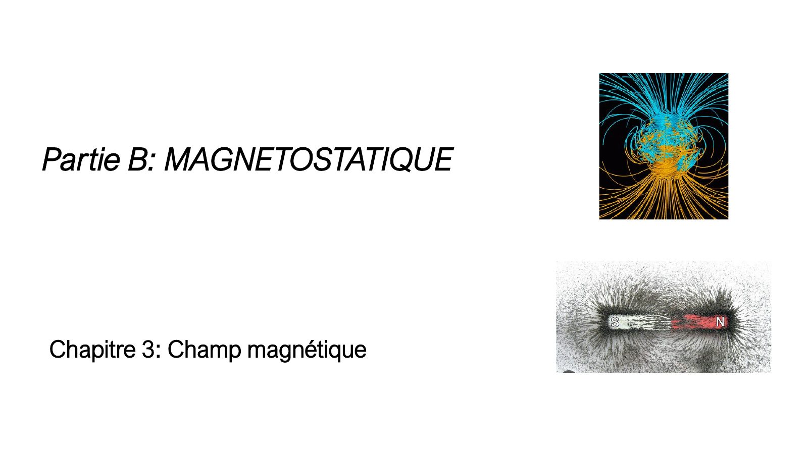{ loading=lazy .papier }](papier/ch3/p01.jpg)
    
Partie B — Chapitre 3 : champ magnétique · Chapitre 3 — support 2024-2025, diapo 1

    [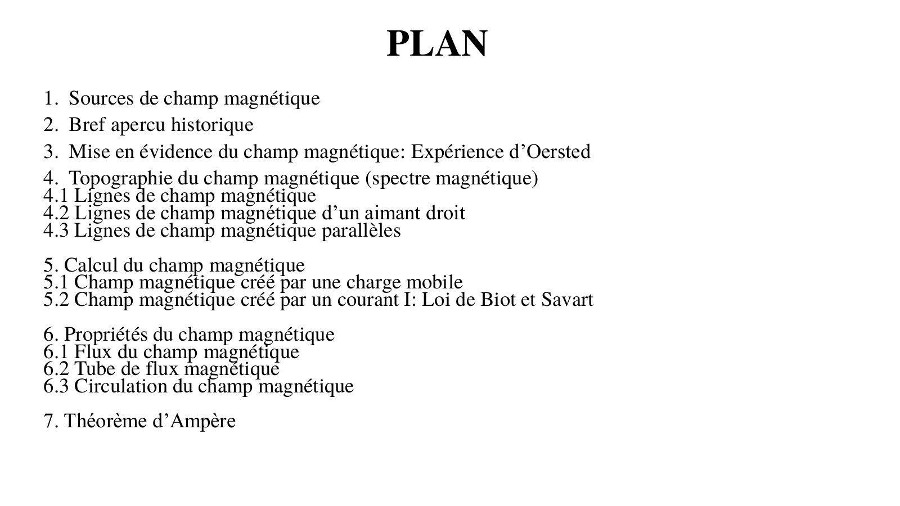{ loading=lazy .papier }](papier/ch3/p02.jpg)
    
Plan · Chapitre 3 — support 2024-2025, diapo 2

    [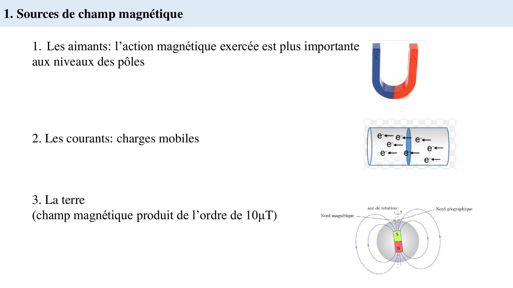{ loading=lazy .papier }](papier/ch3/p03.jpg)
    
Sources de champ magnétique · Chapitre 3 — support 2024-2025, diapo 3

    [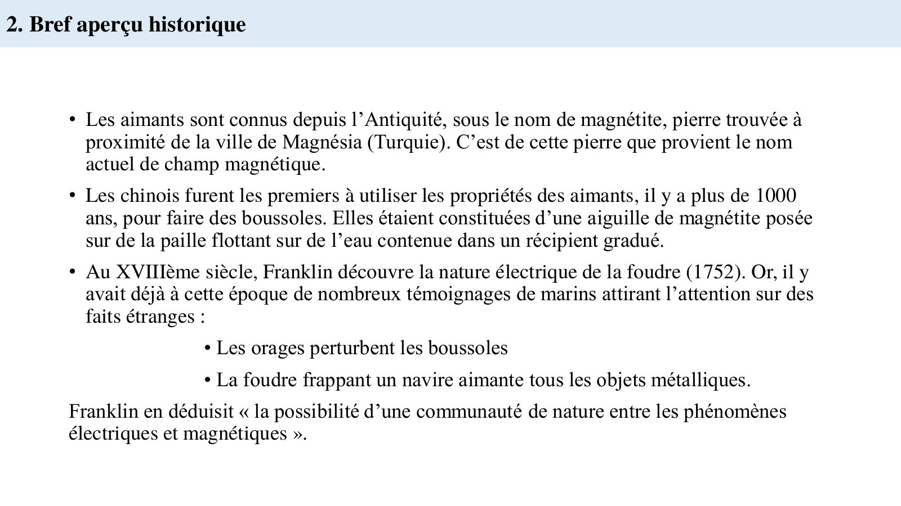{ loading=lazy .papier }](papier/ch3/p04.jpg)
    
Bref aperçu historique · Chapitre 3 — support 2024-2025, diapo 4

    [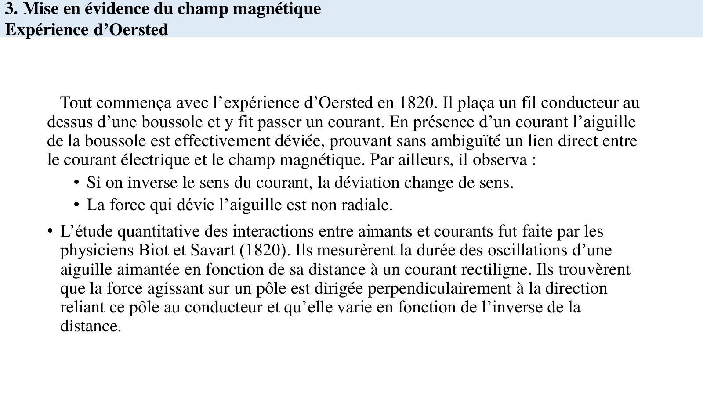{ loading=lazy .papier }](papier/ch3/p05.jpg)
    
Expérience d'Oersted · Chapitre 3 — support 2024-2025, diapo 5

    [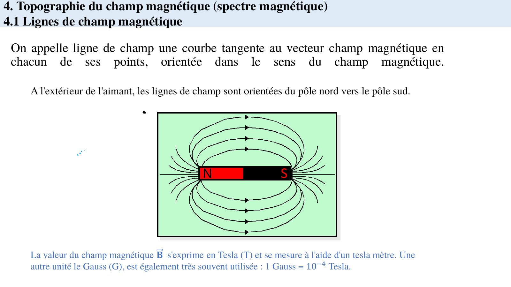{ loading=lazy .papier }](papier/ch3/p06.jpg)
    
Lignes de champ magnétique · Chapitre 3 — support 2024-2025, diapo 6

    [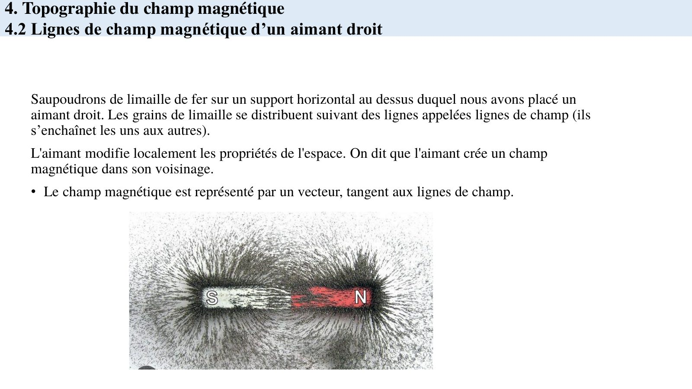{ loading=lazy .papier }](papier/ch3/p07.jpg)
    
Lignes de champ d'un aimant droit · Chapitre 3 — support 2024-2025, diapo 7

    [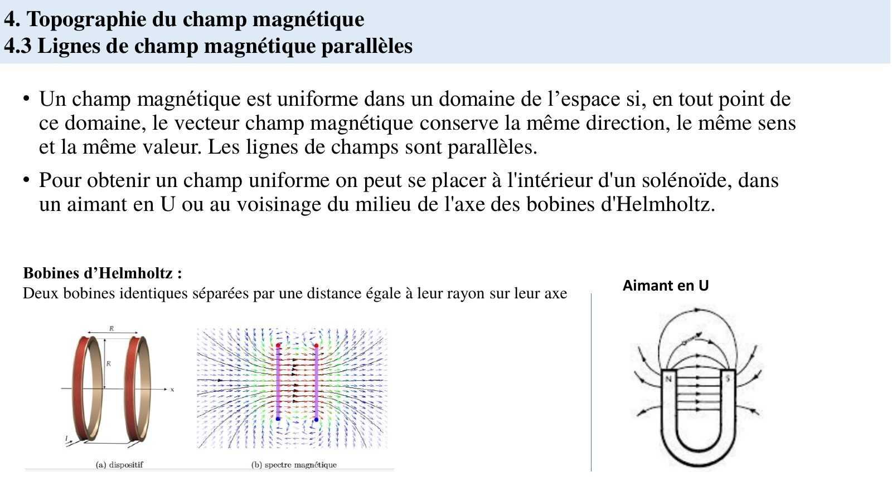{ loading=lazy .papier }](papier/ch3/p08.jpg)
    
Champ uniforme : lignes parallèles · Chapitre 3 — support 2024-2025, diapo 8

    [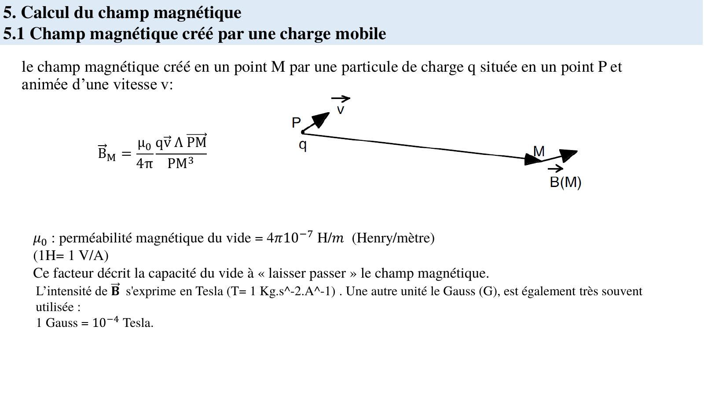{ loading=lazy .papier }](papier/ch3/p09.jpg)
    
Champ créé par une charge mobile · Chapitre 3 — support 2024-2025, diapo 9

    [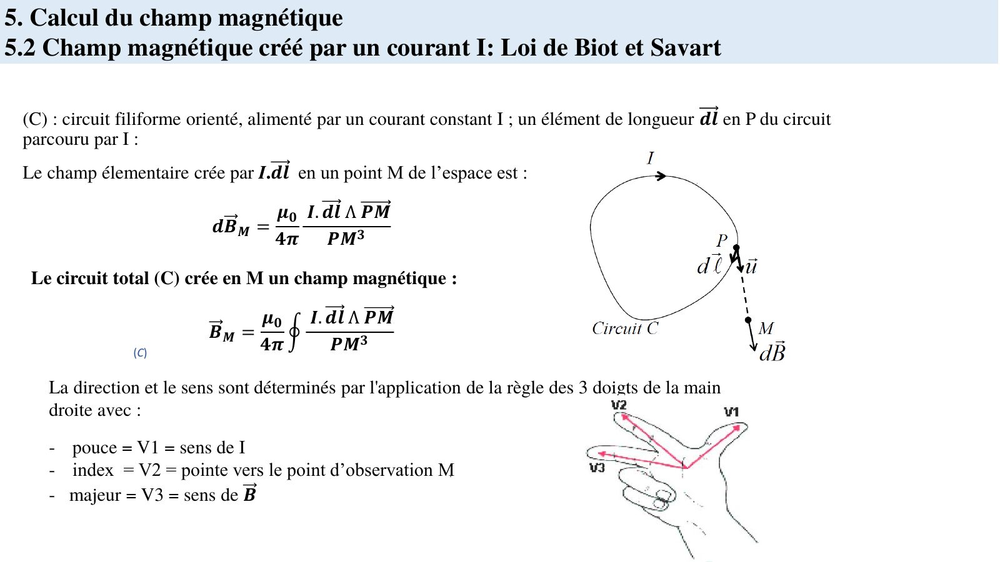{ loading=lazy .papier }](papier/ch3/p10.jpg)
    
Loi de Biot et Savart · Chapitre 3 — support 2024-2025, diapo 10

    [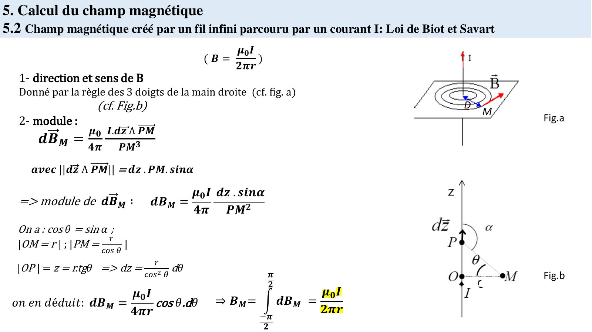{ loading=lazy .papier }](papier/ch3/p11.jpg)
    
Fil infini : calcul par Biot et Savart · Chapitre 3 — support 2024-2025, diapo 11

    [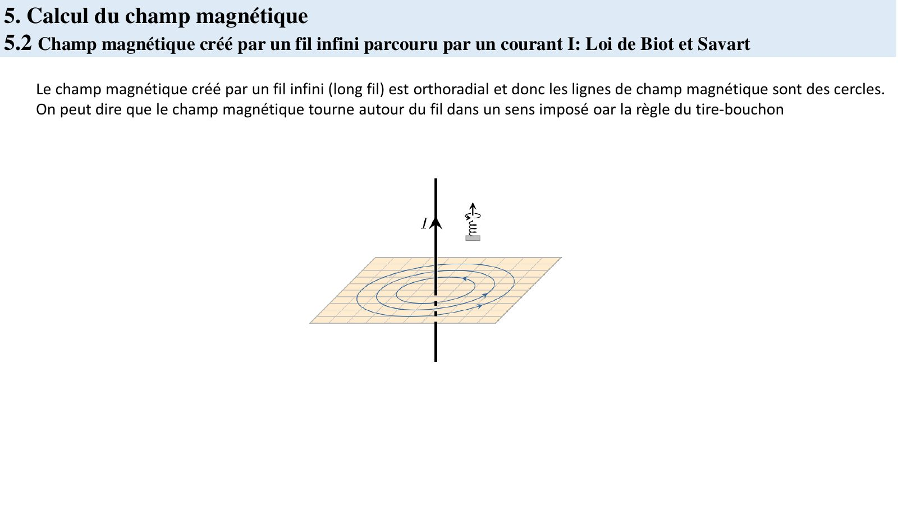{ loading=lazy .papier }](papier/ch3/p12.jpg)
    
Fil infini : lignes de champ circulaires · Chapitre 3 — support 2024-2025, diapo 12

    [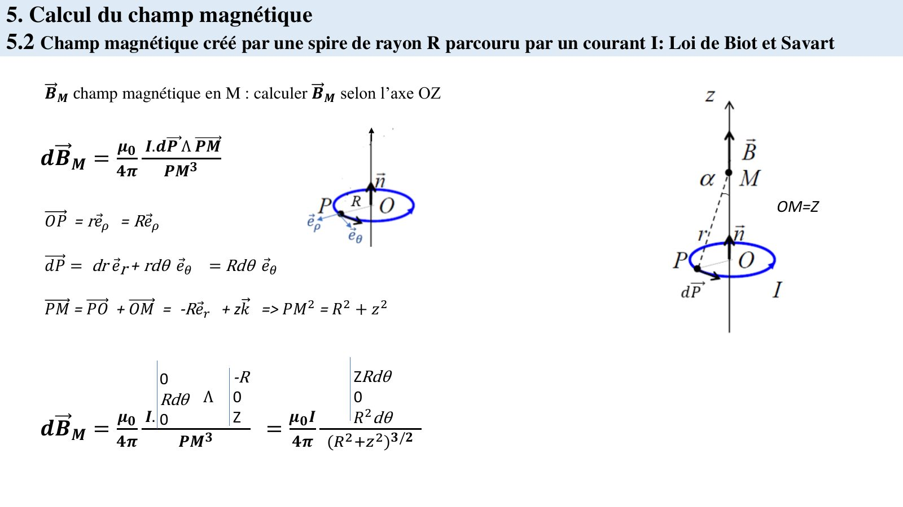{ loading=lazy .papier }](papier/ch3/p13.jpg)
    
Spire circulaire sur son axe · Chapitre 3 — support 2024-2025, diapo 13

    [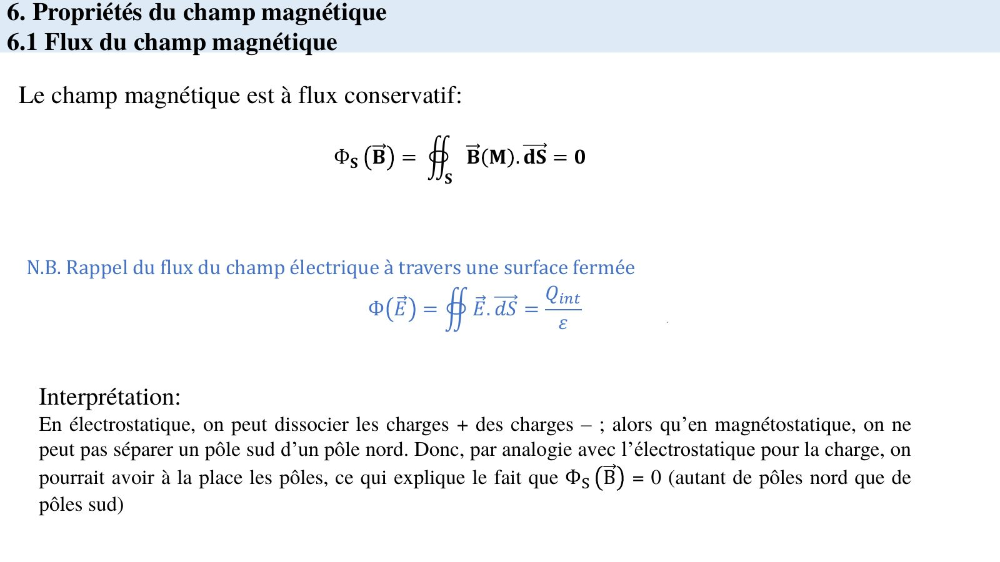{ loading=lazy .papier }](papier/ch3/p14.jpg)
    
Flux du champ magnétique · Chapitre 3 — support 2024-2025, diapo 14

    [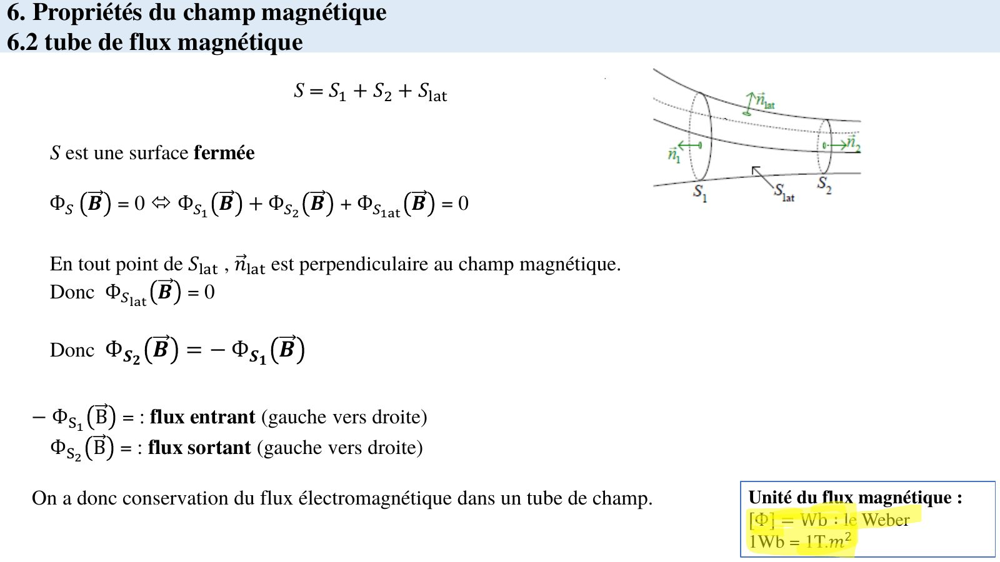{ loading=lazy .papier }](papier/ch3/p15.jpg)
    
Tube de flux · Chapitre 3 — support 2024-2025, diapo 15

    [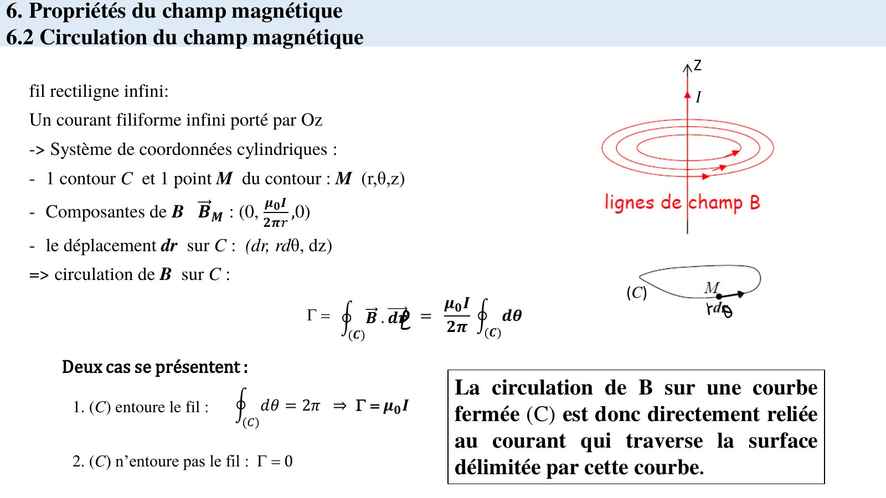{ loading=lazy .papier }](papier/ch3/p16.jpg)
    
Circulation du champ magnétique · Chapitre 3 — support 2024-2025, diapo 16

    [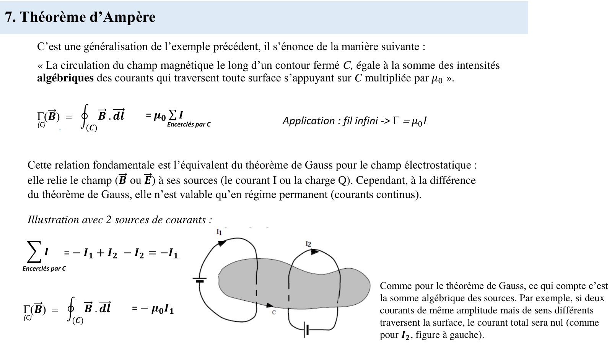{ loading=lazy .papier }](papier/ch3/p17.jpg)
    
Théorème d'Ampère · Chapitre 3 — support 2024-2025, diapo 17

