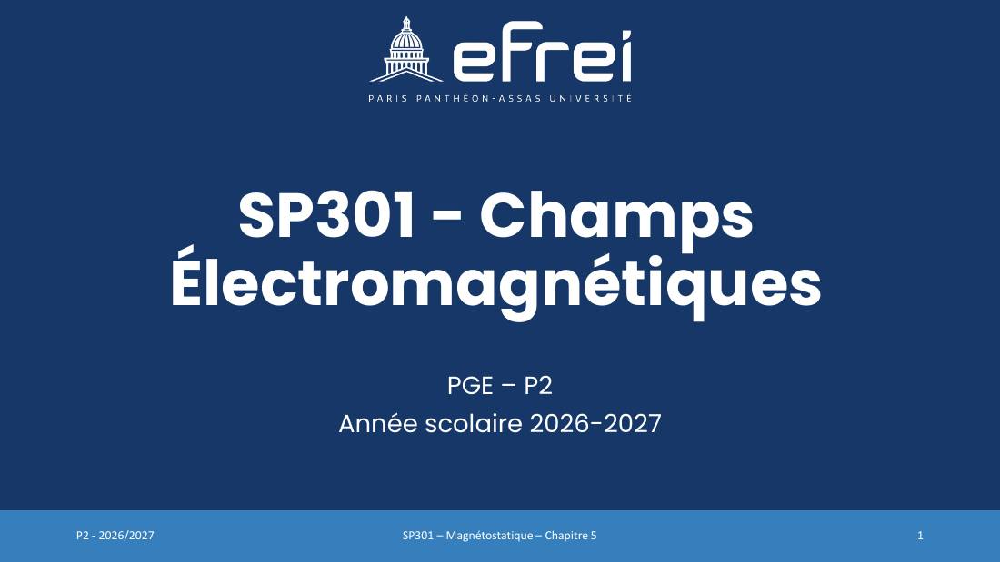
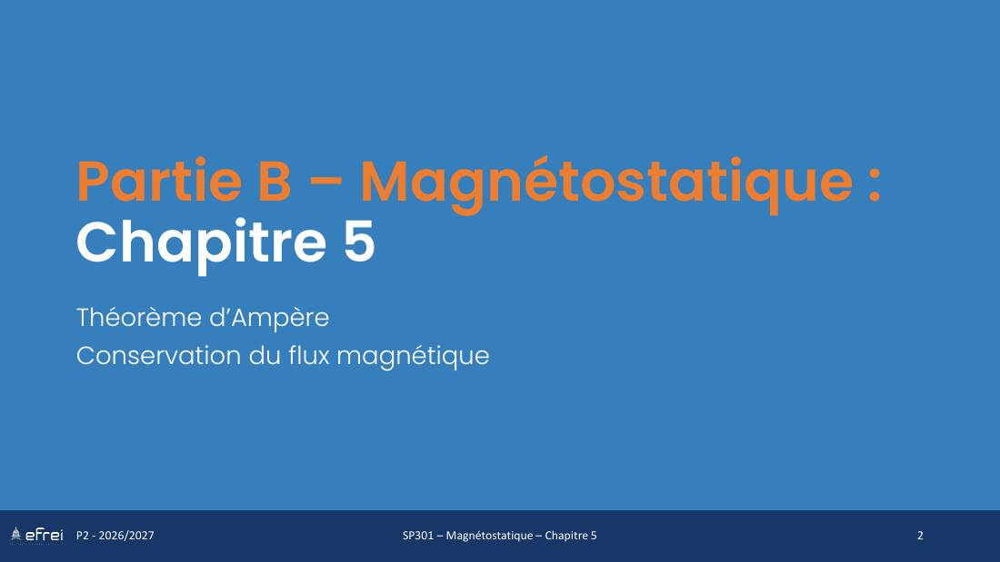
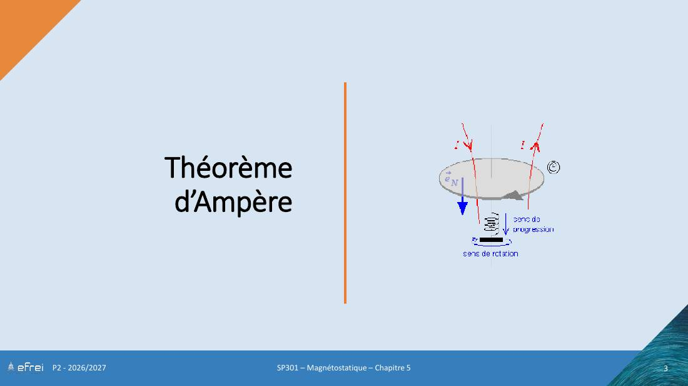
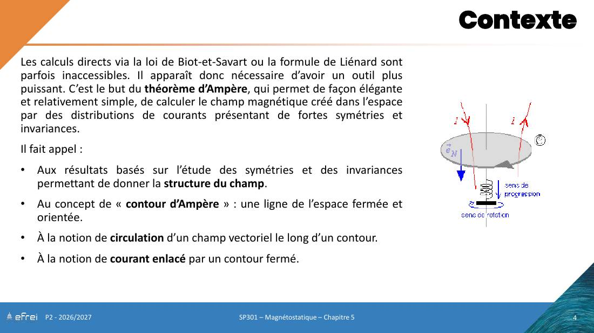
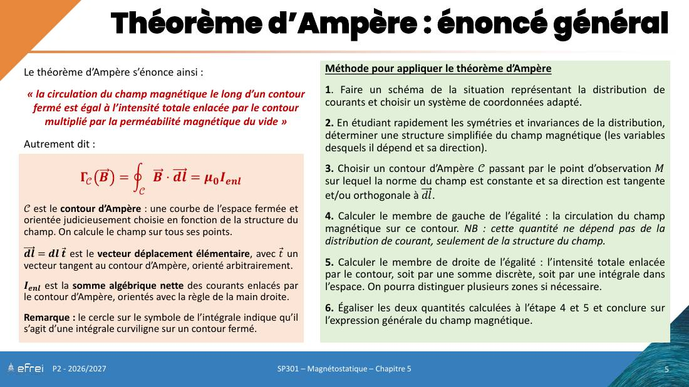
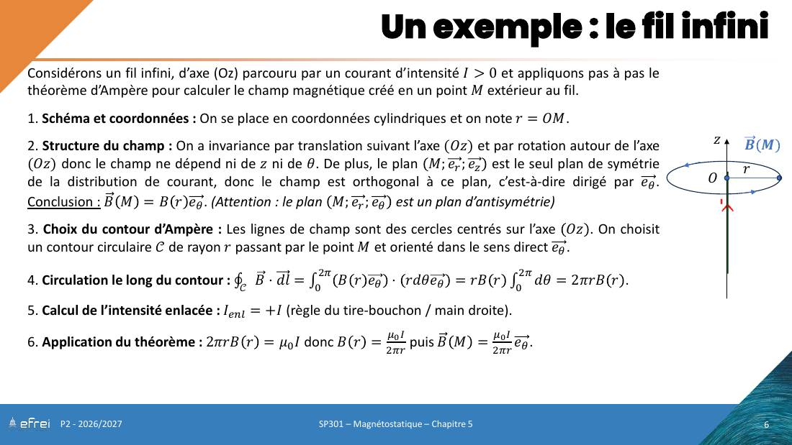
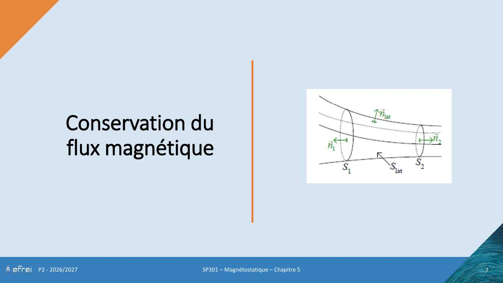
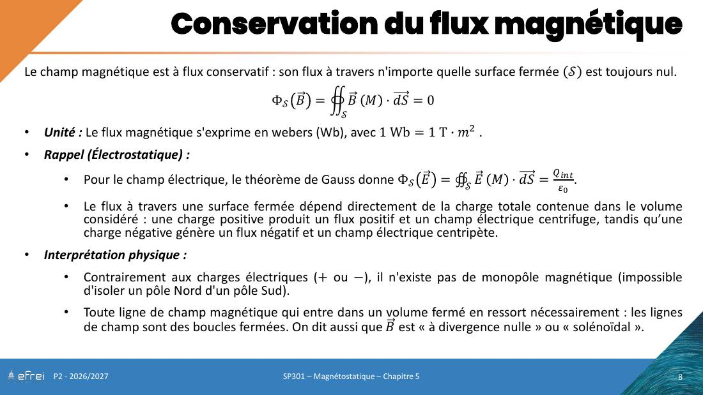
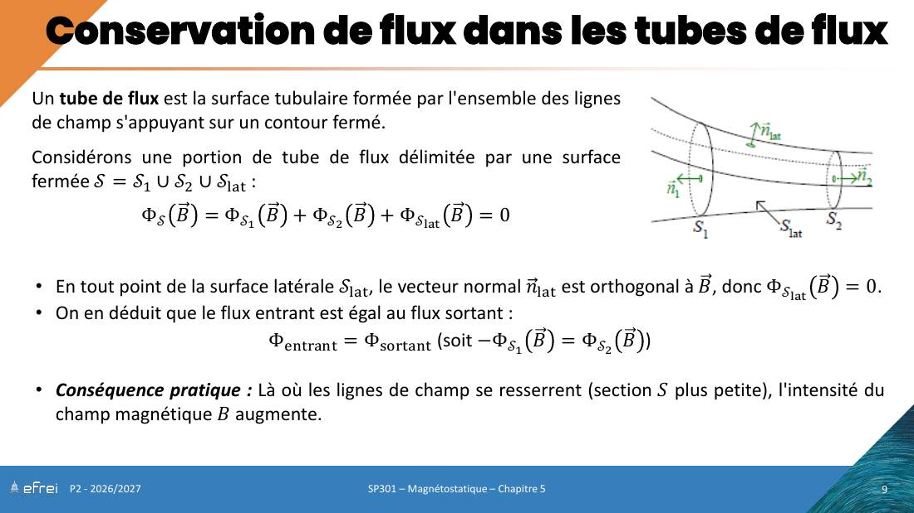

# Chapitre 5 — Théorème d'Ampère, conservation du flux magnétique

=== "Version simplifiée"

    !!! abstract "Le fil du chapitre"
        Biot-Savart ([chapitre 4](chapitre-4-biot-savart.md)) marche toujours, mais l'intégrale
        devient vite impossible. Quand la distribution de courant est **très symétrique** (fil,
        cylindre, câble coaxial, solénoïde), le **théorème d'Ampère** donne $\vec B$ en quelques
        lignes. C'est l'exact pendant du **théorème de Gauss** ([chapitre 3](chapitre-3-gauss.md)) :
        on remplace la *surface fermée* par un **contour fermé**, le *flux* par une **circulation**,
        et la *charge intérieure* par le **courant enlacé**. On termine par une propriété propre à
        $\vec B$ : son **flux est conservatif**.

    ## 1. Les ingrédients

    - **Symétries et invariances** : elles donnent la **structure** du champ (direction et
      variables), voir la fin du [chapitre 4](chapitre-4-biot-savart.md#5-structure-du-champ-magnetique).
    - **Contour d'Ampère** $\mathcal C$ : une courbe de l'espace **fermée** et **orientée**.
    - **Circulation** de $\vec B$ le long de $\mathcal C$ : $\Gamma_{\mathcal C}(\vec B) = \oint_{\mathcal C}\vec B\cdot\mathrm d\vec l$,
      avec $\mathrm d\vec l = \mathrm dl\,\vec t$ ($\vec t$ tangent au contour, dans le sens choisi).
    - **Courant enlacé** $I_{enl}$ : somme **algébrique** des courants qui traversent le contour.

    Le cercle sur l'intégrale $\oint$ rappelle que le contour est **fermé**.

    ## 2. Le théorème

    !!! theoreme "Théorème d'Ampère"
        La circulation du champ magnétique le long d'un contour fermé est égale à $\mu_0$ fois
        l'intensité totale **enlacée** par ce contour :

        $$
        \Gamma_{\mathcal C}(\vec B) = \oint_{\mathcal C}\vec B\cdot\mathrm d\vec l = \mu_0\,I_{enl}
        $$

        Un courant compte **$+$** s'il traverse dans le sens donné par l'orientation du contour
        (règle de la main droite : doigts dans le sens du contour, le pouce donne le sens $+$),
        **$-$** sinon. Valable en **régime permanent** (courants constants).

    --8<-- "docs/physique-elec/champs-em/cours/_schemas/ampere.svg"

    !!! tip "Simulation animée"
        Déplace un contour d'Ampère autour de plusieurs fils : seuls les courants enlacés comptent dans $\oint \vec B\cdot\mathrm d\vec l$. [:material-play-circle: Ouvrir la simulation](../simulations/simulations-champs.html#ampere){ target="_blank" }

    !!! analogie "La ceinture autour des câbles"
        Passe une ceinture autour d'un paquet de câbles. Pour Ampère, seuls comptent les câbles qui
        **traversent** la ceinture, avec un signe selon leur sens. Les câbles à côté créent bien du
        champ sur la ceinture, mais leur contribution sur un tour complet est nulle. Un câble
        aller-retour (le coaxial) traverse dans les deux sens : il compte pour $I - I = 0$.

    !!! methode "Appliquer le théorème d'Ampère en 6 étapes"
        1. **Schéma** de la distribution et **système de coordonnées** adapté (souvent cylindriques).
        2. **Symétries et invariances** → structure de $\vec B$ : de quelles variables il dépend, et
           sa direction.
        3. **Contour d'Ampère** $\mathcal C$ passant par $M$, sur lequel $B$ est **constant** et
           $\vec B$ est **tangent** (ou orthogonal) à $\mathrm d\vec l$.
        4. **Membre de gauche** : la circulation. Elle ne dépend que de la structure du champ, pas
           de la distribution.
        5. **Membre de droite** : $\mu_0 I_{enl}$, par une somme ou une intégrale
           ($I_{enl} = \iint\vec j\cdot\mathrm d\vec S$). Distinguer **plusieurs zones** si besoin.
        6. **Égaler** et conclure sur l'expression vectorielle de $\vec B$.

    ## 3. L'exemple type : le fil infini

    !!! example "Fil infini d'axe $Oz$, courant $I > 0$, point $M$ extérieur"
        1. **Coordonnées** cylindriques, $r = OM$.
        2. **Structure** : invariance par translation selon $Oz$ et par rotation autour de $Oz$
           → $B$ ne dépend ni de $z$ ni de $\theta$. Le plan $(M;\vec e_r,\vec e_z)$ est un plan de
           **symétrie** → $\vec B$ lui est orthogonal, donc selon $\vec e_\theta$ :
           $\vec B(M) = B(r)\,\vec e_\theta$. (Le plan $(M;\vec e_r,\vec e_\theta)$, lui, est un plan
           d'**antisymétrie**.)
        3. **Contour** : les lignes de champ sont des cercles d'axe $Oz$ → cercle de rayon $r$ passant
           par $M$, orienté selon $\vec e_\theta$.
        4. **Circulation** : $\oint \vec B\cdot\mathrm d\vec l = \int_0^{2\pi} B(r)\,\vec e_\theta\cdot r\,\mathrm d\theta\,\vec e_\theta = 2\pi r\,B(r)$.
        5. **Courant enlacé** : $I_{enl} = +I$ (main droite).
        6. **Conclusion** : $2\pi r\,B(r) = \mu_0 I$, donc

        $$
        \vec B(M) = \frac{\mu_0 I}{2\pi r}\,\vec e_\theta
        $$

        On retrouve le résultat de Biot-Savart en trois lignes au lieu d'une intégrale.

    !!! example "Résultats classiques (à savoir refaire)"
        | Distribution | Champ |
        |--------------|-------|
        | Fil infini | $B = \dfrac{\mu_0 I}{2\pi r}$ |
        | Cylindre plein de rayon $R$ (courant uniforme) | $B = \dfrac{\mu_0 I r}{2\pi R^2}$ dedans, $\dfrac{\mu_0 I}{2\pi r}$ dehors |
        | Cylindre creux (courant en surface) | $0$ dedans, $\dfrac{\mu_0 I}{2\pi r}$ dehors |
        | Câble coaxial ($+I$ au centre, $-I$ dans la gaine) | $0$ à l'extérieur ([TD 5](../td/td-5-theoreme-ampere.md)) |
        | Solénoïde infini ($n$ spires par mètre) | $B = \mu_0 n I$ dedans (uniforme), 0 dehors |

        Pour le cylindre plein : $I_{enl} = j\,\pi r^2 = I\dfrac{r^2}{R^2}$ si $r < R$.

    ## 4. Conservation du flux magnétique

    !!! theoreme "$\vec B$ est à flux conservatif"
        Le flux de $\vec B$ à travers **n'importe quelle surface fermée** $\mathcal S$ est nul :

        $$
        \Phi_{\mathcal S}(\vec B) = \oint\!\!\!\oint_{\mathcal S}\vec B(M)\cdot\mathrm d\vec S = 0
        $$

        Unité du flux : le **weber**, $1\ \text{Wb} = 1\ \text{T}\cdot\text{m}^2$.

    | | $\vec E$ (Gauss) | $\vec B$ |
    |-|------------------|----------|
    | Flux sur surface fermée | $\dfrac{Q_{int}}{\varepsilon_0}$ | $0$ |
    | Pourquoi | il existe des charges $+$ (flux sortant, champ centrifuge) et $-$ (flux entrant, centripète) | **pas de monopôle magnétique** : impossible d'isoler un nord d'un sud |
    | Lignes de champ | partent des $+$, finissent sur les $-$ | **boucles fermées** : tout ce qui entre ressort |

    On dit aussi que $\vec B$ est **à divergence nulle**, ou **solénoïdal**.

    ### Tubes de flux

    Un **tube de flux** est la surface formée par toutes les lignes de champ qui s'appuient sur un
    contour fermé. On ferme une portion de tube : $\mathcal S = \mathcal S_1\cup\mathcal S_2\cup\mathcal S_{lat}$.

    - Sur la surface latérale, $\vec B$ est tangent : $\vec n_{lat}\perp\vec B$, donc $\Phi_{lat} = 0$.
    - Il reste $\Phi_{\mathcal S_1} + \Phi_{\mathcal S_2} = 0$ : **flux entrant = flux sortant**
      ($-\Phi_{\mathcal S_1} = \Phi_{\mathcal S_2}$).
    - Conséquence : là où les lignes de champ **se resserrent** (section plus petite), $B$
      **augmente** ($B_1S_1 \approx B_2S_2$).

    !!! analogie "Le tuyau d'arrosage"
        Un tube de flux, c'est un tuyau : l'eau qui entre d'un côté ressort forcément de l'autre. Si le
        tuyau se rétrécit, l'eau va plus vite ; si les lignes de $\vec B$ se resserrent, le champ est plus
        intense.

    ## 5. Gauss ↔ Ampère

    | | Théorème de Gauss | Théorème d'Ampère |
    |-|-------------------|-------------------|
    | Objet géométrique | surface **fermée** $\Sigma$ | contour **fermé** $\mathcal C$ |
    | Grandeur calculée | flux $\oint\!\!\oint\vec E\cdot\mathrm d\vec S$ | circulation $\oint\vec B\cdot\mathrm d\vec l$ |
    | Source | $Q_{int}/\varepsilon_0$ | $\mu_0 I_{enl}$ |
    | Choix | $\vec E$ normal et constant sur $\Sigma$ | $\vec B$ tangent et constant sur $\mathcal C$ |
    | Fil / cylindre | cylindre de Gauss → $2\pi r h\,E$ | cercle d'Ampère → $2\pi r\,B$ |

    ## Pièges classiques

    !!! piege "Somme algébrique"
        Dans $I_{enl}$, les courants ont un **signe**. Câble coaxial ($+I$ puis $-I$) : à l'extérieur,
        $I_{enl} = 0$ donc $B = 0$.

    !!! piege "Courant réparti : seulement la partie enlacée"
        Si le contour est **à l'intérieur** d'un conducteur, on ne prend que le courant qui traverse
        le disque de rayon $r$ : $I_{enl} = \iint_{r' < r}\vec j\cdot\mathrm d\vec S$, pas tout $I$.

    !!! piege "$B$ constant sur le contour"
        Ampère est toujours vrai, mais il ne donne $B$ que si on peut sortir $B$ de l'intégrale. Sans
        symétrie suffisante (spire, fil fini…), on revient à Biot-Savart.

=== "Version papier"

    Les diapos du chapitre 5 telles que le prof les projette (support 2026-2027).

    [{ loading=lazy .papier }](papier/ch5/p01.jpg)
    
Page de titre · Chapitre 5 — support 2026-2027, diapo 1

    [{ loading=lazy .papier }](papier/ch5/p02.jpg)
    
Partie B — Chapitre 5 : théorème d'Ampère, flux magnétique · Chapitre 5 — support 2026-2027, diapo 2

    [{ loading=lazy .papier }](papier/ch5/p03.jpg)
    
Théorème d'Ampère · Chapitre 5 — support 2026-2027, diapo 3

    [{ loading=lazy .papier }](papier/ch5/p04.jpg)
    
Contexte · Chapitre 5 — support 2026-2027, diapo 4

    [{ loading=lazy .papier }](papier/ch5/p05.jpg)
    
Théorème d'Ampère : énoncé général · Chapitre 5 — support 2026-2027, diapo 5

    [{ loading=lazy .papier }](papier/ch5/p06.jpg)
    
Un exemple : le fil infini · Chapitre 5 — support 2026-2027, diapo 6

    [{ loading=lazy .papier }](papier/ch5/p07.jpg)
    
Conservation du flux magnétique · Chapitre 5 — support 2026-2027, diapo 7

    [{ loading=lazy .papier }](papier/ch5/p08.jpg)
    
Conservation du flux magnétique · Chapitre 5 — support 2026-2027, diapo 8

    [{ loading=lazy .papier }](papier/ch5/p09.jpg)
    
Conservation de flux dans les tubes de flux · Chapitre 5 — support 2026-2027, diapo 9

