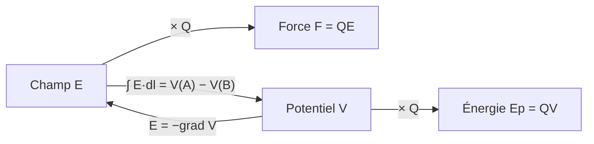

# Fiche — Force, champ, potentiel, énergie

!!! abstract "L'essentiel en 30 secondes"
    - Coulomb : $\vec F = k\dfrac{q_1q_2}{r^2}\vec u_{12}$, avec $k = \dfrac{1}{4\pi\varepsilon_0} \simeq 9\times10^9$ SI.
    - Champ : $\vec E = k\dfrac{q}{r^2}\vec u$ (sortant si $q > 0$), et $\vec F = Q\vec E$.
    - Potentiel : $V = k\dfrac qr$ (scalaire !), et $\vec E = -\overrightarrow{\mathrm{grad}}\,V$.
    - Énergie : $E_p = QV$. Tout se superpose : vecteurs pour $\vec E$, $\vec F$ ; nombres pour $V$, $E_p$.

## Les quatre grandeurs

| Grandeur | Charge ponctuelle | Unité | Nature |
|----------|-------------------|-------|--------|
| Force sur $Q$ | $\vec F = k\dfrac{qQ}{r^2}\vec u$ | N | vecteur |
| Champ | $\vec E = k\dfrac{q}{r^2}\vec u$ | V/m = N/C | vecteur |
| Potentiel | $V = k\dfrac qr$ | V | scalaire |
| Énergie potentielle de $Q$ | $E_p = QV = k\dfrac{qQ}{r}$ | J | scalaire |

$\vec u$ va **de la source vers le point** d'observation ; c'est le signe de $q$ qui fixe le sens.

## Les liens entre elles

!!! theoreme "Circulation et tension"
    $$
    \mathcal C_{AB}(\vec E) = \int_A^B \vec E\cdot\mathrm d\vec l = V(A) - V(B) = U_{AB}
    $$

    Indépendante du chemin. $\vec E$ est perpendiculaire aux équipotentielles et va vers les
    potentiels **décroissants**.

## Gradient

| Coordonnées | $\overrightarrow{\mathrm{grad}}\,V$ |
|-------------|------------------------------|
| Cartésiennes | $\partial_x V\,\vec e_x + \partial_y V\,\vec e_y + \partial_z V\,\vec e_z$ |
| Polaires / cylindriques | $\partial_r V\,\vec e_r + \dfrac1r\partial_\theta V\,\vec e_\theta\ (+\ \partial_z V\,\vec e_z)$ |
| Sphériques | $\partial_r V\,\vec e_r + \dfrac1r\partial_\theta V\,\vec e_\theta + \dfrac{1}{r\sin\theta}\partial_\varphi V\,\vec e_\varphi$ |

## Résultats à connaître

| Situation | Résultat |
|-----------|----------|
| Dipôle ($\pm q$, $AB = 2a$), au milieu | $E = \dfrac{2kq}{a^2}$, dirigé vers $-q$ ; $V = 0$ |
| Dipôle, sur la médiatrice | $E = \dfrac{2kq}{a^2}\sin^3\alpha$ ; $V = 0$ |
| Dipôle, potentiel lointain | $V = \dfrac{2kaq\cos\theta}{r^2}$, champ en $1/r^3$ |
| Condensateur plan | $E = \dfrac Ud$ uniforme, du + vers le − |
| Atome d'hydrogène | $E_p = -\dfrac{ke^2}{r}$, $E_c = \dfrac{ke^2}{2r}$, $E_m = -\dfrac{ke^2}{2r}$ |
| Anneau (axe) | $E_z = \dfrac{kQz}{(R^2 + z^2)^{3/2}}$, $V = \dfrac{kQ}{\sqrt{R^2 + z^2}}$ |

## Distributions continues

| | Linéique | Surfacique | Volumique |
|-|----------|------------|-----------|
| Densité | $\lambda$ (C/m) | $\sigma$ (C/m²) | $\rho$ (C/m³) |
| $\mathrm dQ$ | $\lambda\,\mathrm dl$ | $\sigma\,\mathrm dS$ | $\rho\,\mathrm d\tau$ |

Puis $\mathrm d\vec E = k\dfrac{\mathrm dQ}{r^2}\vec u$, $\mathrm dV = k\dfrac{\mathrm dQ}{r}$, et on intègre.

!!! methode "Champ en un point créé par plusieurs charges"
    1. Faire un **schéma** et placer chaque vecteur (sortant pour $+$, entrant pour $-$).
    2. Repérer les **compensations par symétrie** avant tout calcul.
    3. Calculer chaque **norme** $k|q_i|/r_i^2$.
    4. **Projeter** sur $x$ et $y$ (signes lus sur le schéma), additionner.
    5. Norme finale $\sqrt{E_x^2 + E_y^2}$. Pour $V$ : simple somme des $kq_i/r_i$.

## Pièges classiques

!!! piege "Erreurs fréquentes"
    - Additionner des **normes** de champs au lieu des vecteurs.
    - Oublier le **signe** de $q$ dans $V$ (le potentiel peut être négatif).
    - Écrire $E_p = qV$ avec le potentiel **créé par $q$ elle-même** : c'est le potentiel des
      **autres** charges.
    - Utiliser $V = kq/r$ pour une distribution non ponctuelle (condensateur) : il faut passer par
      $\vec E = -\overrightarrow{\mathrm{grad}}\,V$.

## Auto-test

??? question "Quatre charges $+q$ aux sommets d'un carré : que valent $E$ et $V$ au centre ?"
    $\vec E = \vec 0$ (compensation par paires), mais $V = 4\dfrac{kq}{r} \neq 0$.

??? question "Une charge $Q < 0$ dans un champ $\vec E$ vers la droite : sens de la force ?"
    Vers la gauche : $\vec F = Q\vec E$ et $Q < 0$.

??? question "$V(x) = 3x^2 - 2y$ : que vaut $\vec E$ ?"
    $\vec E = -\overrightarrow{\mathrm{grad}}\,V = -6x\,\vec e_x + 2\,\vec e_y$.

??? question "Pourquoi l'énergie mécanique de l'électron de l'atome d'hydrogène est-elle négative ?"
    $E_m = -\dfrac{ke^2}{2r} < 0$ : l'électron est **lié** au proton. Il faut lui fournir au moins
    $|E_m|$ (énergie d'ionisation) pour l'en séparer.

??? question "Comment évolue le champ d'un dipôle loin des charges ?"
    En $1/r^3$ (plus vite qu'une charge seule, en $1/r^2$) : les champs de $+q$ et $-q$ se
    compensent presque.
