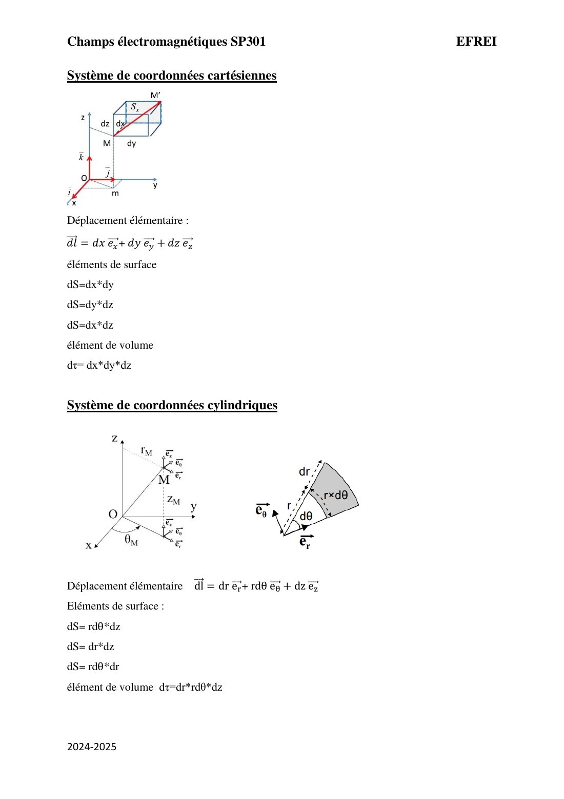
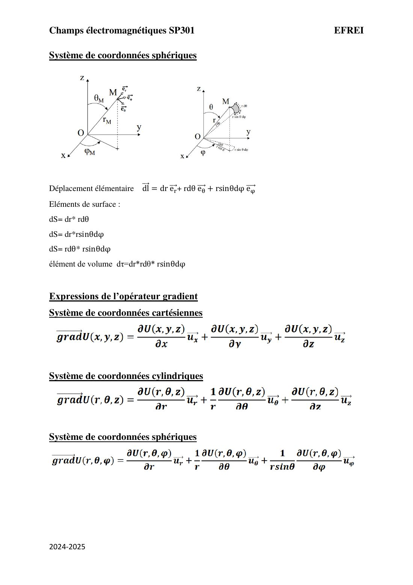
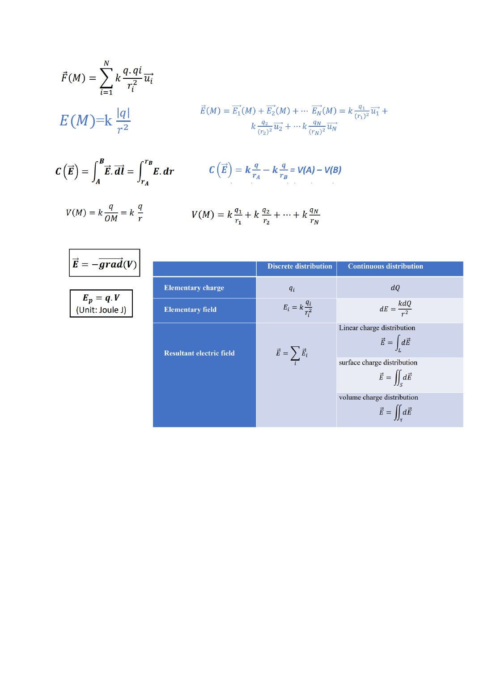
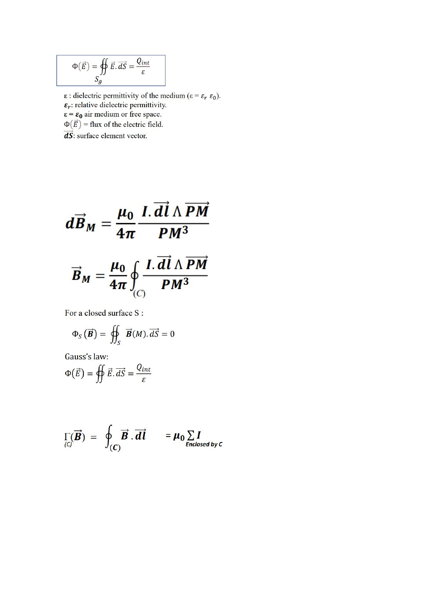

# Formulaire SP301

=== "Version simplifiée"

    Toutes les formules du module sur une page. Les feuilles de formules du prof et le formulaire
    du livret de TD sont dans l'onglet **Version papier**.

    ## Constantes

    | Constante | Valeur |
    |-----------|--------|
    | Charge élémentaire $e$ | $1{,}602\times10^{-19}$ C |
    | $k = \dfrac{1}{4\pi\varepsilon_0}$ | $9\times10^{9}$ SI |
    | Permittivité du vide $\varepsilon_0$ | $8{,}85\times10^{-12}$ F/m |
    | Perméabilité du vide $\mu_0$ | $4\pi\times10^{-7}$ H/m |
    | Masse de l'électron $m_e$ | $9{,}11\times10^{-31}$ kg |

    ## Électrostatique

    | | Charges ponctuelles | Distribution continue |
    |-|---------------------|-----------------------|
    | Force | $\vec F(M) = \sum_i k\dfrac{q\,q_i}{r_i^2}\vec u_i$ | — |
    | Champ | $\vec E = \sum_i k\dfrac{q_i}{r_i^2}\vec u_i$ | $\vec E = \int k\dfrac{\mathrm dQ}{r^2}\vec u$ |
    | Potentiel | $V = \sum_i k\dfrac{q_i}{r_i}$ | $V = \int k\dfrac{\mathrm dQ}{r}$ |

    $$
    \vec F = q\vec E \qquad
    \int_A^B\vec E\cdot\mathrm d\vec l = V(A) - V(B) \qquad
    \vec E = -\overrightarrow{\mathrm{grad}}\,V \qquad
    E_p = qV
    $$

    $\mathrm dQ = \lambda\,\mathrm dl = \sigma\,\mathrm dS = \rho\,\mathrm d\tau$.

    ## Théorème de Gauss et capacité

    $$
    \Phi(\vec E) = \oint\!\!\!\oint_{S_g}\vec E\cdot\mathrm d\vec S = \frac{Q_{int}}{\varepsilon}
    \qquad \varepsilon = \varepsilon_r\varepsilon_0
    \qquad\qquad
    C = \frac{Q}{V_1 - V_2}
    $$

    ## Magnétostatique

    $$
    \mathrm d\vec B_M = \frac{\mu_0}{4\pi}\frac{I\,\mathrm d\vec l\wedge\overrightarrow{PM}}{PM^3}
    \qquad
    \oint\!\!\!\oint_S\vec B\cdot\mathrm d\vec S = 0
    \qquad
    \oint_{(C)}\vec B\cdot\mathrm d\vec l = \mu_0\sum I_{\text{enlacés}}
    $$

    ## Coordonnées

    | | $\mathrm d\vec l$ | $\mathrm dS$ | $\mathrm d\tau$ |
    |-|-------------------|--------------|-----------------|
    | Cartésiennes | $\mathrm dx\,\vec e_x + \mathrm dy\,\vec e_y + \mathrm dz\,\vec e_z$ | $\mathrm dx\,\mathrm dy$ ; $\mathrm dy\,\mathrm dz$ ; $\mathrm dx\,\mathrm dz$ | $\mathrm dx\,\mathrm dy\,\mathrm dz$ |
    | Cylindriques | $\mathrm dr\,\vec e_r + r\,\mathrm d\theta\,\vec e_\theta + \mathrm dz\,\vec e_z$ | $r\,\mathrm d\theta\,\mathrm dz$ ; $\mathrm dr\,\mathrm dz$ ; $r\,\mathrm d\theta\,\mathrm dr$ | $r\,\mathrm dr\,\mathrm d\theta\,\mathrm dz$ |
    | Sphériques | $\mathrm dr\,\vec e_r + r\,\mathrm d\theta\,\vec e_\theta + r\sin\theta\,\mathrm d\varphi\,\vec e_\varphi$ | $r\,\mathrm dr\,\mathrm d\theta$ ; $r\sin\theta\,\mathrm dr\,\mathrm d\varphi$ ; $r^2\sin\theta\,\mathrm d\theta\,\mathrm d\varphi$ | $r^2\sin\theta\,\mathrm dr\,\mathrm d\theta\,\mathrm d\varphi$ |

    ## Gradient

    | | $\overrightarrow{\mathrm{grad}}\,f$ |
    |-|-------------------------------------|
    | Cartésiennes | $\dfrac{\partial f}{\partial x}\vec e_x + \dfrac{\partial f}{\partial y}\vec e_y + \dfrac{\partial f}{\partial z}\vec e_z$ |
    | Cylindriques | $\dfrac{\partial f}{\partial r}\vec e_r + \dfrac1r\dfrac{\partial f}{\partial \theta}\vec e_\theta + \dfrac{\partial f}{\partial z}\vec e_z$ |
    | Sphériques | $\dfrac{\partial f}{\partial r}\vec e_r + \dfrac1r\dfrac{\partial f}{\partial \theta}\vec e_\theta + \dfrac{1}{r\sin\theta}\dfrac{\partial f}{\partial \varphi}\vec e_\varphi$ |

=== "Version papier"

    Le formulaire à la fin du livret de TD, puis les deux feuilles de formules du prof.

    [{ loading=lazy .papier }](papier/formulaire-p07.jpg)
    
Coordonnées cartésiennes et cylindriques · Livret de TD 2024-2025, p. 7

    [{ loading=lazy .papier }](papier/formulaire-p08.jpg)
    
Coordonnées sphériques et gradients · Livret de TD 2024-2025, p. 8

    [{ loading=lazy .papier }](papier/formules-ch1.jpg)
    
Formules du chapitre 1 (feuille du prof)

    [{ loading=lazy .papier }](papier/formules-ch2-3.jpg)
    
Formules des chapitres 2 et 3 (feuille du prof)

