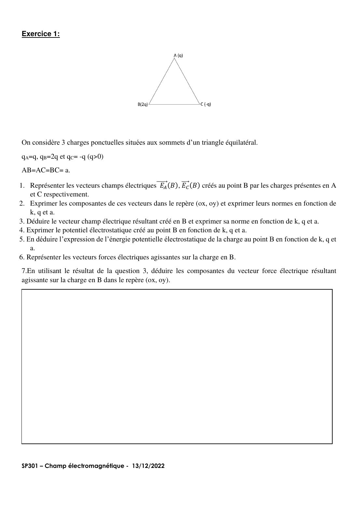
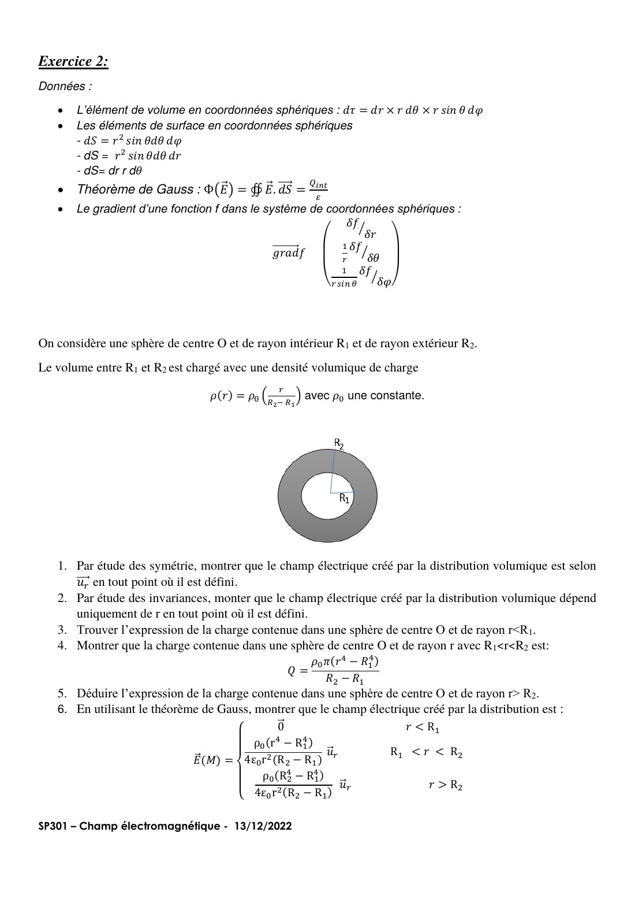
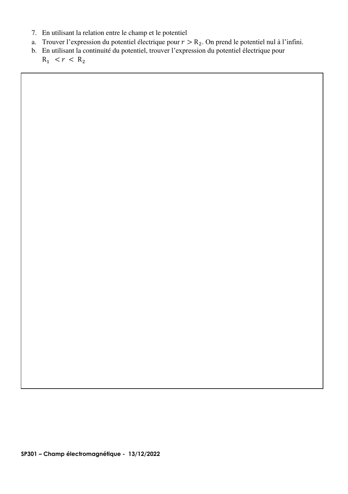
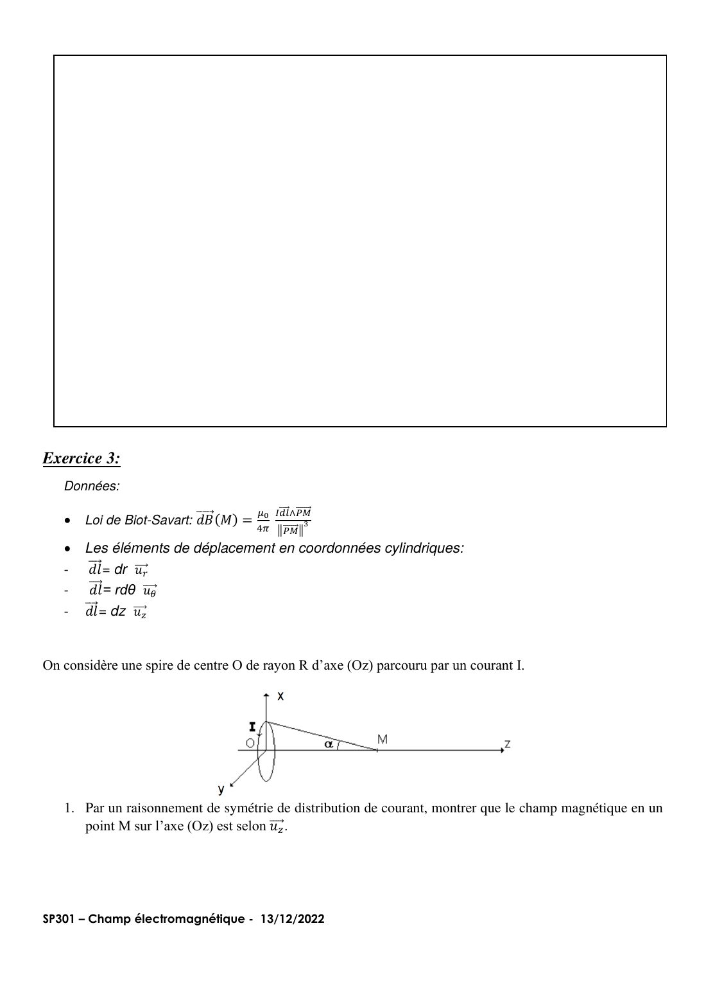
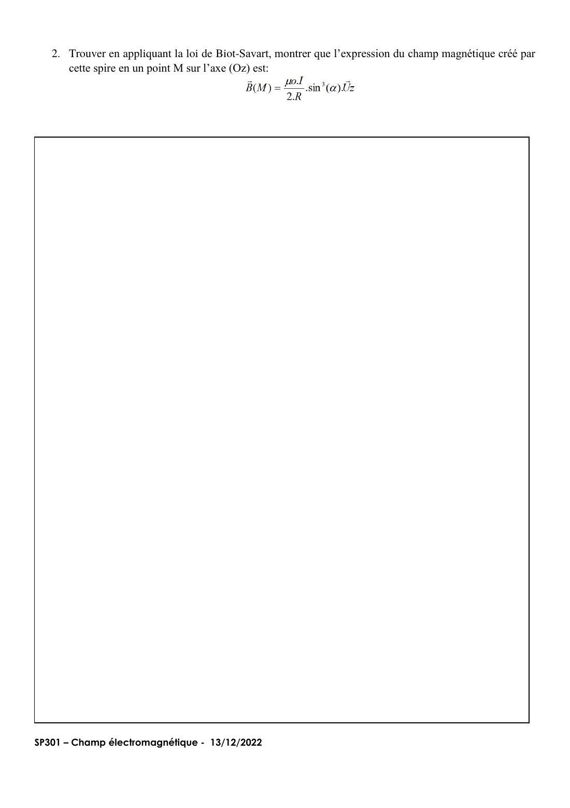

# Annale — DE du 13/12/2022

=== "Version simplifiée"

    Épreuve de **1 h 50, sans calculatrice ni documents**. Sujet : onglet **Version papier**
    (pas de corrigé officiel : les réponses ci-dessous sont les miennes, vérifiées par le calcul).

    ## Exercice 1 — Triangle de charges

    $q_A = q$ (sommet du haut), $q_B = 2q$ (en bas à gauche), $q_C = -q$ (en bas à droite),
    côté $a$. Repère : origine en $B$, $Ox$ vers $C$, $Oy$ vers le haut. Alors
    $A = \left(\dfrac a2, \dfrac{\sqrt3}{2}a\right)$ et $C = (a, 0)$.

    1-2. **Champs en $B$** (les deux ont la norme $\dfrac{kq}{a^2}$) :

    - $\vec E_A(B)$ : $q_A > 0$, le champ **s'éloigne** de $A$, donc dirigé de $A$ vers $B$ :
      $\vec E_A(B) = \dfrac{kq}{a^2}\left(-\dfrac12,\ -\dfrac{\sqrt3}{2}\right)$.
    - $\vec E_C(B)$ : $q_C < 0$, le champ **pointe vers** $C$ :
      $\vec E_C(B) = \dfrac{kq}{a^2}(1,\ 0)$.

    3. **Résultante** :
       $\vec E(B) = \dfrac{kq}{a^2}\left(\dfrac12,\ -\dfrac{\sqrt3}{2}\right)$, de norme
       $E(B) = \dfrac{kq}{a^2}$ (les deux vecteurs font 120° entre eux).
    4. **Potentiel** : $V(B) = \dfrac{kq}{a} + \dfrac{k(-q)}{a} = 0$.
    5. **Énergie potentielle** de la charge $2q$ en $B$ : $E_p = 2q\,V(B) = 0$.
    6-7. **Force** sur $q_B$ : $\vec F = q_B\vec E(B) = 2q\vec E(B)$, soit

    $$
    \vec F = \frac{kq^2}{a^2}\,\vec u_x - \frac{\sqrt3\,kq^2}{a^2}\,\vec u_y
    \qquad F = \frac{2kq^2}{a^2}
    $$

    Elle est répulsive vis-à-vis de $A$ (même signe) et attractive vers $C$ (signe opposé).

    ## Exercice 2 — Sphère creuse chargée en volume

    Charge entre $R_1$ et $R_2$ avec $\rho(r) = \rho_0\dfrac{r}{R_2 - R_1}$.

    1. **Symétries** : tout plan contenant $O$ et $M$ est un plan de symétrie de la distribution,
       donc $\vec E(M)$ appartient à leur intersection, la droite $(OM)$ : $\vec E = E\,\vec u_r$.
    2. **Invariances** : la distribution est invariante par toute rotation autour de $O$ (en
       $\theta$ et en $\varphi$), donc $E$ ne dépend que de $r$.
    3. $r < R_1$ : aucune charge, $Q = 0$.
    4. $R_1 < r < R_2$ :

        $$
        Q(r) = \int_{R_1}^{r}\rho_0\frac{r'}{R_2 - R_1}\,4\pi r'^2\,\mathrm dr'
        = \frac{4\pi\rho_0}{R_2 - R_1}\cdot\frac{r^4 - R_1^4}{4}
        = \frac{\pi\rho_0\,(r^4 - R_1^4)}{R_2 - R_1}
        $$

    5. $r > R_2$ : toute la charge, $Q = \dfrac{\pi\rho_0(R_2^4 - R_1^4)}{R_2 - R_1}$.
    6. **Gauss** sur une sphère de rayon $r$ : $4\pi r^2 E = Q(r)/\varepsilon_0$, ce qui donne les
       trois expressions de l'énoncé ($\vec 0$, $\dfrac{\rho_0(r^4 - R_1^4)}{4\varepsilon_0r^2(R_2 - R_1)}\vec u_r$,
       $\dfrac{\rho_0(R_2^4 - R_1^4)}{4\varepsilon_0r^2(R_2 - R_1)}\vec u_r$).
    7. a. **Potentiel pour $r > R_2$** : $V = -\int E\,\mathrm dr$ et $V(\infty) = 0$ :

        $$
        V(r) = \frac{\rho_0\,(R_2^4 - R_1^4)}{4\varepsilon_0\,(R_2 - R_1)\,r}
        $$

        b. **Pour $R_1 < r < R_2$** : $E = \dfrac{\rho_0}{4\varepsilon_0(R_2 - R_1)}\left(r^2 - \dfrac{R_1^4}{r^2}\right)$ donc

        $$
        V(r) = -\frac{\rho_0}{4\varepsilon_0(R_2 - R_1)}\left(\frac{r^3}{3} + \frac{R_1^4}{r}\right) + C
        $$

        La continuité en $R_2$ donne $C = \dfrac{\rho_0 R_2^3}{3\varepsilon_0(R_2 - R_1)}$, d'où

        $$
        V(r) = \frac{\rho_0}{12\,\varepsilon_0\,(R_2 - R_1)}\left(4R_2^3 - r^3 - \frac{3R_1^4}{r}\right)
        $$

        Vérification : en $r = R_2$ on retrouve bien $\dfrac{\rho_0(R_2^4 - R_1^4)}{4\varepsilon_0(R_2 - R_1)R_2}$.

    !!! piege "Les bornes de l'intégrale de charge"
        On intègre **de $R_1$ à $r$**, pas de 0 à $r$ : il n'y a pas de charge dans la cavité.

    ## Exercice 3 — Spire circulaire

    1. **Symétrie** : tout plan contenant l'axe $(Oz)$ est un plan d'**antisymétrie** de la
       distribution de courant (par réflexion, le sens du courant s'inverse). Le champ magnétique
       est **contenu** dans les plans d'antisymétrie (et perpendiculaire aux plans de symétrie,
       à l'inverse de $\vec E$). L'intersection de tous ces plans est l'axe : $\vec B = B\,\vec u_z$.
       Version « avec les mains » : deux éléments $\mathrm d\vec l$ diamétralement opposés donnent
       des $\mathrm d\vec B$ dont les composantes perpendiculaires à l'axe se compensent.
    2. **Biot et Savart** : $\mathrm d\vec l \perp \overrightarrow{PM}$, donc
       $\|\mathrm d\vec B\| = \dfrac{\mu_0 I\,\mathrm dl}{4\pi PM^2}$. Sa projection sur l'axe vaut
       $\mathrm dB\sin\alpha$ avec $\sin\alpha = \dfrac{R}{PM}$. En intégrant sur $2\pi R$ :

        $$
        B = \frac{\mu_0 I}{4\pi PM^2}\cdot 2\pi R\cdot\sin\alpha
        = \frac{\mu_0 I}{2R}\cdot\frac{R^2}{PM^2}\sin\alpha
        = \frac{\mu_0 I}{2R}\sin^3\alpha
        $$

=== "Version papier"

    Le sujet du DE 2022 (la page de garde et les pages blanches de réponse ne sont pas reprises).

    [{ loading=lazy .papier }](papier/de-2022/p02.jpg)
    
Exercice 1 : triangle de charges · DE du 13/12/2022, p. 2

    [{ loading=lazy .papier }](papier/de-2022/p04.jpg)
    
Exercice 2 : sphère creuse chargée en volume · DE du 13/12/2022, p. 4

    [{ loading=lazy .papier }](papier/de-2022/p05.jpg)
    
Exercice 2 (Q7) : potentiel · DE du 13/12/2022, p. 5

    [{ loading=lazy .papier }](papier/de-2022/p08.jpg)
    
Exercice 3 : spire circulaire · DE du 13/12/2022, p. 8

    [{ loading=lazy .papier }](papier/de-2022/p09.jpg)
    
Exercice 3 (Q2) : loi de Biot et Savart · DE du 13/12/2022, p. 9

