# Annale — DE du 20/12/2023

=== "Version simplifiée"

    Épreuve de **1 h 50**, calculatrice autorisée, sans documents. Sujet vierge et copie corrigée
    dans l'onglet **Version papier**. Les données utiles (gradient, $C = Q/(V_1 - V_2)$, $\mathrm dS$,
    $\mathrm dl$) sont rappelées dans le sujet.

    ## Exercice 1 — Atome d'hydrogène

    Proton immobile $+e$ en $O$, électron en orbite circulaire de rayon $a$.

    1. **Champ du proton** (en tout point sauf en $O$) : $\vec E = k\dfrac{e}{r^2}\,\vec u_r$.
    2. Représentation : vecteur radial, **sortant** (le proton est positif).
    3. **Force sur l'électron** : $\vec F = -e\,\vec E = -k\dfrac{e^2}{a^2}\,\vec u_r$ : attractive,
       dirigée vers le proton.
    4. **Potentiel** : $E_r = -\dfrac{\partial V}{\partial r}$ (les autres composantes sont nulles), donc
       $V = -\int k\dfrac{e}{r^2}\,\mathrm dr = k\dfrac{e}{r} + K_1$. À la distance $a$ : $V = k\dfrac ea + K_1$.
    5. Le potentiel est nul à l'infini : $K_1 = 0$.
    6. **Champ magnétique au niveau du proton** (charge mobile $-e$, vitesse $v \perp$ rayon) :
       $B = \dfrac{\mu_0 e v}{4\pi a^2}$. Le PFD donne $k\dfrac{e^2}{a^2} = m\dfrac{v^2}{a}$, donc
       $v = \dfrac{e}{\sqrt{4\pi\varepsilon_0 m a}}$ et

        $$
        B = \frac{\mu_0\,e^2}{4\pi a^2\sqrt{4\pi\varepsilon_0\,m\,a}}
        $$

    ## Exercice 2 — Condensateur cylindrique

    Cylindres de rayons $R_1$ ($Q_1 > 0$) et $R_2$ ($Q_2 = -Q_1$), hauteur $h$, champ $E(r)\,\vec u_r$.

    1. **Flux** à travers un cylindre fictif d'axe $Oz$, de rayon $r$ et de hauteur $H$ : flux nul
       sur les deux bases ($\vec E \perp \mathrm d\vec S$), et sur la face latérale
       $\Phi = \int_0^{2\pi}\!\!\int_0^H E\,r\,\mathrm d\theta\,\mathrm dz = 2\pi rH\,E(r)$.
    2. **Gauss** :

        | Région | $Q_{int}$ | $\vec E$ |
        |--------|-----------|----------|
        | $r < R_1$ | 0 | $\vec 0$ |
        | $R_1 < r < R_2$ | $\sigma_1\cdot 2\pi R_1H$ | $\dfrac{\sigma_1 R_1}{\varepsilon_0\,r}\,\vec u_r$ |
        | $r > R_2$ | $Q_1 + Q_2 = 0$ | $\vec 0$ |

    3. **Lignes de champ** : radiales, uniquement entre les deux cylindres, du cylindre intérieur
       (+) vers le cylindre extérieur (−).

    ## Exercice 3 — Capacité d'un condensateur plan

    Plaque $-\sigma_0$ en $y = 0$, plaque $+\sigma_0$ en $y = a$, et
    $\vec E = -\dfrac{\sigma_0}{\varepsilon_0}\vec u_y$ entre les deux.

    1. Schéma : lignes de champ verticales, de la plaque du haut (+) vers celle du bas (−).
    2. $y > a$ et $y < 0$ : $\vec E = \vec 0$ (les champs des deux plaques se compensent).
    3. $E_y = -\dfrac{\mathrm dV}{\mathrm dy}$, donc

        $$
        V(a) - V(0) = -\int_0^a E_y\,\mathrm dy = \frac{\sigma_0}{\varepsilon_0}\,a
        $$

        Positif : la plaque + est bien au potentiel le plus haut.

    4. $Q = \sigma_0 S$, donc $C = \dfrac{Q}{V(a) - V(0)} = \dfrac{\sigma_0 S}{\sigma_0 a/\varepsilon_0} = \dfrac{\varepsilon_0 S}{a}$.
       **Conclusion** : la capacité ne dépend pas de la charge, seulement de la géométrie ($S$, $a$)
       et du milieu ($\varepsilon_0$).

    ## Exercice 4 — Cylindre parcouru par une densité de courant $J_s$

    Cylindre d'axe $Oz$, rayon $R$, courant $I$ réparti sur la surface latérale.

    1. $\vec B$ est défini partout **sauf sur la surface** $r = R$ (là où se trouve le courant).
    2. $I = \int J_s\,\mathrm dl = J_s\cdot 2\pi R$, avec $I$ en A, $J_s$ en A/m, $\mathrm dl$ en m.
    3. **Contour d'Ampère** : cercle d'axe $(Oz)$ et de rayon $r$, orienté selon $\vec u_\theta$.
    4. **Circulation** : $\oint \vec B\cdot\mathrm d\vec l = \int_0^{2\pi} B(r)\,r\,\mathrm d\theta = 2\pi r\,B(r)$.
    5. **Ampère** :

        - $r < R$ : aucun courant enlacé, $\vec B = \vec 0$ ;
        - $r > R$ : $I_{enl} = I$, donc $\vec B = \dfrac{\mu_0 I}{2\pi r}\,\vec u_\theta = \dfrac{\mu_0 J_s R}{r}\,\vec u_\theta$.

    !!! tip "Ce qui revient chaque année"
        Un exercice de charges ponctuelles ou d'atome d'hydrogène (champ, potentiel, énergie),
        un théorème de Gauss en plusieurs régions avec le potentiel par continuité, et un champ
        magnétique (Biot et Savart sur une spire, ou Ampère sur un cylindre).

=== "Version papier"

    ### Sujet vierge

    La page de garde n'est pas reprise.

    [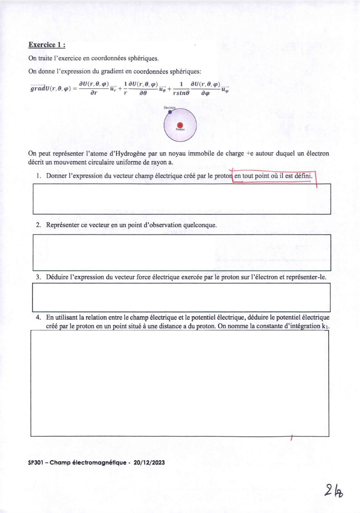{ loading=lazy .papier }](papier/de-2023/sujet-p02.jpg)
    
Exercice 1 : atome d'hydrogène (Q1 à Q4) · DE du 20/12/2023, p. 2

    [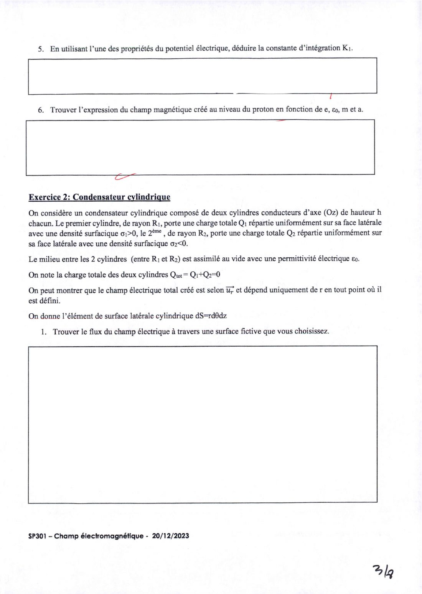{ loading=lazy .papier }](papier/de-2023/sujet-p03.jpg)
    
Exercice 1 (Q5, Q6) et exercice 2 : condensateur cylindrique · DE du 20/12/2023, p. 3

    [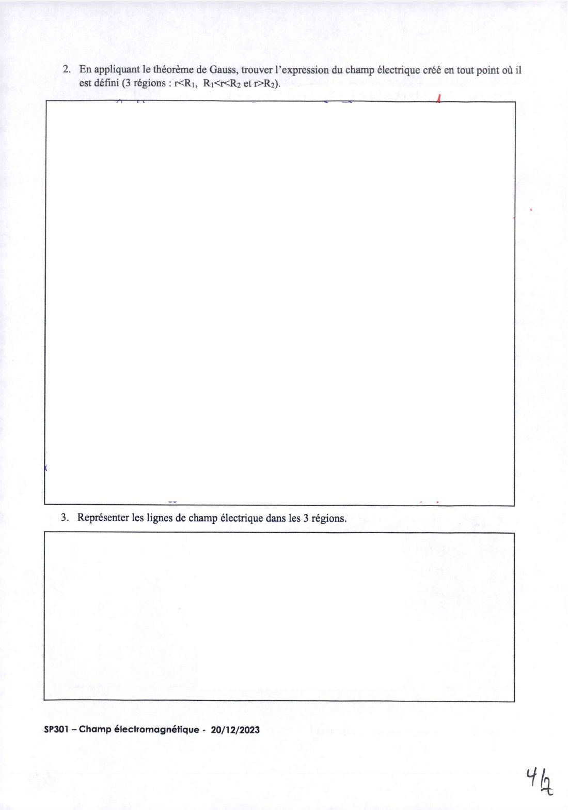{ loading=lazy .papier }](papier/de-2023/sujet-p04.jpg)
    
Exercice 2 (Q2, Q3) · DE du 20/12/2023, p. 4

    [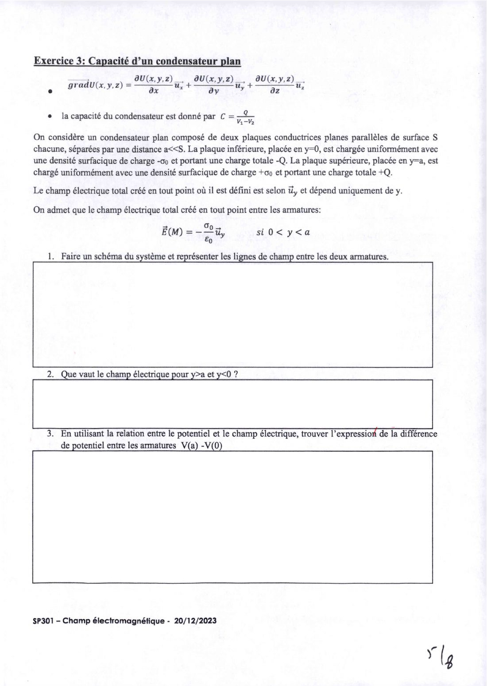{ loading=lazy .papier }](papier/de-2023/sujet-p05.jpg)
    
Exercice 3 : capacité d'un condensateur plan · DE du 20/12/2023, p. 5

    [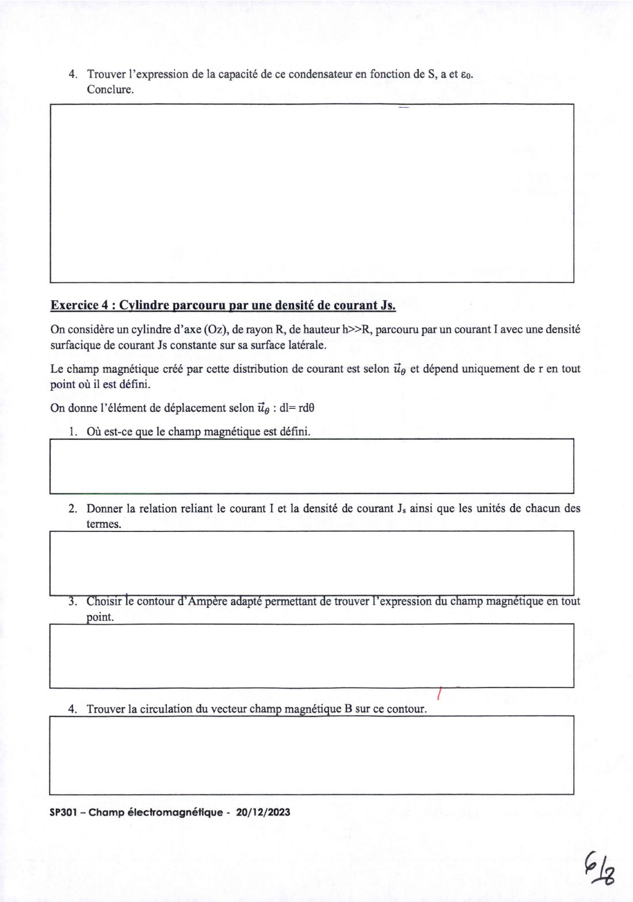{ loading=lazy .papier }](papier/de-2023/sujet-p06.jpg)
    
Exercice 3 (Q4) et exercice 4 : cylindre parcouru par Js · DE du 20/12/2023, p. 6

    [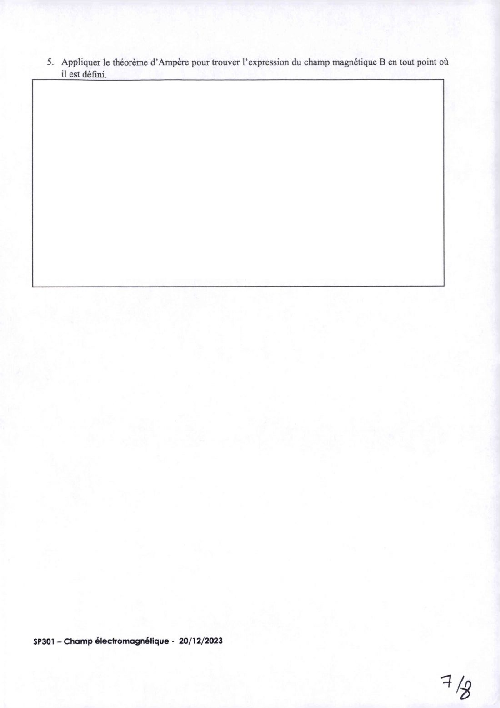{ loading=lazy .papier }](papier/de-2023/sujet-p07.jpg)
    
Exercice 4 (Q5) · DE du 20/12/2023, p. 7

    ### Copie corrigée

    [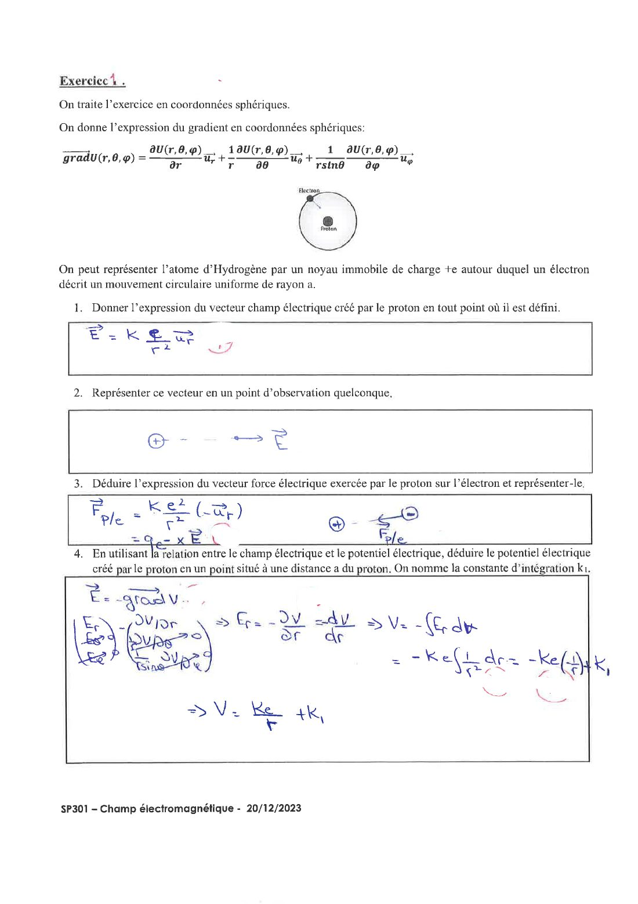{ loading=lazy .papier }](papier/de-2023/corrige-p01.jpg)
    
Exercice 1 (Q1 à Q4) · DE 2023, copie corrigée, p. 1

    [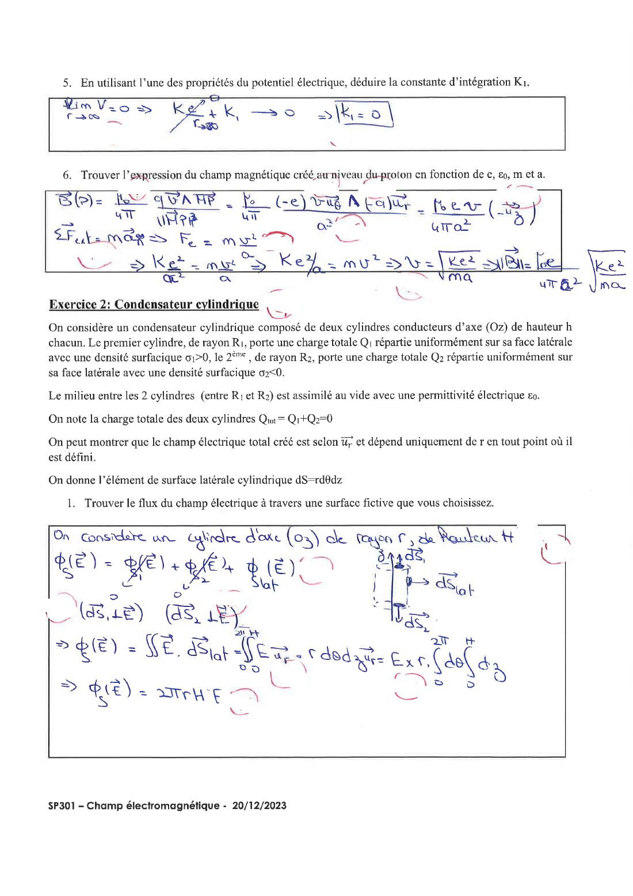{ loading=lazy .papier }](papier/de-2023/corrige-p02.jpg)
    
Exercice 1 (Q5, Q6) et exercice 2 (Q1) · DE 2023, copie corrigée, p. 2

    [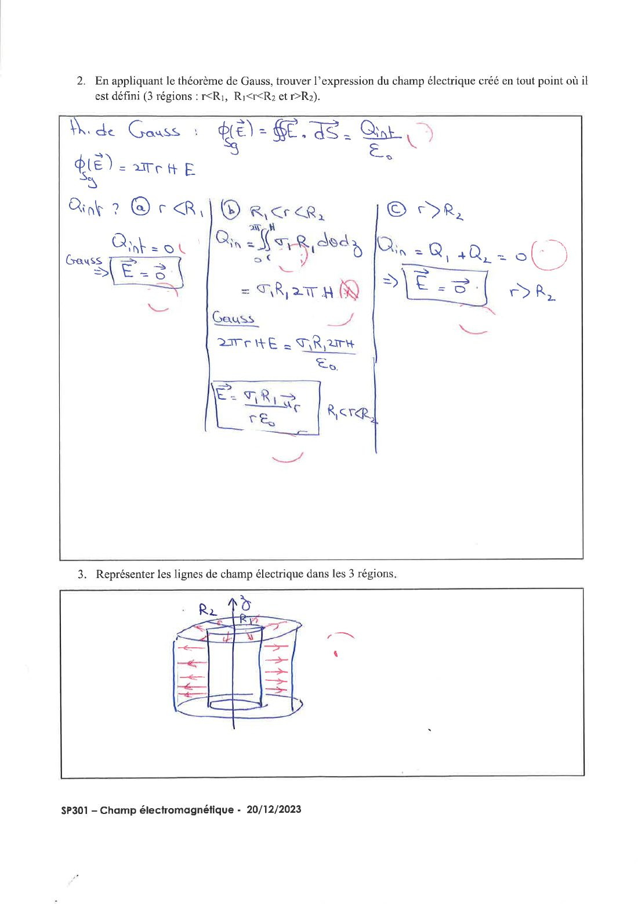{ loading=lazy .papier }](papier/de-2023/corrige-p03.jpg)
    
Exercice 2 (Q2, Q3) · DE 2023, copie corrigée, p. 3

    [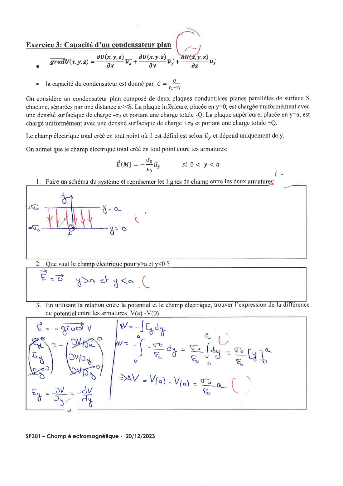{ loading=lazy .papier }](papier/de-2023/corrige-p04.jpg)
    
Exercice 3 (Q1 à Q3) · DE 2023, copie corrigée, p. 4

    [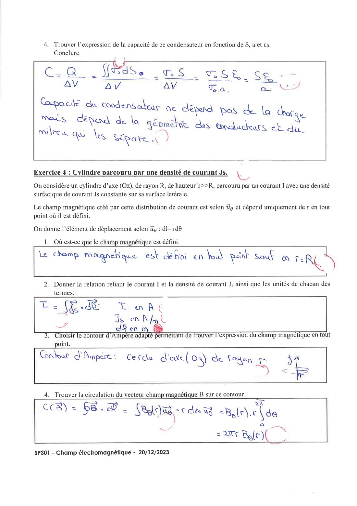{ loading=lazy .papier }](papier/de-2023/corrige-p05.jpg)
    
Exercice 3 (Q4) et exercice 4 (Q1 à Q4) · DE 2023, copie corrigée, p. 5

    [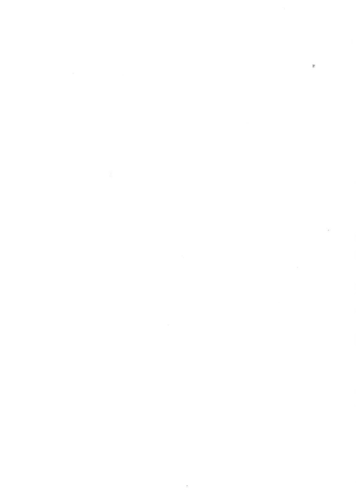{ loading=lazy .papier }](papier/de-2023/corrige-p06.jpg)
    
Exercice 4 (Q5) · DE 2023, copie corrigée, p. 6

