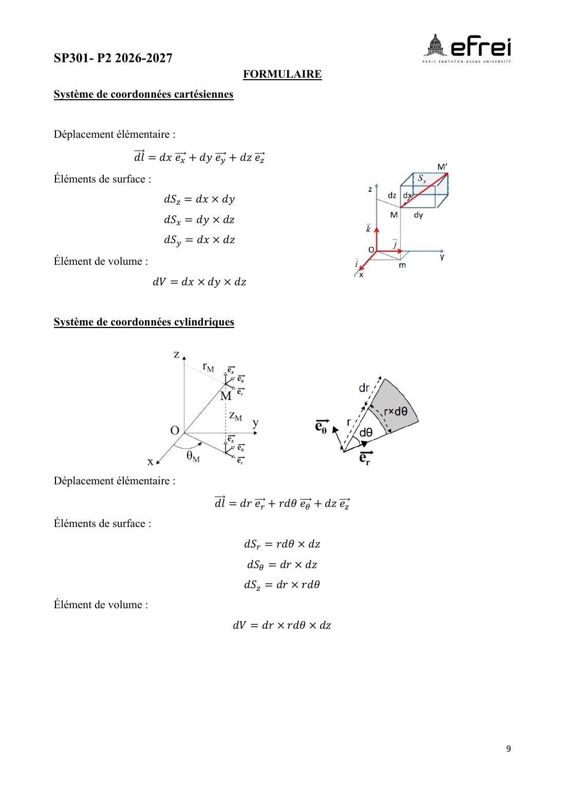
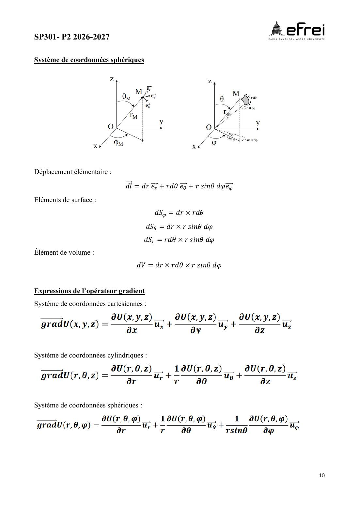

# Travaux dirigés

Chaque TD a deux onglets : **Version simplifiée** (méthode et corrections) et
**Version papier** (les vraies pages des énoncés, à agrandir d'un clic). La numérotation suit
le livret de TD 2026-2027.

| TD | Contenu |
|----|---------|
| [TD 0 — Outils mathématiques](td-0-outils-maths.md) | Dérivées, primitives, trigonométrie, projections, produits scalaire et vectoriel |
| [TD 1 — Charges, champ et potentiel](td-1-charges-champ-potentiel.md) | Carré de charges, expérience de Millikan |
| [TD 2 — Charges distribuées](td-2-charges-distribuees.md) | Charges totales (disque, sphère, demi-sphère, cylindre), sphère creuse |
| [TD 3 — Théorème de Gauss](td-3-theoreme-gauss.md) | Vrai/faux, plan et condensateur plan, Terre-ionosphère, condensateur cylindrique |
| [TD 4 — Champ magnétique](td-4-champ-magnetique.md) | Atome d'hydrogène, deux fils et deux demi-spires, spire par Biot-Savart |
| [TD 5 — Théorème d'Ampère](td-5-theoreme-ampere.md) | Câble coaxial |

!!! tip "Exercices supplémentaires"
    Les exercices supplémentaires du livret sont corrigés en bas de la page du TD
    correspondant. Ceux de la fiche 2024-2025 y sont gardés aussi, dans une partie
    « Pour aller plus loin ».

## Formulaire du livret

Les deux dernières pages du livret 2026-2027 : coordonnées cartésiennes, cylindriques,
sphériques ($\mathrm d\vec l$, $\mathrm dS$, $\mathrm dV$) et gradient. Version rédigée :
[formulaire](../fiches/formulaire.md).

[{ loading=lazy .papier }](papier/formulaire-2627/p09.jpg)

Formulaire : coordonnées cartésiennes et cylindriques · Livret de TD 2026-2027, page 9

[{ loading=lazy .papier }](papier/formulaire-2627/p10.jpg)

Formulaire : coordonnées sphériques, gradient · Livret de TD 2026-2027, page 10

