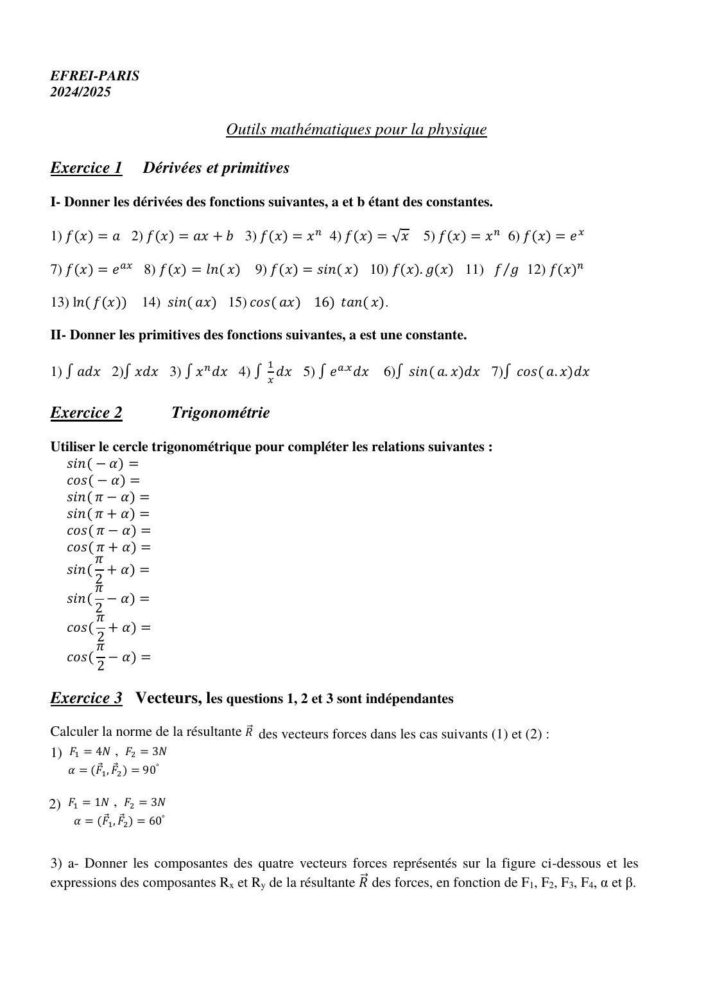
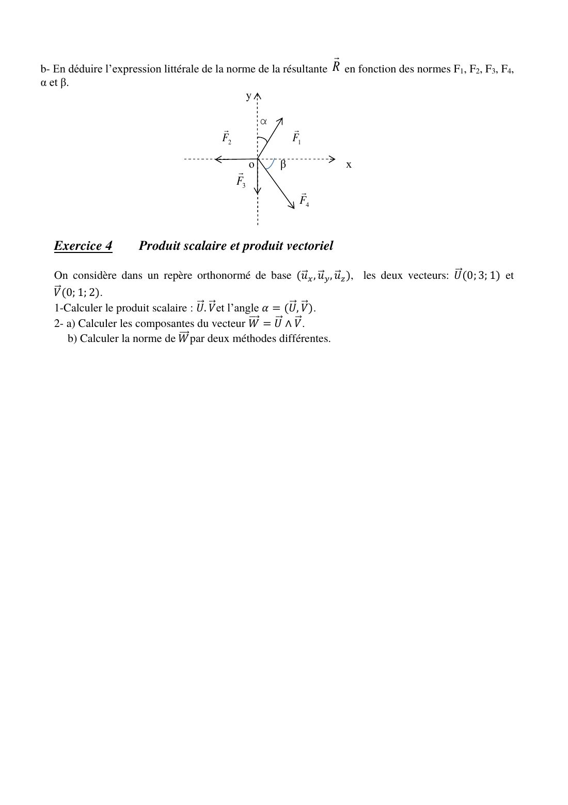

# TD 0 — Outils mathématiques pour la physique

=== "Version simplifiée"

    Les réflexes de calcul dont tout le module a besoin : dériver, intégrer, projeter des
    vecteurs. Énoncés complets dans l'onglet **Version papier**.

    ## Exercice 1 — Dérivées et primitives

    === "Dérivées"

        | $f(x)$ | $f'(x)$ | | $f(x)$ | $f'(x)$ |
        |--------|---------|-|--------|---------|
        | $a$ | $0$ | | $f\cdot g$ | $f'g + fg'$ |
        | $ax + b$ | $a$ | | $f/g$ | $\dfrac{f'g - fg'}{g^2}$ |
        | $x^n$ | $nx^{n-1}$ | | $f^n$ | $n f' f^{n-1}$ |
        | $\sqrt x$ | $\dfrac{1}{2\sqrt x}$ | | $\ln f$ | $\dfrac{f'}{f}$ |
        | $\dfrac{1}{x^n}$ | $-\dfrac{n}{x^{n+1}}$ | | $\sin(ax)$ | $a\cos(ax)$ |
        | $e^x$ | $e^x$ | | $\cos(ax)$ | $-a\sin(ax)$ |
        | $e^{ax}$ | $a e^{ax}$ | | $\tan x$ | $1 + \tan^2 x = \dfrac{1}{\cos^2 x}$ |
        | $\ln x$ | $\dfrac1x$ | | $\sin x$ | $\cos x$ |

    === "Primitives"

        | $\int f(x)\,\mathrm dx$ | Résultat (+ constante) |
        |-------------------------|------------------------|
        | $\int a\,\mathrm dx$ | $ax$ |
        | $\int x\,\mathrm dx$ | $\dfrac{x^2}{2}$ |
        | $\int x^n\,\mathrm dx$ ($n \neq -1$) | $\dfrac{x^{n+1}}{n+1}$ |
        | $\int \dfrac1x\,\mathrm dx$ | $\ln\lvert x\rvert$ |
        | $\int e^{ax}\,\mathrm dx$ | $\dfrac{e^{ax}}{a}$ |
        | $\int \sin(ax)\,\mathrm dx$ | $-\dfrac{\cos(ax)}{a}$ |
        | $\int \cos(ax)\,\mathrm dx$ | $\dfrac{\sin(ax)}{a}$ |

    !!! tip "Celles qui servent vraiment en électromagnétisme"
        $\int \dfrac{\mathrm dr}{r^2} = -\dfrac1r$ (potentiel d'une charge),
        $\int \dfrac{\mathrm dr}{r} = \ln r$ (fil, condensateur cylindrique),
        $\int r^n\,\mathrm dr$ (charges dans une boule), $\int_0^\pi \sin\theta\,\mathrm d\theta = 2$.

    ## Exercice 2 — Trigonométrie

    Tout se lit sur le cercle trigonométrique (symétries par rapport aux axes et à la première
    bissectrice) :

    | | $\sin$ | $\cos$ |
    |-|--------|--------|
    | $-\alpha$ | $-\sin\alpha$ | $\cos\alpha$ |
    | $\pi - \alpha$ | $\sin\alpha$ | $-\cos\alpha$ |
    | $\pi + \alpha$ | $-\sin\alpha$ | $-\cos\alpha$ |
    | $\dfrac\pi2 + \alpha$ | $\cos\alpha$ | $-\sin\alpha$ |
    | $\dfrac\pi2 - \alpha$ | $\cos\alpha$ | $\sin\alpha$ |

    ## Exercice 3 — Résultante de forces

    !!! theoreme "Norme d'une somme de deux vecteurs"
        $$
        R^2 = F_1^2 + F_2^2 + 2F_1F_2\cos\alpha \qquad \alpha = (\vec F_1, \vec F_2)
        $$

    1. $F_1 = 4$ N, $F_2 = 3$ N, $\alpha = 90°$ : $R = \sqrt{16 + 9} = 5$ N.
    2. $F_1 = 1$ N, $F_2 = 3$ N, $\alpha = 60°$ : $R = \sqrt{1 + 9 + 2\cdot 3\cdot\tfrac12} = \sqrt{13} \simeq 3{,}6$ N.
    3. Méthode générale : on projette **chaque** force sur $x$ et sur $y$
       ($F\cos(\text{angle avec } Ox)$, $F\sin(\ldots)$, avec le **signe** donné par le quadrant),
       on additionne : $R_x = \sum F_{ix}$, $R_y = \sum F_{iy}$, puis $R = \sqrt{R_x^2 + R_y^2}$.

    !!! methode "Projeter sans se tromper"
        Angle $\alpha$ mesuré **depuis l'axe $Ox$** : composantes $(F\cos\alpha,\ F\sin\alpha)$.
        Angle $\beta$ mesuré **depuis l'axe $Oy$** : composantes $(F\sin\beta,\ F\cos\beta)$.
        Ensuite seulement on met les signes en regardant le dessin.

    ## Exercice 4 — Produits scalaire et vectoriel

    $\vec U = (0, 3, 1)$, $\vec V = (0, 1, 2)$.

    1. $\vec U\cdot\vec V = 0 + 3 + 2 = 5$. Avec $\|\vec U\| = \sqrt{10}$ et $\|\vec V\| = \sqrt5$ :
       $\cos\alpha = \dfrac{5}{\sqrt{50}} = \dfrac{1}{\sqrt2}$, donc $\alpha = 45°$.
    2. $\vec W = \vec U\wedge\vec V = (3\cdot2 - 1\cdot1,\ 1\cdot0 - 0\cdot2,\ 0\cdot1 - 3\cdot0) = (5, 0, 0)$.
       Norme : $\|\vec W\| = 5$ directement, ou $\|\vec U\|\,\|\vec V\|\sin\alpha = \sqrt{50}\cdot\dfrac{\sqrt2}{2} = 5$ ✓.

    !!! methode "Produit vectoriel en composantes"
        $$
        \begin{pmatrix}a_1\\a_2\\a_3\end{pmatrix}\wedge\begin{pmatrix}b_1\\b_2\\b_3\end{pmatrix}
        = \begin{pmatrix}a_2b_3 - a_3b_2\\ a_3b_1 - a_1b_3\\ a_1b_2 - a_2b_1\end{pmatrix}
        $$

        Base directe : $\vec e_x\wedge\vec e_y = \vec e_z$, $\vec e_y\wedge\vec e_z = \vec e_x$,
        $\vec e_z\wedge\vec e_x = \vec e_y$. Il servira pour Biot et Savart.

=== "Version papier"

    La feuille « Outils mathématiques pour la physique » (2024-2025).

    [{ loading=lazy .papier }](papier/td0/p01.jpg)
    
Exercices 1 à 3 : dérivées, trigonométrie, vecteurs · Outils mathématiques 2024-2025, p. 1

    [{ loading=lazy .papier }](papier/td0/p02.jpg)
    
Exercice 3 (suite) et exercice 4 : produits scalaire et vectoriel · Outils mathématiques 2024-2025, p. 2

