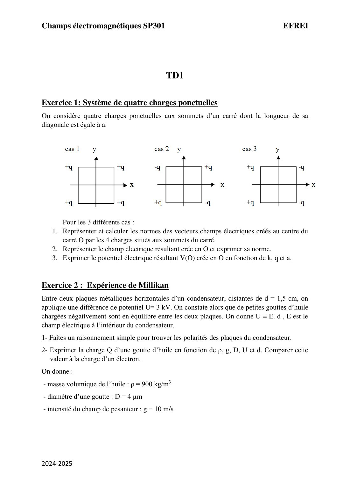
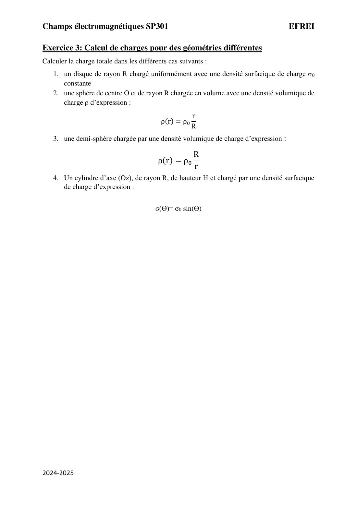
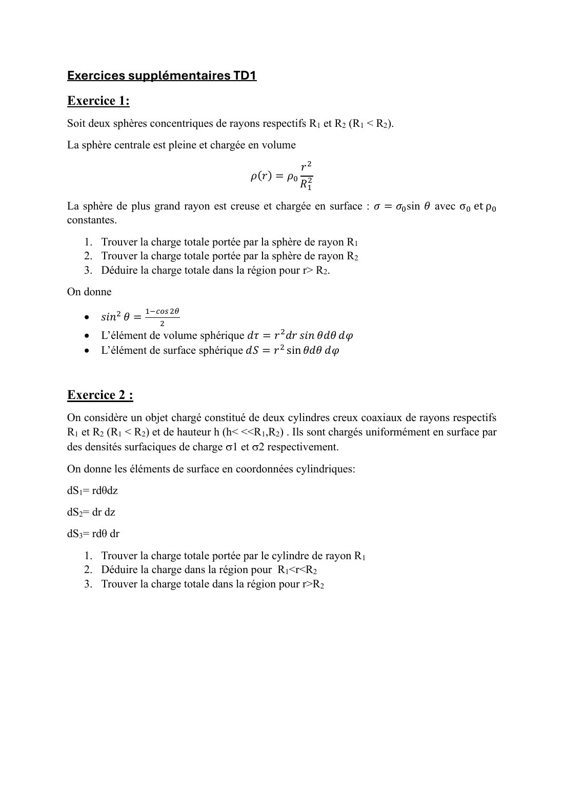

# TD 1 — Charges ponctuelles, champ, potentiel et distributions

=== "Version simplifiée"

    Corrections rédigées ; les schémas des trois cas de l'exercice 1 sont dans l'onglet
    **Version papier**. Rappels : [chapitre 1](../cours/chapitre-1-electrostatique.md).

    ## Exercice 1 — Quatre charges aux sommets d'un carré

    La diagonale vaut $a$, donc chaque sommet est à la distance $\dfrac a2$ du centre $O$. Chaque
    charge crée en $O$ un champ de même norme :

    $$
    E_1 = k\frac{q}{(a/2)^2} = \frac{4kq}{a^2}
    $$

    Il est dirigé le long de la diagonale : **en s'éloignant** de la charge si elle est $+q$,
    **vers** elle si elle est $-q$.

    !!! methode "Raisonner par paires de sommets opposés"
        Deux charges **égales** sur une même diagonale → champs opposés en $O$ : ils s'annulent.
        Deux charges **opposées** sur une diagonale → champs de même sens : ils s'ajoutent
        ($2E_1$, dirigé vers la charge $-q$).

    | Cas | Charges (haut-g, haut-d, bas-g, bas-d) | $\vec E(O)$ | $V(O)$ |
    |-----|----------------------------------------|-------------|--------|
    | 1 | $+q, +q, +q, +q$ | $\vec 0$ (deux paires égales) | $4\cdot\dfrac{kq}{a/2} = \dfrac{8kq}{a}$ |
    | 2 | $-q, +q, +q, -q$ | $\vec 0$ (chaque diagonale porte deux charges égales) | $0$ |
    | 3 | $+q, -q, +q, -q$ | $\dfrac{8\sqrt2\,kq}{a^2}\,\vec e_x$ | $0$ |

    **Détail du cas 3** : chaque diagonale porte $+q$ et $-q$, donc chaque paire donne $2E_1$
    vers la charge $-q$ (qui est à droite). Les deux résultantes font $\pm 45°$ avec $Ox$ :
    leurs composantes verticales s'annulent, les horizontales s'ajoutent :

    $$
    E(O) = 2 \times 2E_1 \cos 45° = 2\sqrt2\,E_1 = \frac{8\sqrt2\,kq}{a^2}
    $$

    !!! piege "Champ nul, potentiel non nul (et inversement)"
        Cas 1 : $\vec E(O) = \vec 0$ mais $V(O) = 8kq/a$. Cas 3 : $V(O) = 0$ mais $\vec E(O) \neq \vec 0$.
        Le potentiel est une somme de **nombres**, le champ une somme de **vecteurs**.

    ## Exercice 2 — Expérience de Millikan

    1. **Polarités.** La goutte est en équilibre : la force électrique compense le poids, elle est
       donc **vers le haut**. Comme $Q < 0$, $\vec F = Q\vec E$ est opposée à $\vec E$ : le champ est
       **vers le bas**. Le champ va du + vers le − : **plaque du haut +, plaque du bas −**.
    2. **Charge.** Équilibre : $|Q|E = mg$ avec $E = \dfrac Ud$ et $m = \rho\cdot\dfrac43\pi\left(\dfrac D2\right)^3 = \dfrac{\rho\pi D^3}{6}$ :

        $$
        |Q| = \frac{\rho\,\pi D^3\,g\,d}{6\,U}
        $$

        A.N. : $|Q| = \dfrac{900 \times \pi \times (4\times10^{-6})^3 \times 10 \times 1{,}5\times10^{-2}}{6 \times 3000} \simeq 1{,}5 \times 10^{-18}$ C,
        soit $|Q|/e \simeq 9$ : la goutte porte **une dizaine d'électrons en excès**. C'est ce
        type de mesure qui a montré que la charge est **quantifiée** (multiple de $e$).

    ## Exercice 3 — Charges totales

    !!! methode "Rappel"
        $Q = \iint \sigma\,\mathrm dS$ ou $Q = \iiint \rho\,\mathrm d\tau$, avec l'élément adapté à la
        géométrie (voir [chapitre 2](../cours/chapitre-2-coordonnees-gauss.md)).

    1. **Disque** de rayon $R$, $\sigma_0$ uniforme :
       $Q = \sigma_0\int_0^R\!\int_0^{2\pi} r\,\mathrm dr\,\mathrm d\theta = \sigma_0\pi R^2$.
    2. **Sphère** de rayon $R$, $\rho = \rho_0\dfrac rR$ :
       $Q = \int_0^R \rho_0\dfrac rR\,r^2\,\mathrm dr\int_0^\pi\sin\theta\,\mathrm d\theta\int_0^{2\pi}\mathrm d\varphi
       = \dfrac{4\pi\rho_0}{R}\cdot\dfrac{R^4}{4} = \pi\rho_0 R^3$.
    3. **Demi-sphère**, $\rho = \rho_0\dfrac Rr$ ($\theta$ de 0 à $\pi/2$, donc
       $\int\sin\theta\,\mathrm d\theta = 1$) :
       $Q = \rho_0 R\int_0^R r\,\mathrm dr \times 1 \times 2\pi = \rho_0 R\cdot\dfrac{R^2}{2}\cdot 2\pi = \pi\rho_0R^3$.
    4. **Cylindre** (surface latérale, rayon $R$, hauteur $H$), $\sigma = \sigma_0\sin\theta$ :
       $Q = \sigma_0 R H\int_0^{2\pi}\sin\theta\,\mathrm d\theta = 0$. Les charges $+$ ($0 < \theta < \pi$)
       et $-$ ($\pi < \theta < 2\pi$) se compensent exactement.

    ## Exercices supplémentaires

    ### Exercice 1 — Deux sphères concentriques

    1. Boule $R_1$, $\rho = \rho_0\dfrac{r^2}{R_1^2}$ :
       $Q_1 = \dfrac{4\pi\rho_0}{R_1^2}\int_0^{R_1} r^4\,\mathrm dr = \dfrac45\pi\rho_0R_1^3$.
    2. Coque $R_2$, $\sigma = \sigma_0\sin\theta$, $\mathrm dS = R_2^2\sin\theta\,\mathrm d\theta\,\mathrm d\varphi$ :
       $Q_2 = \sigma_0R_2^2\cdot 2\pi\int_0^\pi\sin^2\theta\,\mathrm d\theta = \sigma_0R_2^2\cdot2\pi\cdot\dfrac\pi2 = \pi^2\sigma_0R_2^2$.
    3. Pour $r > R_2$ : $Q = Q_1 + Q_2 = \dfrac45\pi\rho_0R_1^3 + \pi^2\sigma_0R_2^2$.

    !!! piege "Ici $\sin\theta$ apparaît deux fois"
        Une fois dans la densité, une fois dans $\mathrm dS$ : on intègre $\sin^2\theta$, pas $\sin\theta$.
        D'où la donnée $\sin^2\theta = \dfrac{1 - \cos 2\theta}{2}$.

    ### Exercice 2 — Deux cylindres creux coaxiaux

    Surfaces latérales : $\mathrm dS = r\,\mathrm d\theta\,\mathrm dz$.

    1. $Q_1 = \sigma_1\cdot 2\pi R_1 h$.
    2. Pour $R_1 < r < R_2$ : seule la charge du cylindre intérieur est englobée, $Q = 2\pi R_1h\sigma_1$.
    3. Pour $r > R_2$ : $Q = 2\pi h(\sigma_1R_1 + \sigma_2R_2)$.

=== "Version papier"

    Énoncés du TD 1 (livret 2024-2025) et exercices supplémentaires.

    [{ loading=lazy .papier }](papier/td1/livret-p01.jpg)
    
Exercices 1 et 2 : quatre charges, Millikan · Livret de TD 2024-2025, p. 1

    [{ loading=lazy .papier }](papier/td1/livret-p02.jpg)
    
Exercice 3 : calcul de charges · Livret de TD 2024-2025, p. 2

    [{ loading=lazy .papier }](papier/td1/supp-p01.jpg)
    
Exercices supplémentaires TD1 · Exercices supplémentaires, p. 1

