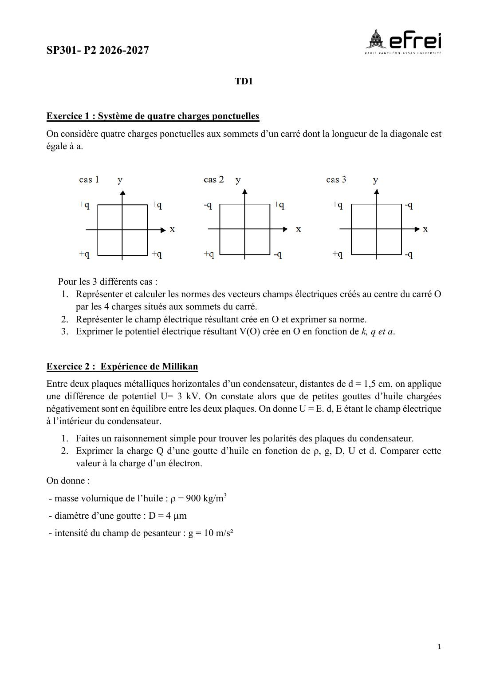

# TD 1 — Charges ponctuelles, champ et potentiel

=== "Version simplifiée"

    Corrections rédigées ; les schémas des trois cas de l'exercice 1 sont dans l'onglet
    **Version papier** (livret 2026-2027). Rappels : [chapitre 1](../cours/chapitre-1-electrostatique.md).
    Les calculs de charges totales sont maintenant dans le [TD 2](td-2-charges-distribuees.md).

    ## Exercice 1 — Quatre charges aux sommets d'un carré

    La diagonale vaut $a$, donc chaque sommet est à la distance $\dfrac a2$ du centre $O$. Chaque
    charge crée en $O$ un champ de même norme :

    $$
    E_1 = k\frac{q}{(a/2)^2} = \frac{4kq}{a^2}
    $$

    Il est dirigé le long de la diagonale : **en s'éloignant** de la charge si elle est $+q$,
    **vers** elle si elle est $-q$.

    !!! methode "Raisonner par paires de sommets opposés"
        Deux charges **égales** sur une même diagonale → champs opposés en $O$ : ils s'annulent.
        Deux charges **opposées** sur une diagonale → champs de même sens : ils s'ajoutent
        ($2E_1$, dirigé vers la charge $-q$).

    | Cas | Charges (haut-g, haut-d, bas-g, bas-d) | $\vec E(O)$ | $V(O)$ |
    |-----|----------------------------------------|-------------|--------|
    | 1 | $+q, +q, +q, +q$ | $\vec 0$ (deux paires égales) | $4\cdot\dfrac{kq}{a/2} = \dfrac{8kq}{a}$ |
    | 2 | $-q, +q, +q, -q$ | $\vec 0$ (chaque diagonale porte deux charges égales) | $0$ |
    | 3 | $+q, -q, +q, -q$ | $\dfrac{8\sqrt2\,kq}{a^2}\,\vec e_x$ | $0$ |

    **Détail du cas 3** : chaque diagonale porte $+q$ et $-q$, donc chaque paire donne $2E_1$
    vers la charge $-q$ (qui est à droite). Les deux résultantes font $\pm 45°$ avec $Ox$ :
    leurs composantes verticales s'annulent, les horizontales s'ajoutent :

    $$
    E(O) = 2 \times 2E_1 \cos 45° = 2\sqrt2\,E_1 = \frac{8\sqrt2\,kq}{a^2}
    $$

    !!! piege "Champ nul, potentiel non nul (et inversement)"
        Cas 1 : $\vec E(O) = \vec 0$ mais $V(O) = 8kq/a$. Cas 3 : $V(O) = 0$ mais $\vec E(O) \neq \vec 0$.
        Le potentiel est une somme de **nombres**, le champ une somme de **vecteurs**.

    ## Exercice 2 — Expérience de Millikan

    1. **Polarités.** La goutte est en équilibre : la force électrique compense le poids, elle est
       donc **vers le haut**. Comme $Q < 0$, $\vec F = Q\vec E$ est opposée à $\vec E$ : le champ est
       **vers le bas**. Le champ va du + vers le − : **plaque du haut +, plaque du bas −**.
    2. **Charge.** Équilibre : $|Q|E = mg$ avec $E = \dfrac Ud$ et $m = \rho\cdot\dfrac43\pi\left(\dfrac D2\right)^3 = \dfrac{\rho\pi D^3}{6}$ :

        $$
        |Q| = \frac{\rho\,\pi D^3\,g\,d}{6\,U}
        $$

        A.N. : $|Q| = \dfrac{900 \times \pi \times (4\times10^{-6})^3 \times 10 \times 1{,}5\times10^{-2}}{6 \times 3000} \simeq 1{,}5 \times 10^{-18}$ C,
        soit $|Q|/e \simeq 9$ : la goutte porte **une dizaine d'électrons en excès**. C'est ce
        type de mesure qui a montré que la charge est **quantifiée** (multiple de $e$).

=== "Version papier"

    Énoncé du TD 1 (livret 2026-2027).

    [{ loading=lazy .papier }](papier/td1-2627/p01.jpg)
    
TD 1 : quatre charges, Millikan · Livret de TD 2026-2027, page 1

