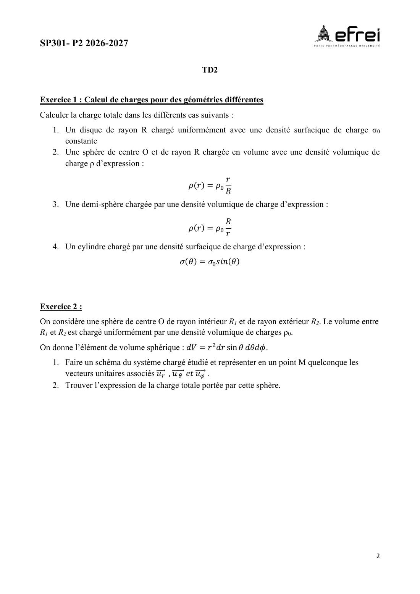
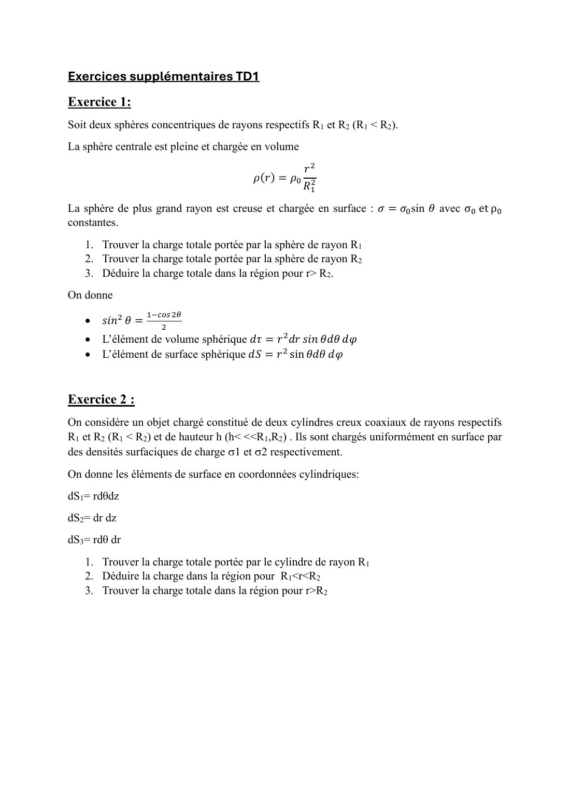

# TD 2 — Calcul de charges pour des distributions continues

=== "Version simplifiée"

    Corrections rédigées. Rappels : [chapitre 2](../cours/chapitre-2-coordonnees-distributions.md)
    (éléments $\mathrm dS$, $\mathrm dV$ et densités $\lambda$, $\sigma$, $\rho$).

    ## Exercice 1 — Charges totales

    !!! methode "Rappel"
        $Q = \iint \sigma\,\mathrm dS$ ou $Q = \iiint \rho\,\mathrm d\tau$, avec l'élément adapté à la
        géométrie (voir [chapitre 2](../cours/chapitre-2-coordonnees-distributions.md)).

    1. **Disque** de rayon $R$, $\sigma_0$ uniforme :
       $Q = \sigma_0\int_0^R\!\int_0^{2\pi} r\,\mathrm dr\,\mathrm d\theta = \sigma_0\pi R^2$.
    2. **Sphère** de rayon $R$, $\rho = \rho_0\dfrac rR$ :
       $Q = \int_0^R \rho_0\dfrac rR\,r^2\,\mathrm dr\int_0^\pi\sin\theta\,\mathrm d\theta\int_0^{2\pi}\mathrm d\varphi
       = \dfrac{4\pi\rho_0}{R}\cdot\dfrac{R^4}{4} = \pi\rho_0 R^3$.
    3. **Demi-sphère**, $\rho = \rho_0\dfrac Rr$ ($\theta$ de 0 à $\pi/2$, donc
       $\int\sin\theta\,\mathrm d\theta = 1$) :
       $Q = \rho_0 R\int_0^R r\,\mathrm dr \times 1 \times 2\pi = \rho_0 R\cdot\dfrac{R^2}{2}\cdot 2\pi = \pi\rho_0R^3$.
    4. **Cylindre** (surface latérale, rayon $R$, hauteur $H$), $\sigma = \sigma_0\sin\theta$ :
       $Q = \sigma_0 R H\int_0^{2\pi}\sin\theta\,\mathrm d\theta = 0$. Les charges $+$ ($0 < \theta < \pi$)
       et $-$ ($\pi < \theta < 2\pi$) se compensent exactement.

    ## Exercice 2 — Sphère creuse chargée uniformément

    Coque sphérique de centre $O$, entre $R_1$ (rayon intérieur) et $R_2$ (rayon extérieur),
    densité volumique $\rho_0$ uniforme.

    1. **Schéma et base locale.** En un point $M$ repéré par $(r, \theta, \varphi)$ :
        - $\vec u_r$ : selon $\overrightarrow{OM}$, vers l'extérieur ;
        - $\vec u_\theta$ : tangent au méridien (le « cercle de longitude »), vers le bas
          ($\theta$ croissant, depuis l'axe $Oz$) ;
        - $\vec u_\varphi$ : tangent au parallèle, horizontal, dans le sens de rotation autour de $Oz$.

    2. **Charge totale.** On intègre $\rho_0\,\mathrm dV$ avec $\mathrm dV = r^2\,\mathrm dr\,\sin\theta\,\mathrm d\theta\,\mathrm d\varphi$,
       $r$ de $R_1$ à $R_2$ :

        $$
        Q = \rho_0\int_{R_1}^{R_2} r^2\,\mathrm dr\int_0^\pi\sin\theta\,\mathrm d\theta\int_0^{2\pi}\mathrm d\varphi
          = \rho_0\cdot\frac{R_2^3 - R_1^3}{3}\cdot 2\cdot 2\pi
          = \frac43\pi\rho_0\left(R_2^3 - R_1^3\right)
        $$

    !!! tip "Vérification"
        C'est la densité × le volume de la coque : (volume de la grande boule) − (volume du trou).
        Si $R_1 = 0$, on retrouve la boule pleine $\frac43\pi R_2^3\rho_0$.

    ## Pour aller plus loin : exercices supplémentaires 2024-2025

    Énoncés dans l'onglet **Version papier** (fiche d'exercices supplémentaires 2024-2025).

    ### Exercice 1 — Deux sphères concentriques

    1. Boule $R_1$, $\rho = \rho_0\dfrac{r^2}{R_1^2}$ :
       $Q_1 = \dfrac{4\pi\rho_0}{R_1^2}\int_0^{R_1} r^4\,\mathrm dr = \dfrac45\pi\rho_0R_1^3$.
    2. Coque $R_2$, $\sigma = \sigma_0\sin\theta$, $\mathrm dS = R_2^2\sin\theta\,\mathrm d\theta\,\mathrm d\varphi$ :
       $Q_2 = \sigma_0R_2^2\cdot 2\pi\int_0^\pi\sin^2\theta\,\mathrm d\theta = \sigma_0R_2^2\cdot2\pi\cdot\dfrac\pi2 = \pi^2\sigma_0R_2^2$.
    3. Pour $r > R_2$ : $Q = Q_1 + Q_2 = \dfrac45\pi\rho_0R_1^3 + \pi^2\sigma_0R_2^2$.

    !!! piege "Ici $\sin\theta$ apparaît deux fois"
        Une fois dans la densité, une fois dans $\mathrm dS$ : on intègre $\sin^2\theta$, pas $\sin\theta$.
        D'où la donnée $\sin^2\theta = \dfrac{1 - \cos 2\theta}{2}$.

    ### Exercice 2 — Deux cylindres creux coaxiaux

    Surfaces latérales : $\mathrm dS = r\,\mathrm d\theta\,\mathrm dz$.

    1. $Q_1 = \sigma_1\cdot 2\pi R_1 h$.
    2. Pour $R_1 < r < R_2$ : seule la charge du cylindre intérieur est englobée, $Q = 2\pi R_1h\sigma_1$.
    3. Pour $r > R_2$ : $Q = 2\pi h(\sigma_1R_1 + \sigma_2R_2)$.

=== "Version papier"

    Énoncé du TD 2 (livret 2026-2027), puis les exercices supplémentaires 2024-2025 corrigés
    plus haut.

    [{ loading=lazy .papier }](papier/td2-2627/p02.jpg)
    
TD 2 : charges totales, sphère creuse · Livret de TD 2026-2027, page 2

    [{ loading=lazy .papier }](papier/supp-2425/p01.jpg)
    
Deux sphères concentriques, deux cylindres coaxiaux · Exercices supplémentaires 2024-2025, p. 1

