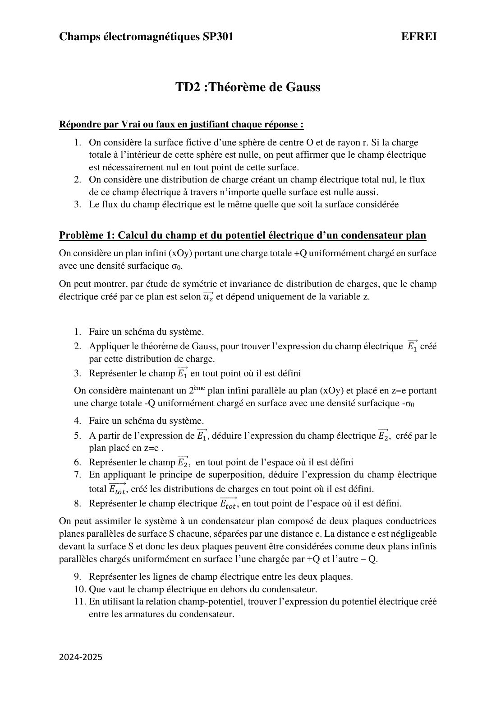
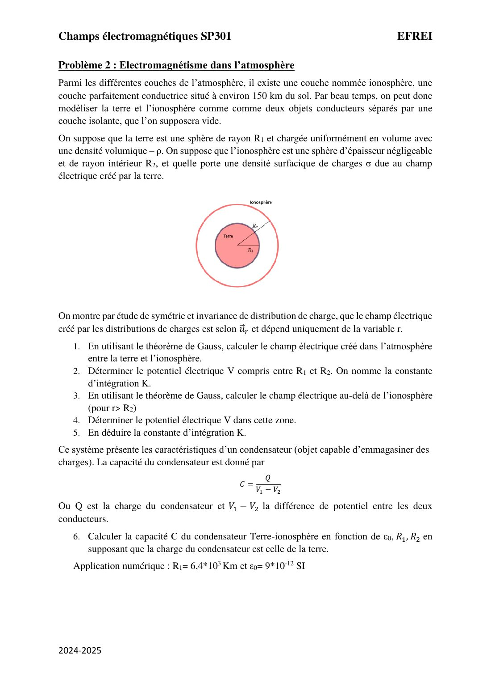
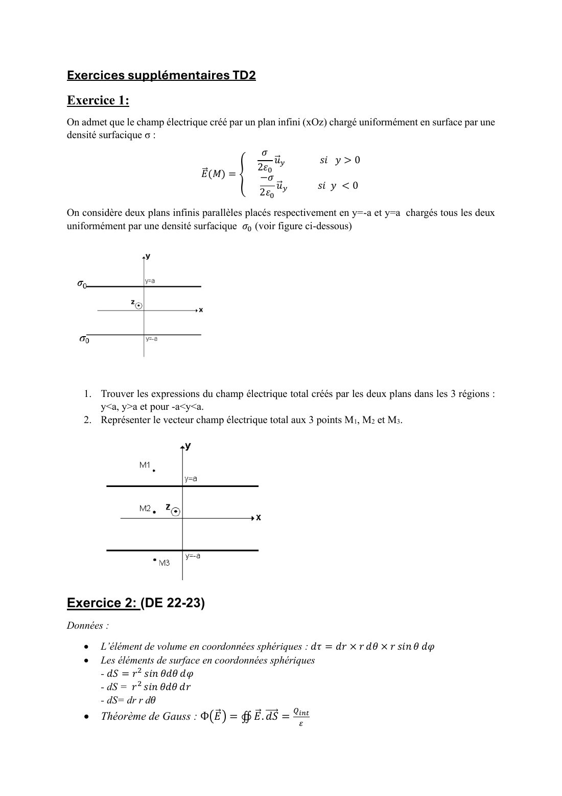
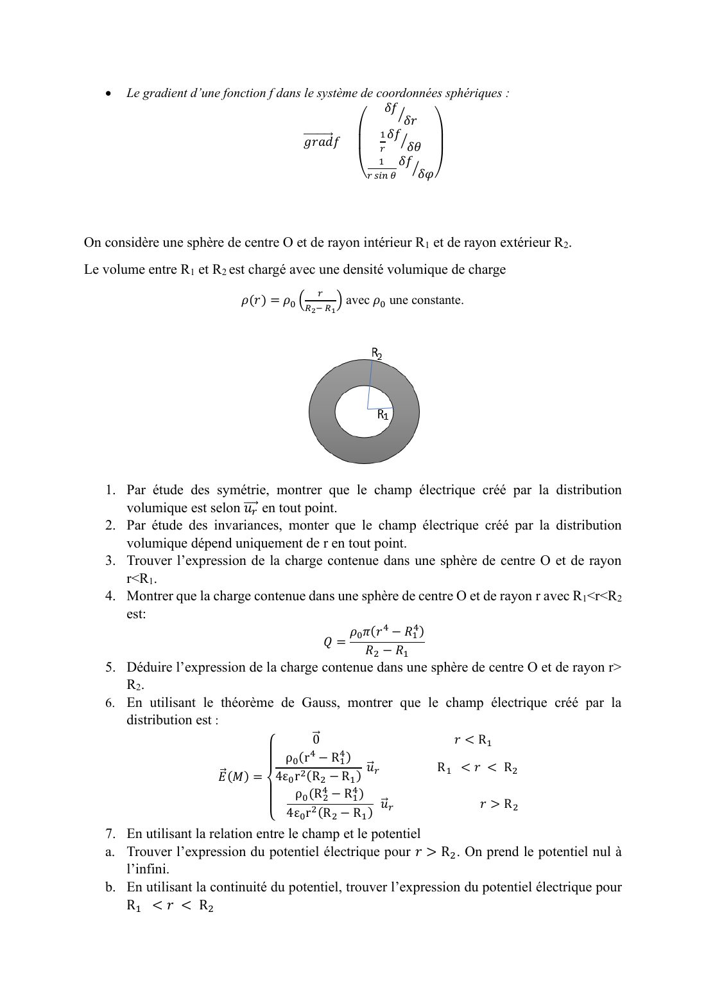

# TD 2 — Théorème de Gauss

=== "Version simplifiée"

    Corrections rédigées. Rappels : [chapitre 2](../cours/chapitre-2-coordonnees-gauss.md)
    (méthode en six étapes et résultats classiques).

    ## Vrai ou faux

    1. **Faux.** $Q_{int} = 0$ impose seulement un **flux** nul. Des charges extérieures à la
       sphère créent un champ non nul sur sa surface (le flux entrant compense le flux sortant).
    2. **Vrai.** Si $\vec E = \vec 0$ partout, alors $\vec E\cdot\mathrm d\vec S = 0$ partout : le flux
       est nul à travers n'importe quelle surface.
    3. **Faux.** Le flux dépend de la surface. Même pour des surfaces fermées, il vaut
       $Q_{int}/\varepsilon_0$ : il change dès que la surface n'englobe pas les mêmes charges.

    ## Problème 1 — Plan infini et condensateur plan

    **Plan $(xOy)$, densité $\sigma_0$.** Le champ est selon $\vec u_z$ et ne dépend que de $z$ ;
    le plan est un plan de symétrie, donc $E_z(-z) = -E_z(z)$.

    Surface de Gauss : cylindre d'axe $Oz$, de section $S$, entre $-z$ et $+z$.

    - Face latérale : $\vec E \perp \mathrm d\vec S$, flux nul.
    - Les deux bases : $\vec E$ sortant et de même norme, $\Phi = 2E(z)S$.
    - $Q_{int} = \sigma_0 S$.

    $$
    2ES = \frac{\sigma_0 S}{\varepsilon_0}
    \quad\Longrightarrow\quad
    \vec E_1 = \frac{\sigma_0}{2\varepsilon_0}\vec u_z\ (z > 0),
    \qquad
    \vec E_1 = -\frac{\sigma_0}{2\varepsilon_0}\vec u_z\ (z < 0)
    $$

    Le champ « sort » du plan des deux côtés et n'est pas défini sur le plan lui-même.

    **Deuxième plan en $z = e$, densité $-\sigma_0$.** Même résultat avec le signe inversé, le
    champ « rentre » dans le plan :

    $$
    \vec E_2 = -\frac{\sigma_0}{2\varepsilon_0}\vec u_z\ (z > e),
    \qquad
    \vec E_2 = +\frac{\sigma_0}{2\varepsilon_0}\vec u_z\ (z < e)
    $$

    **Superposition** :

    | Région | $\vec E_1$ | $\vec E_2$ | $\vec E_{tot}$ |
    |--------|-----------|-----------|----------------|
    | $z < 0$ | $-\dfrac{\sigma_0}{2\varepsilon_0}\vec u_z$ | $+\dfrac{\sigma_0}{2\varepsilon_0}\vec u_z$ | $\vec 0$ |
    | $0 < z < e$ | $+\dfrac{\sigma_0}{2\varepsilon_0}\vec u_z$ | $+\dfrac{\sigma_0}{2\varepsilon_0}\vec u_z$ | $\dfrac{\sigma_0}{\varepsilon_0}\vec u_z$ |
    | $z > e$ | $+\dfrac{\sigma_0}{2\varepsilon_0}\vec u_z$ | $-\dfrac{\sigma_0}{2\varepsilon_0}\vec u_z$ | $\vec 0$ |

    **Condensateur plan.** Lignes de champ : droites parallèles, perpendiculaires aux plaques,
    de la plaque $+Q$ vers la plaque $-Q$. Champ nul à l'extérieur.

    **Potentiel.** $E_z = -\dfrac{\mathrm dV}{\mathrm dz} = \dfrac{\sigma_0}{\varepsilon_0}$, donc

    $$
    V(z) = -\frac{\sigma_0}{\varepsilon_0}\,z + V_0
    \qquad\text{et}\qquad
    U = V(0) - V(e) = \frac{\sigma_0\,e}{\varepsilon_0}
    $$

    Bonus : avec $\sigma_0 = Q/S$, la capacité vaut $C = \dfrac QU = \dfrac{\varepsilon_0 S}{e}$.

    ## Problème 2 — Terre et ionosphère

    La Terre : boule de rayon $R_1$, densité $-\rho$, donc
    $Q_T = -\dfrac43\pi R_1^3\rho$. Ionosphère : coque de rayon $R_2$. Champ selon $\vec u_r$,
    fonction de $r$ seulement ; surface de Gauss : sphère de rayon $r$, $\Phi = 4\pi r^2E(r)$.

    1. **Atmosphère** ($R_1 < r < R_2$) : $Q_{int} = Q_T$, donc

        $$
        \vec E = -\frac{\rho R_1^3}{3\varepsilon_0 r^2}\,\vec u_r
        $$

        Il pointe vers la Terre (elle est chargée négativement).

    2. $E_r = -\dfrac{\mathrm dV}{\mathrm dr}$ donne
       $V(r) = -\dfrac{\rho R_1^3}{3\varepsilon_0\,r} + K$.

    3. **Au-delà** ($r > R_2$) : l'ionosphère porte la charge opposée à celle de la Terre (c'est
       le champ de la Terre qui l'a induite), donc $Q_{int} = 0$ et $\vec E = \vec 0$.
    4. Champ nul : $V$ est constant, et nul puisque $V(\infty) = 0$.
    5. **Continuité** de $V$ en $R_2$ : $-\dfrac{\rho R_1^3}{3\varepsilon_0R_2} + K = 0$, donc
       $K = \dfrac{\rho R_1^3}{3\varepsilon_0R_2}$.
    6. **Capacité.** $V_1 - V_2 = V(R_1) - V(R_2) = -\dfrac{\rho R_1^3}{3\varepsilon_0}\left(\dfrac1{R_1} - \dfrac1{R_2}\right)$ et $Q = Q_T$ :

        $$
        C = \frac{Q_T}{V_1 - V_2} = \frac{4\pi\varepsilon_0\,R_1R_2}{R_2 - R_1}
        $$

        A.N. : $R_1 = 6{,}4\times10^6$ m, $R_2 = R_1 + 150$ km $= 6{,}55\times10^6$ m :
        $C \simeq \dfrac{4\pi \times 9\times10^{-12} \times 6{,}4\times10^6 \times 6{,}55\times10^6}{1{,}5\times10^5} \simeq 3\times10^{-2}$ F.

    !!! tip "Vérification"
        Comme $R_2 - R_1 \ll R_1$, on retrouve presque le condensateur plan :
        $C \approx \dfrac{\varepsilon_0\cdot 4\pi R_1^2}{R_2 - R_1}$ (surface de la Terre / épaisseur).

    ## Exercices supplémentaires

    ### Exercice 1 — Deux plans de même charge

    Plans en $y = \pm a$, tous deux $+\sigma_0$. Chacun donne $\pm\dfrac{\sigma_0}{2\varepsilon_0}\vec u_y$
    (sortant du plan) :

    | Région | Champ total |
    |--------|-------------|
    | $y > a$ ($M_1$) | $\dfrac{\sigma_0}{\varepsilon_0}\vec u_y$ |
    | $-a < y < a$ ($M_2$) | $\vec 0$ (les deux champs s'opposent) |
    | $y < -a$ ($M_3$) | $-\dfrac{\sigma_0}{\varepsilon_0}\vec u_y$ |

    C'est l'inverse du condensateur : nul **entre** les plans, non nul dehors.

    ### Exercice 2 — Sphère creuse chargée en volume (DE 2022-2023)

    Corrigé détaillé dans l'[annale du DE 2022](annale-de-2022.md#exercice-2-sphere-creuse-chargee-en-volume).

=== "Version papier"

    Énoncés du TD 2 (livret 2024-2025) et exercices supplémentaires.

    [{ loading=lazy .papier }](papier/td2/livret-p03.jpg)
    
Vrai/faux et problème 1 : condensateur plan · Livret de TD 2024-2025, p. 3

    [{ loading=lazy .papier }](papier/td2/livret-p04.jpg)
    
Problème 2 : Terre et ionosphère · Livret de TD 2024-2025, p. 4

    [{ loading=lazy .papier }](papier/td2/supp-p02.jpg)
    
Exercices supplémentaires TD2 : deux plans, sphère creuse (DE 22-23) · Exercices supplémentaires, p. 2

    [{ loading=lazy .papier }](papier/td2/supp-p03.jpg)
    
Exercice 2 (suite) : questions · Exercices supplémentaires, p. 3

