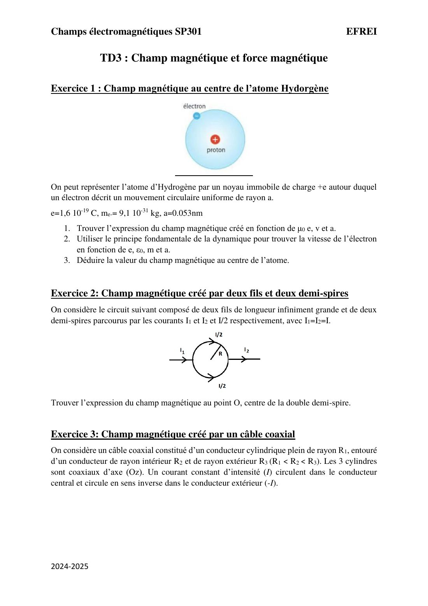
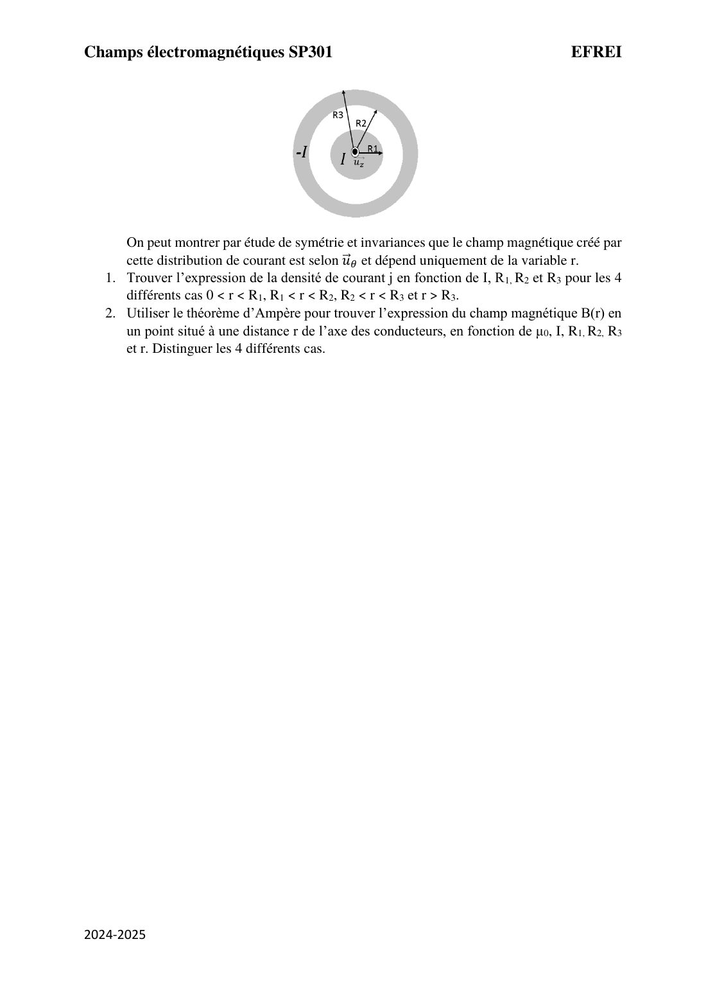
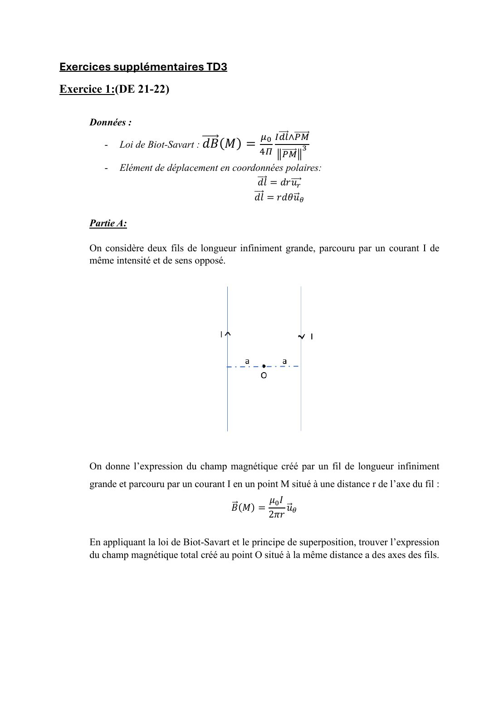
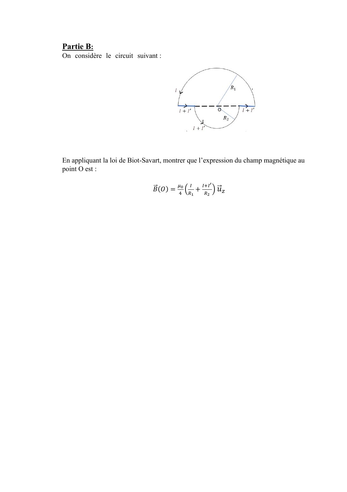

# TD 3 — Champ magnétique

=== "Version simplifiée"

    Corrections rédigées ; les schémas (demi-spires, câble coaxial, circuits) sont dans l'onglet
    **Version papier**. Rappels : [chapitre 3](../cours/chapitre-3-champ-magnetique.md).

    ## Exercice 1 — Champ au centre de l'atome d'hydrogène

    L'électron ($-e$, vitesse $v$) tourne sur un cercle de rayon $a$ autour du proton $O$.

    1. **Champ créé en $O$** par une charge mobile : $\vec B = \dfrac{\mu_0}{4\pi}\dfrac{q\,\vec v\wedge\overrightarrow{PO}}{PO^3}$.
       Ici $\vec v \perp \overrightarrow{PO}$ et $PO = a$, donc

        $$
        B = \frac{\mu_0\,e\,v}{4\pi a^2}
        $$

        dirigé perpendiculairement au plan de l'orbite.

    2. **Vitesse** (PFD, mouvement circulaire uniforme) :
       $\dfrac{e^2}{4\pi\varepsilon_0 a^2} = m\dfrac{v^2}{a}$, donc
       $v = \sqrt{\dfrac{e^2}{4\pi\varepsilon_0\,m\,a}} = \dfrac{e}{\sqrt{4\pi\varepsilon_0 m a}}$.

    3. **Application numérique** : $v \simeq 2{,}2\times10^6$ m/s, puis
       $B = 10^{-7}\times\dfrac{1{,}6\times10^{-19}\times 2{,}2\times10^6}{(0{,}053\times10^{-9})^2} \simeq 12{,}5$ T.
       Énorme à notre échelle (un aimant de frigo fait ~10 mT), mais très localisé.

    ## Exercice 2 — Deux fils et deux demi-spires

    !!! methode "Découper le circuit"
        Le champ total en $O$ est la somme des champs de chaque morceau (superposition).

    - **Les deux fils** sont sur le **diamètre** qui passe par $O$ : pour chacun de leurs points,
      $\mathrm d\vec l \parallel \overrightarrow{PO}$, donc $\mathrm d\vec l\wedge\overrightarrow{PO} = \vec 0$.
      Ils ne créent **aucun** champ en $O$.
    - **Chaque demi-spire** (rayon $R$, courant $I/2$) crée au centre la moitié du champ d'une
      spire : $B = \dfrac{\mu_0 (I/2)}{4R} = \dfrac{\mu_0 I}{8R}$.
    - Sur le schéma, le courant entre à gauche et ressort à droite par **les deux** demi-spires :
      l'une tourne dans le sens horaire, l'autre dans le sens trigonométrique. Leurs champs en $O$
      sont **opposés** :

    $$
    \vec B(O) = \frac{\mu_0 I}{8R}\vec u_z - \frac{\mu_0 I}{8R}\vec u_z = \vec 0
    $$

    ## Exercice 3 — Câble coaxial

    Conducteur central plein (rayon $R_1$, courant $I$), gaine entre $R_2$ et $R_3$ (courant $-I$).
    $\vec B = B(r)\,\vec u_\theta$.

    **1. Densités de courant** (courant / section traversée) :

    | Région | $j$ |
    |--------|-----|
    | $0 < r < R_1$ | $\dfrac{I}{\pi R_1^2}$ |
    | $R_1 < r < R_2$ | $0$ (vide) |
    | $R_2 < r < R_3$ | $-\dfrac{I}{\pi(R_3^2 - R_2^2)}$ |
    | $r > R_3$ | $0$ |

    **2. Théorème d'Ampère** sur un cercle de rayon $r$ d'axe $Oz$ :
    $\oint\vec B\cdot\mathrm d\vec l = 2\pi r\,B(r) = \mu_0 I_{enl}$.

    | Région | $I_{enl}$ | $B(r)$ |
    |--------|-----------|--------|
    | $r < R_1$ | $j\pi r^2 = I\dfrac{r^2}{R_1^2}$ | $\dfrac{\mu_0 I\,r}{2\pi R_1^2}$ |
    | $R_1 < r < R_2$ | $I$ | $\dfrac{\mu_0 I}{2\pi r}$ |
    | $R_2 < r < R_3$ | $I - I\dfrac{r^2 - R_2^2}{R_3^2 - R_2^2}$ | $\dfrac{\mu_0 I}{2\pi r}\cdot\dfrac{R_3^2 - r^2}{R_3^2 - R_2^2}$ |
    | $r > R_3$ | $I - I = 0$ | $0$ |

    $B$ est continu à chaque frontière et **nul à l'extérieur** : c'est tout l'intérêt du câble
    coaxial (pas de rayonnement, pas de perturbation des câbles voisins).

    ## Exercices supplémentaires

    ### Exercice 1, partie A — Deux fils de courants opposés (DE 2021-2022)

    $O$ est au milieu, à la distance $a$ de chaque fil. Chaque fil crée $\dfrac{\mu_0 I}{2\pi a}$.
    Avec des courants **opposés** et $O$ **entre** les fils, les deux champs ont le **même sens**
    en $O$ (règle de la main droite) :

    $$
    B(O) = 2\cdot\frac{\mu_0 I}{2\pi a} = \frac{\mu_0 I}{\pi a}
    $$

    (Avec des courants de même sens, ils s'annuleraient.)

    ### Exercice 1, partie B — Deux demi-spires de rayons différents

    - Les portions rectilignes sont sur le diamètre passant par $O$ : contribution nulle.
    - Demi-spire de rayon $R_1$, courant $I$ : $\dfrac{\mu_0 I}{4R_1}$.
    - Demi-spire de rayon $R_2$, courant $I + I'$ : $\dfrac{\mu_0(I + I')}{4R_2}$.
    - Les deux tournent dans le même sens autour de $O$, les champs s'ajoutent :

    $$
    \vec B(O) = \frac{\mu_0}{4}\left(\frac{I}{R_1} + \frac{I + I'}{R_2}\right)\vec u_z
    $$

    !!! methode "Champ d'un arc au centre"
        Pour un arc d'angle $\theta_0$ et de rayon $R$ : $\mathrm d\vec l\perp\overrightarrow{PO}$ et
        $PO = R$, donc $B = \dfrac{\mu_0 I}{4\pi R^2}\int R\,\mathrm d\theta = \dfrac{\mu_0 I\,\theta_0}{4\pi R}$.
        Spire entière ($2\pi$) : $\dfrac{\mu_0I}{2R}$ ; demi-spire ($\pi$) : $\dfrac{\mu_0I}{4R}$.

=== "Version papier"

    Énoncés du TD 3 (livret 2024-2025) et exercices supplémentaires.

    [{ loading=lazy .papier }](papier/td3/livret-p05.jpg)
    
Exercices 1 à 3 : atome d'hydrogène, demi-spires, câble coaxial · Livret de TD 2024-2025, p. 5

    [{ loading=lazy .papier }](papier/td3/livret-p06.jpg)
    
Exercice 3 (suite) : câble coaxial · Livret de TD 2024-2025, p. 6

    [{ loading=lazy .papier }](papier/td3/supp-p04.jpg)
    
Exercices supplémentaires TD3 : deux fils (DE 21-22) · Exercices supplémentaires, p. 4

    [{ loading=lazy .papier }](papier/td3/supp-p05.jpg)
    
Partie B : circuit à deux demi-spires · Exercices supplémentaires, p. 5

