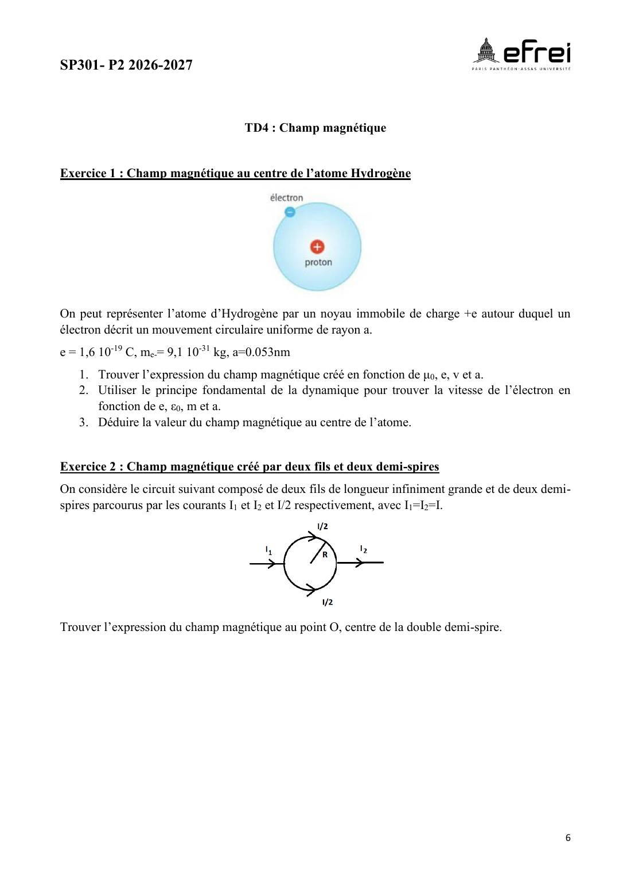
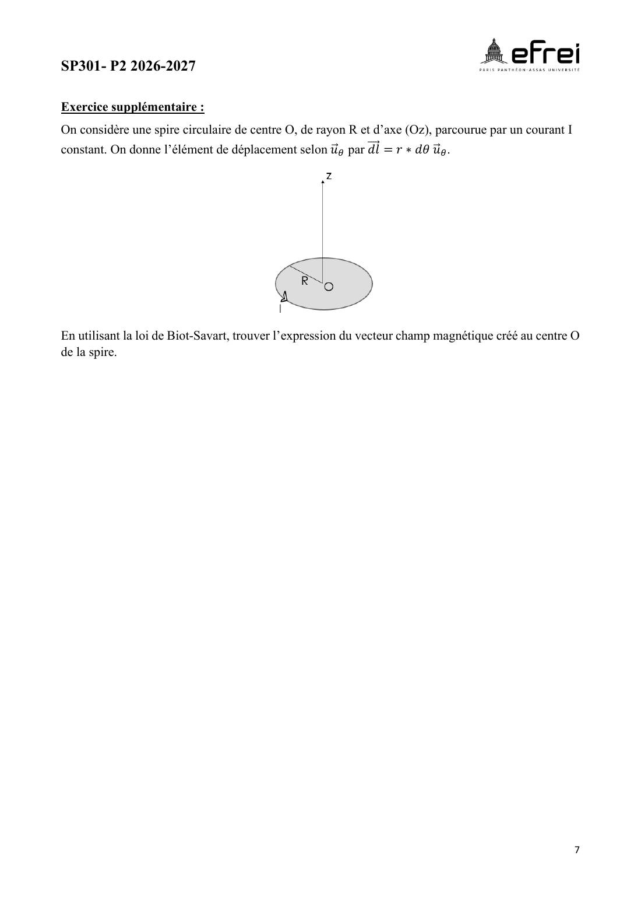
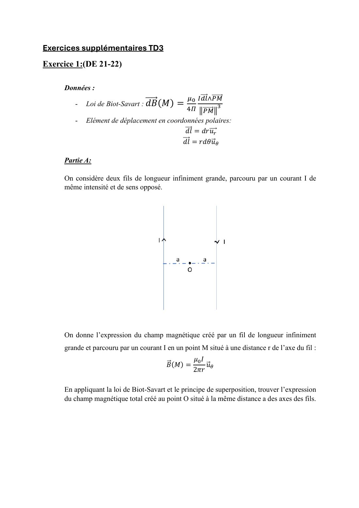
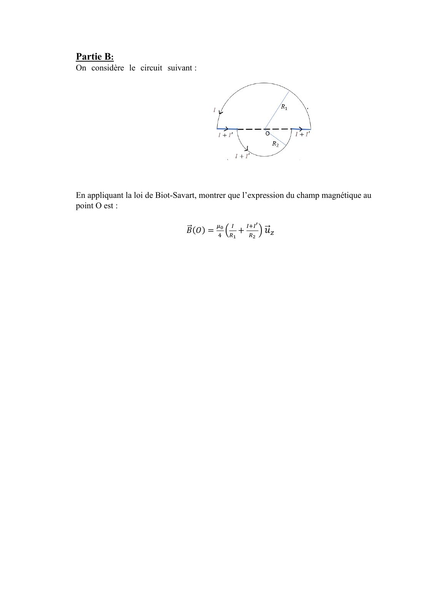

# TD 4 — Champ magnétique (Liénard, Biot-Savart)

=== "Version simplifiée"

    Corrections rédigées ; les schémas sont dans l'onglet **Version papier**. Rappels :
    [chapitre 4](../cours/chapitre-4-biot-savart.md). Le câble coaxial est maintenant dans le
    [TD 5](td-5-theoreme-ampere.md).

    ## Exercice 1 — Champ au centre de l'atome d'hydrogène

    L'électron ($-e$, vitesse $v$) tourne sur un cercle de rayon $a$ autour du proton $O$.

    1. **Champ créé en $O$** par une charge mobile : $\vec B = \dfrac{\mu_0}{4\pi}\dfrac{q\,\vec v\wedge\overrightarrow{PO}}{PO^3}$.
       Ici $\vec v \perp \overrightarrow{PO}$ et $PO = a$, donc

        $$
        B = \frac{\mu_0\,e\,v}{4\pi a^2}
        $$

        dirigé perpendiculairement au plan de l'orbite.

    2. **Vitesse** (PFD, mouvement circulaire uniforme) :
       $\dfrac{e^2}{4\pi\varepsilon_0 a^2} = m\dfrac{v^2}{a}$, donc
       $v = \sqrt{\dfrac{e^2}{4\pi\varepsilon_0\,m\,a}} = \dfrac{e}{\sqrt{4\pi\varepsilon_0 m a}}$.

    3. **Application numérique** : $v \simeq 2{,}2\times10^6$ m/s, puis
       $B = 10^{-7}\times\dfrac{1{,}6\times10^{-19}\times 2{,}2\times10^6}{(0{,}053\times10^{-9})^2} \simeq 12{,}5$ T.
       Énorme à notre échelle (un aimant de frigo fait ~10 mT), mais très localisé.

    ## Exercice 2 — Deux fils et deux demi-spires

    !!! methode "Découper le circuit"
        Le champ total en $O$ est la somme des champs de chaque morceau (superposition).

    - **Les deux fils** sont sur le **diamètre** qui passe par $O$ : pour chacun de leurs points,
      $\mathrm d\vec l \parallel \overrightarrow{PO}$, donc $\mathrm d\vec l\wedge\overrightarrow{PO} = \vec 0$.
      Ils ne créent **aucun** champ en $O$.
    - **Chaque demi-spire** (rayon $R$, courant $I/2$) crée au centre la moitié du champ d'une
      spire : $B = \dfrac{\mu_0 (I/2)}{4R} = \dfrac{\mu_0 I}{8R}$.
    - Sur le schéma, le courant entre à gauche et ressort à droite par **les deux** demi-spires :
      l'une tourne dans le sens horaire, l'autre dans le sens trigonométrique. Leurs champs en $O$
      sont **opposés** :

    $$
    \vec B(O) = \frac{\mu_0 I}{8R}\vec u_z - \frac{\mu_0 I}{8R}\vec u_z = \vec 0
    $$

    ## Exercice supplémentaire — Spire circulaire par Biot-Savart

    Spire de centre $O$, rayon $R$, axe $Oz$, courant $I$ dans le sens de $\vec u_\theta$.
    Un point $P$ de la spire est en $\overrightarrow{OP} = R\,\vec u_r$, et
    $\mathrm d\vec l = R\,\mathrm d\theta\,\vec u_\theta$.

    1. **Vecteur $\overrightarrow{PO}$** (de la source vers le point de calcul) :
       $\overrightarrow{PO} = -R\,\vec u_r$, et $PO = R$.
    2. **Produit vectoriel** : $\vec u_\theta\wedge\vec u_r = -\vec u_z$, donc
       $\mathrm d\vec l\wedge\overrightarrow{PO} = R\,\mathrm d\theta\,\vec u_\theta\wedge(-R\,\vec u_r) = R^2\,\mathrm d\theta\,\vec u_z$.
    3. **Biot-Savart** et intégration sur le tour complet :

        $$
        \vec B(O) = \frac{\mu_0 I}{4\pi}\int_0^{2\pi}\frac{R^2\,\mathrm d\theta}{R^3}\,\vec u_z
                  = \frac{\mu_0 I}{4\pi R}\cdot 2\pi\,\vec u_z
                  = \frac{\mu_0 I}{2R}\,\vec u_z
        $$

    !!! tip "Vérification"
        Main droite : doigts dans le sens du courant ($\vec u_\theta$), le pouce donne $\vec u_z$. On
        retrouve aussi la formule sur l'axe $\dfrac{\mu_0IR^2}{2(R^2+z^2)^{3/2}}$ prise en $z = 0$.

    ## Pour aller plus loin : exercices supplémentaires 2024-2025

    Énoncés dans l'onglet **Version papier**.

    ### Exercice 1, partie A — Deux fils de courants opposés (DE 2021-2022)

    $O$ est au milieu, à la distance $a$ de chaque fil. Chaque fil crée $\dfrac{\mu_0 I}{2\pi a}$.
    Avec des courants **opposés** et $O$ **entre** les fils, les deux champs ont le **même sens**
    en $O$ (règle de la main droite) :

    $$
    B(O) = 2\cdot\frac{\mu_0 I}{2\pi a} = \frac{\mu_0 I}{\pi a}
    $$

    (Avec des courants de même sens, ils s'annuleraient.)

    ### Exercice 1, partie B — Deux demi-spires de rayons différents

    - Les portions rectilignes sont sur le diamètre passant par $O$ : contribution nulle.
    - Demi-spire de rayon $R_1$, courant $I$ : $\dfrac{\mu_0 I}{4R_1}$.
    - Demi-spire de rayon $R_2$, courant $I + I'$ : $\dfrac{\mu_0(I + I')}{4R_2}$.
    - Les deux tournent dans le même sens autour de $O$, les champs s'ajoutent :

    $$
    \vec B(O) = \frac{\mu_0}{4}\left(\frac{I}{R_1} + \frac{I + I'}{R_2}\right)\vec u_z
    $$

    !!! methode "Champ d'un arc au centre"
        Pour un arc d'angle $\theta_0$ et de rayon $R$ : $\mathrm d\vec l\perp\overrightarrow{PO}$ et
        $PO = R$, donc $B = \dfrac{\mu_0 I}{4\pi R^2}\int R\,\mathrm d\theta = \dfrac{\mu_0 I\,\theta_0}{4\pi R}$.
        Spire entière ($2\pi$) : $\dfrac{\mu_0I}{2R}$ ; demi-spire ($\pi$) : $\dfrac{\mu_0I}{4R}$.

=== "Version papier"

    Énoncés du TD 4 (livret 2026-2027), puis les exercices supplémentaires 2024-2025 corrigés
    plus haut.

    [{ loading=lazy .papier }](papier/td4-2627/p06.jpg)
    
TD 4 : atome d'hydrogène, fils et demi-spires · Livret de TD 2026-2027, page 6

    [{ loading=lazy .papier }](papier/td4-2627/p07.jpg)
    
TD 4 : exercice supplémentaire, spire · Livret de TD 2026-2027, page 7

    [{ loading=lazy .papier }](papier/supp-2425/p04.jpg)
    
Deux fils de courants opposés (DE 21-22) · Exercices supplémentaires 2024-2025, p. 4

    [{ loading=lazy .papier }](papier/supp-2425/p05.jpg)
    
Partie B : circuit à deux demi-spires · Exercices supplémentaires 2024-2025, p. 5

