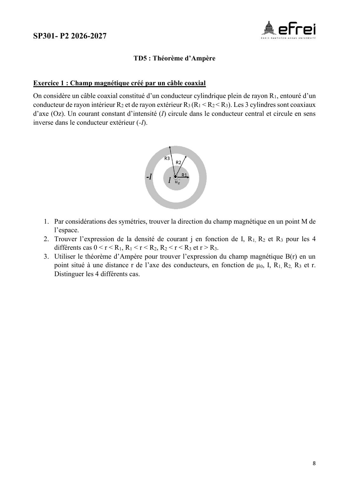

# TD 5 — Théorème d'Ampère

=== "Version simplifiée"

    Correction rédigée ; le schéma du câble est dans l'onglet **Version papier**. Rappels :
    [chapitre 5](../cours/chapitre-5-ampere.md) (méthode en 6 étapes).

    ## Exercice 1 — Câble coaxial

    Conducteur central plein (rayon $R_1$, courant $I$ selon $+\vec u_z$), gaine entre $R_2$ et
    $R_3$ (courant $-I$). Les trois cylindres sont coaxiaux d'axe $Oz$.

    **1. Direction du champ** (symétries et invariances), en coordonnées cylindriques :

    - **Invariances** : par translation selon $Oz$ (câble infini) et par rotation autour de $Oz$
      → $B$ ne dépend ni de $z$ ni de $\theta$, seulement de $r$.
    - **Symétrie** : le plan $(M;\vec u_r,\vec u_z)$ contient l'axe, c'est un plan de symétrie de
      la distribution de courant → $\vec B(M)$ lui est **perpendiculaire**, donc selon $\vec u_\theta$.

    $$
    \vec B(M) = B(r)\,\vec u_\theta
    $$

    Contour d'Ampère : un cercle d'axe $Oz$ et de rayon $r$, orienté selon $\vec u_\theta$.

    **2. Densités de courant** (courant / section traversée) :

    | Région | $j$ |
    |--------|-----|
    | $0 < r < R_1$ | $\dfrac{I}{\pi R_1^2}$ |
    | $R_1 < r < R_2$ | $0$ (vide) |
    | $R_2 < r < R_3$ | $-\dfrac{I}{\pi(R_3^2 - R_2^2)}$ |
    | $r > R_3$ | $0$ |

    **3. Théorème d'Ampère** sur un cercle de rayon $r$ d'axe $Oz$ :
    $\oint\vec B\cdot\mathrm d\vec l = 2\pi r\,B(r) = \mu_0 I_{enl}$.

    | Région | $I_{enl}$ | $B(r)$ |
    |--------|-----------|--------|
    | $r < R_1$ | $j\pi r^2 = I\dfrac{r^2}{R_1^2}$ | $\dfrac{\mu_0 I\,r}{2\pi R_1^2}$ |
    | $R_1 < r < R_2$ | $I$ | $\dfrac{\mu_0 I}{2\pi r}$ |
    | $R_2 < r < R_3$ | $I - I\dfrac{r^2 - R_2^2}{R_3^2 - R_2^2}$ | $\dfrac{\mu_0 I}{2\pi r}\cdot\dfrac{R_3^2 - r^2}{R_3^2 - R_2^2}$ |
    | $r > R_3$ | $I - I = 0$ | $0$ |

    $B$ est continu à chaque frontière et **nul à l'extérieur** : c'est tout l'intérêt du câble
    coaxial (pas de rayonnement, pas de perturbation des câbles voisins).

    !!! piege "Le signe du courant de la gaine"
        Dans la gaine, on n'enlace qu'une **partie** du courant de retour : la fraction
        $\dfrac{r^2 - R_2^2}{R_3^2 - R_2^2}$ de $-I$ (rapport des aires traversées). À $r = R_3$ on
        retrouve tout $-I$.

=== "Version papier"

    Énoncé du TD 5 (livret 2026-2027).

    [{ loading=lazy .papier }](papier/td5-2627/p08.jpg)
    
TD 5 : câble coaxial · Livret de TD 2026-2027, page 8

