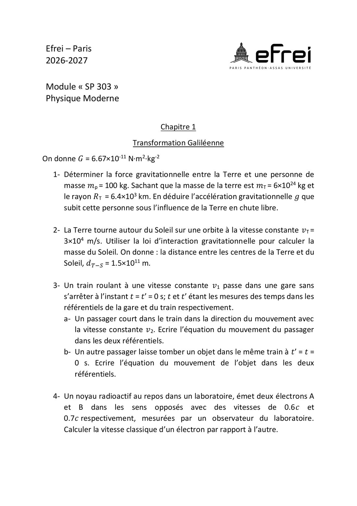
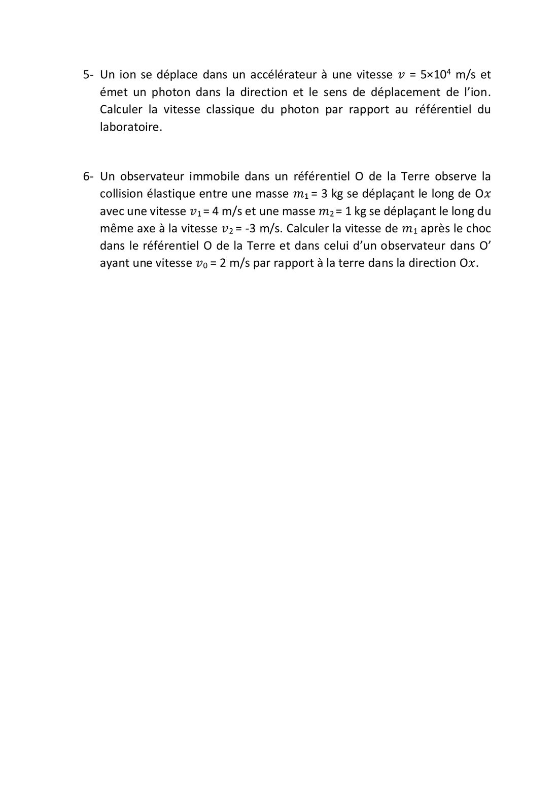

# TD 1 — Transformation galiléenne

=== "Version simplifiée"

    Énoncé dans l'onglet **Version papier** (feuille de TD 2026-2027, p. 1-2).
    Rappels : [chapitre 1](../cours/chapitre-1-galilee.md). Données : $G = 6{,}67 \times 10^{-11}$ N·m²·kg⁻².

    ## 1. Force gravitationnelle Terre–personne

    $$
    F = G\,\frac{m_p\,m_T}{R_T^2} = 6{,}67\times10^{-11}\,\frac{100 \times 6\times10^{24}}{(6{,}4\times10^{6})^2} \approx 977\ \text{N}
    \qquad g = \frac{F}{m_p} \approx 9{,}77\ \text{m/s}^2
    $$

    !!! piege "Unités"
        $R_T = 6{,}4 \times 10^3$ **km** $= 6{,}4 \times 10^6$ m.

    ## 2. Masse du Soleil

    La force gravitationnelle joue le rôle de force centripète ($a = v^2/d$) :

    $$
    G\,\frac{M_S\,m_T}{d^2} = m_T\,\frac{v_T^2}{d}
    \;\Rightarrow\;
    M_S = \frac{v_T^2\,d}{G} = \frac{(3\times10^4)^2 \times 1{,}5\times10^{11}}{6{,}67\times10^{-11}} \approx 2{,}0 \times 10^{30}\ \text{kg}
    $$

    ## 3. Train qui traverse une gare à v₁

    a. **Passager qui court à $v_2$** (sens du mouvement), parti de l'origine à $t = 0$ :

    - dans le train : $x' = v_2\,t'$ ;
    - dans la gare : $x = x' + v_1 t = (v_1 + v_2)\,t$.

    b. **Objet lâché** à $t = 0$ d'une hauteur $h$ :

    - dans le train : $x' = 0$, $\ y' = h - \tfrac12 g t^2$ (chute verticale) ;
    - dans la gare : $x = v_1 t$, $\ y = h - \tfrac12 g t^2$ (parabole).

    ## 4. Deux électrons en sens opposés (0,6c et 0,7c) — calcul classique

    $$
    v_{A/B} = 0{,}6\,c + 0{,}7\,c = 1{,}3\,c > c
    $$

    **Absurde** : cela montre les limites de Galilée. Le calcul relativiste est dans le
    [TD 2, ex. 1](td-2-lorentz.md#1-vitesse-relative-des-deux-electrons).

    ## 5. Photon émis par un ion à 5×10⁴ m/s — calcul classique

    $$
    v = c + v_{ion} = 3\times10^8 + 5\times10^4 = 3{,}0005 \times 10^8\ \text{m/s} > c
    $$

    Encore une contradiction : selon Michelson-Morley, la lumière va à $c$ dans tous les référentiels.

    ## 6. Choc élastique vu depuis deux référentiels

    $m_1 = 3$ kg, $v_1 = 4$ m/s ; $m_2 = 1$ kg, $v_2 = -3$ m/s. On conserve $p$ et $E_c$ :

    $$
    v_{1f} = \frac{(m_1 - m_2)\,v_1 + 2 m_2 v_2}{m_1 + m_2} = \frac{2 \times 4 + 2 \times (-3)}{4} = 0{,}5\ \text{m/s}
    $$

    Dans O′ ($v_0 = 2$ m/s) : $v'_1 = 2$ m/s et $v'_2 = -5$ m/s, donc

    $$
    v'_{1f} = \frac{2 \times 2 + 2 \times (-5)}{4} = -1{,}5\ \text{m/s}
    $$

    Vérification : $v'_{1f} = v_{1f} - v_0 = 0{,}5 - 2 = -1{,}5$ m/s. Les lois du choc sont
    les mêmes dans les deux référentiels, comme le veut la relativité galiléenne.

=== "Version papier"

    Énoncé du TD 1 (feuille de TD 2026-2027, chapitre 1).

    [{ loading=lazy .papier }](papier/td1/p01.jpg)
    
Exercices 1 à 4 : gravitation, train, électrons (calcul classique) · Feuille de TD 2026-2027, p. 1

    [{ loading=lazy .papier }](papier/td1/p02.jpg)
    
Exercices 5 et 6 : photon émis par un ion, choc élastique · Feuille de TD 2026-2027, p. 2

