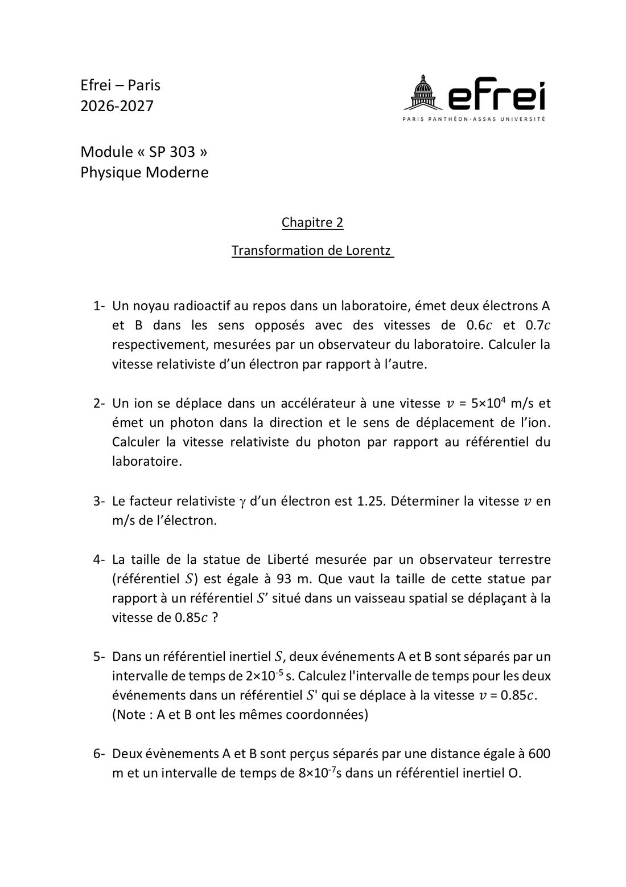
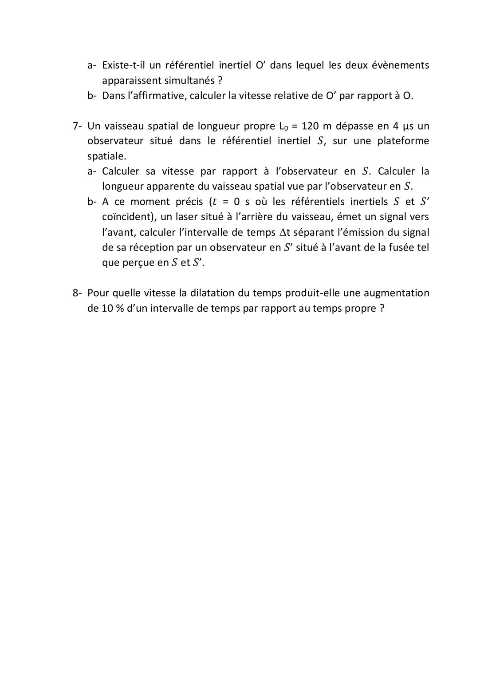

# TD 2 — Transformation de Lorentz

=== "Version simplifiée"

    Énoncé dans l'onglet **Version papier** (feuille de TD 2026-2027, p. 3-4).
    Rappels : [chapitre 2](../cours/chapitre-2-relativite-restreinte.md). $c = 3\times10^8$ m/s.

    ## 1. Vitesse relative des deux électrons

    Sens opposés, $0{,}6\,c$ et $0{,}7\,c$ :

    $$
    u = \frac{0{,}6 + 0{,}7}{1 + 0{,}6 \times 0{,}7}\,c = \frac{1{,}3}{1{,}42}\,c \approx 0{,}916\,c \approx 2{,}75\times10^8\ \text{m/s}
    $$

    Inférieur à $c$, contrairement au 1,3c du calcul classique.

    ## 2. Photon émis par l'ion

    $$
    u = \frac{c + v}{1 + \dfrac{v\,c}{c^2}} = \frac{c + v}{1 + v/c} = c
    $$

    La lumière va exactement à $c$ dans le labo : c'est le 2e postulat.

    ## 3. γ = 1,25 → vitesse

    $$
    \beta = \sqrt{1 - \frac{1}{\gamma^2}} = \sqrt{1 - 0{,}64} = 0{,}6 \;\Rightarrow\; v = 1{,}8 \times 10^8\ \text{m/s}
    $$

    ## 4. Statue de la Liberté vue d'un vaisseau à 0,85c

    $\gamma(0{,}85) = 1{,}898$. La hauteur propre est $L_0 = 93$ m.

    - Si le vaisseau se déplace **parallèlement à la hauteur** (vers le haut) :
      $L = L_0/\gamma = 93 / 1{,}898 \approx 49$ m.
    - S'il se déplace **horizontalement** : la hauteur est perpendiculaire au mouvement,
      donc elle ne change pas (93 m).

    !!! piege
        La réponse attendue est en général 49 m, mais il faut savoir justifier l'autre cas.

    ## 5. Intervalle de temps vu depuis S′ à 0,85c

    A et B ont **les mêmes coordonnées** dans S, donc $\Delta t = 2\times10^{-5}$ s est un
    **temps propre** :

    $$
    \Delta t' = \gamma\,\Delta t = 1{,}898 \times 2\times10^{-5} \approx 3{,}80 \times 10^{-5}\ \text{s}
    $$

    ## 6. Existe-t-il un référentiel où A et B sont simultanés ?

    $\Delta x = 600$ m, $\Delta t = 8\times10^{-7}$ s. On veut
    $\Delta t' = \gamma\left(\Delta t - \dfrac{v\,\Delta x}{c^2}\right) = 0$ :

    $$
    v = \frac{c^2\,\Delta t}{\Delta x} = \frac{c \times (c\,\Delta t)}{\Delta x} = \frac{240}{600}\,c = 0{,}4\,c = 1{,}2 \times 10^8\ \text{m/s}
    $$

    a. **Oui**, car $c\,\Delta t = 240$ m $< \Delta x = 600$ m, donc $v < c$.
    b. $v = 0{,}4\,c$.

    ## 7. Vaisseau de longueur propre 120 m qui passe en 4 µs

    a. L'observateur de S voit passer la longueur **contractée** $L = L_0/\gamma$ en
    $t = 4$ µs : $\ v\,t = L_0\sqrt{1 - \beta^2}$. On élève au carré :

    $$
    \beta = \frac{L_0}{\sqrt{L_0^2 + (c\,t)^2}} = \frac{120}{\sqrt{120^2 + 1200^2}} \approx 0{,}0995
    \;\Rightarrow\; v \approx 2{,}98 \times 10^7\ \text{m/s}
    $$

    $$
    L = L_0\sqrt{1 - \beta^2} \approx 119{,}4\ \text{m}
    $$

    b. **Dans S′** (vaisseau), la lumière parcourt $L_0$ : $\Delta t' = L_0/c = 4{,}0 \times 10^{-7}$ s.
    **Dans S**, on transforme avec $\Delta x' = L_0$ :

    $$
    \Delta t = \gamma\left(\Delta t' + \frac{v\,\Delta x'}{c^2}\right) = \gamma\,\frac{L_0}{c}\,(1 + \beta) \approx 4{,}42 \times 10^{-7}\ \text{s}
    $$

    Vérification dans S : le signal doit rattraper l'avant qui s'éloigne,
    $\Delta t = L/(c - v) = 119{,}4 / 2{,}70\times10^8 \approx 4{,}42 \times 10^{-7}$ s ✓.

    ## 8. Vitesse pour une dilatation du temps de 10 %

    $$
    \gamma = 1{,}1 \;\Rightarrow\; \beta = \sqrt{1 - \frac{1}{1{,}21}} \approx 0{,}417 \;\Rightarrow\; v \approx 1{,}25 \times 10^8\ \text{m/s}
    $$

=== "Version papier"

    Énoncé du TD 2 (feuille de TD 2026-2027, chapitre 2).

    [{ loading=lazy .papier }](papier/td2/p01.jpg)
    
Exercices 1 à 6 : vitesses relativistes, γ, contraction, dilatation, simultanéité · Feuille de TD 2026-2027, p. 3

    [{ loading=lazy .papier }](papier/td2/p02.jpg)
    
Exercices 6 (suite) à 8 : vaisseau de 120 m, dilatation de 10 % · Feuille de TD 2026-2027, p. 4

