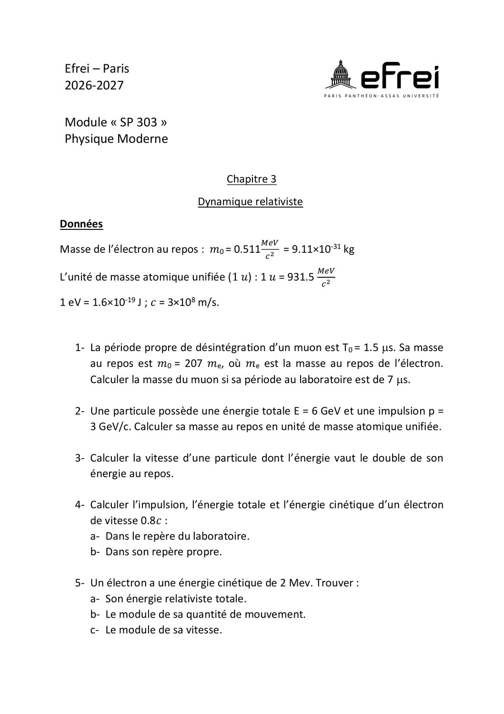

# TD 3 — Dynamique relativiste

=== "Version simplifiée"

    Énoncé dans l'onglet **Version papier** (feuille de TD 2026-2027, p. 5).
    Rappels : [chapitre 3](../cours/chapitre-3-dynamique-relativiste.md).
    Données : $m_e c^2 = 0{,}511$ MeV, $m_e = 9{,}11\times10^{-31}$ kg, $1\ u = 931{,}5$ MeV/$c^2$,
    $1$ eV $= 1{,}6\times10^{-19}$ J.

    ## 1. Masse d'un muon

    Période propre $T_0 = 1{,}5$ s, période au labo $T = 7$ s :

    $$
    \gamma = \frac{T}{T_0} = \frac{7}{1{,}5} \approx 4{,}67
    \qquad
    m = \gamma\,m_0 = 4{,}67 \times 207\,m_e \approx 966\,m_e \approx 8{,}80 \times 10^{-28}\ \text{kg}
    $$

    soit $\approx 494$ MeV/$c^2$.

    ## 2. Masse au repos à partir de E = 6 GeV et p = 3 GeV/c

    $$
    m_0c^2 = \sqrt{E^2 - p^2c^2} = \sqrt{36 - 9} \approx 5{,}20\ \text{GeV}
    \;\Rightarrow\;
    m_0 = \frac{5196\ \text{MeV}/c^2}{931{,}5\ \text{MeV}/c^2} \approx 5{,}58\ u
    $$

    ## 3. Énergie = double de l'énergie au repos

    $\gamma = 2$, donc $\beta = \sqrt 3/2$ et $v \approx 0{,}866\,c \approx 2{,}60\times10^8$ m/s.
    (Tombé au CE 2022.)

    ## 4. Électron à 0,8c

    $\gamma = 1/\sqrt{1 - 0{,}64} = 5/3$.

    a. **Dans le labo :**

    | Grandeur | Calcul | Résultat |
    |----------|--------|----------|
    | $p$ | $\gamma\,m_0 v = \frac53 \times 0{,}511 \times 0{,}8$ MeV/$c$ | $0{,}681$ MeV/$c$ $= 3{,}64\times10^{-22}$ kg·m/s |
    | $E$ | $\gamma\,m_0c^2 = \frac53 \times 0{,}511$ | $0{,}852$ MeV |
    | $T$ | $(\gamma - 1)\,m_0c^2 = \frac23 \times 0{,}511$ | $0{,}341$ MeV |

    b. **Dans son repère propre** (électron au repos) : $p = 0$, $\ E = E_0 = 0{,}511$ MeV, $\ T = 0$.

    ## 5. Électron d'énergie cinétique 2 MeV

    a. $E = T + m_0c^2 = 2 + 0{,}511 = 2{,}511$ MeV.

    b. $pc = \sqrt{E^2 - (m_0c^2)^2} = \sqrt{2{,}511^2 - 0{,}511^2} \approx 2{,}46$ MeV, soit
    $p \approx 2{,}46$ MeV/$c$ $\approx 1{,}31 \times 10^{-21}$ kg·m/s.

    c. $\beta = \dfrac{pc}{E} = \dfrac{2{,}46}{2{,}511} \approx 0{,}979$, donc $v \approx 2{,}94\times10^8$ m/s.

    !!! methode "Conversion MeV/c → kg·m/s"
        $p = \dfrac{2{,}46\times10^6 \times 1{,}6\times10^{-19}}{3\times10^8} \approx 1{,}31\times10^{-21}$ kg·m/s.

=== "Version papier"

    Énoncé du TD 3 (feuille de TD 2026-2027, chapitre 3).

    [{ loading=lazy .papier }](papier/td3/p01.jpg)
    
Exercices 1 à 5 : muon, masse au repos, impulsion et énergie · Feuille de TD 2026-2027, p. 5

