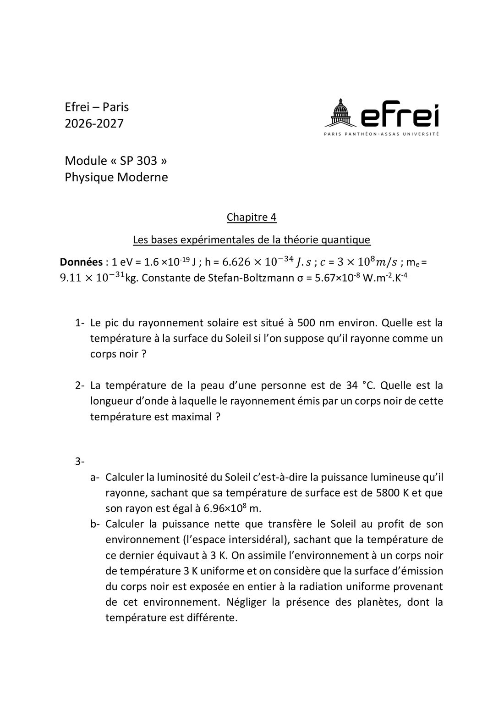
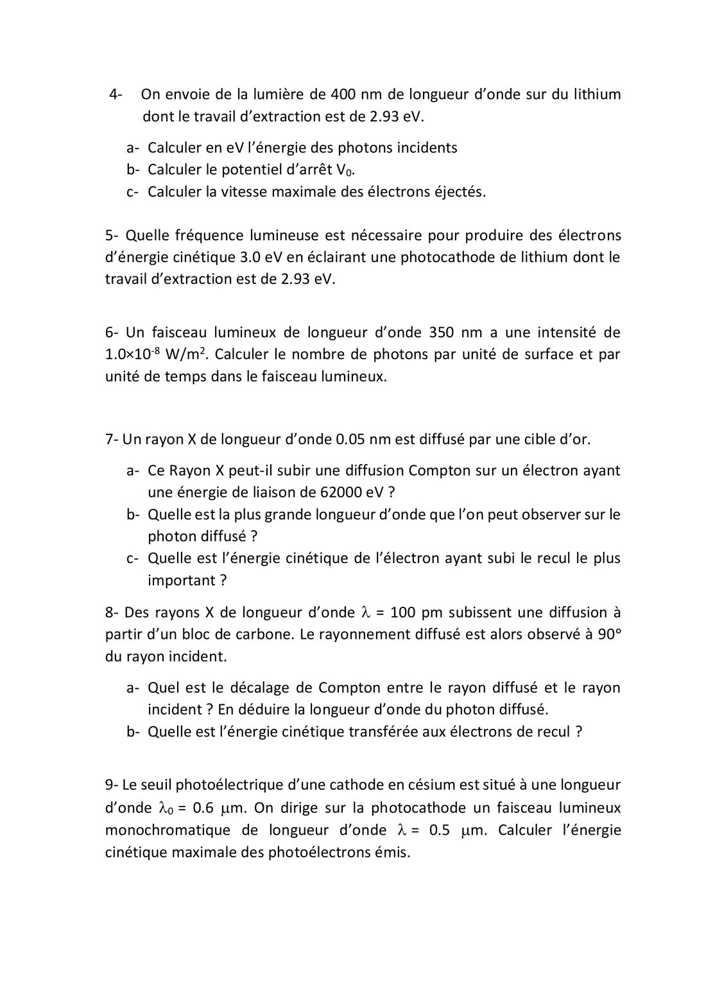
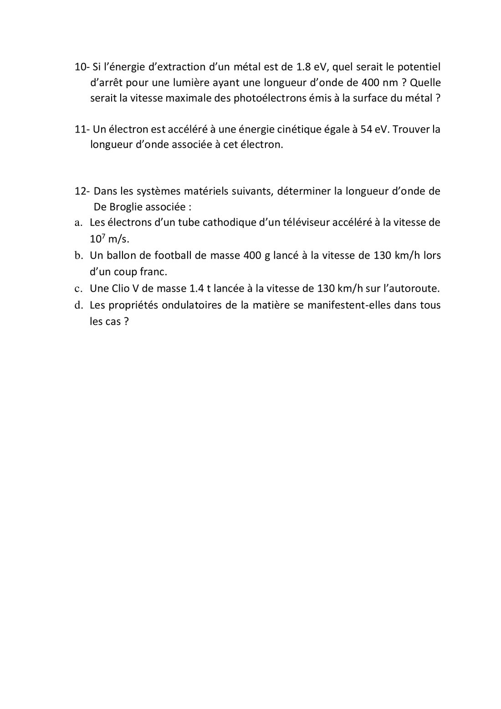

# TD 4 — Les bases expérimentales de la théorie quantique

=== "Version simplifiée"

    Énoncé dans l'onglet **Version papier** (feuille de TD 2026-2027, p. 6-8).
    Rappels : [chapitre 4](../cours/chapitre-4-onde-matiere.md).
    Données : $h = 6{,}626\times10^{-34}$ J·s, $c = 3\times10^8$ m/s, $m_e = 9{,}11\times10^{-31}$ kg,
    $1$ eV $= 1{,}6\times10^{-19}$ J, $\sigma = 5{,}67\times10^{-8}$ W·m⁻²·K⁻⁴, Wien : $\lambda_{max}T = 2{,}898\times10^{-3}$ m·K.

    !!! tip "Raccourci utile"
        $hc \approx 1{,}99 \times 10^{-25}$ J·m $\approx 1242$ eV·nm. Donc $E\,(\text{eV}) \approx \dfrac{1242}{\lambda\,(\text{nm})}$.

    ## Corps noir

    **1. Température du Soleil** ($\lambda_{max} = 500$ nm) :
    $T = \dfrac{2{,}898\times10^{-3}}{500\times10^{-9}} \approx 5800$ K.

    **2. Peau à 34 °C** ($T = 307{,}15$ K) :
    $\lambda_{max} = \dfrac{2{,}898\times10^{-3}}{307{,}15} \approx 9{,}4$ µm (infrarouge).

    !!! piege
        La température doit être en **kelvins** : $T = \theta + 273{,}15$.

    **3a. Luminosité du Soleil** (puissance totale = intensité × surface de la sphère) :

    $$
    P = \sigma\,T^4 \times 4\pi R^2 = 5{,}67\times10^{-8} \times 5800^4 \times 4\pi\,(6{,}96\times10^8)^2 \approx 3{,}9 \times 10^{26}\ \text{W}
    $$

    **3b. Puissance nette** (le Soleil reçoit aussi le rayonnement de l'espace à 3 K) :
    $P_{nette} = \sigma\,4\pi R^2\,(T^4 - T_{env}^4) \approx 3{,}9\times10^{26}$ W : le terme à 3 K est négligeable.

    ## Effet photoélectrique

    !!! theoreme "Équation d'Einstein"
        $h\nu = W_0 + E_{c,max}$ avec $E_{c,max} = e\,V_0 = \tfrac12 m v_{max}^2$ et $W_0 = h\nu_0$.

    **4. Lithium ($W_0 = 2{,}93$ eV), λ = 400 nm**

    a. $E = \dfrac{hc}{\lambda} = 4{,}97\times10^{-19}$ J $\approx 3{,}11$ eV.
    b. $V_0 = \dfrac{E - W_0}{e} = 3{,}11 - 2{,}93 \approx 0{,}18$ V.
    c. $v_{max} = \sqrt{\dfrac{2\,eV_0}{m_e}} \approx 2{,}5\times10^5$ m/s.

    **5. Fréquence pour des électrons de 3,0 eV** :
    $\nu = \dfrac{E_c + W_0}{h} = \dfrac{5{,}93 \times 1{,}6\times10^{-19}}{6{,}626\times10^{-34}} \approx 1{,}43\times10^{15}$ Hz.

    **6. Nombre de photons** (λ = 350 nm, $I = 10^{-8}$ W/m²) :

    $$
    N = \frac{I}{h c/\lambda} = \frac{10^{-8} \times 350\times10^{-9}}{1{,}99\times10^{-25}} \approx 1{,}8\times10^{10}\ \text{photons·m}^{-2}\text{·s}^{-1}
    $$

    **9. Césium, seuil 0,6 µm, éclairé à 0,5 µm** :

    $$
    E_{c,max} = hc\left(\frac1\lambda - \frac1{\lambda_0}\right) \approx 6{,}6\times10^{-20}\ \text{J} \approx 0{,}41\ \text{eV}
    $$

    **10. $W_0 = 1{,}8$ eV, λ = 400 nm** : $V_0 = 3{,}11 - 1{,}8 \approx 1{,}31$ V, et
    $v_{max} = \sqrt{2 e V_0/m_e} \approx 6{,}8\times10^5$ m/s.

    ## Effet Compton

    !!! theoreme "Décalage Compton"
        $$
        \lambda_f - \lambda_i = \frac{h}{m_e c}\,(1 - \cos\theta), \qquad \frac{h}{m_e c} \approx 2{,}43\ \text{pm}
        $$
        Maximal pour $\theta = 180°$ : $\Delta\lambda_{max} = 2h/(m_ec) \approx 4{,}85$ pm.

    **7. Rayon X de 0,05 nm sur de l'or**

    a. $E = hc/\lambda \approx 3{,}98\times10^{-15}$ J $\approx 24{,}8$ keV. C'est **moins** que
    l'énergie de liaison (62 keV) : le photon ne peut pas arracher cet électron, donc pas de
    diffusion Compton sur lui (Compton suppose un électron quasi libre).

    b. Plus grande longueur d'onde diffusée (θ = 180°, électron libre) :
    $\lambda' = 0{,}05 + 0{,}00485 \approx 0{,}0548$ nm.

    c. Énergie cinétique maximale de recul :
    $T = hc\left(\dfrac1\lambda - \dfrac1{\lambda'}\right) \approx 2{,}2$ keV.

    **8. λ = 100 pm, diffusion à 90° sur du carbone**

    a. $\Delta\lambda = \dfrac{h}{m_ec}(1 - \cos 90°) \approx 2{,}43$ pm, donc $\lambda' \approx 102{,}4$ pm.
    b. $T = hc\left(\dfrac1\lambda - \dfrac1{\lambda'}\right) \approx 294$ eV.

    ## Longueur d'onde de De Broglie

    $$
    \lambda = \frac{h}{p} = \frac{h}{mv} = \frac{h}{\sqrt{2 m E_c}}\ \ (\text{non relativiste})
    $$

    **11. Électron de 54 eV** : $\lambda = \dfrac{h}{\sqrt{2 m_e \times 54 \times 1{,}6\times10^{-19}}} \approx 1{,}67\times10^{-10}$ m $= 0{,}167$ nm
    (l'ordre de grandeur des distances entre atomes : c'est l'expérience de Davisson-Germer).

    **12.**

    | Système | Calcul | λ |
    |---------|--------|---|
    | a. électron à $10^7$ m/s | $h/(m_e v)$ | $7{,}3\times10^{-11}$ m |
    | b. ballon, 400 g à 130 km/h (36,1 m/s) | $h/(mv)$ | $4{,}6\times10^{-35}$ m |
    | c. Clio, 1,4 t à 130 km/h | $h/(mv)$ | $1{,}3\times10^{-38}$ m |

    d. Seul l'électron a une longueur d'onde comparable à des objets réels (atomes). Pour le
    ballon et la voiture, λ est incomparablement plus petite que tout obstacle : **aucun effet
    ondulatoire observable** à notre échelle.

=== "Version papier"

    Énoncé du TD 4 (feuille de TD 2026-2027, chapitre 4).

    [{ loading=lazy .papier }](papier/td4/p01.jpg)
    
Exercices 1 à 3 : corps noir (Wien, Stefan-Boltzmann) · Feuille de TD 2026-2027, p. 6

    [{ loading=lazy .papier }](papier/td4/p02.jpg)
    
Exercices 4 à 9 : effet photoélectrique, effet Compton · Feuille de TD 2026-2027, p. 7

    [{ loading=lazy .papier }](papier/td4/p03.jpg)
    
Exercices 10 à 12 : potentiel d'arrêt, longueur d'onde de De Broglie · Feuille de TD 2026-2027, p. 8

