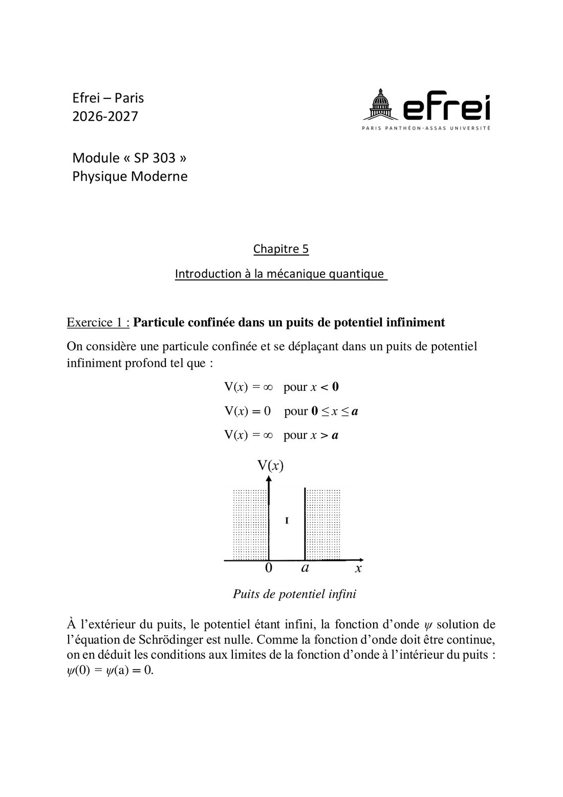
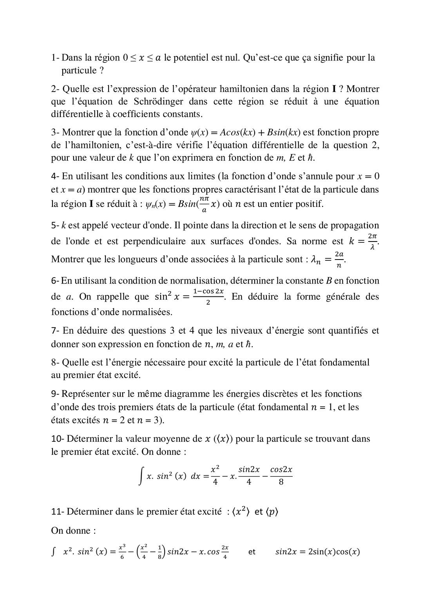
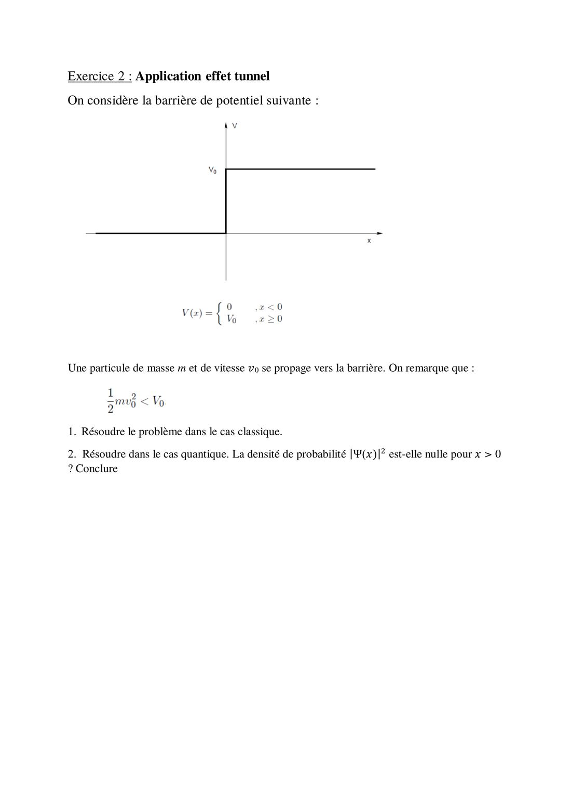

# TD 5 — Introduction à la mécanique quantique

=== "Version simplifiée"

    Énoncé dans l'onglet **Version papier** (feuille de TD 2026-2027, p. 9-11).
    Rappels : [chapitre 5](../cours/chapitre-5-mecanique-quantique.md).

    ## Exercice 1 — Puits de potentiel infini

    $V = 0$ pour $0 \le x \le a$, $V = \infty$ ailleurs. Conditions aux limites : $\psi(0) = \psi(a) = 0$.

    **1.** $V = 0$ : la particule est **libre** à l'intérieur du puits, son énergie est
    uniquement cinétique.

    **2.** $\hat H = -\dfrac{\hbar^2}{2m}\dfrac{d^2}{dx^2}$, d'où
    $$
    \frac{d^2\psi}{dx^2} + \frac{2mE}{\hbar^2}\,\psi = 0
    $$
    équation différentielle linéaire du 2e ordre à coefficients constants.

    **3.** Avec $\psi = A\cos kx + B\sin kx$ : $\psi'' = -k^2\psi$. En remplaçant :
    $(-k^2 + 2mE/\hbar^2)\,\psi = 0$, vérifié si

    $$
    k = \frac{\sqrt{2mE}}{\hbar}
    $$

    **4.** $\psi(0) = A = 0$. Puis $\psi(a) = B\sin(ka) = 0$ avec $B \neq 0$ (sinon $\psi = 0$) :
    $ka = n\pi$, donc

    $$
    \psi_n(x) = B\sin\left(\frac{n\pi}{a}\,x\right), \quad n = 1, 2, 3\ldots
    $$

    ($n = 0$ donnerait $\psi = 0$ : exclu.)

    **5.** $k = \dfrac{2\pi}{\lambda} = \dfrac{n\pi}{a}$ ⟹ $\lambda_n = \dfrac{2a}{n}$ : un nombre entier de
    demi-longueurs d'onde tient dans le puits, comme une corde vibrante.

    **6.** Normalisation :
    $$
    \int_0^a B^2 \sin^2\left(\frac{n\pi x}{a}\right)dx = B^2\,\frac{a}{2} = 1
    \;\Rightarrow\; B = \sqrt{\frac2a}
    \qquad
    \psi_n(x) = \sqrt{\frac2a}\,\sin\left(\frac{n\pi x}{a}\right)
    $$

    (Avec $\sin^2 u = \frac{1 - \cos 2u}{2}$, le terme en cosinus s'intègre à 0 sur $[0, a]$.)

    **7.** $k^2 = \dfrac{2mE}{\hbar^2} = \dfrac{n^2\pi^2}{a^2}$, donc l'énergie est **quantifiée** :

    $$
    E_n = \frac{n^2\pi^2\hbar^2}{2ma^2} = n^2 E_1
    $$

    **8.** Du fondamental au premier état excité : $\Delta E = E_2 - E_1 = 3E_1 = \dfrac{3\pi^2\hbar^2}{2ma^2}$.

    **9.** Diagramme : niveaux $E_1$, $4E_1$, $9E_1$ de plus en plus espacés. $\psi_1$ est une
    demi-arche (0 nœud intérieur), $\psi_2$ une arche positive puis négative (1 nœud en $a/2$),
    $\psi_3$ trois demi-arches (2 nœuds en $a/3$ et $2a/3$).

    **10.** $\langle x \rangle = \int_0^a x\,|\psi_2|^2\,dx = \dfrac{a}{2}$. Par symétrie de
    $|\psi_n|^2$ autour du centre, c'est vrai pour tout $n$.

    **11.** Pour $n = 2$ :

    $$
    \langle x^2 \rangle = a^2\left(\frac13 - \frac{1}{2n^2\pi^2}\right) = a^2\left(\frac13 - \frac{1}{8\pi^2}\right) \approx 0{,}321\,a^2
    $$

    $$
    \langle p \rangle = \int_0^a \psi_2\left(-i\hbar\frac{d\psi_2}{dx}\right)dx = -i\hbar\left[\frac{\psi_2^2}{2}\right]_0^a = 0
    $$

    (la particule va autant vers la gauche que vers la droite).

    ## Exercice 2 — Effet tunnel

    Barrière de hauteur $V_0 > E$ pour $x > 0$ (voir le schéma de l'énoncé).

    1. **Classiquement** : pour $x > 0$ l'énergie cinétique serait $E - V_0 < 0$, ce qui est
       impossible. La particule est **réfléchie** et ne pénètre jamais dans la barrière.

    2. **Quantiquement** : pour $x > 0$, $\ \psi'' - \kappa^2\psi = 0$ avec
       $\kappa = \dfrac{\sqrt{2m(V_0 - E)}}{\hbar}$, donc $\psi = C e^{-\kappa x}$ (on écarte
       $e^{+\kappa x}$ qui diverge). Alors
       $$
       |\psi(x)|^2 = |C|^2 e^{-2\kappa x} \neq 0
       $$
       La probabilité de présence dans la barrière n'est **pas nulle** : elle décroît
       exponentiellement. Si la barrière est assez fine, la particule peut la traverser :
       c'est l'**effet tunnel** (utilisé dans les microscopes à effet tunnel, les mémoires flash…).

=== "Version papier"

    Énoncé du TD 5 (feuille de TD 2026-2027, chapitre 5).

    [{ loading=lazy .papier }](papier/td5/p01.jpg)
    
Exercice 1 : puits de potentiel infini (énoncé) · Feuille de TD 2026-2027, p. 9

    [{ loading=lazy .papier }](papier/td5/p02.jpg)
    
Exercice 1 : questions 1 à 11 · Feuille de TD 2026-2027, p. 10

    [{ loading=lazy .papier }](papier/td5/p03.jpg)
    
Exercice 2 : effet tunnel · Feuille de TD 2026-2027, p. 11

