# Chapitre 3 — Propagation des ondes électromagnétiques dans le vide

=== "Version simplifiée"

    !!! definition "Onde"
        Perturbation qui se propage d'un point à un autre en transportant de l'**énergie** et de la
        **quantité de mouvement**, sans transporter de matière. Une onde électromagnétique est une
        onde **non matérielle** : c'est le couple $(\vec E, \vec B)$ qui se déforme dans l'espace et le temps.
        Elle se propage même dans le vide, contrairement au son.

    ## Équation de d'Alembert

    Dans le vide ($\rho = 0$, $\vec J = \vec 0$), les équations de propagation du chapitre 2 deviennent :

    $$
    \Delta\vec E - \frac{1}{c^2}\frac{\partial^2\vec E}{\partial t^2} = \vec 0
    \qquad
    \Delta\vec B - \frac{1}{c^2}\frac{\partial^2\vec B}{\partial t^2} = \vec 0
    \qquad
    c = \frac{1}{\sqrt{\mu_0\varepsilon_0}}
    $$

    avec $\mu_0 = 4\pi\cdot10^{-7}$ H/m et $\varepsilon_0 \approx \dfrac{1}{36\pi\cdot10^9}$ F/m, d'où $c \approx 3\cdot10^8$ m/s.

    !!! theoreme "Solution à une dimension"
        La solution générale de $\dfrac{\partial^2 f}{\partial x^2} - \dfrac{1}{c^2}\dfrac{\partial^2 f}{\partial t^2} = 0$ est

        $$
        f(x, t) = F(x - ct) + G(x + ct)
        $$

        $F(x - ct)$ est une onde qui avance vers les $x > 0$, $G(x + ct)$ une onde qui avance vers les $x < 0$, toutes deux à la vitesse $c$.

    !!! tip "Lire le sens de propagation"
        Regarde le signe **relatif** de $x$ et $t$ dans la phase : $x - ct$, $kx - \omega t$ ou $\omega t - kx$ → vers les $x$ **croissants** ;
        $x + ct$ ou $kx + \omega t$ → vers les $x$ **décroissants**.

    ## Onde plane

    Une **surface d'onde** est l'ensemble des points où le champ a la même valeur à un instant donné.
    Pour une onde qui ne dépend que de $(x, t)$, ce sont les plans $x = $ constante : l'onde est **plane**.
    Une source émet des ondes sphériques, mais **loin de la source** la sphère est si grande qu'on la voit plane.

    !!! theoreme "Propriétés d'une onde plane progressive dans le vide"
        1. $\vec E$ et $\vec B$ sont **transverses** : perpendiculaires à la direction de propagation $\vec u$.
        2. $\vec E \perp \vec B$.
        3. $\|\vec E\| = c\,\|\vec B\|$.
        4. $(\vec E, \vec B, \vec u)$ est un **trièdre direct**.

        Ces quatre propriétés tiennent en une formule : $\vec B = \dfrac{\vec u \wedge \vec E}{c}$, ou encore $\vec E = c\,\vec B \wedge \vec u$.

    ## Onde plane progressive sinusoïdale (OPPS)

    $$
    \vec E(x, t) = E_0\cos(kx - \omega t)\,\vec u_y
    $$

    $E_0$ est l'amplitude et $kx - \omega t$ la phase. Tout signal périodique est une somme de sinusoïdes (Fourier),
    d'où l'intérêt d'étudier ce cas.

    | Grandeur | Formule | Unité |
    |---|---|---|
    | Période, fréquence | $T = 1/f$ | s, Hz |
    | Pulsation | $\omega = 2\pi f = 2\pi/T$ | rad/s |
    | Longueur d'onde (période spatiale) | $\lambda = cT = c/f$ | m |
    | Nombre d'onde | $k = 2\pi/\lambda = \omega/c$ | rad/m |

    La relation $k = \omega/c$ (**relation de dispersion** dans le vide) s'obtient en injectant l'OPPS dans
    l'équation de d'Alembert : $-k^2 + \omega^2/c^2 = 0$.

    !!! definition "Vecteur d'onde"
        $\vec k = k\,\vec u$ : il a la direction et le sens de la propagation, et pour norme $2\pi/\lambda$.
        Dans une direction quelconque, la phase s'écrit $\omega t - \vec k \cdot \overrightarrow{OM} = \omega t - (k_x x + k_y y + k_z z)$.

    ## Notation complexe

    On écrit $\underline{\vec E} = \vec E_0\,e^{i(\omega t - \vec k \cdot \vec r)}$ et on prend la partie réelle à la fin.
    L'intérêt : les dérivées deviennent des **multiplications**.

    | Opération | Devient |
    |---|---|
    | $\dfrac{\partial}{\partial t}$ | $\times\, i\omega$ |
    | $\nabla$ | $\times\, (-i\vec k)$ |
    | $\text{div}\,\underline{\vec E}$ | $-i\vec k \cdot \underline{\vec E}$ |
    | $\overrightarrow{\text{rot}}\,\underline{\vec E}$ | $-i\vec k \wedge \underline{\vec E}$ |
    | $\Delta$ | $\times\, (-k^2)$ |

    !!! piege "Le signe dépend de la convention"
        Avec $e^{i(\vec k\cdot\vec r - \omega t)}$, c'est l'inverse : $\partial_t \to -i\omega$ et $\nabla \to i\vec k$.
        Le résultat physique est le même : dans les deux cas, Maxwell dans le vide donne

        $$
        \vec k \cdot \vec E = 0, \qquad \vec k \cdot \vec B = 0, \qquad \vec B = \frac{\vec k \wedge \vec E}{\omega}, \qquad k^2 = \frac{\omega^2}{c^2}.
        $$

    !!! methode "Trouver $\vec B$ à partir de $\vec E$"
        1. Lire $\vec k$ dans la phase (direction **et** sens).
        2. $\vec B = \dfrac{\vec k \wedge \vec E}{\omega} = \dfrac{\vec u \wedge \vec E}{c}$.
        3. Vérifier : $\vec B \perp \vec E$, $\|\vec B\| = E_0/c$ et $(\vec E, \vec B, \vec k)$ direct.

        On peut aussi passer par Maxwell-Faraday : $\overrightarrow{\text{rot}}\,\vec E = -\partial\vec B/\partial t$, puis intégrer en temps (sans constante pour une onde).

=== "Version papier"

    Les diapos du chapitre 3 (support 2025-2026).

    <!-- papier: pdf/SP401P/ch3.pdf | Chapitre 3 — support 2025-2026 | ch3 | diapo -->

    [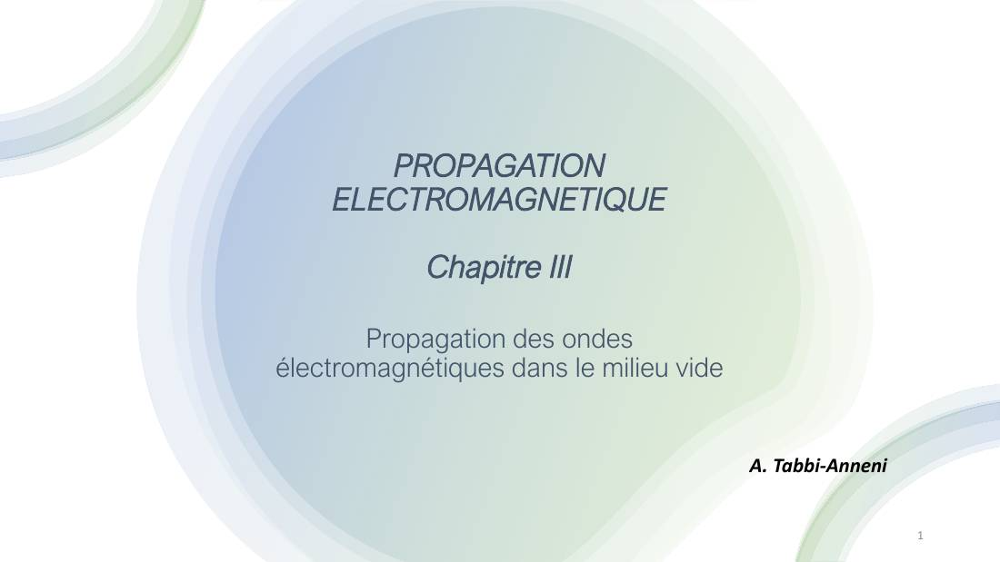{ loading=lazy .papier }](papier/ch3/p01.jpg)
    
Chapitre III · Chapitre 3 — support 2025-2026, diapo 1

    [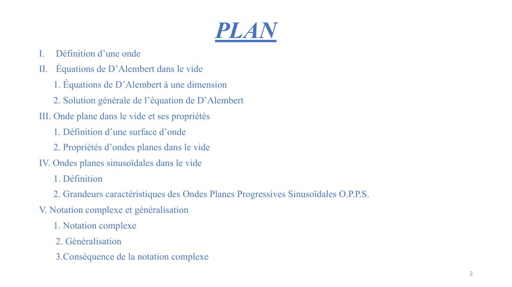{ loading=lazy .papier }](papier/ch3/p02.jpg)
    
Définition d’une onde · Chapitre 3 — support 2025-2026, diapo 2

    [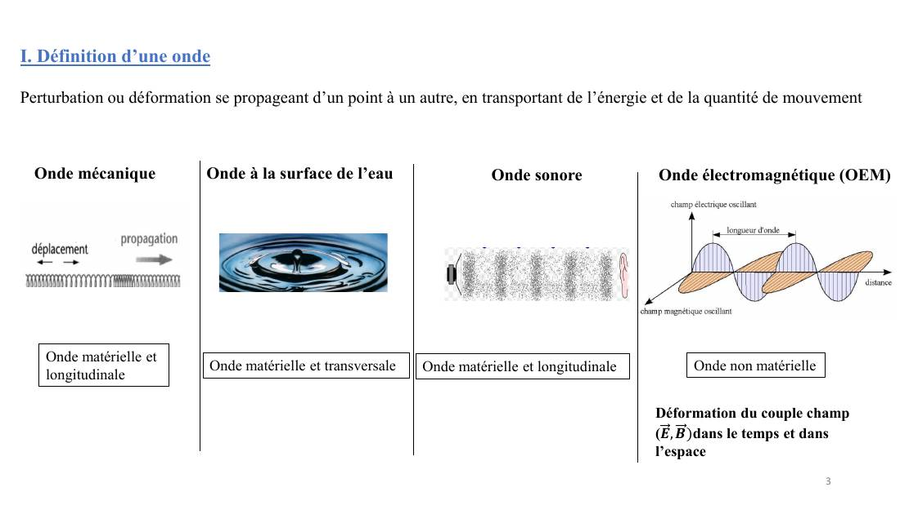{ loading=lazy .papier }](papier/ch3/p03.jpg)
    
I. Définition d’une onde · Chapitre 3 — support 2025-2026, diapo 3

    [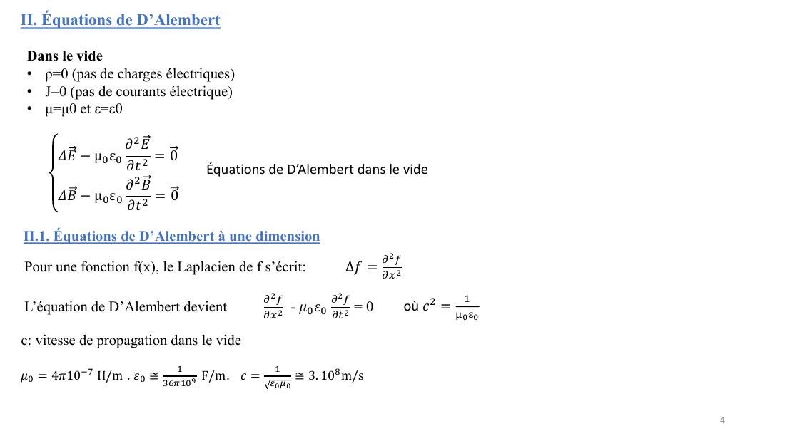{ loading=lazy .papier }](papier/ch3/p04.jpg)
    
II. Équations de D’Alembert · Chapitre 3 — support 2025-2026, diapo 4

    [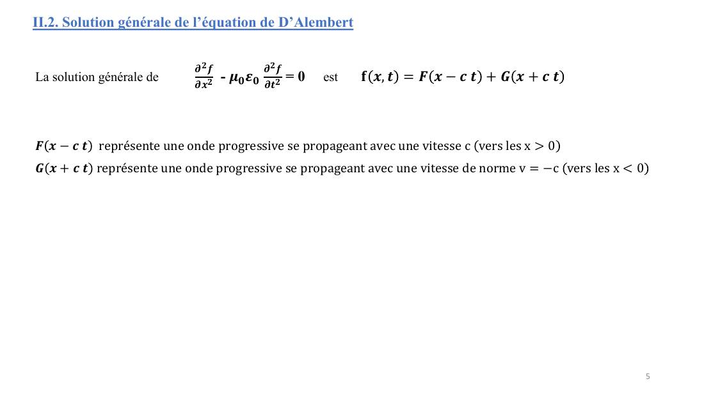{ loading=lazy .papier }](papier/ch3/p05.jpg)
    
II.2. Solution générale de l’équation de D’Alembert · Chapitre 3 — support 2025-2026, diapo 5

    [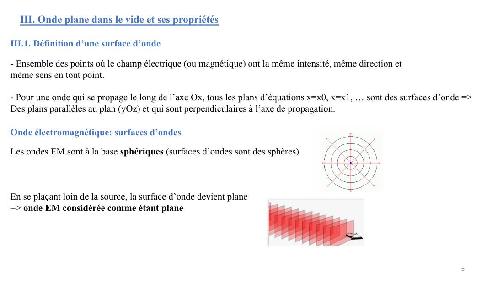{ loading=lazy .papier }](papier/ch3/p06.jpg)
    
III. Onde plane dans le vide et ses propriétés · Chapitre 3 — support 2025-2026, diapo 6

    [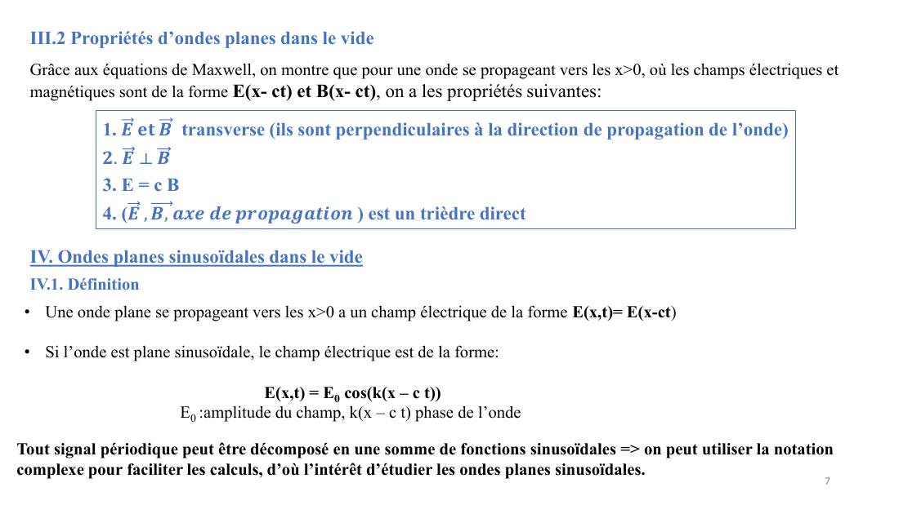{ loading=lazy .papier }](papier/ch3/p07.jpg)
    
III.2 Propriétés d’ondes planes dans le vide · Chapitre 3 — support 2025-2026, diapo 7

    [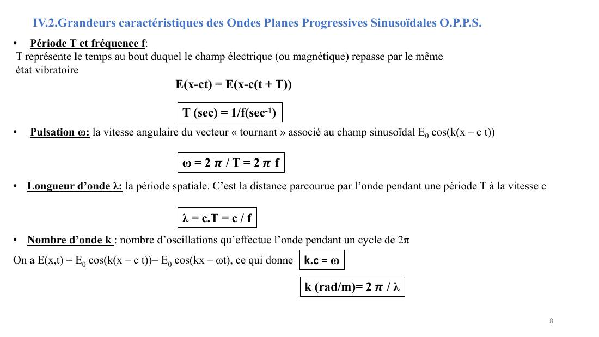{ loading=lazy .papier }](papier/ch3/p08.jpg)
    
IV.2.Grandeurs caractéristiques des Ondes Planes Progressives Sinusoïdales O.P.P.S. · Chapitre 3 — support 2025-2026, diapo 8

    [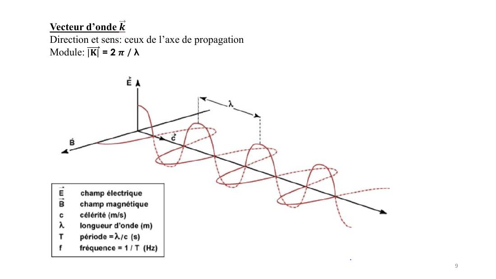{ loading=lazy .papier }](papier/ch3/p09.jpg)
    
Direction et sens: ceux de l’axe de propagation · Chapitre 3 — support 2025-2026, diapo 9

    [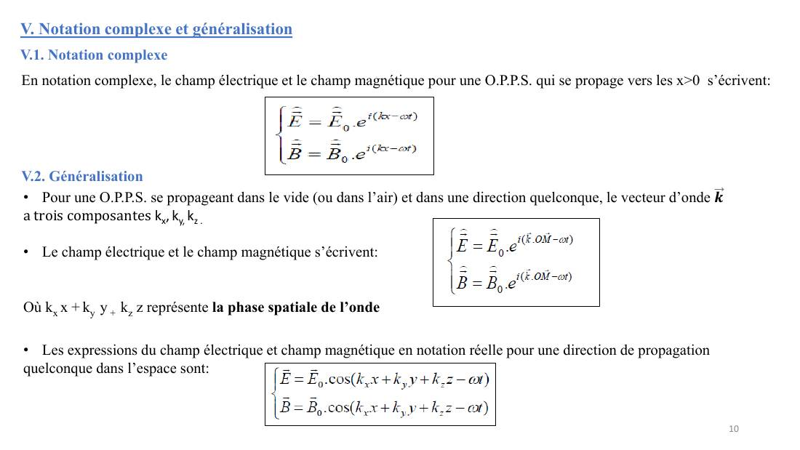{ loading=lazy .papier }](papier/ch3/p10.jpg)
    
V. Notation complexe et généralisation · Chapitre 3 — support 2025-2026, diapo 10

    [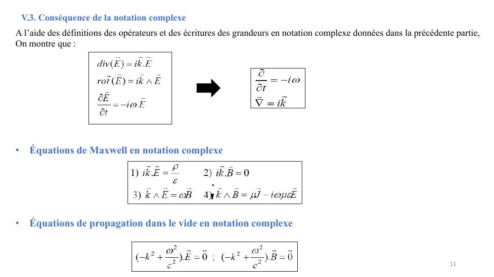{ loading=lazy .papier }](papier/ch3/p11.jpg)
    
V.3. Conséquence de la notation complexe · Chapitre 3 — support 2025-2026, diapo 11

    <!-- /papier -->
