# Chapitre 4 — Ondes électromagnétiques et énergie

=== "Version simplifiée"

    Une onde transporte de l'énergie. Ce chapitre dit **combien** (densité d'énergie),
    **dans quelle direction et à quel débit** (vecteur de Poynting), puis montre que la lumière est
    aussi un flux de **photons**.

    ## Densités d'énergie

    $$
    \omega_e = \frac12\varepsilon E^2 \qquad \omega_m = \frac{B^2}{2\mu} \qquad U = \omega_e + \omega_m \quad (\text{J/m}^3)
    $$

    ## Bilan d'énergie (théorème de Poynting)

    On applique $\text{div}(\vec E \wedge \vec B) = \vec B \cdot \overrightarrow{\text{rot}}\,\vec E - \vec E \cdot \overrightarrow{\text{rot}}\,\vec B$,
    puis Maxwell-Faraday et Maxwell-Ampère :

    !!! theoreme "Équation locale de conservation de l'énergie"

        $$
        \text{div}\,\vec S + \frac{\partial U}{\partial t} = -\vec J \cdot \vec E
        \qquad \text{avec} \qquad \vec S = \frac{\vec E \wedge \vec B}{\mu}
        $$

        $\vec S$ est le **vecteur de Poynting**, en W/m² (une puissance par unité de surface).
        Dans le vide ($\vec J = \vec 0$) : $\text{div}\,\vec S + \dfrac{\partial U}{\partial t} = 0$.

    Intégrée sur un volume $V$ de surface $\Sigma$ :

    $$
    \underbrace{\frac{dW}{dt}}_{\text{variation de l'énergie dans } V} = \underbrace{-\oint\!\!\!\oint_\Sigma \vec S \cdot \overrightarrow{d\Sigma}}_{\text{puissance rayonnée qui sort}} \ \underbrace{- \iiint_V \vec J \cdot \vec E\,d\tau}_{\text{effet Joule}}
    $$

    ## Cas de l'onde plane dans le vide

    Avec $\vec E = E_0\cos(kx - \omega t)\,\vec u_y$ et $B = E/c$ :

    $$
    \vec S = \frac{E^2}{\mu_0 c}\,\vec u_x = \varepsilon_0 c\,E^2\,\vec u_x
    \qquad
    U = \varepsilon_0 E^2 = \frac{B^2}{\mu_0}
    \qquad
    \vec S = U\,c\,\vec u_x
    $$

    - $\omega_e = \omega_m$ : l'énergie est partagée à égalité entre $\vec E$ et $\vec B$.
    - $\vec S$ est dirigé selon la **propagation** : l'énergie avance avec l'onde, à la vitesse $c$
      (comme $\vec J = \rho\vec v$ pour les charges).

    ## Intensité et puissance

    !!! definition "Intensité lumineuse"
        C'est la **moyenne temporelle** de la norme de $\vec S$. Comme $\langle\cos^2\rangle = \frac12$ :

        $$
        I = \langle S \rangle = \frac{\varepsilon_0 c\,E_0^2}{2} = \frac{E_0^2}{2\mu_0 c} = \frac{S_0}{2} \quad (\text{W/m}^2)
        $$

    !!! definition "Puissance rayonnée"
        Flux de $\vec S$ à travers une surface : $P = \iint_\Sigma \vec S \cdot \overrightarrow{d\Sigma}$ (W). Pour une surface
        perpendiculaire à la propagation, $\langle P \rangle = I \times \text{aire}$.

    ??? success "Applications du cours (diapo 11)"
        On note $S_0 = \dfrac{E_0^2}{\mu_0 c}$.

        1. **Source loin de la Terre, qui émet dans toutes les directions** : à la distance $R$, $\vec S = S_0\cos^2(kR - \omega t)\,\vec u_r$.
           Elle rayonne à travers une **sphère** : $P(R, t) = 4\pi R^2 S_0\cos^2(kR - \omega t)$ et $\langle P \rangle = 2\pi R^2 S_0$.
        2. **Source au ras du sol** : elle n'émet que dans le demi-espace au-dessus du sol, donc à travers une **demi-sphère** :
           $\langle P \rangle = \pi R^2 S_0$.
        3. **Faisceau laser** de rayon $R$ selon $Oz$ : $\vec S = S_0\cos^2(kz - \omega t)\,\vec u_z$, section $\pi R^2$, donc
           $P(z, t) = \pi R^2 S_0\cos^2(kz - \omega t)$ et $\langle P \rangle = \dfrac{\pi R^2 E_0^2}{2\mu_0 c}$.

        Pour une source isotrope, $\langle P \rangle$ est fixé : $S_0$ décroît donc en $1/R^2$.

    ## Dualité onde-corpuscule

    - **Aspect ondulatoire** : le couple $(\vec E, \vec B)$ qui vérifie d'Alembert (interférences, diffraction, holographie).
    - **Aspect corpusculaire** : un flux de **photons**, particules sans masse qui vont à $c$. L'énergie est **quantifiée**
      (Planck, 1900). Il est mis en évidence par l'**effet photoélectrique** (Einstein, 1905) et l'**effet Compton**.

    !!! theoreme "Photon"

        $$
        E = h\nu = \hbar\omega \qquad p = \frac{h}{\lambda} = \hbar k \qquad h = 6{,}62\cdot10^{-34}\ \text{J·s},\ \hbar = \frac{h}{2\pi}
        $$

    ## Pression de radiation

    Les photons ont une quantité de mouvement : en frappant une surface, ils exercent une **force**, donc une pression.

    | Obstacle | Pression |
    |---|---|
    | Miroir parfait (tout est réfléchi) | $p = 2U$ |
    | Surface qui absorbe tout ($r = 0$) | $p = U$ |
    | Cas général ($r + t = 1$) | $p = (1 + r)\,U = (2 - t)\,U$ |

    !!! piege "« Lame parfaitement transparente »"
        La diapo associe $p = U$ à une lame « parfaitement transparente ». Dans la formule $(1 + r)U$, c'est le cas $r = 0$ :
        rien n'est réfléchi, toute la quantité de mouvement est cédée à l'obstacle, ce qui correspond physiquement à une
        surface **absorbante**. Une vitre qui laisse tout passer ne subirait aucune force. Au DE, cite la formule du cours.

    avec $U = \varepsilon_0 E^2$ pour une onde plane. En moyenne, $\langle U \rangle = I/c$ : un miroir subit $\langle p \rangle = 2I/c$.

=== "Version papier"

    Les diapos du chapitre 4 (support 2025-2026).

    <!-- papier: pdf/SP401P/ch4.pdf | Chapitre 4 — support 2025-2026 | ch4 | diapo -->

    [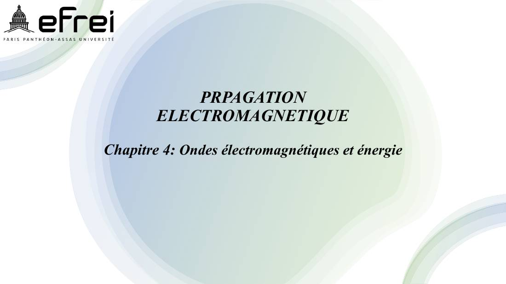{ loading=lazy .papier }](papier/ch4/p01.jpg)
    
Chapitre 4: Ondes électromagnétiques et énergie · Chapitre 4 — support 2025-2026, diapo 1

    [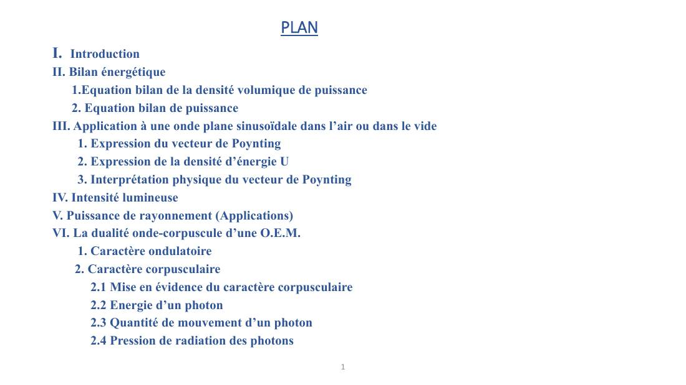{ loading=lazy .papier }](papier/ch4/p02.jpg)
    
I. Introduction · Chapitre 4 — support 2025-2026, diapo 2

    [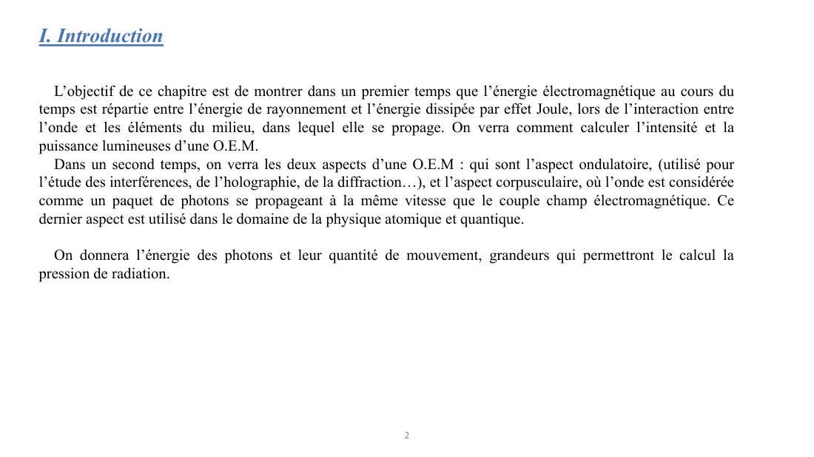{ loading=lazy .papier }](papier/ch4/p03.jpg)
    
I. Introduction · Chapitre 4 — support 2025-2026, diapo 3

    [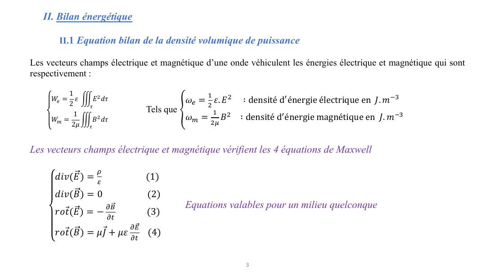{ loading=lazy .papier }](papier/ch4/p04.jpg)
    
II. Bilan énergétique · Chapitre 4 — support 2025-2026, diapo 4

    [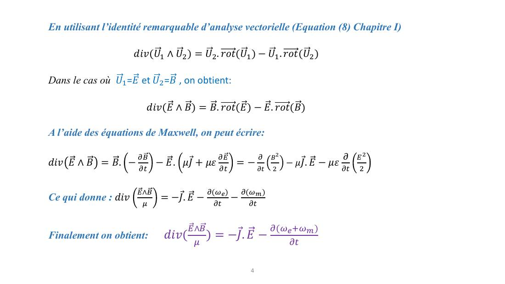{ loading=lazy .papier }](papier/ch4/p05.jpg)
    
En utilisant l’identité remarquable d’analyse vectorielle (Equation (8) Chapitre I) · Chapitre 4 — support 2025-2026, diapo 5

    [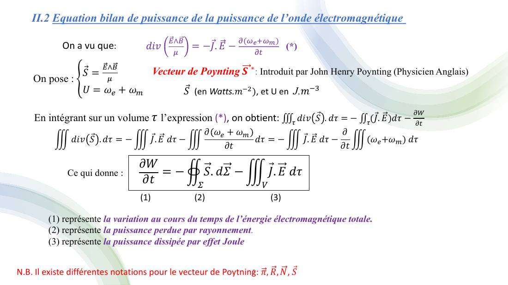{ loading=lazy .papier }](papier/ch4/p06.jpg)
    
II.2 Equation bilan de puissance de la puissance de l’onde électromagnétique · Chapitre 4 — support 2025-2026, diapo 6

    [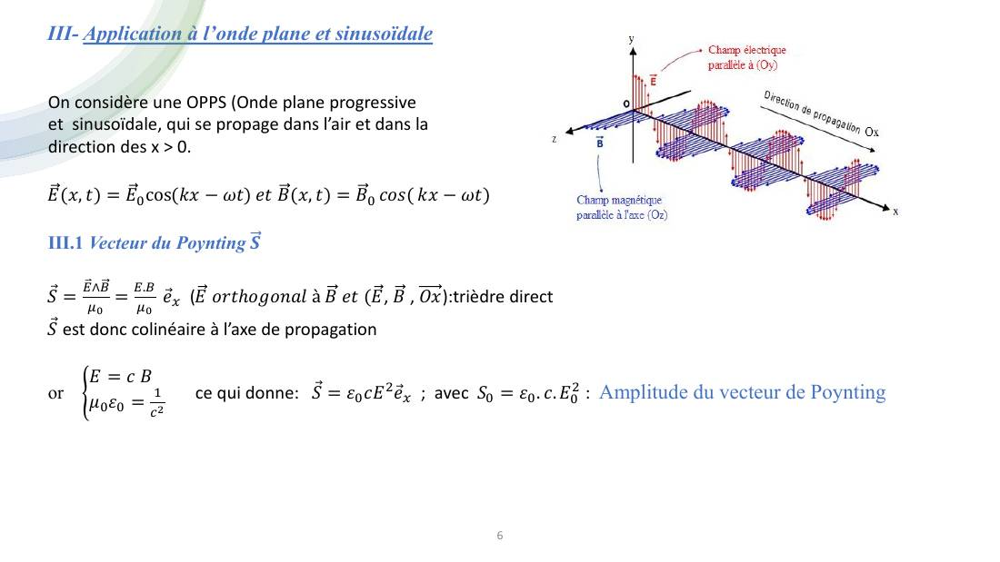{ loading=lazy .papier }](papier/ch4/p07.jpg)
    
III- Application à l’onde plane et sinusoïdale · Chapitre 4 — support 2025-2026, diapo 7

    [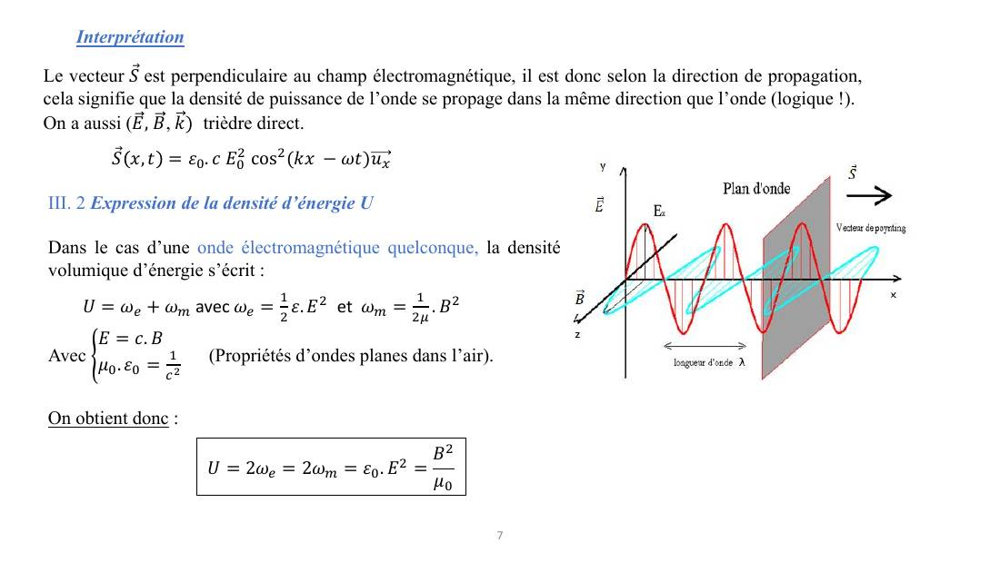{ loading=lazy .papier }](papier/ch4/p08.jpg)
    
cela signifie que la densité de puissance de l’onde se propage dans la même direction que … · Chapitre 4 — support 2025-2026, diapo 8

    [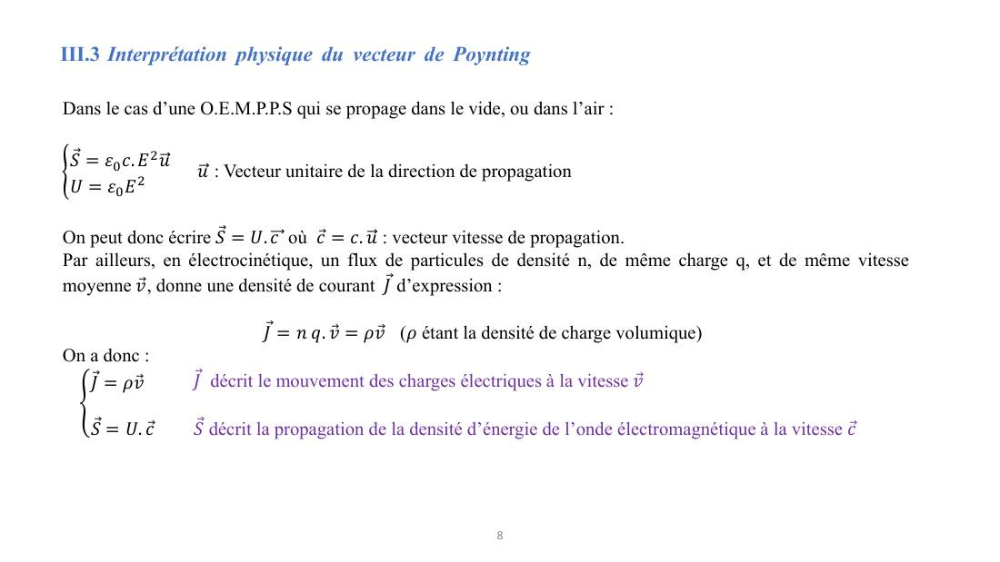{ loading=lazy .papier }](papier/ch4/p09.jpg)
    
III.3 Interprétation physique du vecteur de Poynting · Chapitre 4 — support 2025-2026, diapo 9

    [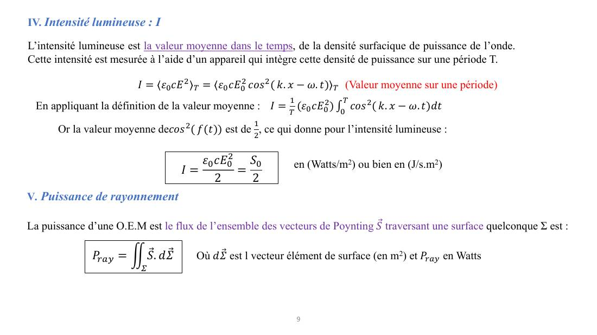{ loading=lazy .papier }](papier/ch4/p10.jpg)
    
IV. Intensité lumineuse : I · Chapitre 4 — support 2025-2026, diapo 10

    [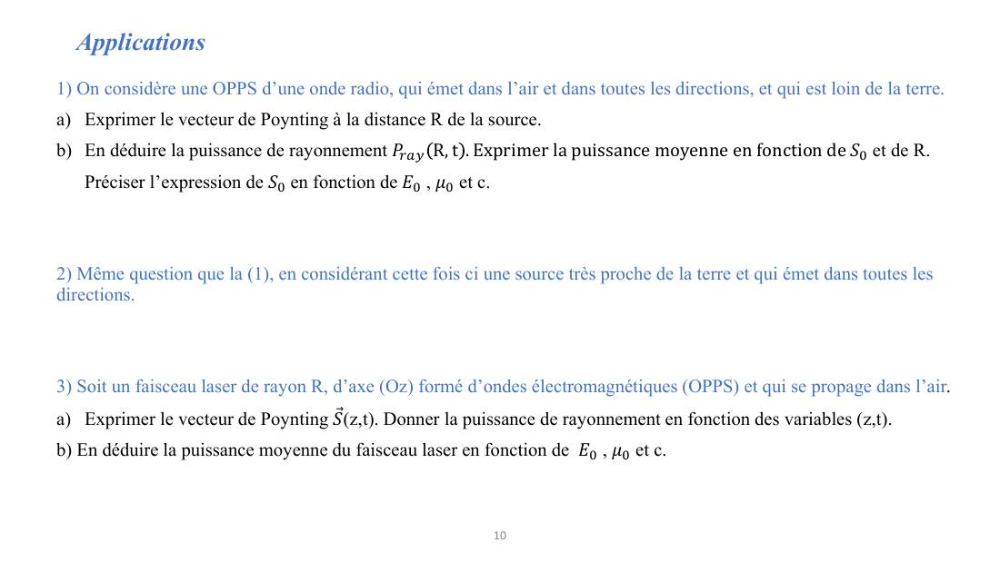{ loading=lazy .papier }](papier/ch4/p11.jpg)
    
1) On considère une OPPS d’une onde radio, qui émet dans l’air et dans toutes les directio… · Chapitre 4 — support 2025-2026, diapo 11

    [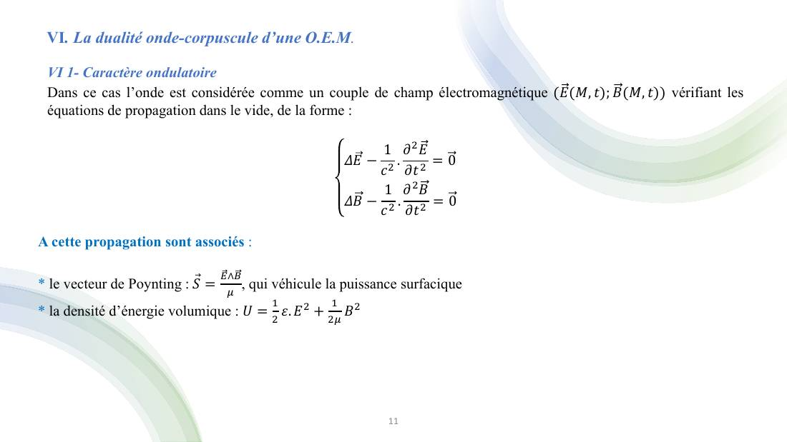{ loading=lazy .papier }](papier/ch4/p12.jpg)
    
VI. La dualité onde-corpuscule d’une O.E.M. · Chapitre 4 — support 2025-2026, diapo 12

    [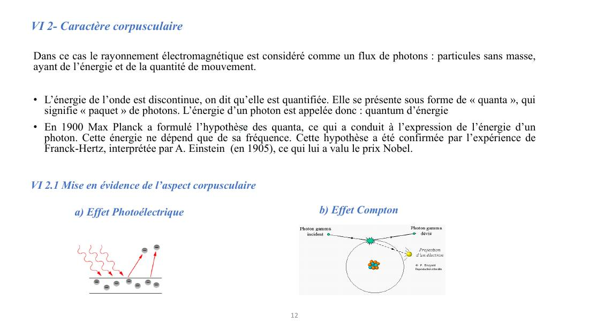{ loading=lazy .papier }](papier/ch4/p13.jpg)
    
VI 2- Caractère corpusculaire · Chapitre 4 — support 2025-2026, diapo 13

    [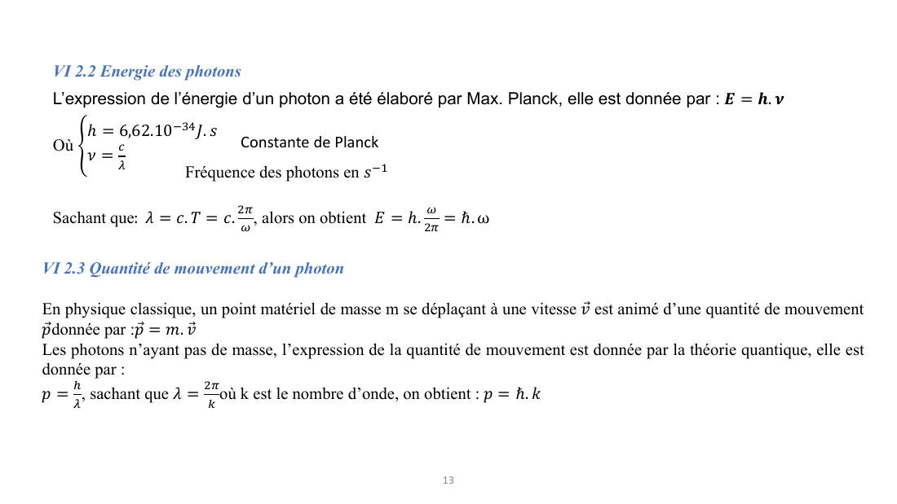{ loading=lazy .papier }](papier/ch4/p14.jpg)
    
VI 2.2 Energie des photons · Chapitre 4 — support 2025-2026, diapo 14

    [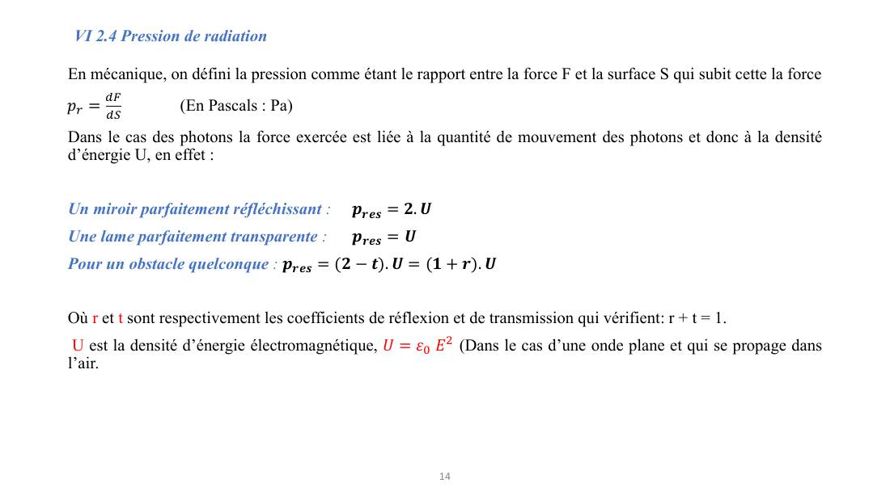{ loading=lazy .papier }](papier/ch4/p15.jpg)
    
VI 2.4 Pression de radiation · Chapitre 4 — support 2025-2026, diapo 15

    <!-- /papier -->
