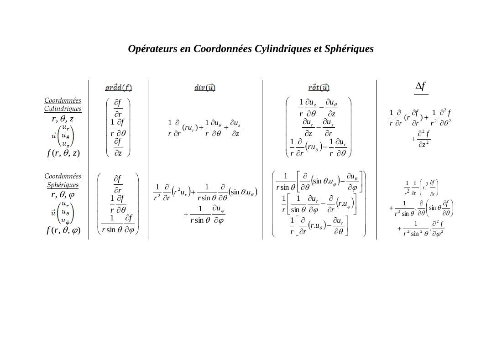

# Fiche — Propagation électromagnétique

## Opérateurs (cartésiennes)

| | Formule | Nature |
|---|---|---|
| $\overrightarrow{\text{grad}}\,f$ | $(\partial_x f,\ \partial_y f,\ \partial_z f)$ | scalaire → vecteur |
| $\text{div}\,\vec U$ | $\partial_xU_x + \partial_yU_y + \partial_zU_z$ | vecteur → scalaire |
| $\overrightarrow{\text{rot}}\,\vec U$ | $(\partial_yU_z - \partial_zU_y,\ \partial_zU_x - \partial_xU_z,\ \partial_xU_y - \partial_yU_x)$ | vecteur → vecteur |
| $\Delta f$ | $\partial_x^2f + \partial_y^2f + \partial_z^2f$ | scalaire ou vecteur (composante par composante) |

$\text{div}\,\overrightarrow{\text{rot}} = 0$ · $\overrightarrow{\text{rot}}\,\overrightarrow{\text{grad}} = \vec 0$ ·
$\overrightarrow{\text{rot}}\,\overrightarrow{\text{rot}}\,\vec U = \overrightarrow{\text{grad}}\,\text{div}\,\vec U - \Delta\vec U$ ·
$\text{div}(\vec E \wedge \vec B) = \vec B\cdot\overrightarrow{\text{rot}}\,\vec E - \vec E\cdot\overrightarrow{\text{rot}}\,\vec B$

**Ostrogradski** : $\oint\!\!\oint_S \vec U\cdot\overrightarrow{dS} = \iiint_V \text{div}\,\vec U\,dV$ ·
**Stokes** : $\oint_C \vec U\cdot\overrightarrow{dl} = \iint_S \overrightarrow{\text{rot}}\,\vec U\cdot\overrightarrow{dS}$

Champ radial : $\text{div}\,\vec E = \frac1r\frac{d(rE_r)}{dr}$ (cylindriques), $\frac{1}{r^2}\frac{d(r^2E_r)}{dr}$ (sphériques) ;
champ orthoradial : $\big(\overrightarrow{\text{rot}}\,\vec B\big)_z = \frac1r\frac{d(rB_\theta)}{dr}$ (cylindriques).

## Maxwell

$$
\text{div}\,\vec E = \frac{\rho}{\varepsilon} \qquad \text{div}\,\vec B = 0 \qquad
\overrightarrow{\text{rot}}\,\vec E = -\frac{\partial\vec B}{\partial t} \qquad
\overrightarrow{\text{rot}}\,\vec B = \mu\vec J + \mu\varepsilon\frac{\partial\vec E}{\partial t}
$$

Propagation (milieu quelconque) : $\Delta\vec E - \mu\varepsilon\,\partial_t^2\vec E = \overrightarrow{\text{grad}}(\rho/\varepsilon) + \mu\,\partial_t\vec J$.

**Induction** : $\Phi = \iint\vec B\cdot\overrightarrow{dS}$ (Wb), $e = -\dfrac{d\Phi}{dt}$ (Lenz : s'oppose à la cause), $i = e/R$ ;
auto-induction : $\Phi = Li$, $e = -L\dfrac{di}{dt}$.

## Ondes dans le vide

$$
\Delta\vec E - \frac{1}{c^2}\frac{\partial^2\vec E}{\partial t^2} = \vec 0 \qquad c = \frac{1}{\sqrt{\mu_0\varepsilon_0}} \approx 3\cdot10^8\ \text{m/s}
\qquad \mu_0 = 4\pi\cdot10^{-7},\ \varepsilon_0 = \frac{10^{-9}}{36\pi}
$$

Solution 1D : $F(x - ct)$ (vers $+x$) $+ \;G(x + ct)$ (vers $-x$).

| $T = 1/f$ | $\omega = 2\pi f$ | $\lambda = c/f = cT$ | $k = 2\pi/\lambda = \omega/c$ |
|---|---|---|---|

**Onde plane progressive** : transverse, $\vec E\perp\vec B$, $E = cB$, $(\vec E, \vec B, \vec u)$ direct :

$$
\vec B = \frac{\vec u \wedge \vec E}{c} = \frac{\vec k \wedge \vec E}{\omega} \qquad \vec E = c\,\vec B \wedge \vec u
$$

Notation complexe $e^{i(\omega t - \vec k\cdot\vec r)}$ : $\partial_t \to i\omega$, $\nabla \to -i\vec k$, $\Delta \to -k^2$.

Superposition de deux ondes opposées → **onde stationnaire** $2E_0\cos\omega t\cos kx$ : nœuds tous les $\lambda/2$, $\langle\vec S\rangle = \vec 0$.

## Énergie

$$
u = \frac{\varepsilon_0E^2}{2} + \frac{B^2}{2\mu_0} \qquad \vec S = \frac{\vec E\wedge\vec B}{\mu_0}\ (\text{W/m}^2) \qquad
\text{div}\,\vec S + \frac{\partial u}{\partial t} = -\vec J\cdot\vec E
$$

Onde plane : $u = \varepsilon_0E^2$, $\vec S = \varepsilon_0cE^2\,\vec u = u\,c\,\vec u$ · intensité $I = \langle S\rangle = \dfrac{\varepsilon_0cE_0^2}{2} = \dfrac{E_0^2}{2\mu_0c}$ ·
puissance $P = \iint\vec S\cdot\overrightarrow{d\Sigma}$ (sphère $4\pi R^2$, demi-sphère $2\pi R^2$, faisceau $\pi R^2$).

**Photon** : $E = h\nu = \hbar\omega$, $p = h/\lambda = \hbar k$, $h = 6{,}62\cdot10^{-34}$ J·s.
**Pression de radiation** : miroir $2U$, absorbant $U$, général $(1 + r)U$ ; en moyenne $\langle U\rangle = I/c$.

## Formulaire officiel

Le formulaire des opérateurs en coordonnées cylindriques et sphériques distribué avec le cours.

<!-- papier: pdf/SP401P/formulaire.pdf | Formulaire des opérateurs | formulaire | page -->

[{ loading=lazy .papier }](papier/formulaire/p01.jpg)

Opérateurs en Coordonnées Cylindriques et Sphériques · Formulaire des opérateurs, page 1

<!-- /papier -->
