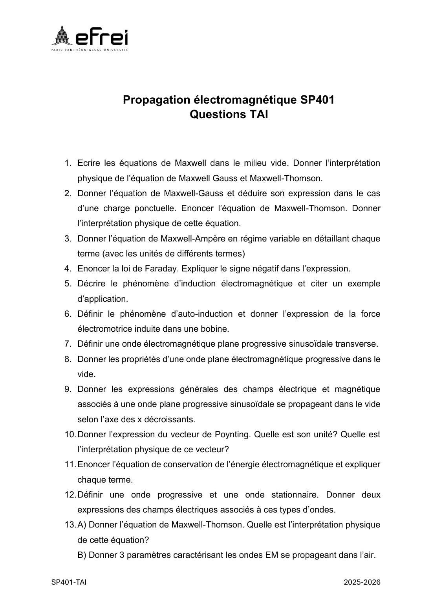
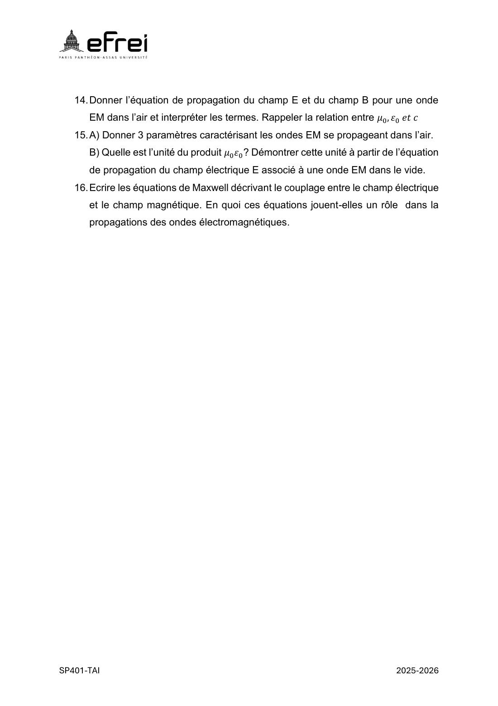

# Travaux d'autonomie et d'initiative (TAI)

=== "Version simplifiée"

    Le TAI compte pour **10 %** de la note (DE 60 %, interrogations de TD 30 %). Ce sont des
    **questions de cours** : voici une réponse type pour chacune des 16 questions de la liste.
    Pour les détails, voir le [cours](../cours/index.md) et la [fiche](../fiches/fiche-propagation.md).

    ??? note "1. Équations de Maxwell dans le vide ; interprétation de Gauss et Thomson"
        $\text{div}\,\vec E = 0$, $\text{div}\,\vec B = 0$, $\overrightarrow{\text{rot}}\,\vec E = -\partial_t\vec B$, $\overrightarrow{\text{rot}}\,\vec B = \mu_0\varepsilon_0\,\partial_t\vec E$.
        Gauss ($\text{div}\,\vec E = \rho/\varepsilon_0$ en général) : les charges sont les sources de $\vec E$ ; les lignes de champ divergent des charges positives.
        Thomson : $\vec B$ n'a pas de source, ses lignes de champ se referment, il n'existe pas de monopôle magnétique.

    ??? note "2. Maxwell-Gauss et charge ponctuelle ; Maxwell-Thomson"
        $\text{div}\,\vec E = \rho/\varepsilon_0$. Pour une charge ponctuelle $q$, on intègre sur une sphère de rayon $r$ (Ostrogradski) :
        $E \cdot 4\pi r^2 = q/\varepsilon_0$, d'où $\vec E = \dfrac{q}{4\pi\varepsilon_0 r^2}\vec u_r$ (et $\text{div}\,\vec E = 0$ partout sauf en la charge).
        Thomson : $\text{div}\,\vec B = 0$, flux de $\vec B$ conservatif, pas de monopôle.

    ??? note "3. Maxwell-Ampère en régime variable, termes et unités"
        $\overrightarrow{\text{rot}}\,\vec B = \mu_0\vec J + \mu_0\varepsilon_0\dfrac{\partial\vec E}{\partial t}$.
        $\vec B$ en T, donc $\overrightarrow{\text{rot}}\,\vec B$ en T/m ; $\mu_0$ en H/m ; $\vec J$ en A/m² ; $\varepsilon_0$ en F/m ; $\partial_t\vec E$ en V/(m·s).
        $\varepsilon_0\,\partial_t\vec E$ est le **courant de déplacement** (en A/m², comme $\vec J$) : un champ électrique variable crée un champ magnétique.

    ??? note "4. Loi de Faraday et signe moins"
        $e = -\dfrac{d\Phi}{dt}$ : une variation du flux de $\vec B$ à travers un circuit y crée une fem. Le signe moins traduit la **loi de Lenz** :
        le courant induit crée un champ qui s'oppose à la variation de flux qui lui a donné naissance.

    ??? note "5. Induction : description et application"
        Apparition d'un courant dans un circuit quand le flux de $\vec B$ qui le traverse varie (aimant qui bouge, courant variable,
        circuit qui tourne). Applications : alternateur et dynamo de vélo, transformateur, plaques à induction, freinage par courants de Foucault, recharge sans fil.

    ??? note "6. Auto-induction et fem d'une bobine"
        Un courant variable dans un circuit crée un $\vec B$ variable, donc un flux propre variable $\Phi = Li$ à travers le circuit lui-même :
        il apparaît une fem qui s'oppose à la variation du courant, $e = -L\dfrac{di}{dt}$ ($L$ en henry).

    ??? note "7. Onde plane progressive sinusoïdale transverse"
        **Plane** : le champ est le même sur des plans perpendiculaires à la propagation. **Progressive** : elle avance (dépendance en $\omega t - \vec k\cdot\vec r$).
        **Sinusoïdale** : un cosinus de pulsation $\omega$ unique. **Transverse** : $\vec E$ et $\vec B$ sont perpendiculaires à la direction de propagation.

    ??? note "8. Propriétés d'une onde plane progressive dans le vide"
        $\vec E$ et $\vec B$ transverses ; $\vec E \perp \vec B$ ; $E = cB$ ; $(\vec E, \vec B, \vec u)$ trièdre direct ; vitesse $c = 1/\sqrt{\mu_0\varepsilon_0}$ ; $k = \omega/c$.

    ??? note "9. OPPS vers les $x$ décroissants"
        Par exemple $\vec E = E_0\cos(\omega t + kx)\,\vec u_y$ et $\vec B = \dfrac{(-\vec u_x) \wedge \vec E}{c} = -\dfrac{E_0}{c}\cos(\omega t + kx)\,\vec u_z$.

    ??? note "10. Vecteur de Poynting"
        $\vec S = \dfrac{\vec E \wedge \vec B}{\mu_0}$, en **W/m²**. C'est la puissance transportée par unité de surface ; il est dirigé dans le sens de propagation de l'énergie.
        Son flux à travers une surface est la puissance qui la traverse.

    ??? note "11. Conservation de l'énergie électromagnétique"
        $\text{div}\,\vec S + \dfrac{\partial u}{\partial t} = -\vec J\cdot\vec E$ avec $u = \dfrac{\varepsilon_0E^2}{2} + \dfrac{B^2}{2\mu_0}$.
        $\partial_t u$ : variation de l'énergie stockée ; $\text{div}\,\vec S$ : puissance qui sort par rayonnement ; $\vec J\cdot\vec E$ : puissance cédée aux charges (effet Joule).

    ??? note "12. Onde progressive et onde stationnaire"
        Progressive : la phase mêle temps et espace, l'onde avance, par exemple $E_0\cos(\omega t - kx)$.
        Stationnaire : temps et espace sont séparés, elle oscille sur place avec des nœuds fixes, par exemple $2E_0\cos(\omega t)\cos(kx)$
        (superposition de deux ondes opposées). Elle ne transporte pas d'énergie en moyenne.

    ??? note "13. Maxwell-Thomson ; 3 paramètres d'une onde dans l'air"
        $\text{div}\,\vec B = 0$ : pas de monopôle, lignes de $\vec B$ fermées.
        Paramètres : fréquence $f$ (ou pulsation $\omega = 2\pi f$), longueur d'onde $\lambda = c/f$, nombre d'onde $k = 2\pi/\lambda$, ainsi que l'amplitude $E_0$ et la vitesse $c$.

    ??? note "14. Équations de propagation de $\vec E$ et $\vec B$ dans l'air"
        $\Delta\vec E - \dfrac{1}{c^2}\dfrac{\partial^2\vec E}{\partial t^2} = \vec 0$, idem pour $\vec B$ : le laplacien décrit les variations dans l'espace,
        la dérivée seconde les variations dans le temps, et leur rapport fixe la vitesse. $\mu_0\varepsilon_0c^2 = 1$.

    ??? note "15. Unité de $\mu_0\varepsilon_0$"
        Dans $\Delta\vec E = \mu_0\varepsilon_0\,\partial_t^2\vec E$ : $[\Delta\vec E] = $ V·m⁻³ et $[\partial_t^2\vec E] = $ V·m⁻¹·s⁻². Donc $[\mu_0\varepsilon_0] = $ s²·m⁻² :
        c'est l'inverse du carré d'une vitesse, $c = 1/\sqrt{\mu_0\varepsilon_0} \approx 3\cdot10^8$ m/s.

    ??? note "16. Couplage $\vec E$-$\vec B$ et propagation"
        Maxwell-Faraday ($\overrightarrow{\text{rot}}\,\vec E = -\partial_t\vec B$) et Maxwell-Ampère ($\overrightarrow{\text{rot}}\,\vec B = \mu_0\varepsilon_0\,\partial_t\vec E$ dans le vide).
        Un $\vec B$ variable crée un $\vec E$ qui varie, qui recrée un $\vec B$… Cet entretien mutuel fait avancer l'onde sans support matériel.
        En combinant les deux, on obtient l'équation de d'Alembert.

=== "Version papier"

    La liste officielle des questions du TAI 2025-2026.

    <!-- papier: pdf/SP401P/tai.pdf | Questions TAI 2025-2026 | sujets | page -->

    [{ loading=lazy .papier }](papier/sujets/p01.jpg)
    
Propagation électromagnétique SP401 · Questions TAI 2025-2026, page 1

    [{ loading=lazy .papier }](papier/sujets/p02.jpg)
    
14. Donner l’équation de propagation du champ E et du champ B pour une onde · Questions TAI 2025-2026, page 2

    <!-- /papier -->
