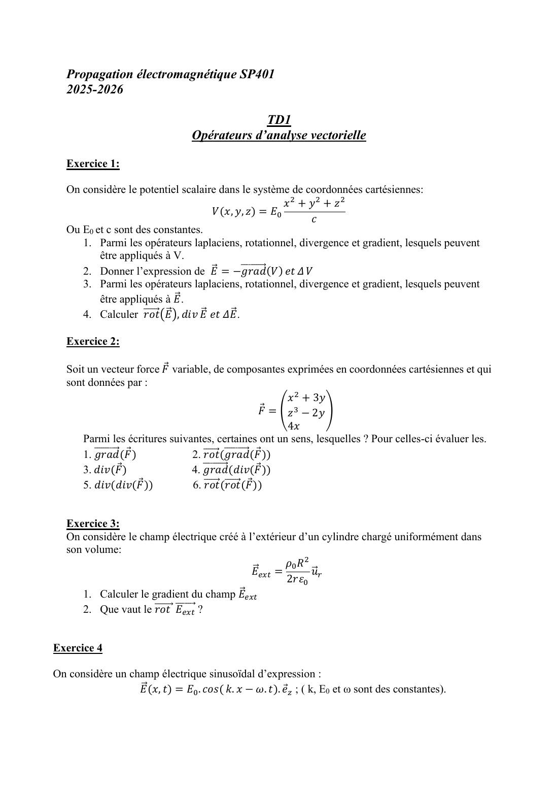
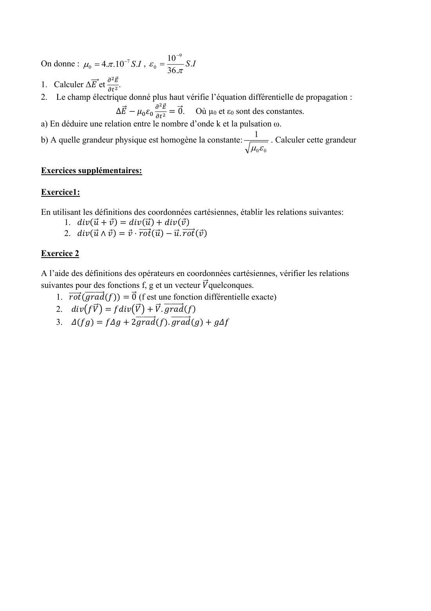

# TD 1 — Opérateurs d'analyse vectorielle

=== "Version simplifiée"

    Rappels : [chapitre 1](../cours/chapitre-1-analyse-vectorielle.md). Avant tout calcul : l'opérateur
    s'applique-t-il à un **scalaire** ou à un **vecteur** ?

    ## Exercice 1 — Potentiel et champ

    $V(x, y, z) = \dfrac{E_0}{c}(x^2 + y^2 + z^2)$.

    ??? success "Correction"
        1. $V$ est un scalaire : on peut lui appliquer le **gradient** et le **laplacien** (pas la divergence ni le rotationnel).
        2. $\overrightarrow{\text{grad}}\,V = \dfrac{2E_0}{c}(x, y, z)$, donc

            $$
            \vec E = -\overrightarrow{\text{grad}}\,V = -\frac{2E_0}{c}\left(x\,\vec u_x + y\,\vec u_y + z\,\vec u_z\right)
            \qquad
            \Delta V = \frac{E_0}{c}(2 + 2 + 2) = \frac{6E_0}{c}
            $$

        3. $\vec E$ est un vecteur : **divergence**, **rotationnel** et **laplacien** (vectoriel) ont un sens.
        4. $\overrightarrow{\text{rot}}\,\vec E = \vec 0$ (chaque composante ne dépend que de « sa » variable ; et de toute façon $\overrightarrow{\text{rot}}\,\overrightarrow{\text{grad}} = \vec 0$).
           $\text{div}\,\vec E = -\dfrac{6E_0}{c}$ (cohérent : $\text{div}\,\vec E = -\Delta V$).
           $\Delta\vec E = \vec 0$ (les composantes sont du premier degré).

    ## Exercice 2 — Quelles écritures ont un sens ?

    $\vec F = (x^2 + 3y,\ z^3 - 2y,\ 4x)$.

    ??? success "Correction"
        | Écriture | Sens ? | Résultat |
        |---|---|---|
        | 1. $\overrightarrow{\text{grad}}(\vec F)$ | non (gradient d'un vecteur) | |
        | 2. $\overrightarrow{\text{rot}}(\overrightarrow{\text{grad}}(\vec F))$ | non (le gradient n'existe pas) | |
        | 3. $\text{div}(\vec F)$ | oui | $2x - 2$ |
        | 4. $\overrightarrow{\text{grad}}(\text{div}\,\vec F)$ | oui | $2\,\vec u_x$ |
        | 5. $\text{div}(\text{div}\,\vec F)$ | non (divergence d'un scalaire) | |
        | 6. $\overrightarrow{\text{rot}}(\overrightarrow{\text{rot}}\,\vec F)$ | oui | $-6z\,\vec u_y$ |

        Détail du 6 :

        $$
        \overrightarrow{\text{rot}}\,\vec F = \begin{pmatrix} \partial_y(4x) - \partial_z(z^3 - 2y) \\ \partial_z(x^2 + 3y) - \partial_x(4x) \\ \partial_x(z^3 - 2y) - \partial_y(x^2 + 3y) \end{pmatrix}
        = \begin{pmatrix} -3z^2 \\ -4 \\ -3 \end{pmatrix},
        \qquad
        \overrightarrow{\text{rot}}\begin{pmatrix} -3z^2 \\ -4 \\ -3 \end{pmatrix} = \begin{pmatrix} 0 - 0 \\ -6z - 0 \\ 0 - 0 \end{pmatrix}.
        $$

        Vérification avec $\overrightarrow{\text{rot}}\,\overrightarrow{\text{rot}} = \overrightarrow{\text{grad}}\,\text{div} - \Delta$ :
        $\Delta\vec F = (2,\ 6z,\ 0)$, donc $(2, 0, 0) - (2, 6z, 0) = (0, -6z, 0)$. ✓

    ## Exercice 3 — Champ à l'extérieur d'un cylindre chargé

    $\vec E_{ext} = \dfrac{\rho_0 R^2}{2\varepsilon_0 r}\,\vec u_r$.

    ??? success "Correction"
        1. Le gradient d'un vecteur n'est pas défini : on calcule celui de sa **norme** $E(r)$, qui ne dépend que de $r$ :
           $\overrightarrow{\text{grad}}\,E = \dfrac{dE}{dr}\,\vec u_r = -\dfrac{\rho_0 R^2}{2\varepsilon_0 r^2}\,\vec u_r$
           (le champ diminue quand on s'éloigne).
        2. En cylindriques, avec $\vec E = E_r(r)\,\vec u_r$ : toutes les dérivées qui interviennent dans le rotationnel
           ($\partial E_r/\partial\theta$, $\partial E_r/\partial z$) sont nulles, donc $\overrightarrow{\text{rot}}\,\vec E_{ext} = \vec 0$.
           En bonus, $\text{div}\,\vec E_{ext} = \frac1r\frac{d}{dr}\left(\frac{\rho_0R^2}{2\varepsilon_0}\right) = 0$ : il n'y a pas de charge à l'extérieur.

    ## Exercice 4 — Champ sinusoïdal et vitesse de la lumière

    $\vec E = E_0\cos(kx - \omega t)\,\vec e_z$, $\mu_0 = 4\pi\cdot10^{-7}$, $\varepsilon_0 = \dfrac{10^{-9}}{36\pi}$.

    ??? success "Correction"
        1. $\Delta\vec E = \dfrac{\partial^2 E_z}{\partial x^2}\,\vec e_z = -k^2\,\vec E$ et $\dfrac{\partial^2\vec E}{\partial t^2} = -\omega^2\,\vec E$.
        2. a) Dans l'équation : $(-k^2 + \mu_0\varepsilon_0\omega^2)\vec E = \vec 0$ pour tout $x, t$, donc $k = \omega\sqrt{\mu_0\varepsilon_0}$.

            b) $\mu_0\varepsilon_0 = \dfrac{k^2}{\omega^2}$ est en (rad/m)²/(rad/s)² = s²/m², donc $\dfrac{1}{\sqrt{\mu_0\varepsilon_0}}$ est une **vitesse**.

            $$
            \mu_0\varepsilon_0 = 4\pi\cdot10^{-7} \times \frac{10^{-9}}{36\pi} = \frac{10^{-16}}{9}
            \quad\Longrightarrow\quad
            \frac{1}{\sqrt{\mu_0\varepsilon_0}} = 3\cdot10^8\ \text{m/s} = c.
            $$

    ## Exercices supplémentaires

    ??? success "Identités (exercices 1 et 2)"
        On développe en cartésiennes et on regroupe.

        - $\text{div}(\vec u + \vec v) = \sum_i \partial_i(u_i + v_i) = \text{div}\,\vec u + \text{div}\,\vec v$ (linéarité de la dérivée).
        - $\text{div}(\vec u \wedge \vec v)$ : la composante $x$ de $\vec u \wedge \vec v$ est $u_yv_z - u_zv_y$. En dérivant les trois composantes
          et en regroupant les termes où l'on dérive $\vec u$ d'un côté et ceux où l'on dérive $\vec v$ de l'autre, on obtient
          $\vec v \cdot \overrightarrow{\text{rot}}\,\vec u - \vec u \cdot \overrightarrow{\text{rot}}\,\vec v$.
        - $\overrightarrow{\text{rot}}(\overrightarrow{\text{grad}}\,f)$ : composante $x$ = $\partial_y\partial_z f - \partial_z\partial_y f = 0$ (Schwarz), idem pour les autres.
        - $\text{div}(f\vec V) = \sum_i \partial_i(fV_i) = \sum_i (f\,\partial_iV_i + V_i\,\partial_i f) = f\,\text{div}\,\vec V + \vec V \cdot \overrightarrow{\text{grad}}\,f$.
        - $\Delta(fg)$ : $\partial_i^2(fg) = f\,\partial_i^2 g + 2\,\partial_i f\,\partial_i g + g\,\partial_i^2 f$, on somme sur $i$.

=== "Version papier"

    Énoncé du TD 1 tel qu'il est distribué.

    <!-- papier: pdf/SP401P/td1.pdf | TD 1 — énoncé | td1 | page -->

    [{ loading=lazy .papier }](papier/td1/p01.jpg)
    
Propagation électromagnétique SP401 · TD 1 — énoncé, page 1

    [{ loading=lazy .papier }](papier/td1/p02.jpg)
    
2. Le champ électrique donné plus haut vérifie l’équation différentielle de propagation : · TD 1 — énoncé, page 2

    <!-- /papier -->
