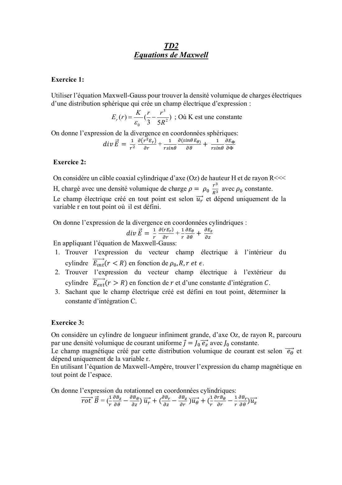
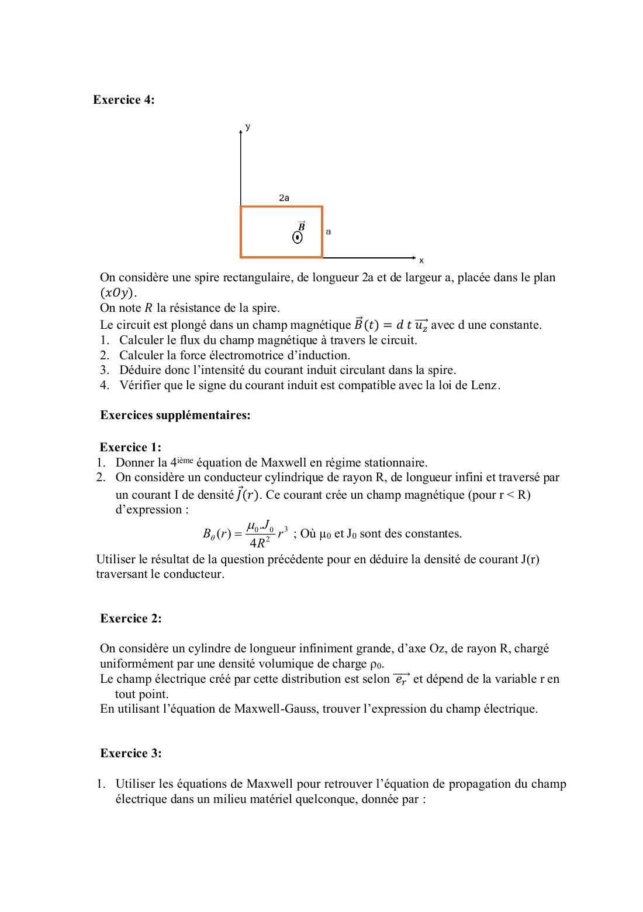
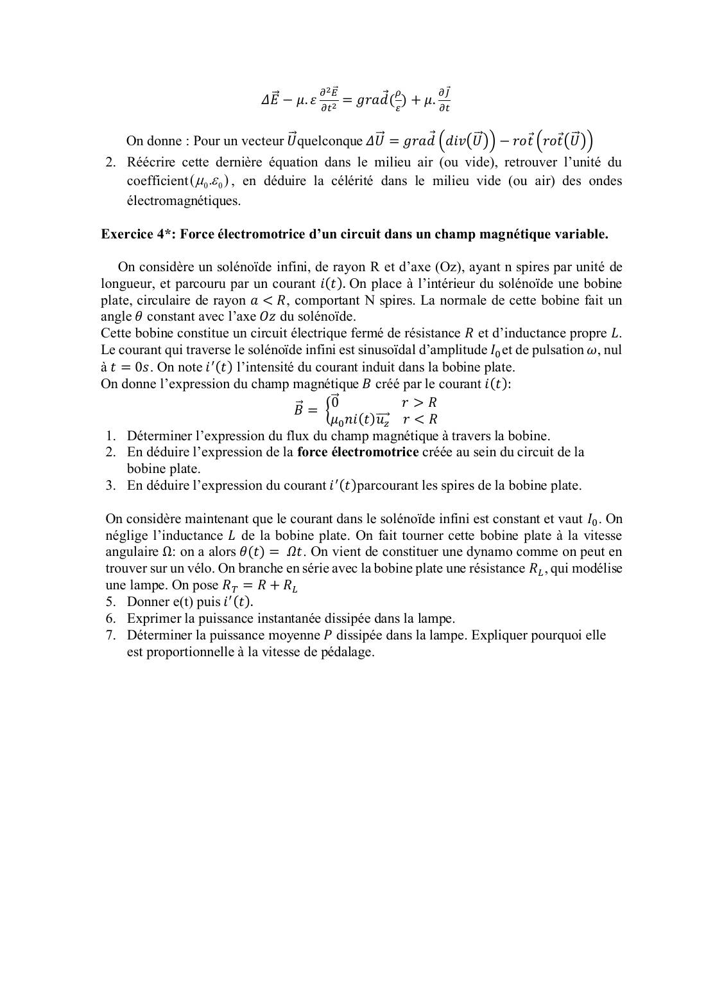

# TD 2 — Équations de Maxwell et induction

=== "Version simplifiée"

    Rappels : [chapitre 2](../cours/chapitre-2-maxwell.md). Méthode générale : on choisit l'équation de
    Maxwell qui relie ce qu'on connaît à ce qu'on cherche, on simplifie l'opérateur avec les symétries
    (une seule composante, une seule variable), puis on intègre.

    ## Exercice 1 — Densité de charge d'une distribution sphérique

    $E_r(r) = \dfrac{K}{\varepsilon_0}\left(\dfrac r3 - \dfrac{r^3}{5R^2}\right)$.

    ??? success "Correction"
        Maxwell-Gauss : $\rho = \varepsilon_0\,\text{div}\,\vec E$, et seul le terme en $r$ de la divergence sphérique reste :

        $$
        \rho = \varepsilon_0 \cdot \frac{1}{r^2}\frac{d}{dr}\left[\frac{K}{\varepsilon_0}\left(\frac{r^3}{3} - \frac{r^5}{5R^2}\right)\right]
        = \frac{K}{r^2}\left(r^2 - \frac{r^4}{R^2}\right) = K\left(1 - \frac{r^2}{R^2}\right).
        $$

        La charge est maximale au centre et s'annule en $r = R$.

    ## Exercice 2 — Câble chargé avec $\rho = \rho_0\,r^3/R^3$

    ??? success "Correction"
        Avec $\vec E = E(r)\,\vec u_r$, Maxwell-Gauss en cylindriques s'écrit $\dfrac1r\dfrac{d(rE)}{dr} = \dfrac{\rho}{\varepsilon}$.

        1. **Intérieur** ($r < R$) : $\dfrac{d(rE)}{dr} = \dfrac{\rho_0 r^4}{\varepsilon R^3}$, donc $rE = \dfrac{\rho_0 r^5}{5\varepsilon R^3} + A$.
           Le champ doit rester fini sur l'axe ($r \to 0$), donc $A = 0$ :

            $$
            \vec E_{int} = \frac{\rho_0\,r^4}{5\varepsilon R^3}\,\vec u_r
            $$

        2. **Extérieur** ($r > R$, $\rho = 0$) : $\dfrac{d(rE)}{dr} = 0$, donc $\vec E_{ext} = \dfrac{C}{r}\,\vec u_r$.
        3. Le champ est défini partout (pas de charge surfacique), donc **continu** en $r = R$ :
           $\dfrac CR = \dfrac{\rho_0 R}{5\varepsilon}$, d'où $C = \dfrac{\rho_0 R^2}{5\varepsilon}$.

    ## Exercice 3 — Champ magnétique d'un cylindre parcouru par $\vec j = J_0\,\vec e_z$

    ??? success "Correction"
        En régime permanent, Maxwell-Ampère donne $\overrightarrow{\text{rot}}\,\vec B = \mu_0\vec j$. Avec $\vec B = B(r)\,\vec e_\theta$,
        seule la composante $z$ du rotationnel reste : $\dfrac1r\dfrac{d(rB)}{dr} = \mu_0 j_z$.

        - $r < R$ : $\dfrac{d(rB)}{dr} = \mu_0 J_0 r$, donc $rB = \dfrac{\mu_0J_0r^2}{2}$ (constante nulle : $B$ fini sur l'axe) et $B = \dfrac{\mu_0 J_0\,r}{2}$.
        - $r > R$ : $rB = $ constante ; par continuité en $R$, $B = \dfrac{\mu_0 J_0 R^2}{2r}$.

        On retrouve le résultat du théorème d'Ampère : avec $I = J_0\pi R^2$, $B_{ext} = \dfrac{\mu_0 I}{2\pi r}$.

    ## Exercice 4 — Spire rectangulaire dans $\vec B(t) = d\,t\,\vec u_z$

    Spire de côtés $2a$ et $a$ dans le plan $(xOy)$, de résistance $R$.

    ??? success "Correction"
        On oriente la spire dans le sens trigonométrique vu depuis les $z > 0$, donc $\overrightarrow{dS} = dS\,\vec u_z$.

        1. $\vec B$ est uniforme : $\Phi = B \times S = d\,t \times 2a^2 = 2a^2 d\,t$.
        2. $e = -\dfrac{d\Phi}{dt} = -2a^2 d$ (constante).
        3. $i = \dfrac eR = -\dfrac{2a^2 d}{R}$.
        4. Si $d > 0$, le flux augmente. $i < 0$ : le courant tourne dans le sens **horaire** (vu d'en haut), il crée donc un champ
           dirigé vers $-\vec u_z$, qui s'oppose à l'augmentation du flux : c'est la loi de Lenz. ✓

    ## Exercices supplémentaires

    ??? success "Exercice 1 — Densité de courant à partir de $B$"
        1. En régime stationnaire : $\overrightarrow{\text{rot}}\,\vec B = \mu_0\vec J$.
        2. $B(r) = \dfrac{\mu_0 J_0}{4R^2}\,r^3$ selon $\vec u_\theta$ :
           $\mu_0 J = \dfrac1r\dfrac{d(rB)}{dr} = \dfrac1r\cdot\dfrac{\mu_0J_0}{4R^2}\cdot 4r^3$, donc $\vec J = J_0\dfrac{r^2}{R^2}\,\vec u_z$.

    ??? success "Exercice 2 — Cylindre uniformément chargé"
        $\dfrac1r\dfrac{d(rE)}{dr} = \dfrac{\rho_0}{\varepsilon_0}$ dedans, $0$ dehors. Avec un champ fini sur l'axe et continu en $R$ :

        $$
        E_{int} = \frac{\rho_0\,r}{2\varepsilon_0} \qquad E_{ext} = \frac{\rho_0 R^2}{2\varepsilon_0\,r}
        $$

    ??? success "Exercice 3 — Équation de propagation"
        On prend le rotationnel de Maxwell-Faraday :

        $$
        \overrightarrow{\text{rot}}(\overrightarrow{\text{rot}}\,\vec E) = -\frac{\partial}{\partial t}\overrightarrow{\text{rot}}\,\vec B = -\mu\frac{\partial\vec J}{\partial t} - \mu\varepsilon\frac{\partial^2\vec E}{\partial t^2}.
        $$

        Or $\overrightarrow{\text{rot}}(\overrightarrow{\text{rot}}\,\vec E) = \overrightarrow{\text{grad}}(\text{div}\,\vec E) - \Delta\vec E = \overrightarrow{\text{grad}}(\rho/\varepsilon) - \Delta\vec E$. On réarrange :
        $\Delta\vec E - \mu\varepsilon\,\partial_t^2\vec E = \overrightarrow{\text{grad}}(\rho/\varepsilon) + \mu\,\partial_t\vec J$. ✓

        Dans le vide : $\Delta\vec E - \mu_0\varepsilon_0\,\partial_t^2\vec E = \vec 0$. $\mu_0\varepsilon_0$ est en s²/m², et $c = 1/\sqrt{\mu_0\varepsilon_0} = 3\cdot10^8$ m/s.

    ??? success "Exercice 4* — Bobine dans un solénoïde, puis dynamo"
        Données : $N$ spires de rayon $a$, normale à l'angle $\theta$ de $Oz$, champ $B = \mu_0 n i(t)$ uniforme dans le solénoïde,
        $i(t) = I_0\sin\omega t$ (sinusoïdal, nul en $t = 0$).

        1. $\Phi = N\,B\,\pi a^2\cos\theta = N\mu_0 n\pi a^2\cos\theta\; I_0\sin\omega t$.
        2. $e = -\dfrac{d\Phi}{dt} = -E_m\cos\omega t$, avec $E_m = N\mu_0 n\pi a^2 I_0\,\omega\cos\theta$.
        3. La bobine a aussi sa propre fem d'auto-induction : $R\,i' = e - L\dfrac{di'}{dt}$. En régime sinusoïdal établi
           (notation complexe : $\underline{i'} = \underline e/(R + jL\omega)$) :

            $$
            i'(t) = -\frac{E_m}{\sqrt{R^2 + L^2\omega^2}}\cos(\omega t - \psi), \qquad \tan\psi = \frac{L\omega}{R}.
            $$

        **Dynamo** ($i = I_0$ constant, $L$ négligée, $\theta = \Omega t$) :

        5. $\Phi = N\mu_0 n I_0\pi a^2\cos\Omega t$, donc $e(t) = N\mu_0 n I_0\pi a^2\,\Omega\sin\Omega t$ et $i'(t) = \dfrac{e(t)}{R_T}$.
        6. $p(t) = R_L\,i'^2 = \dfrac{R_L}{R_T^2}\left(N\mu_0 n I_0\pi a^2\,\Omega\right)^2\sin^2\Omega t$.
        7. $\langle\sin^2\rangle = \frac12$ :

            $$
            P = \frac{R_L}{2R_T^2}\left(N\mu_0 n I_0\pi a^2\right)^2\Omega^2.
            $$

            La fem est proportionnelle à $\Omega$ (le flux varie d'autant plus vite qu'on pédale vite), donc la puissance est
            proportionnelle à $\Omega^2$, le **carré** de la vitesse de pédalage, et non à la vitesse elle-même comme le dit l'énoncé.
            Elle augmente quand même avec la vitesse : la lampe brille plus quand on pédale plus vite.

=== "Version papier"

    Énoncé du TD 2 tel qu'il est distribué.

    <!-- papier: pdf/SP401P/td2.pdf | TD 2 — énoncé | td2 | page -->

    [{ loading=lazy .papier }](papier/td2/p01.jpg)
    
Equations de Maxwell · TD 2 — énoncé, page 1

    [{ loading=lazy .papier }](papier/td2/p02.jpg)
    
Exercice 4: · TD 2 — énoncé, page 2

    [{ loading=lazy .papier }](papier/td2/p03.jpg)
    
2. Réécrire cette dernière équation dans le milieu air (ou vide), retrouver l’unité du · TD 2 — énoncé, page 3

    <!-- /papier -->
