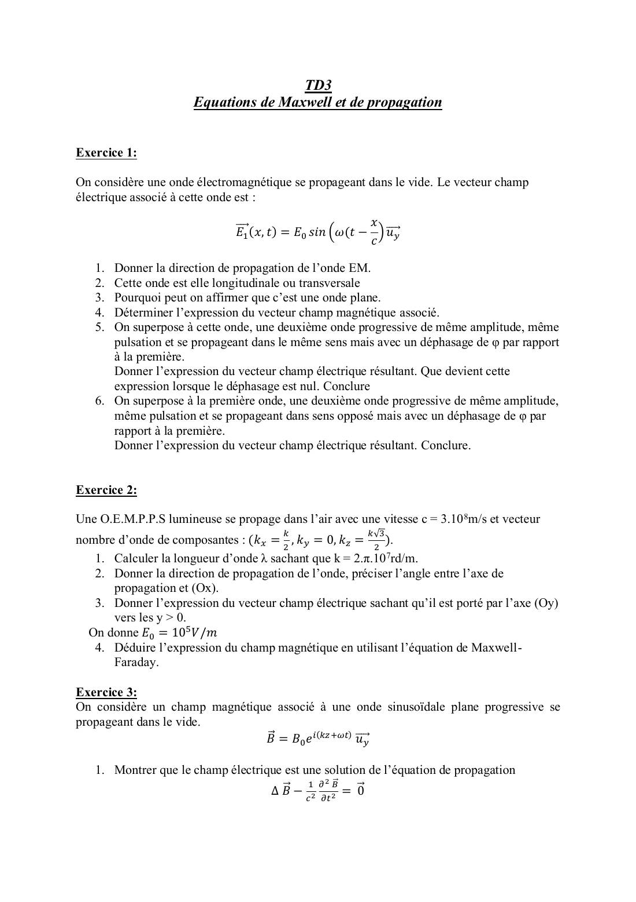
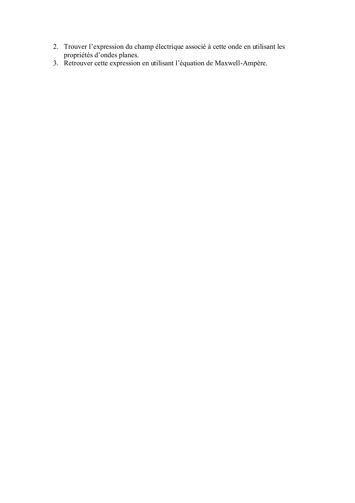

# TD 3 — Équations de Maxwell et de propagation

=== "Version simplifiée"

    Rappels : [chapitre 3](../cours/chapitre-3-ondes-vide.md). L'outil central :
    $\vec B = \dfrac{\vec u \wedge \vec E}{c}$, où $\vec u$ est la direction de propagation lue dans la phase.

    ## Exercice 1 — Onde $\vec E_1 = E_0\sin\left(\omega\left(t - \frac xc\right)\right)\vec u_y$

    ??? success "Correction"
        1. La phase contient $t - x/c$ : l'onde se propage selon $+\vec u_x$.
        2. $\vec E_1$ est selon $\vec u_y$, perpendiculaire à la propagation : l'onde est **transversale**.
        3. Le champ ne dépend que de $x$ (et $t$) : il a la même valeur sur tout plan $x = $ constante, ce sont les surfaces d'onde. L'onde est **plane**.
        4. $\vec B_1 = \dfrac{\vec u_x \wedge \vec E_1}{c} = \dfrac{E_0}{c}\sin\left(\omega\left(t - \frac xc\right)\right)\vec u_z$
           (car $\vec u_x \wedge \vec u_y = \vec u_z$).
        5. Deuxième onde, même sens, déphasée de $\varphi$ : avec $\sin p + \sin q = 2\sin\frac{p+q}2\cos\frac{p-q}2$,

            $$
            \vec E = E_0\left[\sin\left(\omega t - kx\right) + \sin\left(\omega t - kx + \varphi\right)\right]\vec u_y
            = 2E_0\cos\frac\varphi2\,\sin\left(\omega t - kx + \frac\varphi2\right)\vec u_y.
            $$

            C'est encore une **onde progressive**, d'amplitude $2E_0\cos\frac\varphi2$. Si $\varphi = 0$, l'amplitude double
            (interférence constructive) ; si $\varphi = \pi$, les ondes s'annulent.
        6. Deuxième onde en sens opposé : $E_0\sin(\omega t + kx + \varphi)$. La même formule donne

            $$
            \vec E = 2E_0\sin\left(\omega t + \frac\varphi2\right)\cos\left(kx + \frac\varphi2\right)\vec u_y.
            $$

            Le temps et l'espace sont **séparés** : c'est une **onde stationnaire**. Elle ne se propage pas, elle oscille sur place,
            avec des **nœuds** (champ toujours nul) aux points où $\cos(kx + \varphi/2) = 0$, espacés de $\lambda/2$.

    ## Exercice 2 — Onde dans une direction oblique

    $k_x = \dfrac k2$, $k_y = 0$, $k_z = \dfrac{k\sqrt3}{2}$, $k = 2\pi\cdot10^7$ rad/m, $E_0 = 10^5$ V/m.

    ??? success "Correction"
        1. $\lambda = \dfrac{2\pi}{k} = 10^{-7}$ m $= 100$ nm (ultraviolet).
        2. $\vec u = \dfrac{\vec k}{k} = \left(\frac12, 0, \frac{\sqrt3}{2}\right)$ : propagation dans le plan $(xOz)$, avec $\cos\alpha = \frac12$, donc **60°** par rapport à $(Ox)$.
        3. $\vec E \perp \vec k$ et porté par $+\vec u_y$ : ça marche, car $k_y = 0$. Avec $\omega = kc = 6\pi\cdot10^{15} \approx 1{,}88\cdot10^{16}$ rad/s :

            $$
            \vec E = 10^5\cos\left(\omega t - \frac k2 x - \frac{k\sqrt3}{2} z\right)\vec u_y \ \ \text{(V/m)}
            $$

        4. Maxwell-Faraday en notation complexe donne $\vec B = \dfrac{\vec k \wedge \vec E}{\omega}$. Avec
           $\left(\frac12, 0, \frac{\sqrt3}2\right) \wedge (0, 1, 0) = \left(-\frac{\sqrt3}{2}, 0, \frac12\right)$ :

            $$
            \vec B = \frac{E_0}{c}\left(-\frac{\sqrt3}{2}\,\vec u_x + \frac12\,\vec u_z\right)\cos\left(\omega t - \frac k2 x - \frac{k\sqrt3}{2} z\right),
            \qquad \frac{E_0}{c} \approx 3{,}3\cdot10^{-4}\ \text{T}.
            $$

    ## Exercice 3 — $\vec B = B_0\,e^{i(kz + \omega t)}\,\vec u_y$

    ??? success "Correction"
        1. (L'énoncé dit « champ électrique » mais l'équation porte sur $\vec B$.) $\Delta\vec B = -k^2\vec B$ et
           $\partial_t^2\vec B = -\omega^2\vec B$, donc $\Delta\vec B - \frac{1}{c^2}\partial_t^2\vec B = \left(-k^2 + \frac{\omega^2}{c^2}\right)\vec B = \vec 0$ dès que $k = \omega/c$. ✓
        2. La phase $kz + \omega t$ indique une propagation vers les $z$ **décroissants** : $\vec u = -\vec u_z$. Avec $\vec E = c\,\vec B \wedge \vec u$ :

            $$
            \vec E = cB_0\,e^{i(kz + \omega t)}\,\vec u_y \wedge (-\vec u_z) = -cB_0\,e^{i(kz + \omega t)}\,\vec u_x.
            $$

            Vérification : $(\vec E, \vec B, \vec u) = (-\vec u_x, \vec u_y, -\vec u_z)$ est direct, car $(-\vec u_x) \wedge \vec u_y = -\vec u_z$. ✓
        3. Maxwell-Ampère dans le vide : $\overrightarrow{\text{rot}}\,\vec B = \frac{1}{c^2}\partial_t\vec E$. Pour $\vec B = B_y(z, t)\,\vec u_y$ :
           $\overrightarrow{\text{rot}}\,\vec B = -\partial_z B_y\,\vec u_x = -ikB_y\,\vec u_x$. Donc $\frac{i\omega}{c^2}\vec E = -ikB_y\,\vec u_x$, soit
           $\vec E = -\frac{kc^2}{\omega}B_y\,\vec u_x = -cB_0\,e^{i(kz + \omega t)}\,\vec u_x$. On retrouve le même résultat. ✓

=== "Version papier"

    Énoncé du TD 3 tel qu'il est distribué.

    <!-- papier: pdf/SP401P/td3.pdf | TD 3 — énoncé | td3 | page -->

    [{ loading=lazy .papier }](papier/td3/p01.jpg)
    
Equations de Maxwell et de propagation · TD 3 — énoncé, page 1

    [{ loading=lazy .papier }](papier/td3/p02.jpg)
    
2. Trouver l’expression du champ électrique associé à cette onde en utilisant les · TD 3 — énoncé, page 2

    <!-- /papier -->
