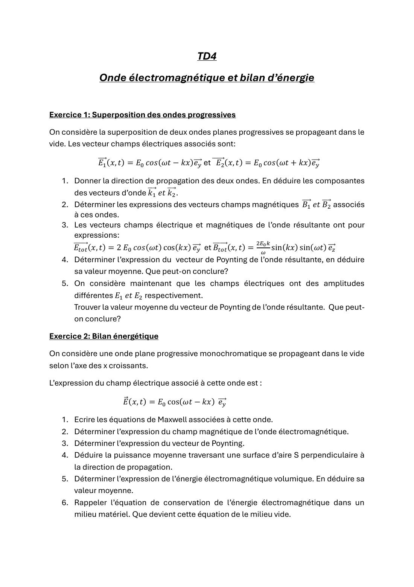
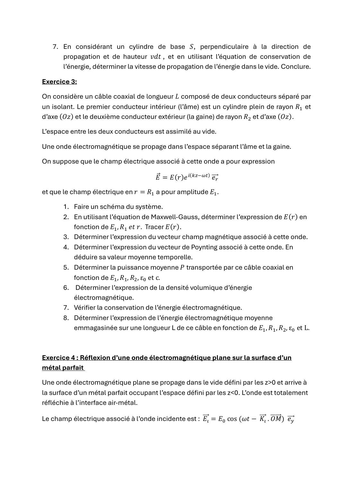
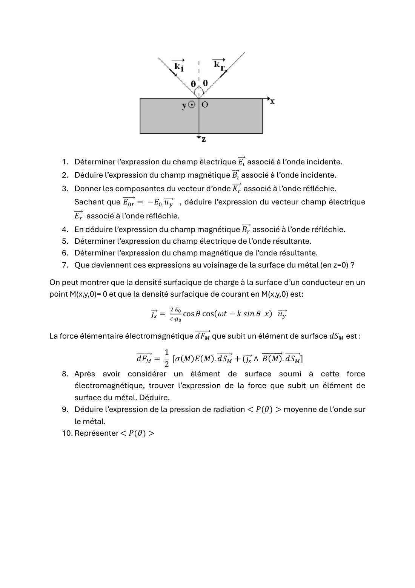

# TD 4 — Onde électromagnétique et bilan d'énergie

=== "Version simplifiée"

    Rappels : [chapitre 4](../cours/chapitre-4-energie.md). $\vec S = \dfrac{\vec E \wedge \vec B}{\mu_0}$ se calcule
    **avec les champs réels** (pas les complexes), puis on moyenne avec $\langle\cos^2\rangle = \frac12$.

    ## Exercice 1 — Superposition et onde stationnaire

    $\vec E_1 = E_0\cos(\omega t - kx)\,\vec e_y$ et $\vec E_2 = E_0\cos(\omega t + kx)\,\vec e_y$.

    ??? success "Correction"
        1. $\vec E_1$ va vers les $x$ croissants : $\vec k_1 = k\,\vec e_x$. $\vec E_2$ va vers les $x$ décroissants : $\vec k_2 = -k\,\vec e_x$.
        2. $\vec B_1 = \dfrac{\vec e_x \wedge \vec E_1}{c} = \dfrac{E_0}{c}\cos(\omega t - kx)\,\vec e_z$ et
           $\vec B_2 = \dfrac{(-\vec e_x) \wedge \vec E_2}{c} = -\dfrac{E_0}{c}\cos(\omega t + kx)\,\vec e_z$.
        3. On vérifie les champs donnés : $\cos(\omega t - kx) + \cos(\omega t + kx) = 2\cos\omega t\cos kx$ et
           $\cos(\omega t - kx) - \cos(\omega t + kx) = 2\sin\omega t\sin kx$. Avec $E_0/c = E_0k/\omega$, on retrouve
           $\vec B_{tot} = \dfrac{2E_0k}{\omega}\sin kx\sin\omega t\,\vec e_z$. ✓
        4. $\vec S = \dfrac{E_{tot}B_{tot}}{\mu_0}\,(\vec e_y \wedge \vec e_z) = \dfrac{4E_0^2}{\mu_0 c}\cos\omega t\sin\omega t\cos kx\sin kx\,\vec e_x
           = \dfrac{E_0^2}{\mu_0 c}\sin(2\omega t)\sin(2kx)\,\vec e_x$.

            $\langle\sin 2\omega t\rangle = 0$, donc $\langle\vec S\rangle = \vec 0$ : une **onde stationnaire ne transporte pas d'énergie** en moyenne.
            L'énergie fait des allers-retours entre nœuds et ventres.
        5. Avec des amplitudes $E_1$ et $E_2$ : $E = E_1\cos(\omega t - kx) + E_2\cos(\omega t + kx)$ et
           $cB = E_1\cos(\omega t - kx) - E_2\cos(\omega t + kx)$. Dans le produit $EB$, les termes croisés s'annulent, il reste

            $$
            \langle S_x\rangle = \frac{E_1^2 - E_2^2}{2\mu_0 c} = \frac{\varepsilon_0 c}{2}\left(E_1^2 - E_2^2\right).
            $$

            Le flux net est la **différence** des intensités des deux ondes : l'énergie avance dans le sens de l'onde la plus forte.

    ## Exercice 2 — Bilan d'énergie d'une OPPM

    $\vec E = E_0\cos(\omega t - kx)\,\vec e_y$ dans le vide.

    ??? success "Correction"
        1. Dans le vide : $\text{div}\,\vec E = 0$, $\text{div}\,\vec B = 0$, $\overrightarrow{\text{rot}}\,\vec E = -\partial_t\vec B$, $\overrightarrow{\text{rot}}\,\vec B = \frac{1}{c^2}\partial_t\vec E$.
        2. $\vec B = \dfrac{E_0}{c}\cos(\omega t - kx)\,\vec e_z$.
        3. $\vec S = \dfrac{E_0^2}{\mu_0 c}\cos^2(\omega t - kx)\,\vec e_x = \varepsilon_0 c\,E_0^2\cos^2(\omega t - kx)\,\vec e_x$.
        4. $\langle P\rangle = \langle S\rangle\,S = \dfrac{\varepsilon_0 c\,E_0^2}{2}\,S$.
        5. $u = \dfrac{\varepsilon_0E^2}{2} + \dfrac{B^2}{2\mu_0} = \varepsilon_0E_0^2\cos^2(\omega t - kx)$, donc $\langle u\rangle = \dfrac{\varepsilon_0E_0^2}{2}$.
        6. Milieu matériel : $\text{div}\,\vec S + \dfrac{\partial u}{\partial t} = -\vec j \cdot \vec E$. Dans le vide : $\text{div}\,\vec S + \dfrac{\partial u}{\partial t} = 0$.
        7. Pendant $dt$, l'énergie qui traverse la base $S$ est $\langle S\rangle\,S\,dt$. Elle remplit le cylindre de volume $S\,v\,dt$,
           qui contient $\langle u\rangle\,S\,v\,dt$. En égalant : $v = \dfrac{\langle S\rangle}{\langle u\rangle} = \dfrac{\varepsilon_0cE_0^2/2}{\varepsilon_0E_0^2/2} = c$.
           **L'énergie se propage à la vitesse de l'onde.**

    ## Exercice 3 — Câble coaxial

    Âme de rayon $R_1$, gaine de rayon $R_2$, vide entre les deux. $\vec E = E(r)\,e^{i(kz - \omega t)}\,\vec e_r$, avec $E(R_1) = E_1$.

    ??? success "Correction"
        1. Schéma : deux cylindres coaxiaux d'axe $Oz$ ; le champ $\vec E$ est radial entre eux et l'onde avance selon $Oz$.
        2. Entre les conducteurs, $\rho = 0$, donc $\text{div}\,\vec E = \dfrac1r\dfrac{d(rE)}{dr} = 0$. Ainsi $rE = $ constante $= R_1E_1$ :

            $$
            E(r) = \frac{E_1R_1}{r} \qquad (R_1 \le r \le R_2),
            $$

            qui décroît en $1/r$ de $E_1$ à $E_1R_1/R_2$.
        3. Maxwell-Faraday : $\overrightarrow{\text{rot}}\,\vec E = \partial_z E_r\,\vec e_\theta = ikE_r\,\vec e_\theta = -\partial_t\vec B = i\omega\vec B$. Donc

            $$
            \vec B = \frac{E_1R_1}{c\,r}\,e^{i(kz - \omega t)}\,\vec e_\theta.
            $$

        4. Avec les champs réels (cosinus) : $\vec S = \dfrac{\vec E \wedge \vec B}{\mu_0} = \dfrac{E_1^2R_1^2}{\mu_0 c\,r^2}\cos^2(kz - \omega t)\,\vec e_z$, et
           $\langle\vec S\rangle = \dfrac{\varepsilon_0 c\,E_1^2R_1^2}{2r^2}\,\vec e_z$.
        5. On intègre sur la couronne $R_1 < r < R_2$ :

            $$
            P = \int_{R_1}^{R_2}\frac{\varepsilon_0cE_1^2R_1^2}{2r^2}\,2\pi r\,dr = \pi\varepsilon_0 c\,E_1^2R_1^2\ln\frac{R_2}{R_1}.
            $$

        6. $u = \dfrac{\varepsilon_0E^2}{2} + \dfrac{B^2}{2\mu_0} = \varepsilon_0E^2 = \dfrac{\varepsilon_0E_1^2R_1^2}{r^2}\cos^2(kz - \omega t)$.
        7. On pose $A = E_1^2R_1^2/r^2$ et $\phi = kz - \omega t$.
           $\text{div}\,\vec S = \partial_zS_z = -\dfrac{2kA}{\mu_0c}\cos\phi\sin\phi$ et $\partial_tu = +2\omega\varepsilon_0A\cos\phi\sin\phi$.
           La somme vaut $2A\cos\phi\sin\phi\,\varepsilon_0(\omega - kc) = 0$, car $\dfrac{1}{\mu_0c} = \varepsilon_0c$ et $\omega = kc$. ✓
        8. $\langle W\rangle = \displaystyle\int_{R_1}^{R_2}\frac{\varepsilon_0E_1^2R_1^2}{2r^2}\,2\pi r\,L\,dr = \pi\varepsilon_0E_1^2R_1^2\,L\ln\frac{R_2}{R_1}$.
           Remarque : $P = \dfrac{\langle W\rangle}{L}\,c$, l'énergie avance encore à la vitesse $c$.

    ## Exercice 4 — Réflexion sur un métal parfait

    !!! piege "Orientation de l'axe $z$"
        Le texte place le vide en $z > 0$, mais la **figure** oriente $z$ vers le bas, donc vers le métal. La formule de
        $\vec j_s$ donnée par l'énoncé correspond à la figure. On suit donc la figure : vide pour $z < 0$, métal pour $z > 0$,
        incidence $\theta$ par rapport à la normale.

    ??? success "Correction"
        On note $\phi_i = \omega t - kx\sin\theta - kz\cos\theta$ et $\phi_r = \omega t - kx\sin\theta + kz\cos\theta$.

        1. $\vec K_i = k(\sin\theta, 0, \cos\theta)$, donc $\vec E_i = E_0\cos\phi_i\,\vec e_y$.
        2. $\vec B_i = \dfrac{\vec K_i \wedge \vec E_i}{\omega} = \dfrac{E_0}{c}\cos\phi_i\,(-\cos\theta\,\vec e_x + \sin\theta\,\vec e_z)$.
        3. Réflexion : $\vec K_r = k(\sin\theta, 0, -\cos\theta)$ et $\vec E_r = -E_0\cos\phi_r\,\vec e_y$.
        4. $\vec B_r = \dfrac{\vec K_r \wedge \vec E_r}{\omega} = -\dfrac{E_0}{c}\cos\phi_r\,(\cos\theta\,\vec e_x + \sin\theta\,\vec e_z)$.
        5. $\vec E = \vec E_i + \vec E_r = 2E_0\sin(\omega t - kx\sin\theta)\sin(kz\cos\theta)\,\vec e_y$.
        6. $\vec B = -\dfrac{2E_0}{c}\cos\theta\cos(\omega t - kx\sin\theta)\cos(kz\cos\theta)\,\vec e_x + \dfrac{2E_0}{c}\sin\theta\sin(\omega t - kx\sin\theta)\sin(kz\cos\theta)\,\vec e_z$.

            L'onde est **progressive selon $x$** (le long du métal) et **stationnaire selon $z$**.
        7. En $z = 0$ : $\vec E = \vec 0$ (le champ électrique tangent est nul à la surface d'un conducteur parfait) et
           $\vec B = -\dfrac{2E_0}{c}\cos\theta\cos(\omega t - kx\sin\theta)\,\vec e_x$ : $\vec B$ est tangent à la surface.
           Cela redonne bien le $\vec j_s$ de l'énoncé.
        8. $\sigma = 0$, donc seul le terme magnétique reste :

            $$
            d\vec F = \frac12\,\vec j_s \wedge \vec B\,dS
            = \frac12 \cdot \frac{2E_0\cos\theta}{\mu_0c}\cos(\cdot) \cdot \left(-\frac{2E_0\cos\theta}{c}\cos(\cdot)\right)(\vec e_y \wedge \vec e_x)\,dS
            = 2\varepsilon_0E_0^2\cos^2\theta\cos^2(\omega t - kx\sin\theta)\,\vec e_z\,dS.
            $$

            La force est selon $+\vec e_z$, donc **vers l'intérieur du métal** : l'onde pousse la surface.
        9. $\langle P(\theta)\rangle = \dfrac{\langle dF\rangle}{dS} = \varepsilon_0E_0^2\cos^2\theta$.
        10. $\langle P\rangle$ vaut $\varepsilon_0E_0^2$ en incidence normale ($\theta = 0$), décroît en $\cos^2\theta$ et s'annule en incidence rasante ($\theta = 90°$).
            Contrôle : en incidence normale, $I = \varepsilon_0cE_0^2/2$ et un miroir subit $2I/c = \varepsilon_0E_0^2$. ✓

=== "Version papier"

    Énoncé du TD 4 tel qu'il est distribué.

    <!-- papier: pdf/SP401P/td4.pdf | TD 4 — énoncé | td4 | page -->

    [{ loading=lazy .papier }](papier/td4/p01.jpg)
    
Onde électromagnétique et bilan d’énergie · TD 4 — énoncé, page 1

    [{ loading=lazy .papier }](papier/td4/p02.jpg)
    
l’énergie, déterminer la vitesse de propagation de l’énergie dans le vide. Conclure. · TD 4 — énoncé, page 2

    [{ loading=lazy .papier }](papier/td4/p03.jpg)
    
1. Déterminer l’expression du champ électrique ⃗⃗⃗ · TD 4 — énoncé, page 3

    <!-- /papier -->
