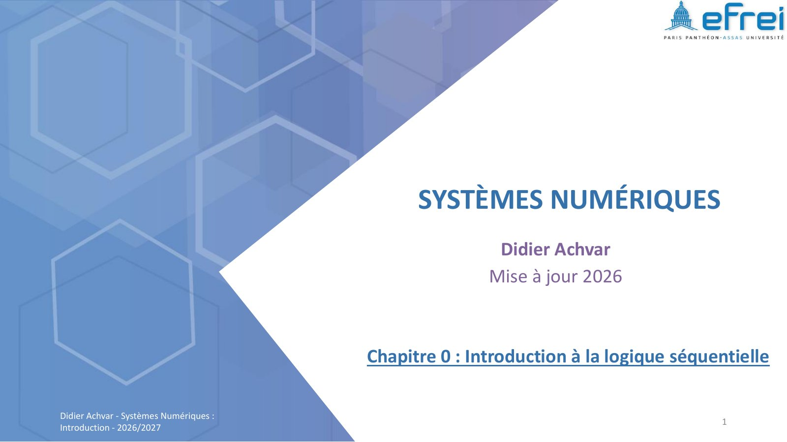
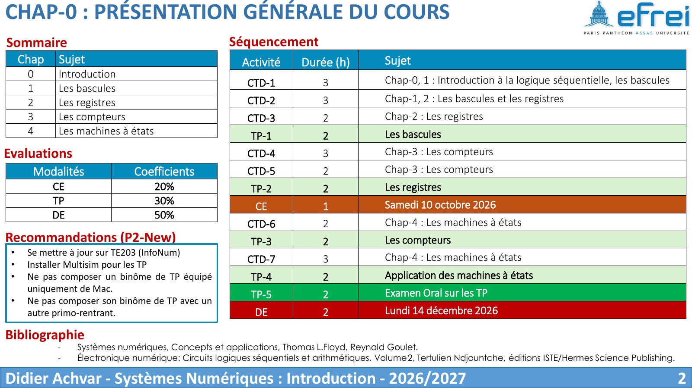
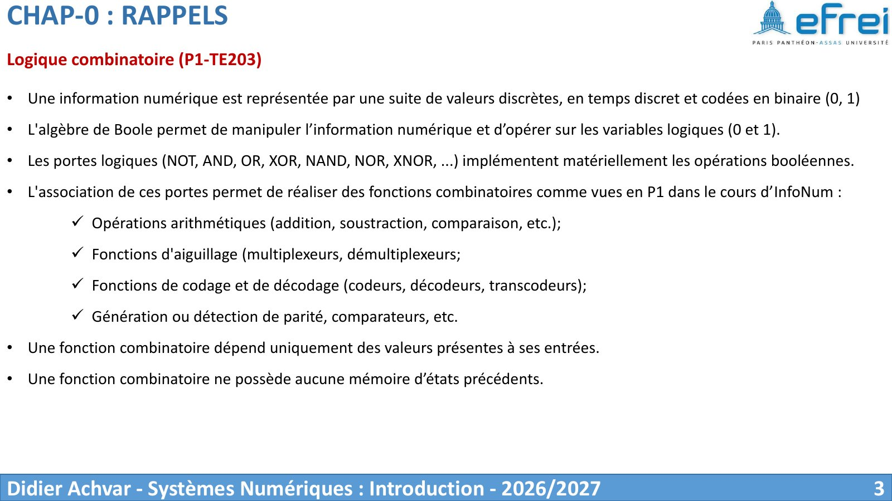
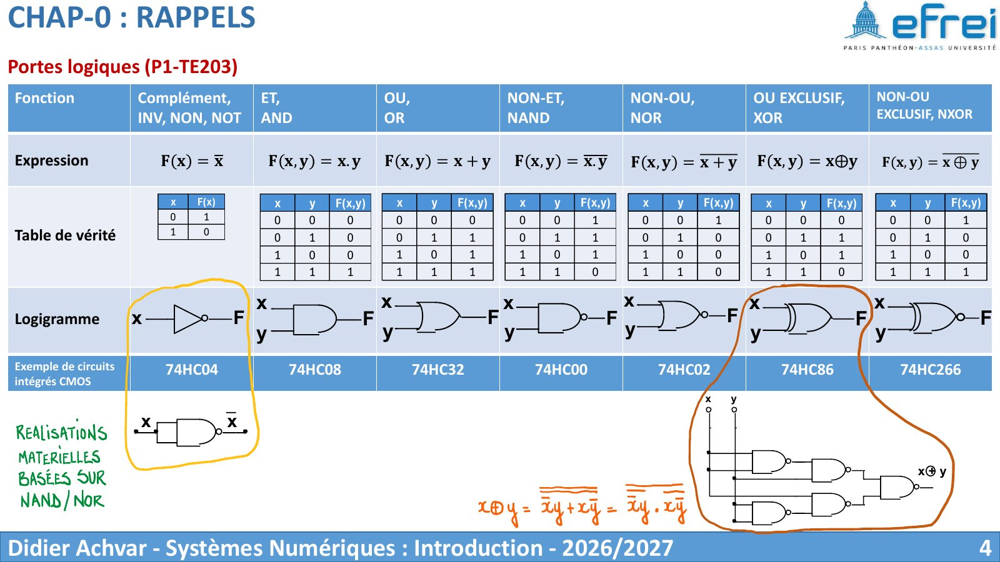
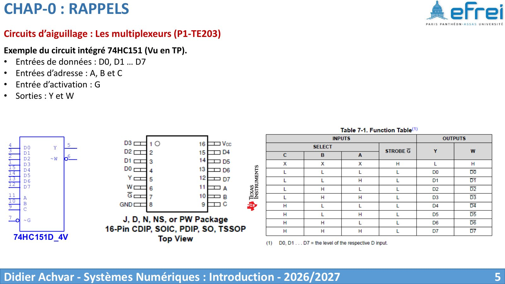
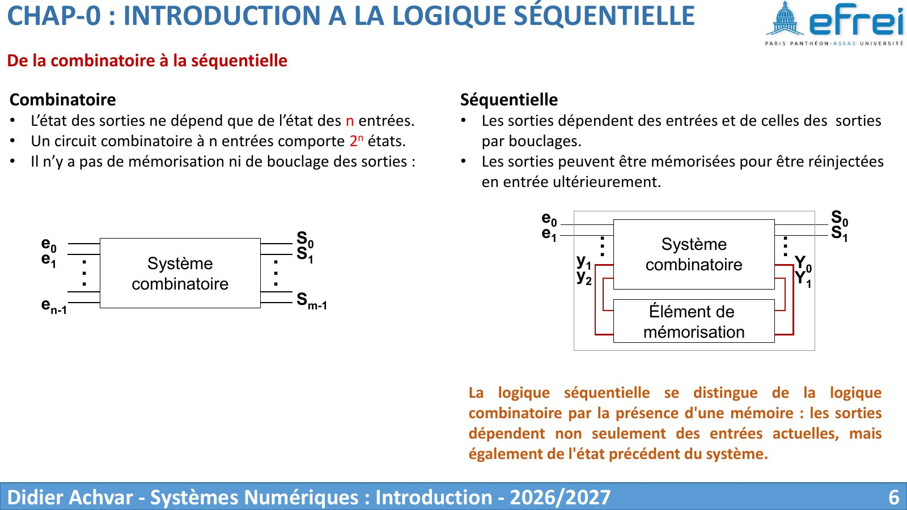

# Chapitre 0 — De la logique combinatoire à la logique séquentielle

=== "Version simplifiée"

    ## Organisation du module (2026-2027)

    | Évaluation | Coefficient | Date |
    |------------|:-----------:|------|
    | CE (contrôle écrit) | 20 % | samedi 10 octobre 2026 |
    | TP (comptes rendus + oral) | 30 % | TP 1 à 5 |
    | DE (examen final) | 50 % | lundi 14 décembre 2026 |

    Ordre des chapitres : 0 Introduction → 1 Bascules → 2 Registres → 3 Compteurs →
    4 Machines à états. Les exercices de TD sont dans les diapos de chaque chapitre.

    ## Rappels de logique combinatoire

    L'information numérique est une suite de valeurs binaires. L'algèbre de Boole
    permet de la traiter, et des portes logiques réalisent ces traitements
    (opérations arithmétiques, multiplexage, codage/décodage…).

    | Porte | Expression | Sortie à 1 quand… |
    |-------|------------|-------------------|
    | NON (INV) | $\overline{x}$ | $x = 0$ |
    | ET (AND) | $x \cdot y$ | les deux entrées valent 1 |
    | OU (OR) | $x + y$ | au moins une entrée vaut 1 |
    | NON-ET (NAND) | $\overline{x \cdot y}$ | au moins une entrée vaut 0 |
    | NON-OU (NOR) | $\overline{x + y}$ | les deux entrées valent 0 |
    | OU exclusif (XOR) | $x \oplus y$ | les entrées sont différentes |
    | NON-OU exclusif (XNOR) | $\overline{x \oplus y}$ | les entrées sont égales |

    !!! theoreme "NAND et NOR sont universelles"
        Toute fonction logique peut être réalisée **uniquement avec des NAND** (ou
        uniquement avec des NOR). Par exemple, avec des NAND :

        - $\overline{x} = \overline{x \cdot x}$
        - $x \cdot y = \overline{\overline{x \cdot y}}$
        - $x + y = \overline{\overline{x} \cdot \overline{y}}$ (De Morgan)

    ## Les multiplexeurs (rappel de P1)

    Un multiplexeur est un **circuit d'aiguillage** : il recopie sur sa sortie
    l'entrée de donnée dont le numéro est donné par les entrées d'adresse.

    !!! example "Le 74HC151 (vu en TP)"
        - 8 entrées de données $D_0 \dots D_7$ ;
        - 3 entrées d'adresse $C\,B\,A$ : la sortie recopie $D_k$ avec $k = (CBA)_2$ ;
        - une entrée d'activation $\overline{G}$, active au niveau bas ;
        - deux sorties : $Y$ et son complément $\overline{W}$.

    ## Combinatoire vs séquentiel

    !!! definition "Circuit combinatoire"
        Les sorties ne dépendent **que des entrées à l'instant présent**. Pas de
        bouclage, pas de mémoire. Avec $n$ entrées, il y a $2^n$ combinaisons
        d'entrée possibles.

    !!! definition "Circuit séquentiel"
        Les sorties dépendent des entrées **et de l'état précédent**, grâce à des
        sorties **rebouclées** sur les entrées. Le circuit peut donc **mémoriser**
        une information pour l'utiliser plus tard.

    ```mermaid
    flowchart LR
        E[Entrées e0 … en-1] --> C[Bloc combinatoire]
        C --> S[Sorties S0 … Sm-1]
        C -- "Y (état futur)" --> M[Mémoire<br/>retard Δt]
        M -- "y (état présent)" --> C
    ```

    Structure générale d'un circuit séquentiel : un bloc combinatoire calcule les
    sorties et l'état futur $Y$ ; un élément de mémorisation le renvoie en entrée
    avec un retard $\Delta t$, soit $y(t + \Delta t) = Y(t)$.

    L'élément de mémorisation de base, c'est la **bascule** → [chapitre 1](chapitre-1-bascules.md).

=== "Version papier"

    Le chapitre 0 n'a plus de support à part en 2026-2027 : ce sont les premières diapos du support du chapitre 1 (D. Achvar). Il ne contient pas d'exercice.

    [{ loading=lazy .papier }](papier/ch0/p01.jpg)
    <p class="papier-legende">Page de titre · Chapitre 0 — support 2026-2027, diapo 1</p>

    [{ loading=lazy .papier }](papier/ch0/p02.jpg)
    <p class="papier-legende">Séquencement, évaluations et bibliographie · Chapitre 0 — support 2026-2027, diapo 2</p>

    [{ loading=lazy .papier }](papier/ch0/p03.jpg)
    <p class="papier-legende">Rappels de logique combinatoire · Chapitre 0 — support 2026-2027, diapo 3</p>

    [{ loading=lazy .papier }](papier/ch0/p04.jpg)
    <p class="papier-legende">Portes logiques · Chapitre 0 — support 2026-2027, diapo 4</p>

    [{ loading=lazy .papier }](papier/ch0/p05.jpg)
    <p class="papier-legende">Multiplexeurs : exemple du 74HC151 · Chapitre 0 — support 2026-2027, diapo 5</p>

    [{ loading=lazy .papier }](papier/ch0/p06.jpg)
    <p class="papier-legende">De la combinatoire à la séquentielle · Chapitre 0 — support 2026-2027, diapo 6</p>
