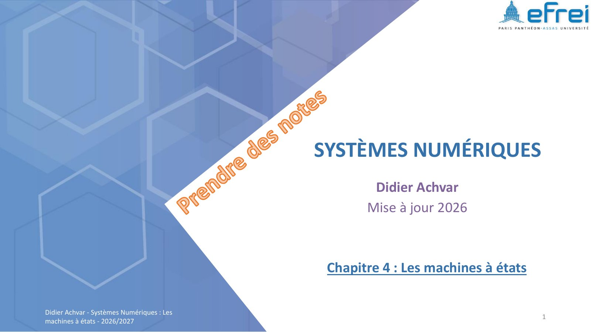
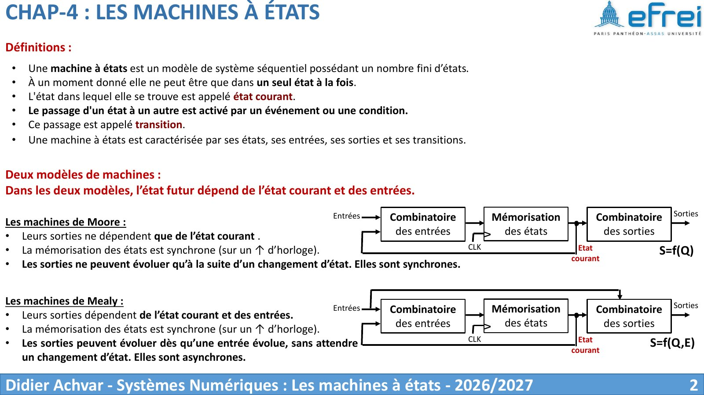
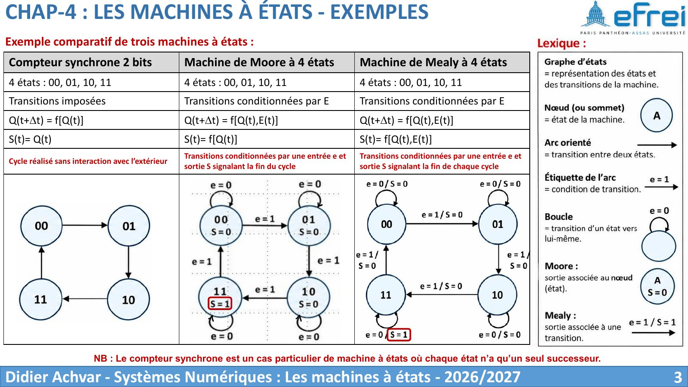
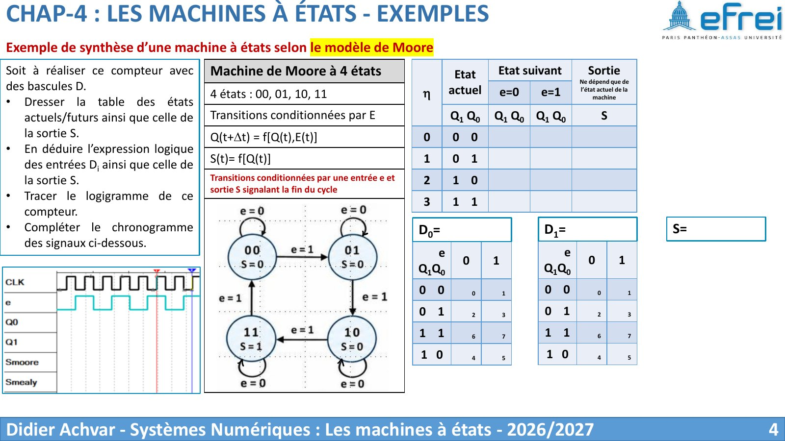
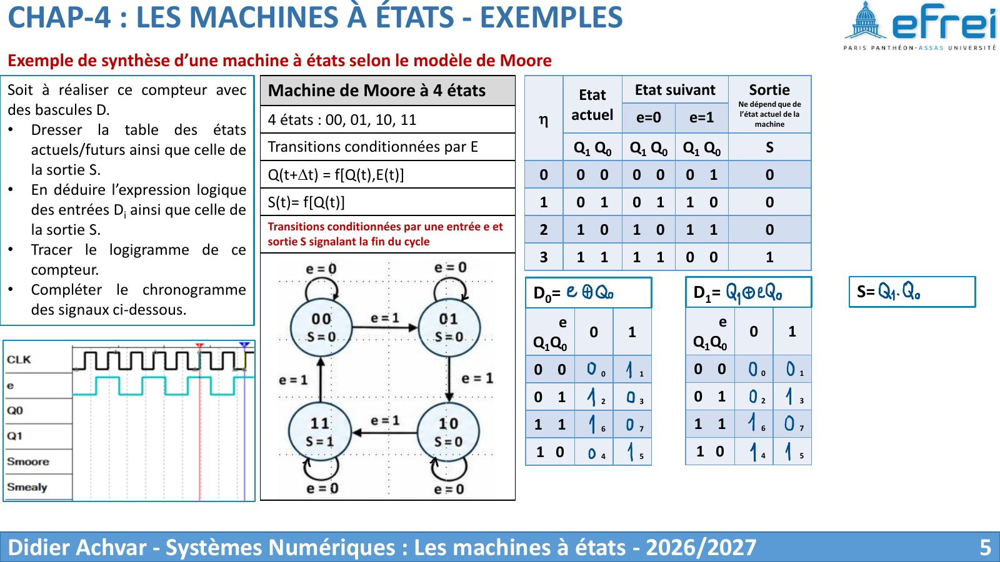
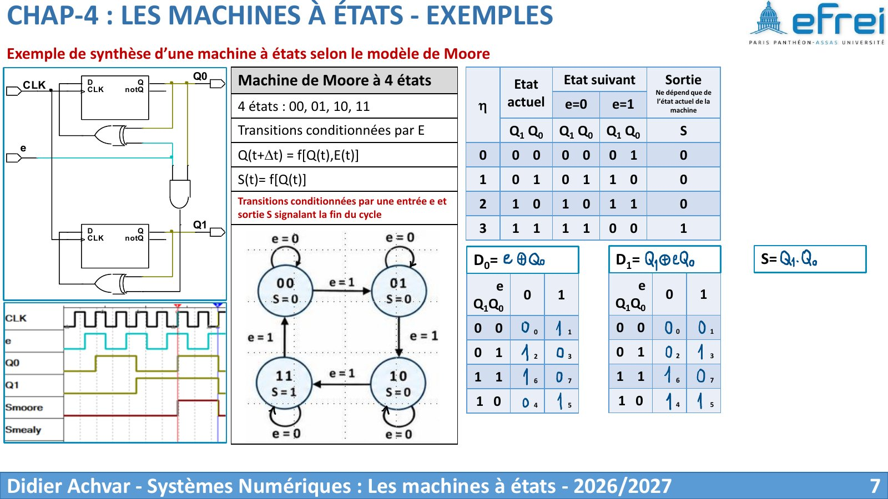
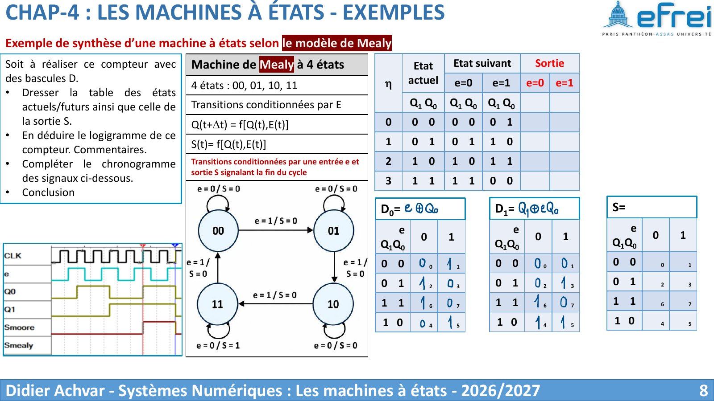
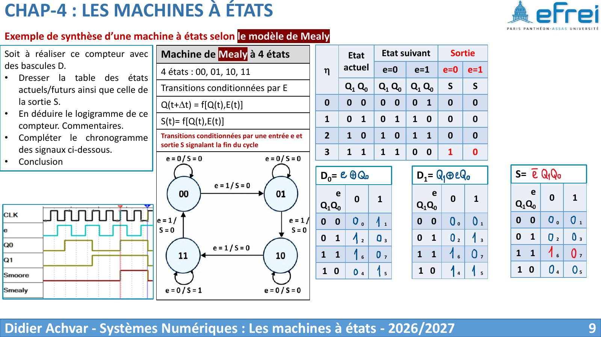
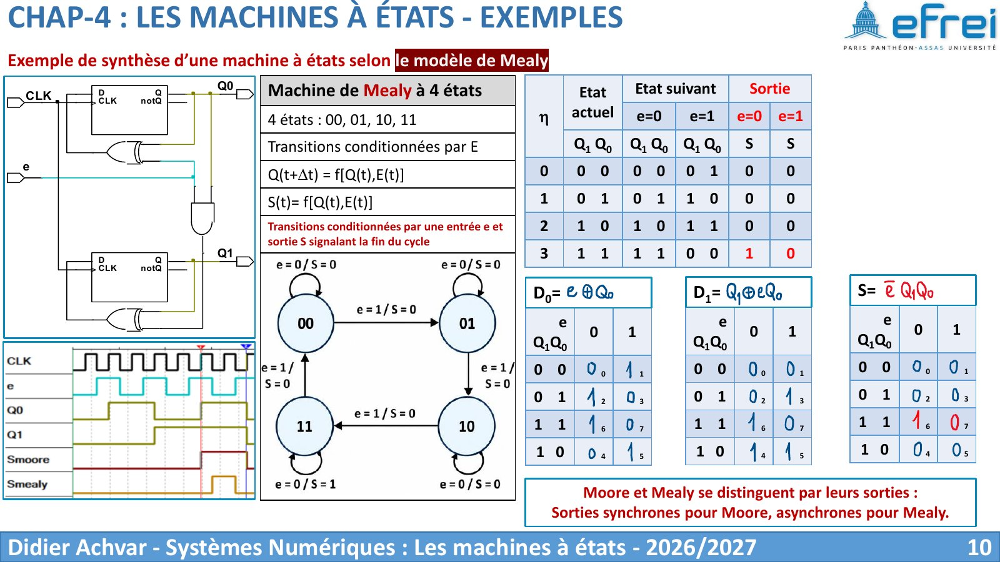

# Chapitre 4 — Les machines à états

=== "Version simplifiée"

    !!! definition "Machine à états finie (automate)"
        Modèle de séquencement qui possède un **nombre fini d'états**. À chaque
        instant, elle est dans un seul état, l'**état courant**. Le passage d'un état
        à un autre, la **transition**, est déclenché par une condition sur les
        entrées. Un automate est défini par ses états et ses transitions.

    ```mermaid
    flowchart LR
        E[Entrées] --> F[Combinatoire<br/>état futur]
        F --> M[Mémoire des états<br/>bascules]
        M -- état courant --> F
        M --> G[Combinatoire<br/>des sorties]
        E -. Mealy uniquement .-> G
        G --> S[Sorties]
    ```

    ## Moore ou Mealy ?

    | | **Moore** | **Mealy** |
    |-|-----------|-----------|
    | Les sorties dépendent de… | l'état courant **seulement** | l'état courant **et les entrées** |
    | Sorties | synchrones (changent au front d'horloge) | asynchrones (réagissent tout de suite à une entrée) |
    | Sur le graphe | la sortie est écrite **dans l'état** : `E3 / 1` | la sortie est écrite **sur la transition** : `x = 0 / 1` |
    | Nombre d'états | souvent un de plus | souvent moins d'états |

    !!! methode "Conception d'une machine de Moore"
        1. Élaborer le **diagramme des états** (avec les sorties dans chaque état).
        2. **Coder les états** sur $N$ bascules ($2^N \geq$ nombre d'états).
        3. Dresser la table **état présent → état futur** pour chaque valeur des entrées.
        4. Utiliser la **table de transitions** de la bascule (pour des D : $D_i = Q_i(t+1)$).
        5. Calculer et simplifier les **entrées des bascules** (Karnaugh ; états inutilisés = X).
        6. Calculer et simplifier les **sorties** en fonction de l'état.
        7. Tracer le **logigramme**.

    ## Compteur, Moore ou Mealy : l'exemple comparatif du cours

    | | Compteur synchrone 2 bits | Machine de Moore à 4 états | Machine de Mealy à 4 états |
    |-|-|-|-|
    | Transitions | imposées | conditionnées par l'entrée $e$ | conditionnées par l'entrée $e$ |
    | État futur | $Q(t + \Delta t) = f[Q(t)]$ | $f[Q(t), e(t)]$ | $f[Q(t), e(t)]$ |
    | Sortie | $S(t) = Q(t)$ | $S(t) = f[Q(t)]$ | $S(t) = f[Q(t), e(t)]$ |

    Le compteur synchrone est un cas particulier de machine à états : chaque état
    n'a qu'un seul successeur.

    ## Exemple : compteur 2 bits commandé par $e$

    4 états 00 → 01 → 10 → 11 → 00. $e = 1$ → on avance, $e = 0$ → on reste.
    La sortie $S$ signale la fin du cycle. Bascules D.

    | État $Q_1Q_0$ | Futur si $e = 0$ | Futur si $e = 1$ | $S$ Moore | $S$ Mealy ($e = 0$ / $e = 1$) |
    |:-:|:-:|:-:|:-:|:-:|
    | 00 | 00 | 01 | 0 | 0 / 0 |
    | 01 | 01 | 10 | 0 | 0 / 0 |
    | 10 | 10 | 11 | 0 | 0 / 0 |
    | 11 | 11 | 00 | **1** | **1** / 0 |

    Les entrées des bascules sont les mêmes pour les deux modèles :

    $$
    D_0 = e \oplus Q_0, \qquad D_1 = Q_1 \oplus e\,Q_0
    $$

    Seule la sortie change :

    $$
    S_{Moore} = Q_1 Q_0, \qquad S_{Mealy} = \overline{e}\,Q_1 Q_0
    $$

    !!! piege "Ce qui distingue Moore et Mealy"
        Les sorties : **synchrones pour Moore** (elles ne bougent qu'au front
        d'horloge, après un changement d'état), **asynchrones pour Mealy** (elles
        réagissent dès que l'entrée change).

    !!! methode "Lire une équation d'entrée D"
        $D_0 = e \oplus Q_0$ : si $e = 0$, $Q_0$ est recopié (maintien) ; si $e = 1$,
        $Q_0$ s'inverse (on compte). $D_1 = Q_1 \oplus e\,Q_0$ : $Q_1$ ne s'inverse
        que si on avance **et** que $Q_0 = 1$, comme dans un compteur binaire.

    Exemples complets (5 LEDs, détecteur de séquence en Moore **et** en Mealy) :
    [TD 4](../td/td-4-machines-etats.md).

=== "Version papier"

    Les diapos de cours du chapitre 4 (support 2026-2027 de D. Achvar). Les diapos d'exercices de ce support sont dans la [version papier du TD 4](../td/td-4-machines-etats.md).

    [{ loading=lazy .papier }](papier/ch4/p01.jpg)
    <p class="papier-legende">Page de titre · Chapitre 4 — support 2026-2027, diapo 1</p>

    [{ loading=lazy .papier }](papier/ch4/p02.jpg)
    <p class="papier-legende">Définitions : Moore et Mealy · Chapitre 4 — support 2026-2027, diapo 2</p>

    [{ loading=lazy .papier }](papier/ch4/p03.jpg)
    <p class="papier-legende">Exemple comparatif de trois machines à états · Chapitre 4 — support 2026-2027, diapo 3</p>

    [{ loading=lazy .papier }](papier/ch4/p04.jpg)
    <p class="papier-legende">Synthèse en Moore : énoncé · Chapitre 4 — support 2026-2027, diapo 4</p>

    [{ loading=lazy .papier }](papier/ch4/p05.jpg)
    <p class="papier-legende">Synthèse en Moore : tables et équations · Chapitre 4 — support 2026-2027, diapo 5</p>

    [{ loading=lazy .papier }](papier/ch4/p06.jpg)
    <p class="papier-legende">Synthèse en Moore : logigramme · Chapitre 4 — support 2026-2027, diapo 6</p>

    [{ loading=lazy .papier }](papier/ch4/p07.jpg)
    <p class="papier-legende">Synthèse en Moore : chronogramme · Chapitre 4 — support 2026-2027, diapo 7</p>

    [{ loading=lazy .papier }](papier/ch4/p08.jpg)
    <p class="papier-legende">Synthèse en Mealy : énoncé · Chapitre 4 — support 2026-2027, diapo 8</p>

    [{ loading=lazy .papier }](papier/ch4/p09.jpg)
    <p class="papier-legende">Synthèse en Mealy : équations et chronogramme · Chapitre 4 — support 2026-2027, diapo 9</p>

    [{ loading=lazy .papier }](papier/ch4/p10.jpg)
    <p class="papier-legende">Synthèse en Mealy : logigramme et conclusion · Chapitre 4 — support 2026-2027, diapo 10</p>
