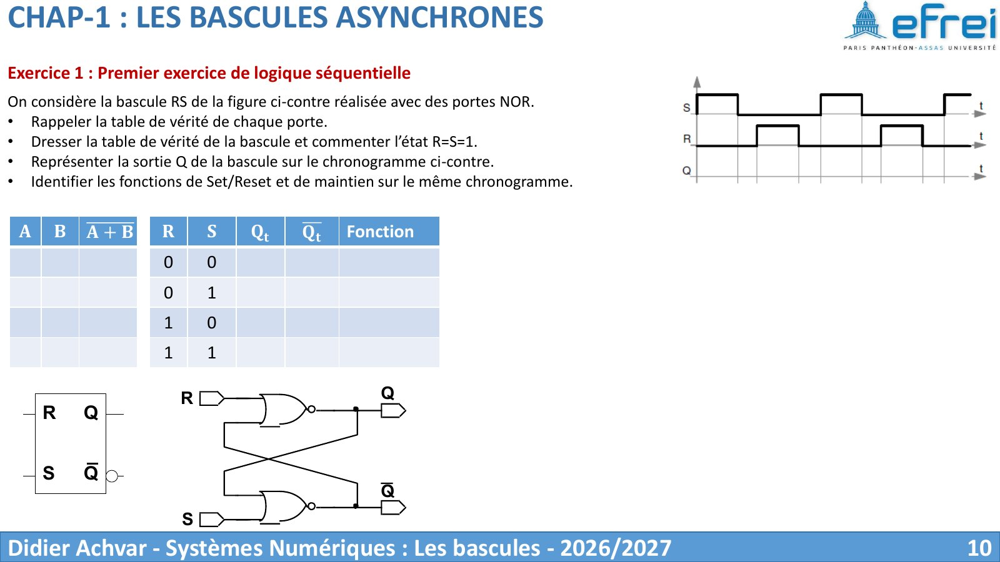
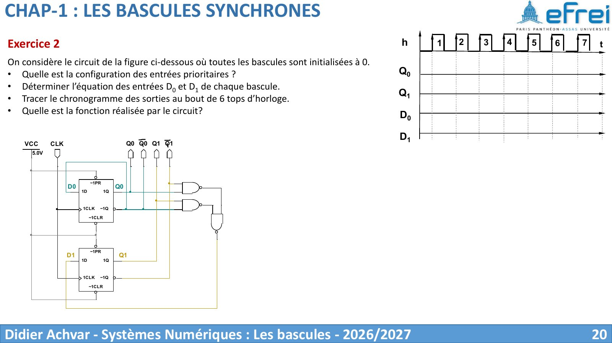
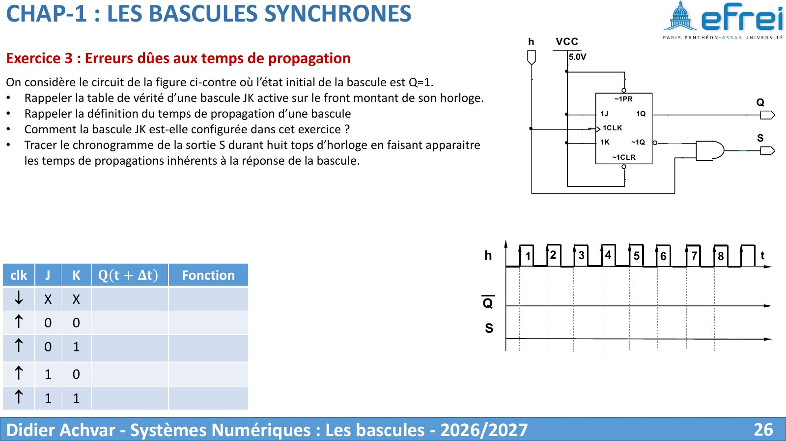
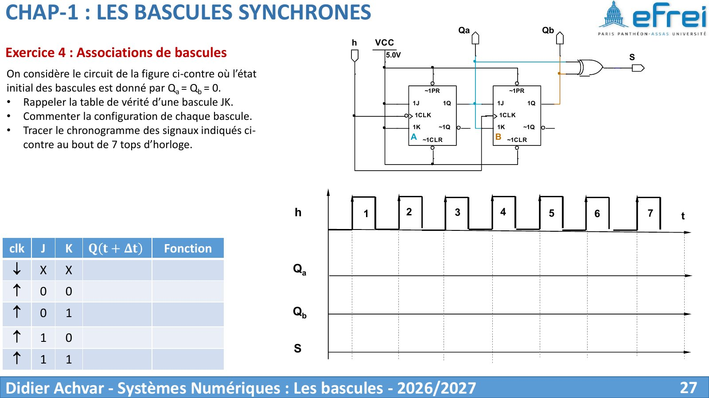
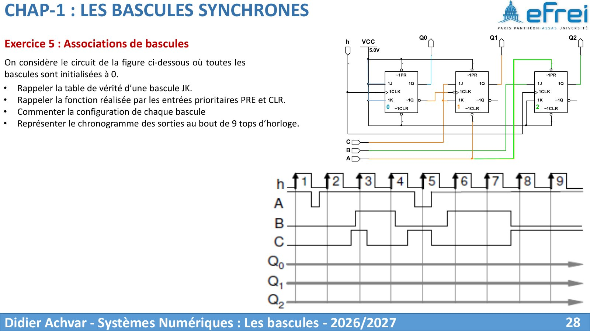

# TD 1 — Les bascules

=== "Version simplifiée"

    Énoncés, schémas et chronogrammes à compléter : onglet **Version papier**
    (exercices 1 à 5 du support 2026-2027). Rappels : [chapitre 1](../cours/chapitre-1-bascules.md).

    ## Exercice 1 — Bascule RS à portes NOR

    **Table de la NOR** : la sortie vaut 1 seulement si les deux entrées valent 0.

    | $A$ | $B$ | $\overline{A + B}$ |
    |:---:|:---:|:---:|
    | 0 | 0 | 1 |
    | 0 | 1 | 0 |
    | 1 | 0 | 0 |
    | 1 | 1 | 0 |

    **Table de la bascule** (chaque NOR reçoit une entrée et la sortie de l'autre porte) :

    | $R$ | $S$ | $Q_t$ | $\overline{Q}_t$ | Fonction |
    |:---:|:---:|:---:|:---:|----------|
    | 0 | 0 | $Q_{t-1}$ | $\overline{Q}_{t-1}$ | Maintien |
    | 0 | 1 | 1 | 0 | Set |
    | 1 | 0 | 0 | 1 | Reset |
    | 1 | 1 | 0 | 0 | Non utilisé |

    **Commentaire sur $R = S = 1$** : $Q = \overline{Q} = 0$, les sorties ne sont plus
    complémentaires. Et si $R$ et $S$ repassent à 0 en même temps, l'état final
    dépend de la porte la plus rapide : il est imprévisible.

    **Chronogramme** : la RS est **asynchrone**. On lit $R$ et $S$ à chaque instant (pas
    de front à attendre) et on annote S, R ou M sur chaque intervalle.

    ## Exercice 2 — Deux bascules D et des NAND

    **Entrées prioritaires** : $\overline{PRE}$ et $\overline{CLR}$ des deux bascules
    sont reliées à $V_{CC}$, donc **inactives** (aucun forçage).

    **Équations** (lues sur le schéma) :

    - $D_0 = \overline{Q_0}$ : la bascule 0 est rebouclée sur elle-même (diviseur par 2) ;
    - les trois NAND donnent $D_1 = \overline{\overline{Q_0\,\overline{Q_1}}\cdot\overline{\overline{Q_0}\,Q_1}} = Q_0\overline{Q_1} + \overline{Q_0}\,Q_1$, soit $D_1 = Q_0 \oplus Q_1$.

    **Tableau d'états** (les deux bascules reçoivent la même horloge, front montant) :

    | Après le top | $Q_1$ | $Q_0$ | $D_1 = Q_0 \oplus Q_1$ | $D_0 = \overline{Q_0}$ |
    |:-:|:-:|:-:|:-:|:-:|
    | CI | 0 | 0 | 0 | 1 |
    | 1 | 0 | 1 | 1 | 0 |
    | 2 | 1 | 0 | 1 | 1 |
    | 3 | 1 | 1 | 0 | 0 |
    | 4 | 0 | 0 | 0 | 1 |
    | 5 | 0 | 1 | 1 | 0 |
    | 6 | 1 | 0 | 1 | 1 |

    **Fonction** : $Q_1Q_0$ prend les valeurs 0, 1, 2, 3, 0… C'est un **compteur
    synchrone modulo 4**. Sur le chronogramme, $D_0$ et $D_1$ changent juste après
    chaque front (avec $Q_0$ et $Q_1$), et c'est leur valeur juste **avant** le front
    suivant qui est copiée.

    ## Exercice 3 — Erreurs dues aux temps de propagation

    **Table de la JK sur front montant** :

    | $clk$ | $J$ | $K$ | $Q(t + \Delta t)$ | Fonction |
    |:-:|:-:|:-:|:-:|---|
    | ↓ | X | X | $Q(t)$ | Mémoire |
    | ↑ | 0 | 0 | $Q(t)$ | Mémoire |
    | ↑ | 0 | 1 | 0 | Reset |
    | ↑ | 1 | 0 | 1 | Set |
    | ↑ | 1 | 1 | $\overline{Q(t)}$ | Toggle |

    **Temps de propagation $t_p$** : durée minimale entre le front actif de l'horloge et
    la réaction de la sortie.

    **Configuration** : $J = K = 1$ (reliées à $V_{CC}$), $\overline{PRE} = \overline{CLR} = 1$
    → la bascule est en mode **toggle** : $Q$ s'inverse à chaque front montant, c'est un
    diviseur de fréquence par 2. La sortie vaut $S = h \cdot \overline{Q}$.

    **Chronogramme** (CI : $Q = 1$, donc $\overline{Q} = 0$) :

    - fronts **impairs** (1, 3, 5, 7) : $\overline{Q}$ passe à 1, mais seulement $t_p$
      après le front. $S$ monte donc à $t_p$ après le front et redescend quand $h$
      retombe : l'impulsion est **raccourcie de $t_p$** ;
    - fronts **pairs** (2, 4, 6, 8) : $h$ monte alors que $\overline{Q}$ vaut encore 1
      pendant $t_p$. $S$ présente une **impulsion parasite** (glitch) de durée $t_p$.

    !!! piege "La conclusion attendue"
        Sans temps de propagation, $S$ ne serait à 1 qu'une demi-période sur deux.
        Le retard de la bascule crée des impulsions parasites : on ne combine pas
        directement l'horloge avec une sortie de bascule qu'elle commande.

    ## Exercice 4 — Association de deux JK

    **Configuration** (CI : $Q_a = Q_b = 0$, entrées prioritaires inactives) :

    - **A** : $J_a = K_a = 1$, horloge $h$ sur **front descendant** → toggle à chaque
      front descendant de $h$, diviseur par 2 ;
    - **B** : $J_b = K_b = Q_a$, horloge $h$ sur **front montant** → toggle si $Q_a = 1$,
      mémoire si $Q_a = 0$ ;
    - $S = Q_a \oplus Q_b$.

    | Instant | $Q_a$ | $Q_b$ | $S$ |
    |---|:-:|:-:|:-:|
    | départ, front ↑ 1 ($Q_a = 0$ : B mémorise) | 0 | 0 | 0 |
    | front ↓ 1 | 1 | 0 | 1 |
    | front ↑ 2 ($Q_a = 1$ : B bascule) | 1 | 1 | 0 |
    | front ↓ 2 | 0 | 1 | 1 |
    | front ↑ 3 (B mémorise) | 0 | 1 | 1 |
    | front ↓ 3 | 1 | 1 | 0 |
    | front ↑ 4 (B bascule) | 1 | 0 | 1 |
    | front ↓ 4 | 0 | 0 | 0 |

    Puis le cycle recommence (fronts 5 à 7 = fronts 1 à 3). $Q_a$ a une période de
    $2T$ et change sur les fronts descendants ; $Q_b$ a une période de $4T$ et change
    sur les fronts montants pairs.

    ## Exercice 5 — Trois JK et entrées prioritaires

    **Rôle de $\overline{PRE}$ et $\overline{CLR}$** : forçage **asynchrone** et
    **prioritaire**, actif au niveau bas. $\overline{PRE} = 0$ force $Q = 1$,
    $\overline{CLR} = 0$ force $Q = 0$, immédiatement, quels que soient l'horloge et
    $J$, $K$.

    **Configuration** (lue sur le schéma) :

    | Bascule | Horloge | $J$, $K$ | Entrée prioritaire | Comportement |
    |:-:|---|---|---|---|
    | 0 | $h$, front ↑ | $J_0 = K_0 = 1$ | aucune | toggle à chaque front de $h$ |
    | 1 | $\overline{Q_0}$, front ↓ (soit $Q_0$ qui monte) | $J_1 = K_1 = C$ | $\overline{CLR_1} = A$ | toggle si $C = 1$, sinon mémoire |
    | 2 | $h$, front ↑ | $J_2 = B$, $K_2 = 1$ | $\overline{PRE_2} = A$ | toggle si $B = 1$, reset si $B = 0$ |

    Quand $A = 0$ : $Q_1$ est forcée à 0 et $Q_2$ à 1, sans attendre l'horloge.

    **Chronogramme**, avec $A$, $B$, $C$ lus sur la figure de l'énoncé (bascule 1
    déclenchée seulement aux fronts impairs, quand $Q_0$ passe de 0 à 1) :

    | Après | $A$ | $B$ | $C$ | $Q_0$ | $Q_1$ | $Q_2$ |
    |---|:-:|:-:|:-:|:-:|:-:|:-:|
    | front 1 | 1 | 0 | 0 | 1 | 0 | 0 |
    | impulsion $A = 0$ | 0 | 0 | 0 | 1 | 0 | **1** (forcé) |
    | front 2 | 1 | 0 | 0 | 0 | 0 | 0 |
    | front 3 | 1 | 1 | 1 | 1 | 1 | 1 |
    | front 4 | 1 | 1 | 0 | 0 | 1 | 0 |
    | $A = 0$ (avant et pendant le front 5) | 0 | 0 | 1 | 0 → 1 | **0** (forcé) | **1** (forcé) |
    | front 6 | 1 | 1 | 0 | 0 | 0 | 0 |
    | front 7 | 1 | 1 | 0 | 1 | 0 | 1 |
    | front 8 | 1 | 0 | 1 | 0 | 0 | 0 |
    | front 9 | 1 | 0 | 1 | 1 | 1 | 0 |

    !!! methode "Analyser un circuit de bascules"
        1. Pour chaque bascule : horloge (laquelle, quel front), équations de $J$/$K$ ou $D$, entrées prioritaires.
        2. Appliquer d'abord les **entrées prioritaires** : tant qu'elles sont actives, les fronts sont ignorés.
        3. À chaque front, lire les entrées **juste avant** le front, puis appliquer la table.
        4. Une bascule déclenchée par une autre sortie ne réagit qu'aux fronts de cette sortie.

    ## TP 1 — Ce qu'il faut en retenir

    - **RS en NAND** : table de vérité, fonctions S / R / M, état interdit.
    - **D (7474)** : $\overline{PRE}$ et $\overline{CLR}$ actives au niveau bas ; M (maintien) et C (copie) sur les chronogrammes.
    - **Mesure de $t_{pLH}$ et $t_{pHL}$** à haute fréquence, pour estimer la fréquence d'horloge maximale.
    - **Au-delà de $f_{max}$** (générateur à 50 MHz), la bascule ne suit plus : la sortie devient fausse.
    - **JK (74107)** : $\overline{CLR}$ active au niveau bas, fonctions M / S / R / T à chaque front descendant.

=== "Version papier"

    Énoncés 2026-2027, tirés du support du chapitre 1 (D. Achvar). La numérotation suit celle de la version simplifiée.

    [{ loading=lazy .papier }](papier/td1/bascules-p10.jpg)
    
Exercice 1 — bascule RS à NOR · Chapitre 1 — Les bascules (2026-2027), p. 10

    [{ loading=lazy .papier }](papier/td1/bascules-p20.jpg)
    
Exercice 2 — deux bascules D et portes NAND · Chapitre 1 — Les bascules (2026-2027), p. 20

    [{ loading=lazy .papier }](papier/td1/bascules-p26.jpg)
    
Exercice 3 — erreurs dues aux temps de propagation · Chapitre 1 — Les bascules (2026-2027), p. 26

    [{ loading=lazy .papier }](papier/td1/bascules-p27.jpg)
    
Exercice 4 — association de deux JK · Chapitre 1 — Les bascules (2026-2027), p. 27

    [{ loading=lazy .papier }](papier/td1/bascules-p28.jpg)
    
Exercice 5 — association de trois JK, PRE / CLR · Chapitre 1 — Les bascules (2026-2027), p. 28

